# 导论

与本书大多数章节不同，本节没有与之关联的源代码或工程。这里我们将讨论向量数学、图形渲染理论以及 OpenGL。本节是全书其余内容的前导。

## 向量数学

本书假定你熟悉代数与几何，但不一定熟悉向量数学。后续材料会带你跟上更复杂的主题，而本节介绍向量数学的基础。

**向量**的含义可以有多种，取决于我们是在几何意义上还是在数值意义上谈论它。无论哪种情况，向量都有维数，用来表示该向量具有多少个维度。二维向量被限制在单个平面内，而三维向量可以指向任意物理空间。向量也可以有更高的维数，但一般我们只处理 2 到 4 维的向量。

严格来说，向量也可以只有一个维度。这样的向量称为**标量**。

从几何角度看，向量可以表示两个概念之一：某个特定空间中的位置或方向。**向量位置**表示空间中的一个具体地点。例如在下图中，我们有一个向量位置 A：

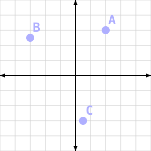

> 向量位置

向量也可以表示一个**方向**。方向向量没有原点；它只是指定了空间中的某个方向。下面这些都是方向向量，但向量 B 和 D 是相同的，尽管它们画在了不同的位置：

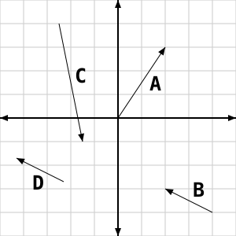

> 方向向量

对几何来说这一切都没问题，但向量也可以用数值来描述。这种情况下，向量就是一串数字，每个维度一个。所以二维向量有两个数，三维向量有三个，以此类推。就数值而言，标量就是单独一个数。

向量中的每一个数称为一个**分量**。每个分量通常都有名字。就本书而言，向量的第一个分量是 X 分量，第二个是 Y 分量，第三个是 Z 分量，如果还有第四个，就称为 W。

在文字中书写向量时，要用括号括起来。所以一个 3D 向量可以写作 (0, 2, 4)；X 分量是 0，Y 分量是 2，Z 分量是 4。把它们作为等式的一部分书写时，则写成如下形式：

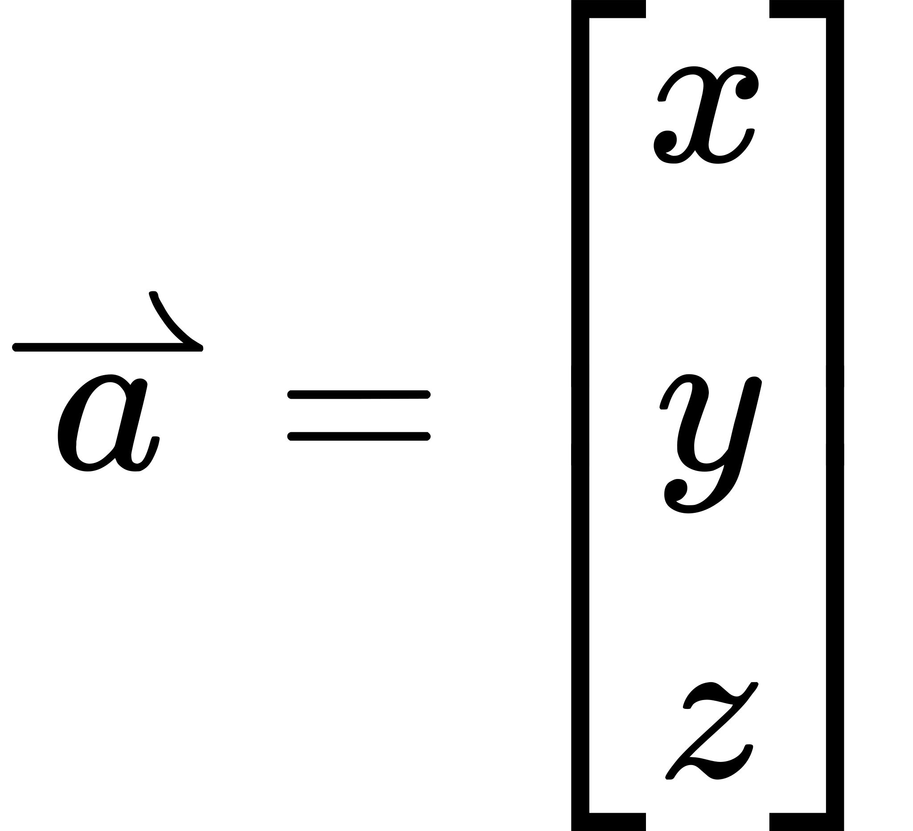

在数学公式中，向量变量要么用粗体表示，要么在变量名上加一个箭头。

以图形方式绘制向量时，要区分向量位置与方向向量。然而在数值上两者*没有*任何区别。区别只在于你如何使用它们，而不是你如何用数字表示它们。所以你可以把一个位置当作方向，对它们施加某种向量运算，然后再把结果当作位置。

虽然向量由各自独立的数值分量组成，但整体而言可以对向量施加若干数学运算。我们会展示其中几个，并同时给出它们的几何表示与数值表示。

**向量加法**

你可以取两个向量并把它们相加。从图形上看，做法如下：

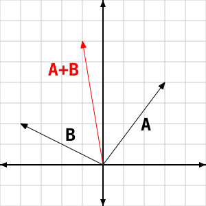

> 向量加法

记住，向量的方向可以平移而不改变其值。所以如果你把两个向量首尾相接，向量和就是从第一个向量的尾部指向最后一个向量的头部的那条向量。

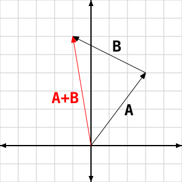

> 向量首尾相接相加

在数值上，两个向量的和就是对应分量分别相加：

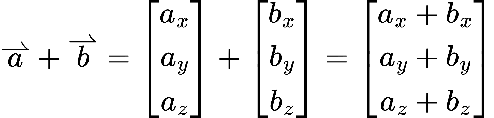

> 带数值的向量加法

任何对向量的每个分量分别施加运算的操作都称为**逐分量运算**。向量加法就是逐分量的。对两个向量做逐分量运算时，要求两个向量具有相同的维数。

**向量取负与减法**

你可以对一个向量取负，这会反转它的方向：

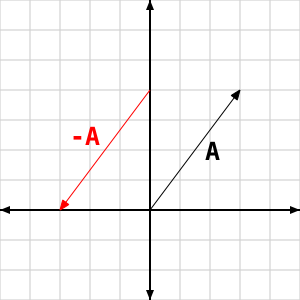

> 向量取负

在数值上，这意味着对向量的每个分量取负。

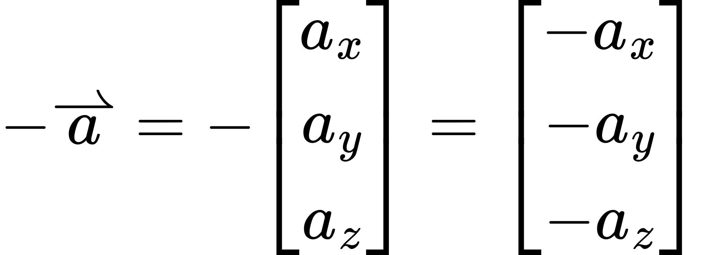

> 向量取负

与标量数学一样，向量减法等同于加上第二个向量的负值。

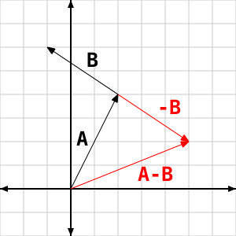

> 向量减法

**向量乘法**

向量乘法是为数不多的几种没有真正几何对应物的向量运算之一。用一个向量去乘另一个方向，或者用一个位置去乘另一个位置，都没有什么实际意义。不过这并不意味着其数值形式没有用。

在数值上，两个向量相乘就是逐分量相乘，与向量加法非常类似。

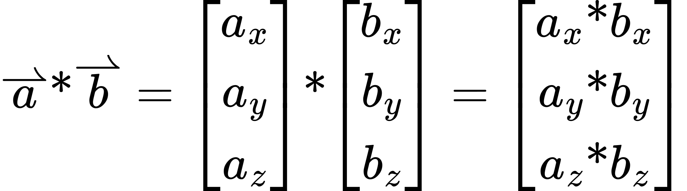

> 向量乘法

**向量/标量运算**

向量可以与标量值进行运算。回顾一下，标量就是单个的数。向量可以乘以标量，这会根据标量的取值放大或缩小向量的长度。

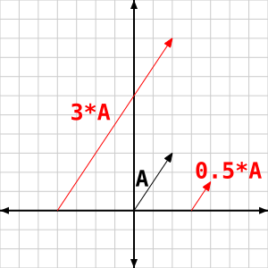

> 向量缩放

在数值上，这是一次逐分量乘法，其中向量的每个分量与标量的各个分量相乘。

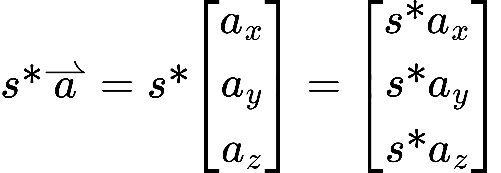

> 向量-标量乘法

标量也可以与向量相加。这与向量之间的乘法一样，没有几何表示。它是把标量与向量的各个分量逐分量相加。

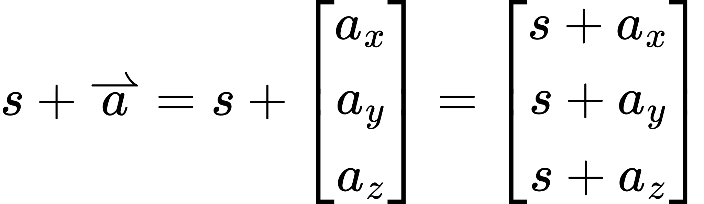

> 向量-标量加法

**向量代数**

了解这些向量运算之间的相互关系是有用的。

向量加法与乘法遵循标量加法与乘法的许多相同规则：它们满足交换律、结合律和分配律。

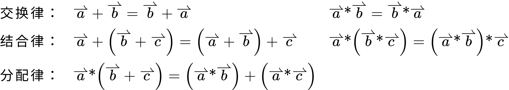

> 向量代数

向量/标量运算也具有类似的性质。

**长度**

向量有长度。方向向量的长度就是从起点到终点的距离。

在数值上，计算该距离需要用到下面这个公式：

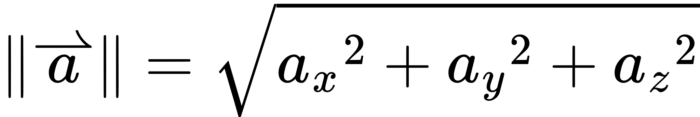

> 向量长度

这里用到了勾股定理来计算向量的长度。它适用于任意维数的向量，不只是二维或三维。

**单位向量与归一化**

长度恰好为一的向量称为**单位向量**。它表示一个纯粹的、长度为一的方向。在数学公式中，单位向量变量写作在变量名上加 ^ 的形式。

一个向量可以通过**归一化**转换为单位向量，做法是用该向量除以它的长度。更准确地说，是乘以该长度的倒数。

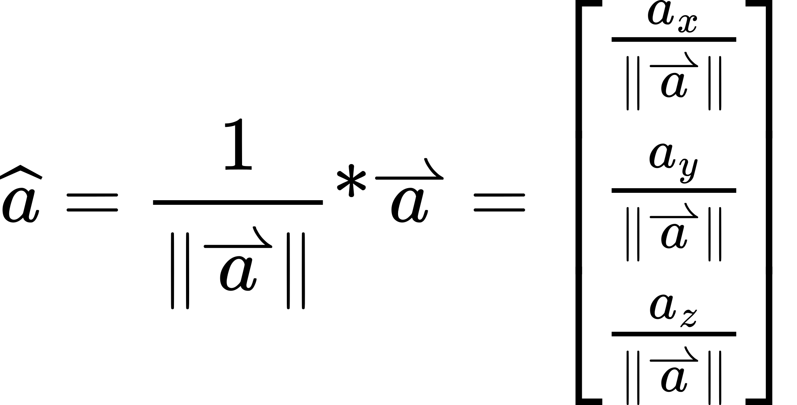

> 向量归一化

这还不是我们将在这些教程中用到的全部向量数学。新的向量数学运算会在首次用到时按需介绍并解释。而且与这里介绍的数学运算不同，它们大多不是逐分量运算。

**区间记法**

本书会频繁使用标准记法来指定某个值必须落在一定范围内。

如果一个值被约束在 0 到 1 之间，并且确实可以取到 0 和 1这两个值，就称它“在区间 [0, 1] 上”。方括号表示该区间包含紧邻其旁的那个值。

如果一个值被约束在 0 到 1 之间，但实际不能取 0，就称它在区间 (0, 1] 上。圆括号表示该区间不包含紧邻其旁的那个值。

如果一个值被约束为 0 或任意大于零的数，就使用无穷记法。这个区间写作 [0, ∞)。注意无穷永远无法取到，因此总是排除在外的。约束为任意小于零但不包含零的值则写作 (-∞, 0)。

## 图形与渲染

这是渲染过程的概览。如果不是立刻就理解全部内容，也不用着急；后续教程会极为详尽地讲解每一个步骤。

你在电脑屏幕上看到的一切，甚至包括你此刻正在读的这段文字（假设你是在电子显示设备上阅读，而不是看的打印稿），都只是一个二维的像素数组。如果你把屏幕上的某个东西截屏并放大，它会显得块状分明。

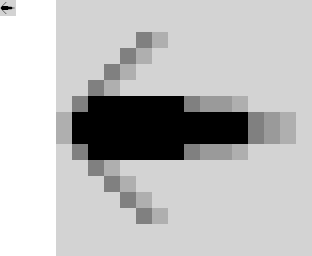

> 一幅图像

每一个这样的块就是一个**像素**。“像素”一词源自“**Picture Element**”（ picture element，图像元素）。屏幕上的每个像素都有特定的颜色。由像素组成的二维数组称为**图像**。

因此，任何形式图形学的目的，都是确定该把什么颜色放进哪些像素。正是这种决定让文字看起来像文字、让窗口看起来像窗口，等等。

既然所有图形都只是二维的像素数组，那么 3D 又是如何实现的？三维图形因此是一套为像素生成颜色的系统，它让你相信眼前所见的场景是一个 3D 世界，而不是一幅 2D 图像。把 3D 世界转换为该世界的 2D 图像的过程称为**渲染**。

渲染 3D 世界有多种方法。你电脑中这类实时图形硬件所采用的方法，涉及大量“伪造”。这个过程称为**光栅化**，而使用光栅化的渲染系统称为**光栅化器**。

在光栅化器中，你看到的所有物体都是空心的壳。有一些技术可以让你把这些空壳剖开，但这实际上只是用另一个展示内部样子的壳替换掉原壳的一部分。一切都是壳。

所有这些壳都由三角形构成。即使看起来是圆形的表面，只要看得足够仔细，也不过是三角形。有些技术会为看起来更近或更大的物体生成更多三角形，使观察者几乎看不到物体的多面体轮廓。但它们始终由三角形组成。

**注意**

> 有些光栅化器使用平面四边形：四边的物体，其所有顶点都位于同一平面上。基于硬件的光栅化器始终使用三角形的原因之一，就是三角形的所有边都保证位于同一平面。知道这一点可以让光栅化过程不那么复杂。

一个物体由一系列相邻的三角形构成，这些三角形定义了物体的外表面。这样的一串三角形通常称为**几何体**、**模型**或**网格**。这几个术语可以互换使用。

光栅化过程有若干阶段。这些阶段被排成一条管线，三角形从顶端进入，底部则填出一幅 2D 图像。这也是光栅化如此适合硬件加速的原因之一：它每次只处理一个三角形，且按特定顺序处理。新的三角形可以在之前送入的三角形仍处于某个光栅化阶段时，从管线顶端喂入。

三角形以及各种网格提交给光栅化器的顺序会影响其输出。永远要记住，无论你以何种方式提交三角形网格数据，光栅化器都会按特定顺序处理每个三角形，只有在前一个三角形绘制完成后才会绘制下一个。

OpenGL 是用于访问基于硬件的光栅化器的 API。因此，它符合基于光栅化的 3D 渲染器的模型。光栅化器从用户处接收一串三角形，对它们执行运算，并依据这些三角形数据写入像素。这是对 OpenGL 中光栅化工作方式的一种简化，但对我们的 purposes 而言已经够用。

**三角形与顶点**

三角形由 3 个顶点组成。**顶点**是一组任意数据。为简单起见（后面我们会再展开讨论），我们假设这份数据必须包含三维空间中的一个点。它可以包含其他数据，但至少必须有这一项。任意 3 个不共线的点构成一个三角形，所以一个三角形的最少信息就是 3 个三维点。

3D 空间中的一个点由 3 个数或坐标定义：一个 X 坐标、一个 Y 坐标、一个 Z 坐标。它们通常用括号书写，形如 (X, Y, Z)。

### 光栅化概览

光栅化管线在现代硬件上非常复杂。这里只是这条管线的一个高度简化的概览。在考察用 OpenGL 渲染东西的细节之前，必须先对管线有一个简单的理解。没有这个高层概览，那些细节会让人不知所措。

**裁剪空间变换**

光栅化的第一个阶段是把每个三角形的顶点变换到空间的某个区域。这个体积之内的内容都会被渲染到输出图像中，落在该区域之外的内容则不会。这个区域对应于用户想要渲染的世界视图。

三角形被变换到的那个体积，在 OpenGL 的术语中称为**裁剪空间**。三角形顶点在裁剪空间中的位置称为**裁剪坐标**。

裁剪坐标与常规位置略有不同。3D 空间中的一个位置有 3 个坐标，而裁剪空间中的一个位置有*四*个坐标。前三个是通常的 X、Y、Z 位置，第四个称为 W。这个最后的坐标实际上定义了该顶点的裁剪空间范围。

同一个三角形内不同顶点的裁剪空间可以不同。它是在 X、Y、Z 每个方向上范围均为 [-W, W] 的一个 3D 空间区域。因此 W 坐标不同的顶点位于不同的裁剪空间立方体中。由于每个顶点都可以有独立的 W 分量，三角形的每个顶点都存在于各自的裁剪空间中。

在裁剪空间中，X 正方向向右，Y 正方向向上，Z 正方向背离观察者。

把顶点位置变换到裁剪空间的过程相当自由。OpenGL 在这一步提供了很大的灵活性。我们会在整个教程系列中详细讨论这一步。

因为裁剪空间是经过变换后可见的世界，所以任何落在该区域之外的三角形都会被丢弃。任何部分位于该区域之外的三角形则会经历一个称为**裁剪**的过程。这个过程把三角形拆成若干更小的三角形，使这些小三角形完全位于裁剪空间之内。“裁剪空间”这个名字正由此而来。

**归一化坐标**

裁剪空间很有意思，但不方便。这个空间的范围对每个顶点都不同，这让可视化三角形相当困难。因此，裁剪空间会被变换到一个更合理的坐标空间：**归一化设备坐标**。

这个过程非常简单。把每个顶点位置的 X、Y、Z 除以 W，就得到归一化设备坐标。就是这样。

归一化设备坐标空间本质上就是裁剪空间，只是 X、Y、Z 的范围变成了 [-1, 1]。各个方向完全相同。除以 W 是把 3D 三角形投影到 2D 图像上的重要一环，我们会在后续教程中讨论它。

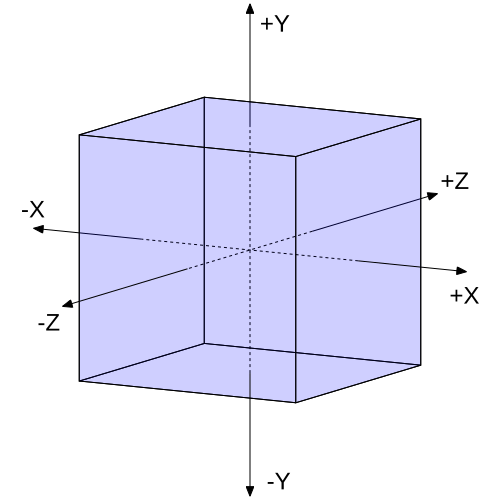

> 归一化设备坐标空间

立方体标示出归一化设备坐标空间的边界。

**窗口变换**

光栅化的下一个阶段是再次变换每个三角形的顶点。这一次，它们从归一化设备坐标转换为**窗口坐标**。顾名思义，窗口坐标是相对于 OpenGL 运行时所在的窗口而言的。

尽管称为窗口坐标，它们仍然是三维坐标。X 向右，Y 向上，Z 向外，与裁剪空间完全一样。唯一的区别是这些坐标的边界取决于可视窗口。另外还要指出，虽然这些是窗口坐标，但精度并没有丢失。它们不是整数坐标，而是浮点值，因此精度仍然超出单个像素。

Z 的范围是 [0, 1]，0 表示最近，1 表示最远。顶点位置落在该范围之外是不可见的。

请注意，窗口坐标以左下角位置作为 (0, 0) 原点。这与用户习惯的窗口坐标相反，后者以左上角为原点。如果你需要，可以用一些变换技巧让你在左上角为原点的坐标空间中工作。

这个过程的全部细节会随着教程的推进而展开详细讨论。

**扫描转换**

把三角形的坐标转换为窗口坐标之后，三角形要经历一个称为**扫描转换**的过程。这个过程根据输出图像上窗口像素的排布，把三角形覆盖的区域拆分成一个个像素。

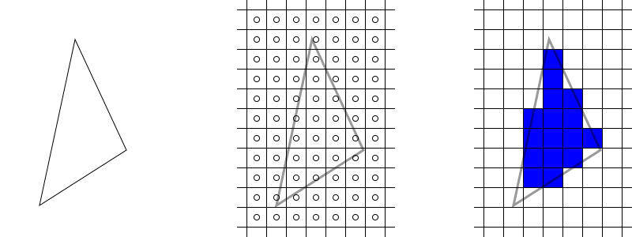

> 扫描转换后的三角形

中间的图像显示的是输出像素的数字网格；圆圈代表每个像素的中心。每个像素中心代表一个**采样点**：像素区域内的某个离散位置。在扫描转换期间，三角形会为落在其 2D 区域内的每一个像素采样点生成一个**片元**。

右侧的图像显示了扫描转换该三角形所生成的片元。这构成了对三角形大致形状的粗略近似。

三角形之间共享边的情况非常常见。OpenGL 提供了一项保证：只要共享边上的顶点位置*完全相同*，扫描转换时就不会出现采样点空隙。

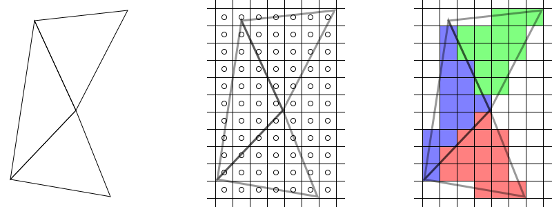

> 共享边的扫描转换

为了让这一点更易用，OpenGL 还提供另一项保证：如果你把相同的输入顶点数据送过相同的顶点处理器，就会得到完全相同的输出；这称为**不变性保证**。因此，确保无空隙扫描转换的责任在用户一方，你必须使用相同的输入顶点。

扫描转换本质上是一个 2D 操作。这个过程只使用三角形在窗口坐标中的 X、Y 位置来决定生成哪些片元。Z 值并没有被遗忘，但它并不直接参与扫描转换三角形的实际过程。

扫描转换一个三角形的结果，是一串覆盖该三角形形状的片元。每个片元都关联着某些数据。这些数据包含片元在窗口坐标中的 2D 位置，以及该片元的 Z 位置。这个 Z 值称为片元的深度。片元中可能还包含其他信息，我们会在后续教程中展开讨论。

**片元处理**

这个阶段从扫描转换后的三角形中取出一个片元，把它转换成一个或多个颜色值以及单个深度值。来自同一个三角形的片元其处理顺序无关紧要；由于单个三角形位于同一个平面上，由它生成的片元不可能重叠。然而，来自其他三角形的片元则可能重叠。由于顺序在光栅化器中很重要，来自一个三角形的所有片元必须先全部处理完，才能处理另一个三角形的片元。

这个阶段相当自由。OpenGL 的用户在决定给片元赋予什么颜色上有许多选择。我们会在整个教程系列中详细讨论这一步。

**注意：Direct3D 说明**

> Direct3D 更愿意把这个阶段称为“像素处理”或“像素着色”。这个叫法在几个方面都属于误称。首先，一个像素的最终颜色可以由单个像素内多个*采样点*生成的多个片元的结果组合而成。这是消除三角形锯齿边的常用技术。此外，片元数据尚未被写入图像，所以它还不是像素。事实上，片元处理步骤可以根据任意计算结果有条件地阻止某个片元被渲染。因此，按 D3D 的说法，一个“像素”可能根本永远不会真正成为像素。

**片元写入**

在生成一个或多个颜色值以及一个深度值之后，片元被写入目标图像。这一步不只是简单地写入目标图像。把颜色和深度与图像中当前已有的颜色相结合，可能涉及若干计算。这些内容会在各个教程中详细讨论。

### 颜色

前面说过，像素是 2D 图像中具有特定颜色的元素。而颜色有很多种描述方式。

在计算机图形学中，对颜色最常见的描述是取值在 [0, 1] 区间上的一串数字。每个数字对应某一种参考颜色的强度；因此这串数字所表示的最终颜色就是这些参考颜色的混合。

这组参考颜色称为**色彩空间**。屏幕上最常见的色彩空间是 RGB，其参考颜色为红、绿、蓝。印刷品往往使用 CMYK（青、品红、黄、黑）。由于我们处理的是渲染到屏幕的场景，并且 OpenGL 也要求如此，我们将使用 RGB 色彩空间。

**注意**

> 你可以用可编程着色器（见下文）玩些花哨的活儿，从而在不同色彩空间中工作。所以严格来说，我们只需要输出到线性 RGB 色彩空间。

因此在 OpenGL 中，一个像素被定义为取值在 [0, 1] 区间上的 3 个值，表示线性 RGB 色彩空间中的一种颜色。通过组合这 3 种颜色的不同强度，我们可以生成数百万种不同的色调。后面处理透明时，这一点会稍微扩展一下。

### 着色器

**着色器**是一个程序，设计为在渲染操作中作为一部分在渲染器上运行。无论使用何种渲染系统，着色器都只能在该渲染过程中的某些特定位置执行。这些**着色器阶段**就是挂载点，用户可以在那里加入任意算法以创造特定的视觉效果。

就上面概述的光栅化而言，有若干着色器阶段既在性能上经济，又对用户极具用处。例如，把传入的顶点变换到裁剪空间就是一处适合放入用户自定义代码的挂载点，把片元处理为最终颜色和深度也是。

OpenGL 的着色器运行在真正的渲染硬件上。这往往能为其他任务释放出宝贵的 CPU 时间，或者干脆完成一些若没有执行任意代码的灵活性就很难、甚至不可能完成的操作。其缺点是，它们必须处在某些限制之内，而 CPU 代码不必受这些限制。

针对不同 API 有多种着色语言可用。本教程使用的正是 OpenGL 的主着色语言。它有个毫无想象力的名字，叫 OpenGL 着色语言，简称 **GLSL**。它看起来很像 C，但绝对*不是* C。

## OpenGL 是什么

在开始研究如何编写 OpenGL 应用之前，我们必须先知道我们写的东西究竟是什么。OpenGL 到底是什么？

### OpenGL 作为一个 API

人们通常把 OpenGL 理解为一套应用编程接口（**API**）。OpenGL API 已经暴露给了多种语言。但它们在最低层最终使用的都是 C API。

OpenGL API 被定义为一台状态机。几乎所有 OpenGL 函数都会设置或获取 OpenGL 中的某项状态。唯一不改变状态的函数，是那些利用当前已设置的状态来触发渲染的函数。

你可以把这台状态机想象成一个非常大的结构体，里面有许多不同的字段。这个结构体称为 **OpenGL 上下文**，上下文中的每个字段都代表渲染所必需的某项信息。

C 语言形式的 API 由若干 typedef、`#define` 的枚举值以及函数定义。这些 typedef 定义了 `GLint `、`GLfloat ` 之类的基本 GL 类型，它们都被定义为具有特定的位深度。

结构体这类复杂的聚合类型绝不会直接暴露在 OpenGL 中。任何这类构造都隐藏在 API 之后。这样一来，把 OpenGL API 暴露给非 C 语言时就不需要复杂的转换层了。

在 C++ 中，如果你想创建一个包含整数、浮点数和字符串的对象，你会这样创建和访问它：

```cpp
struct Object
{
    int count;
    float opacity;
    char *name;
};

//Create the storage for the object.
Object newObject;

//Put data into the object.
newObject.count = 5;
newObject.opacity = 0.4f;
newObject.name = "Some String";
```

在 OpenGL 中，你要用的 API 更像这样：

```cpp
//Create the storage for the object
GLuint objectName;
glGenObject(1, &objectName);

//Put data into the object.
glBindObject(GL_MODIFY, objectName);
glObjectParameteri(GL_MODIFY, GL_OBJECT_COUNT, 5);
glObjectParameterf(GL_MODIFY, GL_OBJECT_OPACITY, 0.4f);
glObjectParameters(GL_MODIFY, GL_OBJECT_NAME, "Some String");
```

当然，这些都不是真实的 OpenGL 命令。这里只是示意这类对象的接口大概是什么样子。

所有 OpenGL 对象的存储空间都由 OpenGL 自己持有。因此，用户只能通过引用来访问对象。几乎所有 OpenGL 对象都由一个无符号整数（`GLuint `）来引用。对象由形如 `glGen *` 的函数创建，其中 * 是对象的类型。第一个参数是要创建的对象数量，第二个是一个 `GLuint* ` 数组，用来接收新创建的对象名。

要修改大多数对象，我们必须先把它们绑定到上下文。许多对象可以绑定到上下文中不同的位置；这使得同一个对象可以以不同方式使用。这些不同的位置称为**目标**；所有对象都有一份有效目标列表，有些则只有一个。在上面的例子中，虚拟目标“GL_MODIFY”就是 `objectName ` 被绑定到的位置。

把目标想象成一个全局指针。所以在我们的例子里，`GL_MODIFY `目标只是一个能存放该类型对象的全局指针。调用 `glBindObject(GL_MODIFY, objectName) `类似于这样做：

```cpp
Object *GL_MODIFY = NULL;

//glBindObject:
GL_MODIFY = ptr(objectName); //Convert object into pointer.
```

修改这些对象的 OpenGL 函数，只会修改已绑定到上下文的对象。这些函数把所修改对象的目标作为第一个参数，它指向某个已绑定的对象。

枚举值 `GL_OBJECT_*`为对象中所有可以设置的字段命名。`glObjectParameter `这一族函数用于设置绑定到给定目标的对象内部的参数。请注意，由于 OpenGL 是 C 语言 API，它不得不为类型各异的各个版本取不同的名字。所以有用于整数参数的 `glObjectParameteri `、用于浮点参数的 `glObjectParameterf `，依此类推。从代码的角度看，可以把这些函数理解为：

```cpp
//glObjectParameteri(GL_MODIFY, GL_OBJECT_COUNT, 5);
GL_MODIFY->count = 5;
//glObjectParameterf(GL_MODIFY, GL_OBJECT_OPACITY, 0.4f);
GL_MODIFY->opacity = 0.4f;
...
```

把对象 0 绑定到上下文中的某个目标，等价于把该目标的全局指针设为 `NULL `。这会解绑当前绑定在该目标上的任何对象。

请注意，并非所有 OpenGL 对象都像这个例子这么简单，改变对象状态的函数也不总遵循这些命名约定。遇到例外情况时我们会逐一讨论。

### OpenGL 规范

严格来说，OpenGL 不是一个 API，而是一份规范、一份文档。C API 只是实现这份规范的一种方式。规范定义了 OpenGL 的初始状态、每个函数如何改变或获取该状态，以及当你调用一个渲染函数时应该发生什么。

这份规范由 OpenGL 架构评审委员会（**ARB**）编写，它是来自 Apple、NVIDIA、AMD（即原来的 ATI）等公司的代表组成的团体。ARB 是 [Khronos Group](http://www.khronos.org/) 的一部分。

这份规范是一份非常复杂且技术性很强的文档。不过其中一部分还是相当易读的，尽管你通常至少需要对“应该发生什么”有一定理解才能读懂它。如果你要试着读它，最重要的一点是：它描述的是*结果*，而不是实现。规范说 X 会发生，并不意味着它真的这样发生。它的含义是，用户不应该能分辨出差别。如果某块硬件能以另一种方式提供相同的行为，那么规范是允许的，只要用户永远无法分辨出差别。

**OpenGL 实现**

OpenGL ARB 掌握规范的制定，但并不掌管 OpenGL 的代码。OpenGL 不是从某个集中地点下载下来的东西。对某一块具体硬件而言，要由该硬件的开发者来为它编写一个 **OpenGL 实现**。实现这个词的含义正如其名：它实现 OpenGL 规范，暴露规范中定义的 OpenGL API。

在不同操作系统上，控制 OpenGL 实现的方面也不同。在 Windows 上，OpenGL 实现几乎完全由硬件厂商自己控制。在 Mac OSX 上，OpenGL 实现由 Apple 控制；由他们决定暴露哪个版本的 OpenGL，以及可以向用户提供哪些额外功能。Apple 的 OpenGL 实现有相当一部分由 Apple 自己编写，硬件开发者则针对 Apple 创建的内部驱动 API 进行开发。在 Linux 上，情况就……比较复杂了。

简而言之，如果你的程序似乎出现了不符合规范的行为，那是你所用 OpenGL 实现厂商的问题（前提是这不是你代码里的 bug）。在 Windows 上，各家显卡厂商把它们的 OpenGL 实现放在常规驱动里。所以如果你怀疑是它们的实现有 bug，你首先应该确认显卡驱动是最新版本；这个 bug 可能在你上次更新驱动之后已经被修复了。

**OpenGL 版本**

OpenGL 规范有很多版本。OpenGL 的版本不像大多数 Direct3D 版本那样通常会改动 API 的大部分。在某个 OpenGL 版本上可用的代码，几乎总能在更晚的 OpenGL 版本上继续工作。

唯一的例外涉及 OpenGL 3.0 及以上版本相对于此前版本的变化。v3.0 弃用了一批较旧的函数，v3.1 把其中大部分函数从 API 中移除[^Deprecation only means marking those functions as to be removed in later versions. They are still available for use in 3.0.]。这同时把规范分成了两个变体（称为 profile）：核心 profile 与兼容性 profile。兼容性 profile 保留了 3.1 中移除的所有函数，核心 profile 则不保留。理论上，OpenGL 实现可以只实现核心 profile；那样一来，依赖兼容性 profile 的软件在该实现上就无法运行。

从实际角度说，这一切根本无关紧要。没有哪个 OpenGL 驱动开发者会发布只实现核心 profile 的驱动。因此实际上这意味着完全不成问题；所有 OpenGL 版本实际上都是向后兼容的。

## 术语表

- **向量**：由其他值按有序序列组合而成的值。向量中存储的值的个数就是它的维数。可以对向量整体施加数学运算。
- **标量**：单个的非向量值。一维向量可以视为标量。
- **向量位置**：表示位置的向量。
- **方向向量**：表示方向的向量。
- **向量分量**：向量内部的某个值。
- **逐分量运算**：对向量施加、作用于其每个分量的运算。逐分量运算的结果是与输入具有相同维数的向量。许多向量运算都是逐分量的。
- **单位向量**：长度恰好为一的向量。它们表示纯方向性的向量。
- **向量归一化**：把向量转换为与原向量同方向的单位向量的过程。
- **像素**：数字图像的最小划分单位。一个像素在某个特定色彩空间中具有特定颜色。
- **图像**：像素组成的二维数组。
- **渲染**：把源 3D 世界转换为 2D 图像的过程，该图像表示从某个特定角度看到的这个世界。
- **光栅化**：一种特定的渲染方法，用于把一系列 3D 三角形转换为 2D 图像。
- **几何体、模型、网格**：3D 空间中由三角形构成的单个物体。
- **顶点**：构成三角形的 3 个元素之一。顶点可以包含任意数据，其中包含一个表示该顶点在 3D 空间中位置的三维位置。
- **裁剪空间、裁剪坐标**：顶点位置被变换进去的一个三维空间区域。这些顶点位置是四维量。裁剪坐标的第四个分量（W）表示该顶点的裁剪空间可见范围。所以裁剪坐标的 X、Y、Z 分量必须位于 [-W, W] 之间，才属于世界的可见部分。

  在裁剪空间中，X 正方向向右，Y 正方向向上，Z 正方向向外。

  裁剪空间顶点由渲染管线的顶点处理阶段输出。
- **裁剪**：把一个以裁剪坐标表示的三角形在其一个或多个顶点位于裁剪空间之外时切分开的过程。
- **归一化设备坐标**：裁剪坐标除以其第四个分量之后的结果。这使该空间区域对所有分量都是相同的。位置落在 [-1, 1] 区间上的顶点可见，其他顶点不可见。
- **窗口空间、窗口坐标**：归一化设备坐标所映射到的三维空间区域。顶点在该空间中的 X、Y 位置相对于目标图像。原点在左下角，X 正方向向右，Y 正方向向上。Z 值是 [0, 1] 区间上的数，0 表示最近的值，1 表示最远的值。顶点位置落在该范围之外不可见。
- **扫描转换**：把窗口空间中的三角形按照投影到输出图像像素上的结果转换为若干片元的过程。
- **采样点**：像素范围内的一个离散位置，用来决定是否由该三角形扫描转换生成片元。单个像素的区域内可以有多个采样点，它们可以生成多个片元。
- **片元**：扫描转换后的三角形中的单个元素。片元可以包含任意数据，其中包含一个三维位置，用于标识该片元在窗口空间中来自三角形的哪个位置。
- **不变性保证**：OpenGL 提供的一项保证，即如果向顶点处理提供二进制完全相同的输入，同时其他所有状态也保持完全一致，那么输出的裁剪空间顶点将完全相同。
- **色彩空间**：在计算机图形学中定义一种颜色表示方式的一组参考颜色，以及这些参考颜色与实际颜色之间的映射函数。所有颜色都是相对于某个特定色彩空间定义的。
- **着色器**：为执行某些用户自定义操作而设计、由渲染器运行的程序。
- **着色器阶段**：渲染管线中可执行着色器以完成某项计算的特定位置。该计算的结果将被送入渲染管线的下一个阶段。
- **OpenGL**：一份规范，定义了基于光栅化的渲染系统的有效行为。
- **OpenGL 上下文**：用于渲染的一组特定状态。OpenGL 上下文就像一个大型 C 风格结构体，包含大量可访问的字段。如果你要创建多个用于渲染的窗口，每个窗口都会有自己的 OpenGL 上下文。
- **对象绑定**：对象可以绑定到 OpenGL 上下文中的某个特定位置。发生绑定时，对象内部的状态会取代上下文中某一组状态。大多数对象有多个绑定点，每种类型的对象只能绑定到某些特定绑定点。对象绑定到哪个绑定点决定了它覆盖哪些状态。
- **架构评审委员会**：Khronos Group 中负责 OpenGL 规范的机构。
- **OpenGL 实现**：为特定系统实现 OpenGL 规范的软件。
