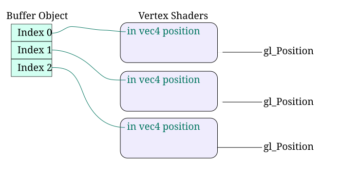
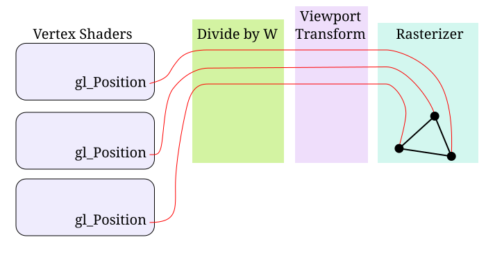

# 你好，三角形！

编程语言的教程和入门书通常都以一个叫作 "Hello, World!" 的程序开篇。这个程序是最精简的代码，只要能打印出 "Hello, World!" 这段文字。它是一个很不错的检验手段，可以确认构建系统工作正常，并且你能够编译和执行代码。

用 OpenGL 写出真正的文字相当麻烦。因此，本教程的第一个任务改为在屏幕上画出一个三角形。

## 框架与 FreeGLUT

本教程的源代码位于 `Tut1 Hello Triangle/Tut1.cpp `，内容相当简单。构建最终可执行文件的工程文件实际上用到了两个源文件：本教程文件，以及位于 `framework/framework.cpp ` 的公共框架文件。FreeGLUT 的实际初始化就在框架文件中完成，main 函数也在这里。这个文件只是调用主教程文件中定义的函数。

FreeGLUT 是一个相当简单的 OpenGL 初始化系统。它创建并管理单个窗口，所有 OpenGL 命令都针对这个窗口。由于各种 GUI 系统中的窗口都需要做一系列簿记工作，用户与它的交互方式受到严格的约束。

框架文件要求定义 5 个函数：`defaults `、`init `、`display `、`reshape ` 和 `keyboard `。`defaults `函数在 FreeGLUT 初始化之前被调用，它给了教程修改窗口尺寸或初始化参数的机会。`init `函数在 OpenGL 初始化完成之后被调用，这给了教程文件在实际渲染开始之前把所需内容加载到 OpenGL 中的机会。`reshape `函数在窗口每次改变大小时由 FreeGLUT 调用。这让教程可以发起必要的 OpenGL 调用，使窗口尺寸与 OpenGL 保持同步。`keyboard `函数在用户按下按键时由 FreeGLUT 调用，这给了教程处理一些基本用户输入的机会。

`display `函数是最重要的工作发生的地方。当 FreeGLUT 检测到屏幕需要重新渲染时，就会调用这个函数。

## 剖析 display

`display `函数表面上看起来相当简单。然而它的运作其实相当复杂，并且与 `init `函数中完成的初始化密不可分。

**示例：display 函数**

```cpp
glClearColor(0.0f, 0.0f, 0.0f, 0.0f);
glClear(GL_COLOR_BUFFER_BIT);

glUseProgram(theProgram);

glBindBuffer(GL_ARRAY_BUFFER, positionBufferObject);
glEnableVertexAttribArray(0);
glVertexAttribPointer(0, 4, GL_FLOAT, GL_FALSE, 0, 0);

glDrawArrays(GL_TRIANGLES, 0, 3);

glDisableVertexAttribArray(0);
glUseProgram(0);

glutSwapBuffers();
```

我们来仔细看看这段代码。

前两行清除屏幕。`glClearColor `属于状态设置函数之类的调用，它设置清除屏幕时所用的颜色。这里把清除颜色设为黑色。`glClear `本身并不设置 OpenGL 状态，它只是让屏幕被清除。参数 `GL_COLOR_BUFFER_BIT `表示这次清除会影响颜色缓冲，从而把它清除为我们在上一个函数中设置的当前清除颜色。

下一行把当前着色器程序设为后续所有渲染命令所使用的程序。它具体如何工作，后面会详细讨论。

接下来的三条命令都在设置状态。它们配置了待渲染三角形的坐标，告诉 OpenGL 三角形顶点数据将从内存的哪个位置读入。这些命令具体如何工作，后面会详细说明。

`glDrawArrays `函数，顾名思义，是一个渲染函数。它利用当前状态生成一串构成三角形的顶点。

再接下来两行只是清理工作，撤销为渲染而做的一部分设置。

最后一行 `glutSwapBuffers `是 FreeGLUT 命令，不是 OpenGL 命令。正如我们在 `framework.cpp `中设置的，OpenGL 帧缓冲是双缓冲的。这意味着当前展示给用户的图像与我们正在渲染到的图像*不是*同一幅。因此我们的全部渲染内容在显示给用户之前都是不可见的。这样用户永远不会看到渲染了一半的图像。`glutSwapBuffers `函数的作用就是把正在渲染的图像显示给用户。

## 追踪数据

在基础背景部分，我们描述了 OpenGL 管线的工作方式。现在我们结合教程 1 中的代码重新审视这条管线，这会让我们理解 OpenGL 具体是如何渲染数据的。

### 顶点传输

光栅化管线的第一个阶段是把顶点变换到裁剪空间。不过在此之前，OpenGL 必须先收到一份顶点列表。所以管线的第一个阶段就是把三角形数据发送给 OpenGL。

这就是我们希望传输的数据：

```cpp
const float vertexPositions[] = {
    0.75f, 0.75f, 0.0f, 1.0f,
    0.75f, -0.75f, 0.0f, 1.0f,
    -0.75f, -0.75f, 0.0f, 1.0f,
};
```

每行的 4 个值表示一个顶点的 4D 位置。它们是四维的，因为裁剪空间同样是 4D 的，你可能还记得这一点。这些顶点位置已经处于裁剪空间中。我们希望 OpenGL 做的事情就是根据这份顶点数据渲染出一个三角形。由于每 4 个浮点数表示一个顶点的位置，我们有了 3 个顶点：这正好是一个三角形的最少顶点数。

即便我们有了这些数据，OpenGL 也不能直接使用它。OpenGL 对自己能读取哪部分内存有一些限制。你可以随意分配顶点数据，但 OpenGL 无法直接看到你的任何内存。因此第一步是分配一块 OpenGL *能*看到的内存，并把我们的数据填入其中。这就是所谓的缓冲对象。

缓冲对象是由 OpenGL 应用户要求管理和分配的一段线性内存。这段内存的内容由用户控制，但用户只能间接地控制它。可以把缓冲对象看成一段 GPU 内存。GPU 能快速读取这段内存，因此把数据存在其中有性能优势。

教程中的缓冲对象是在初始化阶段创建的。创建该缓冲对象的代码如下：

**示例：缓冲对象初始化**

```cpp
void InitializeVertexBuffer()
{
    glGenBuffers(1, &positionBufferObject);
    
    glBindBuffer(GL_ARRAY_BUFFER, positionBufferObject);
    glBufferData(GL_ARRAY_BUFFER, sizeof(vertexPositions), vertexPositions, GL_STATIC_DRAW);
    glBindBuffer(GL_ARRAY_BUFFER, 0);
}
```

第一行创建缓冲对象，并把对象的句柄存入全局变量 `positionBufferObject `。对象此时虽然已经存在，但还没有占用任何内存，因为 we 还没有为它分配内存。

`glBindBuffer `函数把新建的缓冲对象绑定到 `GL_ARRAY_BUFFER `绑定目标。正如导论中提到的，OpenGL 中的对象通常必须先绑定到上下文才能发挥作用，缓冲对象也不例外。之后所有影响绑定到 `GL_ARRAY_BUFFER `的缓冲的命令都会作用于这个特定对象，直到有新的缓冲对象被绑定到 `GL_ARRAY_BUFFER `。

`glBufferData `函数完成两件事。它为当前绑定到 `GL_ARRAY_BUFFER `的缓冲分配内存，也就是我们刚刚创建并绑定的那个。我们已经有了一些顶点数据，问题在于它们存放在我们的内存里，而不是 OpenGL 的内存里。`sizeof(vertexPositions) `借助 C++ 编译器求出 `vertexPositions `数组的字节大小。然后我们把这个大小作为要为该缓冲对象分配的内存大小传给 `glBufferData `。这样我们就分配了足够的 GPU 内存来存放顶点数据。

`glBufferData `执行的另一个操作是把数据从我们的内存数组复制到缓冲对象中。这由第三个参数控制。如果该值不是 NULL，就像本例中这样，`glBufferData `就会把指针所引用的数据复制进缓冲对象。函数调用结束后，缓冲对象存储的内容与 `vertexPositions `存储的完全一致。

第四参数我们会在后面的教程中讨论。

第二次绑定缓冲的调用只是清理工作。把缓冲对象 0 绑定到 `GL_ARRAY_BUFFER `，会让此前绑定到该目标的缓冲对象解绑。这里的 0 很像 NULL 指针。这一步并非严格必要，因为之后任何对该目标的绑定都会自动解绑已有的对象。不过除非你对渲染有非常严格的控制，否则通常最好把绑定过的对象解绑。

以上所做的全部事情，只是为了把顶点数据放进 GPU 的内存而已。但缓冲对象是没有格式的：在 OpenGL 看来，我们所做的不过是分配了一个缓冲对象并往里面填了随机的二进制数据。现在我们还需要做一件事，告诉 OpenGL 这个缓冲对象里存放着顶点数据，以及这些顶点数据是什么形式的。

我们在渲染代码里完成这件事，也就是下面这几行：

```cpp
glBindBuffer(GL_ARRAY_BUFFER, positionBufferObject);
glEnableVertexAttribArray(0);
glVertexAttribPointer(0, 4, GL_FLOAT, GL_FALSE, 0, 0);
```

第一个函数我们之前已经见过了。它只是说明我们要使用这个缓冲对象。

第二个函数 `glEnableVertexAttribArray `我们会在下一节解释。不调用这个函数，第三个函数就没什么意义。

第三个函数才是真正的关键。`glVertexAttribPointer `尽管名字里有 "Pointer"，却并不处理指针，它处理的是缓冲对象。

渲染时，OpenGL 从存放在缓冲对象中的数组里提取顶点数据。我们需要告诉 OpenGL 的是，缓冲对象中的顶点数组数据采用了什么格式，也就是说，需要告诉 OpenGL 应该如何解读存放在缓冲里的这串数据。

在本例中，我们的数据格式如下：

- 我们的位置数据以 32 位浮点值存储，使用 C/C++ 类型 `float `。
- 每个位置由其中 4 个值组成。
- 每组 4 个值之间没有空隙。这些值在数组中是紧密排列的。
- 数据数组中的第一个值位于缓冲对象的起始处。

`glVertexAttribPointer `函数把这些信息全部告诉了 OpenGL。第三个参数指定值的基础类型，本例中是 `GL_FLOAT `，对应 32 位浮点值。第二个参数指定多少个这样的值构成一份数据，本例中是 4。第五个参数指定每组值之间的间距，本例中值之间没有空隙，所以该值为 0。第六个参数指定从缓冲对象起始处到数据所在位置的字节偏移，也就是距缓冲对象开头 0 字节。

第四参数我们会在后面的教程中讨论。第一个参数则会在下一节讨论。

有一件事似乎没有提到：指定这些数据来自哪个缓冲对象。这是一种隐式关联而非显式关联。`glVertexAttribPointer `总是指代该函数被调用时绑定到 `GL_ARRAY_BUFFER `的那个缓冲。因此它不接受缓冲对象句柄，而是直接使用我们此前绑定的那个句柄。

后面的教程会更详细地讨论这个函数。

一旦 OpenGL 知道该从哪里获取顶点数据，它就可以用这些顶点数据来渲染了。

```cpp
glDrawArrays(GL_TRIANGLES, 0, 3);
```

这个函数表面上看起来非常简单，但做的事情很多。第二和第三个参数表示从顶点数据中读取的起始索引和索引数量。顶点数组（由 `glVertexAttribPointer `定义）的第 0 个索引会被处理，然后是第 1 个和第 2 个索引。也就是说，它从第 0 个索引开始，从数组中读取 3 个顶点。

`glDrawArrays `的第一个参数告诉 OpenGL，它拿到的每 3 个顶点要当作一个独立的三角形。因此它只读取 3 个顶点，并把它们连接成一个三角形。

同样，我们会在另一个教程中展开讨论。

### 顶点处理与着色器

现在我们能告诉 OpenGL 顶点数据是什么了，接下来进入管线的下一个阶段：顶点处理。这是本教程要覆盖的两个可编程阶段之一，因此会用到着色器。

着色器无非是一个运行在 GPU 上的程序。管线中可能存在多个着色器阶段，每个阶段都有自己的输入和输出。着色器的目的是接收它的输入以及可能的其他各类数据，并将它们转换为一组输出。

每个着色器在一组输入上执行。需要特别指出的是，任何阶段的着色器都*完全独立*于同阶段的任何其他着色器运行。着色器的各次执行之间不存在串扰。每组输入的执行都从着色器开头开始，一直进行到结尾。着色器会定义自己的输入和输出（在多数情况下），未写入全部输出就结束是违法的。

顶点着色器正如其名，操作对象是顶点。更具体地说，顶点着色器的每次调用只处理*一个*顶点。除了其他任何用户自定义的输出之外，这类着色器还必须输出该顶点的裁剪空间位置。这个裁剪空间位置如何计算，完全由着色器自己决定。

OpenGL 中的着色器使用 OpenGL 着色语言（  GLSL  ）编写。这门语言看起来很像 C，但它确实不是 C。它受到的限制远比 C 多（例如禁止递归）。这就是我们这个简单顶点着色器的样子：

**示例：顶点着色器**

```glsl
#version 330

layout(location = 0) in vec4 position;
void main()
{
    gl_Position = position;
}
```

它看起来相当简单。第一行声明该着色器使用的 GLSL 版本是 3.30。所有 GLSL 着色器都必须有版本声明。

下一行定义了顶点着色器的一个输入。该输入名为 `position `，类型是 `vec4 `，即一个由浮点值构成的 4 维向量。它还带有布局位置 0，这一点我们稍后会解释。

和 C 一样，着色器的执行从 `main `函数开始。这个着色器非常简单，把输入 `position `复制到一个叫作 `gl_Position `的东西里。这个变量*不是*在着色器中定义的，因为它是每个顶点着色器中都定义的标准变量。如果你在 GLSL 着色器中看到一个以 "gl_" 开头的标识符，那它一定是内置标识符。你不能自己创建以 "gl_" 开头的标识符，只能使用已经存在的那些。`gl_Position `的定义如下：

```glsl
out vec4 gl_Position;
```

回顾一下，顶点着色器至少要做到的是为顶点生成一个裁剪空间位置。`gl_Position `正是这样东西：顶点的裁剪空间位置。由于我们的输入位置数据本身就是裁剪空间位置，这个着色器只是把它直接复制到输出。

**顶点属性**

着色器有输入和输出。可以把它们类比为函数参数和函数返回值。如果着色器是一个函数，那么它被以若干输入值调用，并被期望返回若干输出值。

着色器阶段的输入来自某处，输出也送往某处。因此顶点着色器中的输入 `position `必须从某个地方填入数据。那么这些数据从哪里来？顶点着色器的输入称为顶点属性。

你可能已经见过与"顶点属性"这个词相近的东西，比如 "glEnable *VertexAttrib *Array" 或 "gl * VertexAttrib*Pointer"。

这就是 OpenGL 中数据沿管线流动的方式。渲染开始时，缓冲对象中的顶点数据会按照 `glVertexAttribPointer `所做的设置被读取。这个函数描述了一个属性的数据来自何处。某次具体的 `glVertexAttribPointer `调用与顶点着色器某个输入值的字符串名称之间的联系有些复杂。

顶点着色器的每个输入都有一个称为属性索引的索引位置。本着色器中的输入是用下面这条语句定义的：

```glsl
layout(location = 0) in vec4 position;
```

其中的布局位置部分把属性索引 0 分配给了 `position `。属性索引必须大于等于零，并且同一时刻可用的属性索引数量存在硬件层面的上限 [^自商用可编程硬件诞生以来，几乎所有硬件的这个上限都恰好是 16。不多不少。]。

在代码中，引用属性时*总是*用属性索引。`glEnableVertexAttribArray `、`glDisableVertexAttribArray `和 `glVertexAttribPointer `这几个函数的第一个参数都是属性索引。我们已在顶点着色器中把 `position `属性的属性索引设为 0，因此 `glEnableVertexAttribArray(0) `这一调用启用的就是 `position `属性的属性索引。

下面是数据流向顶点着色器的示意图：



> 流向顶点着色器的数据流

如果不调用 `glEnableVertexAttribArray `，对该属性索引调用 `glVertexAttribPointer `就没什么意义。这个启用调用不必在顶点属性指针调用之前进行，但必须在渲染之前完成。如果属性未被启用，渲染时就不会使用它。

### 光栅化

到目前为止发生的事情是：3 个顶点被交给了 OpenGL，OpenGL 用顶点着色器把它们变换成裁剪空间中的 3 个位置。接下来，顶点位置通过将位置的 3 个 XYZ 分量除以 W 分量，被变换到归一化设备坐标。本例中这 3 个位置的 W 都是 1.0，因此这些位置实际上已经处于归一化设备坐标空间。

之后，顶点位置被变换到窗口坐标。这由所谓的视口变换完成。它之所以这么叫，是因为用于设置它的函数叫 `glViewport `。教程每次窗口尺寸变化时都会调用这个函数。记住，框架会在窗口尺寸变化时调用 `reshape `。所以教程中 reshape 的实现如下：

**示例：重塑窗口**

```cpp
void reshape (int w, int h)
{
    glViewport(0, 0, (GLsizei) w, (GLsizei) h);
}
```

这告诉 OpenGL 我们要渲染到可用区域的哪个范围。本例中我们把它改成与整个可用区域一致。如果没有这次函数调用，改变窗口大小就不会对渲染产生任何影响。另外请注意，我们完全没有设法保持宽高比恒定；沿某个方向缩小或拉伸窗口，会让三角形随之缩放与拉伸。

回顾一下，窗口坐标采用左下角为原点的坐标系。因此点 (0, 0) 位于窗口的左下角。这个函数的前两个坐标取左下角位置，另外两个坐标取视口矩形的宽和高。

一旦进入窗口坐标空间，OpenGL 现在就可以拿这 3 个顶点并把它们扫描转换成一系列片元。不过为此，OpenGL 必须先判定这份顶点列表代表什么。

OpenGL 可以用多种不同方式解读一份顶点列表。OpenGL 解读顶点列表的方式由绘制命令给出：

```cpp
glDrawArrays(GL_TRIANGLES, 0, 3);
```

枚举值 `GL_TRIANGLES `告诉 OpenGL，列表中每 3 个顶点应当组合成一个三角形。由于我们只传入了 3 个顶点，所以得到 1 个三角形。



> 流向光栅化器的数据流

如果我们渲染 6 个顶点，就会得到 2 个三角形。

### 片元处理

片元着色器用来计算片元的输出颜色。片元着色器的输入包括该片元在窗口空间中的 XYZ 位置。它还可以包含用户自定义数据，这部分我们会在后面的教程中讲到。

我们的片元着色器如下：

**示例：片元着色器**

```glsl
#version 330

out vec4 outputColor;
void main()
{
   outputColor = vec4(1.0f, 1.0f, 1.0f, 1.0f);
}
```

和顶点着色器一样，第一行声明该着色器使用 GLSL 3.30 版本。

下一行为片元着色器指定一个输出。输出变量的类型是 `vec4 `。

main 函数只是把输出颜色设为一个 4 维向量，所有分量都是 1.0f。这把颜色的红、绿、蓝分量设为满强度，也就是 1.0，从而得到三角形的白色。第四个分量我们会在后面的教程中看到。

尽管所有片元着色器都会拿到片元的窗口空间位置，这个着色器并不需要它，所以干脆没有使用。

片元着色器执行完毕后，片元的输出颜色被写入输出图像。

**注意**

> 在顶点着色器那一节，我们必须使用 `layout(location = #) `语法，才能在顶点着色器输入与顶点属性索引之间建立联系。这是用户把顶点数组连接到顶点着色器输入所必需的。那么你也许会想，片元着色器输出与屏幕之间的联系又在哪里。
>
> OpenGL 认识到，在大量渲染场景中，片元着色器的输出只有一个合理的去处：当前正在渲染的图像（在我们的例子中就是屏幕）。因此，如果你只定义了片元着色器的一个输出，那么该输出值会自动写入当前的目标图像。当然也可以有多个片元着色器输出分别写入多个不同的目标图像，这会引入一些复杂性，与属性索引类似。但那是以后再谈的话题。

## 创建着色器

我们刚才略过了这些称为着色器的文本字符串究竟是如何发送给 OpenGL 的。现在我们详细讨论一下。

**注意**

> 如果你熟悉 Direct3D 等其他 API 中着色器的工作方式，那在这里对你没什么帮助。OpenGL 着色器的工作方式与其他 API 差别很大。

着色器使用一门类 C 语言编写，因此 OpenGL 采用了一套非常类 C 的编译模型。在 C 中，每个 .c 文件被编译成一个目标文件，然后一个或多个目标文件被链接成一个程序（或静态/共享库）。OpenGL 做的事情非常类似。

着色器字符串被编译成一个着色器对象，它对应于一个目标文件。一个或多个着色器对象被链接成一个程序对象。

OpenGL 中的程序对象包含了渲染时用到的*所有*着色器的代码。在教程中，我们有一个顶点着色器和一个片元着色器，两者被链接进同一个程序对象。构建该程序对象由下面这段代码负责：

**示例：程序初始化**

```cpp
void InitializeProgram()
{
    std::vector<GLuint> shaderList;
    
    shaderList.push_back(CreateShader(GL_VERTEX_SHADER, strVertexShader));
    shaderList.push_back(CreateShader(GL_FRAGMENT_SHADER, strFragmentShader));
    
    theProgram = CreateProgram(shaderList);

    std::for_each(shaderList.begin(), shaderList.end(), glDeleteShader);
}
```

第一条语句只是创建了一个列表，用来存放我们打算链接在一起的着色器对象。接下来两条语句编译我们的两个着色器字符串。`CreateShader `函数是教程中定义的函数，用来编译着色器。

把着色器编译成着色器对象的过程很像编译源代码，其中最重要的一点就是错误检查。下面是 `CreateShader `的实现：

**示例：着色器创建**

```cpp
GLuint CreateShader(GLenum eShaderType, const std::string &strShaderFile)
{
    GLuint shader = glCreateShader(eShaderType);
    const char *strFileData = strShaderFile.c_str();
    glShaderSource(shader, 1, &strFileData, NULL);
    
    glCompileShader(shader);
    
    GLint status;
    glGetShaderiv(shader, GL_COMPILE_STATUS, &status);
    if (status == GL_FALSE)
    {
        GLint infoLogLength;
        glGetShaderiv(shader, GL_INFO_LOG_LENGTH, &infoLogLength);
        
        GLchar *strInfoLog = new GLchar[infoLogLength + 1];
        glGetShaderInfoLog(shader, infoLogLength, NULL, strInfoLog);
        
        const char *strShaderType = NULL;
        switch(eShaderType)
        {
        case GL_VERTEX_SHADER: strShaderType = "vertex"; break;
        case GL_GEOMETRY_SHADER: strShaderType = "geometry"; break;
        case GL_FRAGMENT_SHADER: strShaderType = "fragment"; break;
        }
        
        fprintf(stderr, "Compile failure in %s shader:\n%s\n", strShaderType, strInfoLog);
        delete[] strInfoLog;
    }

    return shader;
}
```

OpenGL 着色器对象正如其名，是一个对象。因此第一步是用 `glCreateShader `创建该对象。这个函数创建特定类型（顶点或片元）的着色器，所以它接受一个参数来指明创建的是哪种对象。由于每个着色器阶段都有各自的语法规则以及预定义的变量和常量（这使得不同着色器阶段成为 GLSL 的不同方言），编译器必须被告知正在编译的是哪个着色器阶段。

**注意**

> 着色器对象和程序对象都是 OpenGL 中的对象，但它们与其他类型的 OpenGL 对象工作方式相当不同。例如，上面展示的创建缓冲对象使用的是 "glGen *" 形式的函数，其中 * 是 "Buffer"。它接受要创建的对象数量，以及一个用来存放这些对象句柄的列表。
>
> 着色器/程序对象与其他类型 OpenGL 对象之间还有许多其他差异。

下一步是真正把文本着色器编译进对象。C 风格的字符串从 C++ 的 `std::string `对象中取出，再通过 `glShaderSource `函数送入着色器对象。第一个参数是要放入字符串的着色器对象。接下来的参数是要放入着色器的字符串数量。把多个字符串编译进单个着色器对象，其原理类似于在 C 文件中编译头文件。当然，不同之处在于 .c 文件会显式列出它包含的文件，而你必须用 `glShaderSource `手动添加它们。

接下来的参数是一个 const char* 字符串数组。最后一个参数通常是各字符串长度的数组。我们传入 `NULL `，这告诉 OpenGL 假定字符串以空字符结尾。一般来说，除非你需要在字符串中使用空字符，否则没有必要使用最后一个参数。

字符串进入对象之后，就用 `glCompileShader `进行编译，它做的事正如其名。

编译之后，我们需要知道编译是否成功。做法是调用 `glGetShaderiv `获取 `GL_COMPILE_STATUS `。如果它是 `GL_FALSE `，说明着色器编译失败；否则编译成功。

如果编译失败，我们做一些错误报告。它向 stderr 打印一条消息，说明什么编译失败了，同时还会打印 OpenGL 提供的一段信息日志来描述该错误；可以把它看作普通 C 编译中的编译器输出。

创建好两个着色器对象之后，我们把它们交给 `CreateProgram `函数：

**示例：程序创建**

```cpp
GLuint CreateProgram(const std::vector<GLuint> &shaderList)
{
    GLuint program = glCreateProgram();
    
    for(size_t iLoop = 0; iLoop < shaderList.size(); iLoop++)
        glAttachShader(program, shaderList[iLoop]);
    
    glLinkProgram(program);
    
    GLint status;
    glGetProgramiv (program, GL_LINK_STATUS, &status);
    if (status == GL_FALSE)
    {
        GLint infoLogLength;
        glGetProgramiv(program, GL_INFO_LOG_LENGTH, &infoLogLength);
        
        GLchar *strInfoLog = new GLchar[infoLogLength + 1];
        glGetProgramInfoLog(program, infoLogLength, NULL, strInfoLog);
        fprintf(stderr, "Linker failure: %s\n", strInfoLog);
        delete[] strInfoLog;
    }
    
    for(size_t iLoop = 0; iLoop < shaderList.size(); iLoop++)
        glDetachShader(program, shaderList[iLoop]);

    return program;
}
```

这个函数相当简单。它先用 `glCreateProgram `创建一个空的程序对象。这个函数不接受任何参数；记住，程序对象是*所有*着色器阶段的组合。

接着，它遍历着色器对象的 `std::vector `，不断调用 `glAttachShader `函数，把之前创建的每个着色器对象都附加到程序上。程序不需要被告知每个着色器对象属于哪个阶段；着色器对象自己会记住这一点。

所有着色器对象都附加完成后，代码用 `glLinkProgram `链接程序。和之前一样，我们随后必须调用 `glGetProgramiv `并传入 `GL_LINK_STATUS `来获取链接状态。如果是 GL_FALSE，说明链接失败，我们打印链接日志；否则返回创建好的程序。

**注意**

> 在上面这些着色器中，顶点着色器输入 `position `的属性索引是在着色器内部直接指定的。除了 `layout(location = #) `之外，还有其他方式为属性指定属性索引。甚至在你完全不用它们的情况下，OpenGL 也会自动分配属性索引。因此，你可能并不知道某个属性的属性索引。如果需要查询属性索引，可以用着色器程序对象和一个包含该属性名称的字符串调用 `glGetAttribLocation `。

程序成功链接之后，着色器对象会通过 `glDetachShader `从程序上移除。移除着色器不会影响程序的链接状态和功能，它所做的只是告诉 OpenGL 这些对象不再与该程序相关联。

程序成功链接、并且着色器对象从程序上移除之后，着色器对象会被 C++ 算法 `std::for_each. `删除。这一行遍历列表中的每个着色器，并对它们调用 `glDeleteShader `。

**使用程序**

要告诉 OpenGL 渲染命令应当使用某个特定的程序对象，需要调用 `glUseProgram `函数。在教程中，它在 `display `函数里被调用了两次。第一次传入全局变量 `theProgram `，告诉 OpenGL 我们要在后续渲染中使用该程序，直到另行通知。之后它被以 0 调用，告诉 OpenGL 渲染时不使用任何程序。

**注意**

> 对本系列教程而言，使用程序对象是*必须*的。OpenGL 的兼容配置确实提供了默认渲染状态，在不使用程序时接管渲染。我们不会使用它，也建议你避免使用。

## 清理

教程分配了不少 OpenGL 资源。它分配了一个缓冲对象，代表 GPU 上的一段内存。它创建了两个着色器对象和一个程序对象，它们都存放在 OpenGL 拥有的内存中。但它只删除了着色器对象，其他一概没删。

这部分源于 FreeGLUT 的性质，它并没有为清理函数提供钩子。但部分原因也来自 OpenGL 自身的性质。在这样简单的示例中，其实没必要删除任何东西。当窗口失去活动状态而导致 OpenGL 关闭时，OpenGL 会清理自己的资源。

在关闭 OpenGL 之前删除自己创建的对象通常是好习惯。如果你把对象封装在 C++ 对象中，让析构函数去删除这些 OpenGL 对象，那就更应该这么做。但这并非严格必需。

## 本章小结

在本教程中，你学到了以下内容：

- 缓冲对象是由 OpenGL 分配的线性内存数组，可以用来存储顶点数据。
- GLSL 着色器被编译成着色器对象，表示单个着色器阶段要执行的代码。这些着色器对象可以链接在一起生成程序对象，它代表渲染期间要执行的全部着色器代码。
- `glDrawArrays `函数可以用来绘制三角形，它以特定的缓冲对象作为顶点数据来源，并使用当前绑定的程序对象。

### 进一步学习

即便是这样简单的教程，也有许多东西可以动手尝试和探索。

- 把片元着色器设置的颜色值改成其他数值。使用 [0, 1] 区间内的值，然后再看看超出该区间会发生什么。
- 修改顶点数据中各顶点的位置。把位置值保持在 [-1, 1] 区间内，然后看看三角形超出该区间会发生什么。注意修改位置的 Z 值时的现象（注意：在该区间内时应该不会有任何变化）。暂时让 W 值保持 1.0。
- 修改清除颜色，使用 [0, 1] 区间内的值。注意它与上面视口改动之间的相互影响。
- 再往列表里添加 3 个顶点，并把 `glDrawArrays `调用中传入的顶点数从 3 改为 6。继续添加并玩味它们。
- 修改 `reshape `传给 `glViewport `的值。把它们改得比窗口大或小，看看会发生什么。再把它们挪到窗口内不同的象限。
- 修改 `reshape `函数，使改变窗口大小时三角形不会被拉伸。这意味着渲染目标区域（视口）可能小于窗口区域。同时也试着让它总是把该区域居中于窗口。

### 值得关注的 OpenGL 函数

- **glClearColor, glClear**：这两个函数清除屏幕上当前可见的区域。`glClearColor `设置清除所用的颜色，而带 `GL_COLOR_BUFFER_BIT `值的 `glClear `则用该颜色清除图像。
- **glGenBuffers, glBindBuffer, glBufferData**：这几个函数用于创建和操作缓冲对象。`glGenBuffers `创建一个或多个缓冲，`glBindBuffer `把它绑定到上下文中的某个位置，`glBufferData `分配内存，并把来自用户的数据填充进缓冲对象。
- **glEnableVertexAttribArray, glDisableVertexAttribArray, glVertexAttribPointer**：这几个函数控制顶点属性数组。`glEnableVertexAttribArray `启用给定的属性索引，`glDisableVertexAttribArray `禁用该属性索引，`glVertexAttribPointer `则定义顶点数据的格式和来源位置（缓冲对象）。
- **glDrawArrays**：该函数启动渲染，使用当前启用的顶点属性和当前程序对象（以及其他状态）。它会按顺序从属性数组中取出若干顶点。
- **glViewport**：该函数定义当前的视口变换。它把窗口中的一个区域定义为可视区域，由左下角位置和宽/高指定。
- **glCreateShader, glShaderSource, glCompileShader, glDeleteShader**：这几个函数创建一个可用的着色器对象。`glCreateShader `只创建某个特定着色器阶段的空着色器对象。`glShaderSource `把字符串设置进该对象；对它多次调用只会覆盖先前设置的字符串。`glCompileShader `用先前设置的字符串编译该着色器对象。`glDeleteShader `删除该着色器对象。
- **glCreateProgram, glAttachShader, glLinkProgram, glDetachShader**：这几个函数创建一个可用的程序对象。`glCreateProgram `创建空的程序对象。`glAttachShader `把一个着色器对象附加到该程序，多次调用可附加多个着色器对象。`glLinkProgram `把先前附加的所有着色器链接成一个完整的程序。`glDetachShader `用于从程序对象中移除着色器对象，这不会影响程序的行为。
- **glUseProgram**：该函数让给定程序成为当前程序。此调用之后发生的所有渲染都会在各着色器阶段使用该程序。如果传入程序 0，则当前没有程序。
- **glGetAttribLocation**：该函数获取具名属性的属性索引。它接受要在其中查找属性的程序，以及用户要查询属性索引的顶点着色器输入变量的名称。

## 术语表

- **缓冲对象**：表示一段线性内存的 OpenGL 对象，其中存放任意数据。缓冲的内容由用户定义，但内存由 OpenGL 分配。缓冲对象中的数据有多种用途，包括存储渲染时使用的顶点数据。
- **输入变量**：在全局作用域声明的着色器变量。输入变量的值来自 OpenGL 渲染管线中更早的阶段。
- **输出变量**：在全局作用域用 `out `关键字声明的着色器变量。着色器写入的输出变量会传递给 OpenGL 渲染管线中更晚的阶段进行处理。
- **顶点属性**：顶点着色器的输入变量称为顶点属性。每个顶点属性是长度最多为 4 个元素的向量。顶点属性从缓冲对象中读取；缓冲对象数据与顶点输入之间的联系由 `glVertexAttribPointer `和 `glEnableVertexAttribArray `函数建立。特定程序对象中的每个顶点属性都有一个索引，可以用 `glGetAttribLocation `查询该索引。其他各个顶点属性函数用这个索引来引用对应属性。
- **属性索引**：顶点着色器中的每个输入变量都必须分配一个索引号。代码中用这个编号来引用对应属性，这个编号就是属性索引。
- **视口变换**：把顶点数据从归一化设备坐标空间变换到窗口空间的过程。它指定了窗口中的可视区域。
- **着色器对象**：OpenGL API 中用于编译着色器、并表示已编译着色器信息的对象。每个着色器对象都根据其所承载数据的着色器阶段来确定类型。
- **程序对象**：OpenGL API 中表示渲染时所用全部着色器处理完整序列的对象。可以从程序对象中查询属性位置以及关于该程序的其他各类信息。它们还包含一些状态，会在后面的教程中介绍。
