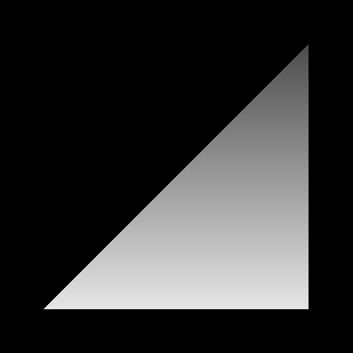
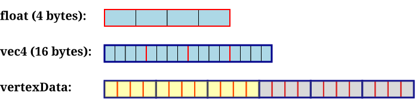
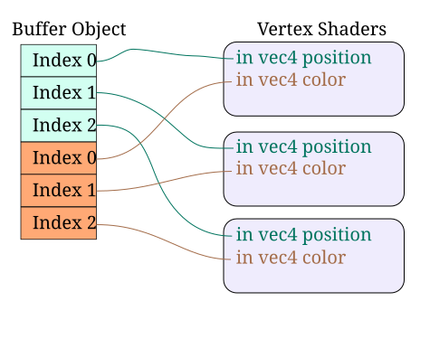
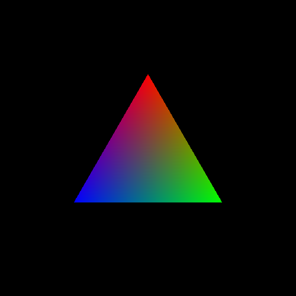

# 玩转颜色

本教程将展示如何给上一个教程中的三角形加上颜色。我们不再只给三角形一种单一的颜色，而是用两种方法让它整个表面呈现变化的颜色。第一种方法利用片元的位置来计算颜色，第二种方法用逐顶点数据来计算颜色。

## 显示片元位置

正如概览中所说的，片元数据的一部分包含该片元在屏幕上的位置。因此，如果我们想让三角形的颜色在其表面发生变化，就可以在片元着色器中访问这份数据，并用它在片段着色器中计算该片元的最终颜色。这正是在 顶点位置 教程中完成的，该教程的主文件是 `FragPosition.cpp `。

在本教程以及之后所有教程中，着色器都将从文件加载，而不是硬编码在 .cpp 文件中的字符串。为此，框架提供了 `Framework::LoadShader `和 `Framework::CreateProgram `函数。它们的工作方式与上一个教程中的 `CreateShader `和 `CreateProgram `类似，区别在于 `LoadShader `接受的是一个文件名而不是着色器文件。

FragPosition 教程加载了两个着色器：顶点着色器 `data/FragPosition.vert `和片元着色器 `data/FragPosition.frag `。顶点着色器与上一个教程中的完全相同。不过片元着色器是全新的：

**示例：FragPosition 的片元着色器**

```glsl
#version 330

out vec4 outputColor;

void main()
{
    float lerpValue = gl_FragCoord.y / 500.0f;
    
    outputColor = mix(vec4(1.0f, 1.0f, 1.0f, 1.0f),
        vec4(0.2f, 0.2f, 0.2f, 1.0f), lerpValue);
}
```

`gl_FragCoord `是一个内置变量，只在片元着色器中可用。它是一个 `vec3 `，因此有 X、Y、Z 三个分量。X 和 Y 值采用*窗口*坐标，因此这两个数的绝对值会随窗口分辨率变化。回顾一下，窗口坐标把原点放在左下角。因此，沿着三角形底边的片元，其 Y 值要低于顶部的片元。

这个着色器的思路是：片元的颜色由其窗口位置的 Y 值决定。500.0f 是窗口的高度（除非你改变窗口大小）。函数第一行中的除法只是把 Y 位置换算到 [0, 1] 区间，其中 1 对应窗口顶部，0 对应窗口底部。

第二行用这个 [0, 1] 的值在两种颜色之间做线性插值。`mix `函数是 OpenGL 着色语言提供的众多标准函数之一。这些函数中有许多是*向量化*的，像 `mix `就是如此。也就是说，它们的一部分参数可以是向量，当参数是向量时，会同时对该向量的每个分量执行相应运算。本例中，前两个参数的维数必须匹配。

`mix `函数执行线性插值。如果第三个参数为 0，它返回的正是第一个参数；如果第三个参数为 1，它返回的正是第二个参数。如果第三个参数介于 0 和 1 之间，它返回的值就介于另外两个参数之间，具体取值由第三个参数决定。

**注意**

> `mix `的第三个参数必须落在 [0, 1] 区间内。不过 GLSL 不会为你检查这一点，也不会替你做钳制。如果它不在该区间内，`mix `函数的结果将是未定义的。"未定义"是 OpenGL 的简写，意思是"我不知道，但多半不是你想要的"。

我们得到的图像如下：



> 片元位置

本例中，三角形底部也就是最接近 Y 为 0 的部分会最接近白色。而三角形顶部也就是最接近 Y 为 500 的部分颜色最暗。

除了片元着色器之外，代码基本没什么变化。

## 顶点属性

在片元着色器中使用片元位置相当有用，但它远不是控制三角形颜色的最佳工具。一个更有用的工具是显式地为每个顶点指定颜色。顶点颜色 教程实现了这一点，该教程的主文件是 `VertexColors.cpp `。

我们希望影响穿过整个系统传递的数据。我们想要发生的事件序列如下。

1. 对于传给顶点着色器的每一个位置，我们都希望同时传入一个对应的颜色值。
2. 对于顶点着色器输出的每一个位置，我们还希望输出一个颜色值，与顶点着色器收到的输入颜色值相同。
3. 在片元着色器中，我们希望从顶点着色器接收一个输入颜色，并用它作为该片元的输出颜色。

关于这个事件序列，你大概有一些尖锐的疑问，尤其是第 2、3 步究竟怎么可能实现。我们稍后会解答。现在跟随修改后的数据流穿过 OpenGL 管线。

### 多个顶点数组与属性

为了完成第一步，我们需要修改顶点数组数据。现在数据如下：

**示例：新的顶点数组数据**

```cpp
const float vertexData[] = {
     0.0f,    0.5f, 0.0f, 1.0f,
     0.5f, -0.366f, 0.0f, 1.0f,
    -0.5f, -0.366f, 0.0f, 1.0f,
     1.0f,    0.0f, 0.0f, 1.0f,
     0.0f,    1.0f, 0.0f, 1.0f,
     0.0f,    0.0f, 1.0f, 1.0f,
};
```

首先，我们需要理解数据数组在最底层是什么样子。在 C/C++ 中，单个字节是最小的可寻址数据。一个字节表示 8 位（一位可以是 0 或 1），取值范围是 [0, 255]。一个 `float `类型的值需要 4 个字节的存储空间。任何 `float `值都存放在内存中连续的 4 个字节里。

4 个浮点数的序列，用 GLSL 的话说就是一个 `vec4 `，正是如此：一串四个浮点值。因此一个 `vec4 `占用 16 字节，即 4 个 `float `乘以一个 `float `的大小。

`vertexData `变量是一个大的浮点数组。然而我们希望把它当作两个数组来使用。每 4 个浮点数是一个 `vec4 `，前三个 `vec4 `表示位置，接下来的 3 个则是对应顶点的颜色。

在内存中，`vertexData `数组看起来是这样：



> 顶点数组内存布局

上面两个图展示的是基本数据类型的布局，每个方框是一个字节。下面的图展示整个数组的布局，每个方框是一个 `float `。方框的左半部分表示位置，右半部分表示颜色。

前 3 组值是三角形的三个位置，接下来的 3 组值是这三个顶点上的颜色。实质上我们有两个数组，只不过它们恰好在内存中彼此相邻。一个起始于内存地址 `&vertexData[0] `，另一个起始于内存地址 `&vertexData[12] `

和所有顶点数据一样，这些数据被放进缓冲对象。我们之前已经见过这段代码：

**示例：缓冲对象初始化**

```cpp
void InitializeVertexBuffer()
{
    glGenBuffers(1, &vertexBufferObject);
    
    glBindBuffer(GL_ARRAY_BUFFER, vertexBufferObject);
    glBufferData(GL_ARRAY_BUFFER, sizeof(vertexData), vertexData, GL_STATIC_DRAW);
    glBindBuffer(GL_ARRAY_BUFFER, 0);
}
```

代码没有变化，因为数组大小是由编译器通过 `sizeof `指令计算出来的。由于我们向缓冲中添加了几个元素，算出的尺寸自然也就变大了。

另外，你可能注意到这里的位置与之前教程中的不同。最初的三角形，也就是 顶点位置 代码中使用的那个三角形，是一个直角三角形（三角形的其中一个角为 90 度）同时也是等腰三角形（三条边中有两条等长）。这个新三角形是一个以原点为中心的等边三角形（三条边都等长）。

回顾一下，我们现在每个顶点要发送两份数据：一个位置和一个颜色。我们有两个数组，各存一份数据。它们可能在内存中恰好彼此相邻，但这并没有改变什么；这确实是两份数据数组。我们需要告诉 OpenGL 该如何获取其中每一份数据。

做法如下：

**示例：渲染场景**

```cpp
void display()
{
    glClearColor(0.0f, 0.0f, 0.0f, 0.0f);
    glClear(GL_COLOR_BUFFER_BIT);
    
    glUseProgram(theProgram);
    
    glBindBuffer(GL_ARRAY_BUFFER, vertexBufferObject);
    glEnableVertexAttribArray(0);
    glEnableVertexAttribArray(1);
    glVertexAttribPointer(0, 4, GL_FLOAT, GL_FALSE, 0, 0);
    glVertexAttribPointer(1, 4, GL_FLOAT, GL_FALSE, 0, (void*)48);
    
    glDrawArrays(GL_TRIANGLES, 0, 3);
    
    glDisableVertexAttribArray(0);
    glDisableVertexAttribArray(1);
    glUseProgram(0);
    
    glutSwapBuffers();
    glutPostRedisplay();
}
```

由于我们有两份数据，因此有两个顶点属性。对于每个属性，都必须调用 `glEnableVertexAttribArray `来启用该属性。第一个参数是顶点着色器中该属性的 `layout(location) `字段所设置的位置。

然后，对每个要使用的属性数组调用 `glVertexAttribPointer `。两次调用唯一的区别在于数据送往哪个属性位置，以及最后一个参数。最后一个参数是该属性的数据在缓冲中起始位置的字节偏移。本例中这个偏移是 4（一个 `float `的大小）× 4（一个 `vec4 `中 `float `的数量）× 3（位置数据中 `vec4 ` 的数量）。

**注意**

> 如果你想知道为什么写的是 `(void*)48 `而不是 `48 `，那要归因于一些历史遗留的 API 包袱。函数名之所以叫 glVertexAttrib "Pointer"，是因为最后一个参数在技术上是指向客户端内存的指针。或者说，至少在过去是。所以我们必须把整数值 48 显式转换为指针类型。

之后，我们用 `glDrawArrays `进行渲染，再用 `glDisableVertexAttribArray. `禁用这些数组。

#### 绘制细节

在上一个教程中，我们略过了 `glDrawArrays `究竟做了什么的细节。现在我们仔细看看。

各个属性数组函数为 OpenGL 建立了渲染时读取的数组。在我们这里的情况下有两个数组。每个数组都有一个缓冲对象，以及该数组在缓冲中起始位置的偏移，但数组并没有显式的大小。如果我们用 C++ 伪代码来看整体情况，得到的是这样：

**示例：顶点数组**

```cpp
GLbyte *bufferObject = (void*){0.0f, 0.5f, 0.0f, 1.0f, 0.5f, -0.366f, ...};
float *positionAttribArray[4] = (float *[4])(&(bufferObject + 0));
float *colorAttribArray[4] = (float *[4])(&(bufferObject + 48));
```

`positionAttribArray `的每个元素包含 4 个分量，这正是我们输入顶点着色器的大小（vec4）。之所以是这样，是因为 `glVertexAttribPointer `的第二个参数是 4。每个分量都是一个浮点数，这同样是因为第三个参数是 `GL_FLOAT `。该数组从 `bufferObject `取数据，这是因为 `glVertexAttribPointer `被调用时绑定的正是这个缓冲对象。而相对缓冲对象开头的偏移是 0，因为那是 `glVertexAttribPointer `的最后一个参数。

`colorAttribArray `同理，唯一区别是偏移值为 48 字节。

用上述伪代码形式表示顶点数组数据，`glDrawArrays `的实现大致如下：

**示例：Draw Arrays 的实现**

```cpp
void glDrawArrays(GLenum type, GLint start, GLint count)
{
    for(GLint element = start; element < start + count; element++)
    {
        VertexShader(positionAttribArray[element], colorAttribArray[element]);
    }
}
```

这意味着顶点着色器会被执行 `count `次，它拿到的数据从第 `start `个元素开始，连续 `count `个元素。因此顶点着色器第一次运行时，它从 `bufferObject[0 + (0 * 4 * sizeof(float))] `取位置属性，从 `bufferObject[48 + (0 * 4 * sizeof(float))] `取颜色属性。第二次运行时，它从 `bufferObject[0 + (1 * 4 * sizeof(float))] `取位置，从 `bufferObject[48 + (1 * 4 * sizeof(float))] `取颜色，依此类推。

从缓冲对象到顶点着色器的数据流现在是这样的：



> 多个顶点属性

和之前一样，每处理的 3 个顶点都会被变换成一个三角形。

### 顶点着色器

我们新的顶点着色器如下：

**示例：多输入顶点着色器**

```glsl
#version 330

layout (location = 0) in vec4 position;
layout (location = 1) in vec4 color;

smooth out vec4 theColor;

void main()
{
    gl_Position = position;
    theColor = color;
}
```

这里多了三行新内容，我们逐行来看。

全局变量 `color `的声明为顶点着色器定义了一个新输入。因此这个着色器除了接受名为 `position `的输入之外，还接受第二个名为 `color `的输入。和 `position `输入一样，本教程为每个属性指定一个属性索引。`position `的属性索引是 0，而 `color `是 1。

做到这里只是把数据送进了顶点着色器。我们还想把这些数据从顶点着色器传出去。为此必须定义一个输出变量，这通过 `out `关键字完成。本例中输出变量名为 `theColor `，类型是 `vec4 `。

`smooth `关键字是一个插值限定符。我们稍后会看到它的含义。

当然，这只是定义了该输出变量。在 `main `中我们才真正写入它，把作为顶点属性传入的 `color `的值赋给它。因为这里是着色器代码，我们本来也可以用其他启发式方法或任意算法来计算颜色。但就本教程的目的而言，它只是把传给顶点着色器的某个属性值原样传递下去。

严格来说，内置变量 `gl_Position `的定义是 `out vec4 gl_Position `，所以它同样是一个输出变量。它是一个特殊的输出，因为这个值直接被系统使用，而不是只被着色器使用。像上面的 `theColor `这样的用户自定义输出，对系统本身并没有内在含义。它们只有在其他着色器阶段用到它们时才会产生影响，这正是我们接下来要看到的。

### 片元程序

新的片元着色器如下：

**示例：带输入的片元着色器**

```glsl
#version 330

smooth in vec4 theColor;

out vec4 outputColor;

void main()
{
    outputColor = theColor;
}
```

这个片元着色器定义了一个输入变量。这个输入变量的名称和类型与顶点着色器的输出变量完全相同，这绝非巧合。我们想要把信息从顶点着色器送到片元着色器，为此 OpenGL 要求前一阶段的输出与后一阶段的输入具有相同的名称和类型，并且必须使用相同的插值限定符；如果顶点着色器用了 `smooth `，片元着色器也必须如此。

这也是 OpenGL 要求顶点和片元着色器必须链接在一起的一个主要原因：如果名称、类型或插值限定符不匹配，OpenGL 在链接程序时就会报错。

于是片元着色器接收到从顶点着色器输出的值。这个着色器只是取过这个值并复制到输出。因此每个片元的颜色就简单等于顶点着色器传下来的值。

### 片元插值

现在终于要说到房间里那头最大的大象了。这里存在一个基本的通信问题。

看，我们的顶点着色器只运行 3 次。这 3 次执行产生了 3 个输出位置（`gl_Position `）和 3 个输出颜色（`theColor `）。这 3 个位置被用来构建并光栅化一个三角形，产生若干片元。

而片元着色器并不是运行 3 次。对于光栅化器为这个三角形产生的每一个片元，它都会运行一次。三角形产生的片元数量取决于查看时的分辨率以及三角形在屏幕上覆盖的面积。边长为 1 的等边三角形面积约为 0.433。屏幕总面积（X 和 Y 的取值范围均为 [-1, 1]）是 4，因此我们的三角形大约覆盖屏幕的十分之一。窗口的原始分辨率是 500x500 像素。500*500 是 250,000 像素，其中十分之一是 25,000。因此我们的片元着色器大约要执行 25,000 次。

这里就出现了轻微的不平衡。如果顶点着色器直接与片元着色器通信，而顶点着色器总共只输出 3 个颜色值，那么另外 24,997 个值从哪里来？

答案是片元插值。

通过在定义顶点输出和片元输入时使用插值限定符 `smooth `，我们是在告诉 OpenGL 对这个值做特殊处理。每个片元得到的并不是来自某个单一顶点的一个值，而是三角形表面上三个输出值之间的*混合*。片元越靠近某个顶点，该顶点的输出对片元程序所收到的值贡献就越大。

由于这种插值是顶点着色器与片元着色器之间通信最常用的模式，如果你不指定插值关键字，默认会使用 `smooth `。另外还有两个可选值：`noperspective `和 `flat `。

如果你修改教程，把 `smooth `改成 `noperspective `，你不会看到任何变化。这并不意味着没有发生变化，只是我们的示例太简单，实际上不足以产生差异。`smooth `和 `noperspective `之间的区别相当微妙，只有当我们开始使用更具体的例子时才有意义。我们稍后再讨论这个区别。

`flat `插值实际上是关闭插值。它本质上是说：不在三个值之间做插值，而是让三角形的每个片元直接取三个顶点着色器输出变量中的第一个。片元着色器在整个三角形表面得到的都是同一个固定值，"`flat `"这个名字正由此而来。

每个被光栅化的三角形都有自己的一组 3 个输出，用于插值计算由该三角形产生的片元的值。所以如果你渲染 2 个三角形，其中一个三角形的插值结果不会直接影响另一个三角形的插值结果。因此，每个三角形都可以独立于其他三角形来看待。

用共享的顶点和顶点数据构建多个三角形是可行的，而且在许多情况下非常值得去做。这一点我们以后再讨论。

### 最终图像

运行本教程后，你会得到下面这幅图像。



> 插值后的顶点颜色

三角形每个顶点的颜色分别是纯红、纯绿和纯蓝。它们向三角形中心逐渐混合。

## 本章小结

在本教程中，你学到了以下内容：

- 数据通过缓冲对象和属性数组传递给顶点着色器，这些数据被处理成三角形。
- GLSL 内置变量 `gl_FragCoord `可以在片元着色器中获取当前片元的窗口空间坐标。
- 数据可以从顶点着色器传递到片元着色器，方式是在顶点着色器中使用输出变量，并在片元着色器中使用与之对应的输入变量。
- 从顶点着色器传递到片元着色器的数据会依据顶点着色器输出变量和片元着色器输入变量各自所用的插值限定符，在三角形表面上进行插值。

### 进一步学习

下面给出一些可以动手尝试的想法。

- 修改 FragPosition 教程中的视口。把视口放到显示区域的上半部分，再放到下半部分。看看这会如何影响三角形上的着色效果。
- 把 FragPosition 教程和顶点颜色教程结合起来。使用来自顶点着色器的插值颜色，并把它与根据片元屏幕空间位置计算出的值相乘。

### 值得关注的 GLSL 函数

```cpp
mix(void);
```

根据 `alpha `在 `initial `和 `final `之间执行线性插值。`alpha `值为 0 时返回 `inital `值，`alpha `为 1 时返回 `final `值。`vec `类型表示该参数可以是向量，也可以是 `float `。不过在一次特定的函数调用中，所有出现的 `vec `必须一致，因此 `initial `和 `final `必须具有相同类型。

`alpha `值可以是标量，也可以是与 `initial `和 `final `等长的向量。如果是标量，那么两个值的所有分量都由该标量插值。如果是向量，那么 `initial `和 `final `的分量分别由 `alpha `对应的分量插值。

如果 `alpha `或 `alpha `的任一分量落在 [0, 1] 区间之外，该函数的返回值将是未定义的。

## 术语表

- **片元插值**：这个过程是指取顶点着色器的 3 个对应输出，并在三角形表面上对它们做插值。每生成一个片元，同时也为顶点着色器的每个输出生成一个插值值（某些内置输出除外，比如 `gl_Position `）。插值的处理方式取决于顶点输出和片元输入上的插值限定符。
- **插值限定符**：一个 GLSL 关键字，赋给顶点着色器的输出以及片元着色器中对应的输入。它决定三角形的三个值如何在该三角形表面上插值。顶点着色器输出上所用的限定符必须与同名片元着色器输入上所用的限定符一致。

  合法的插值限定符有 `smooth `、`flat `和 `noperspective `。
