# 静止的物体

到目前为止，我们看到的东西都非常扁平。无非是一个三角形。这个三角形可能动来动去，或者带上了一些颜色。

本教程要讲的是如何创建一个真实的物体世界。

## 不真实的世界

`Orthographic Cube` 教程渲染的是一个长方体（一个 3D 的矩形）。长方体的尺寸是 0.5x0.5x1.5，因此它在 Z 轴方向上的长度是 X 和 Y 的 3 倍。

本教程中的代码大部分你应该已经很熟悉了。我们只是画 12 个三角形而不是 1 个。长方体的每个矩形面由 2 个三角形组成，沿对角线之一把面切开。

这些顶点同样带有颜色。不过，组成一个面的 6 个顶点颜色始终相同；这让每个面拥有单一、均匀的颜色。

顶点着色器是把我们已知的东西组合起来。它把颜色传递到片元阶段，同时接收一个 `vec2` 类型的 offset uniform，并把一个偏移量加到位置的 X 和 Y 分量上。片元着色器则只是拿插值得到的颜色作为输出颜色。

### 背面剔除

不过，有一处代码改动非常值得注意：初始化函数。它新增了几个需要讨论的函数。

**示例：Face Culling Initialization**

```cpp
void init()
{
    InitializeProgram();
    InitializeVertexBuffer();
    
    glGenVertexArrays(1, &vao);
    glBindVertexArray(vao);
    
    glEnable(GL_CULL_FACE);
    glCullFace(GL_BACK);
    glFrontFace(GL_CW);
}
```

最后三行是新增的。

`glEnable` 函数是一个多用途工具。OpenGL 的状态中包含大量二值的开关标志。`glEnable` 用来把这些标志置为「开」。类似地，还有一个 `glDisable` 函数把标志置为「关」。

`GL_CULL_FACE` 标志一旦启用，就告诉 OpenGL 激活背面剔除。到现在为止，我们一直是关闭背面剔除来渲染的。

背面剔除是一个有助于节省性能的特性。以我们的长方体为例。拿起一个遥控器，它的大致形状就是一个长方体。无论你从哪个方向看、怎么摆放，你都不可能同时看到超过 3 个面。那么为什么还要花费那么多片元处理时间，去绘制另外三个面呢？

背面剔除就是告诉 OpenGL 不要绘制你看不到的那些面。实际上它相当简单。

在窗口空间中，经过从归一化设备坐标的变换之后，你得到一个三角形。这个三角形的各个顶点是以特定的顺序提交给 OpenGL 的。这给了你一种为三角形顶点编号的方式。

无论三角形的大小和形状如何，你都可以用两种方式对它排序：顺时针或逆时针。也就是说，相对于三角形中心，如果顶点从 1 到 2 到 3 的顺序在圆周上呈顺时针移动，那么这个三角形相对观察者就是顺时针朝向的；否则它相对观察者就是逆时针朝向的。这种顺序称为绕序。

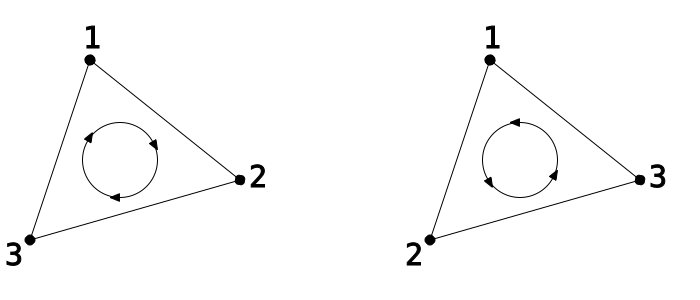

> 三角形绕序

OpenGL 中的背面剔除正是基于这种顺序工作的。设置它分两步完成，由初始化函数中最后两条语句完成。

`glFrontFace` 定义哪一种绕序——顺时针还是逆时针——被视为三角形的「正面」。这个函数可以接收 `GL_CW` 或 `GL_CCW`，分别对应顺时针和逆时针。

`glCullFace` 函数定义哪一面（正面或背面）被剔除。它可以接收 `GL_BACK`、`GL_FRONT` 或 `GL_FRONT_AND_BACK`。后者会剔除*一切*，因此不会有任何三角形被渲染。这在测量顶点着色器性能时可能有用，但对于真正绘制东西来说没什么用。

本教程中的三角形数据是特意排序过的，使三角形顺时针的一侧朝外。这样就阻止了朝后那些面的绘制。

### 缺乏透视

于是，图像看起来是这样的：

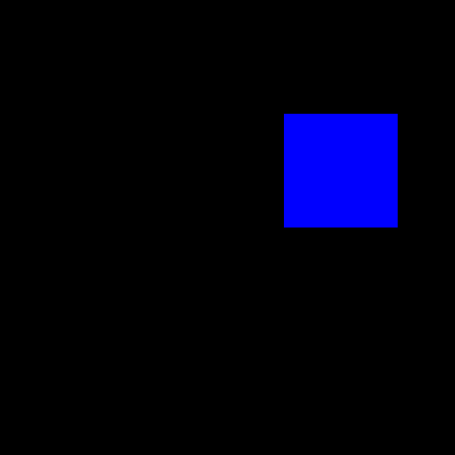

> 正交长方体

这里有点不对劲。具体来说，它看起来像一个正方形。

再拿起一个遥控器。让它正对着你的眼睛，并把它放在视野中央。你应该只能看到遥控器的正面面板。

现在，把它向右上方移动，移到类似图中正方形所在的位置。你应该能看到遥控器的底面和左侧。

那么我们应该能看到我们那个长方体的底面和左侧。但我们看不到。为什么？

回想一下渲染是怎么发生的。在裁剪空间中，长方体后端的顶点正好位于前端顶点的背后。当我们把这些顶点变换到窗口坐标时，后面的顶点仍然正好位于前面顶点的背后。这就是光栅化器看到的东西，因此也是光栅化器所渲染的东西。

一定存在某种现实世界在做的事情，而我们没有做。那件事就叫作「透视」。

## 透视投影

回想一下，我们的目标图像——屏幕——不过是一个二维的像素数组。我们所使用的 3D 渲染管线定义了顶点位置从裁剪空间到窗口空间的变换。一旦位置处于窗口空间，2D 三角形就被渲染出来。

就渲染管线而言，投影是把一个世界从某个维度变换到另一个维度的方式。我们最初的世界是三维的，因此渲染管线定义了一个从 3D 世界到我们所看到的 2D 世界的投影。三角形正是在这个 2D 世界中被实际渲染的。

有限投影——也就是我们感兴趣的那类——只把物体投影到低维空间中一块有限的区域上。对于 3D 到 2D 的投影，存在一个有限的平面，世界被投影到它上面。对于 2D 到 1D，则存在一条有界的线作为投影的结果。

正交投影是一种非常简单的投影。当投影到一个轴对齐的表面上时（如下图），投影所做的仅仅是丢掉垂直于该表面的那个坐标。

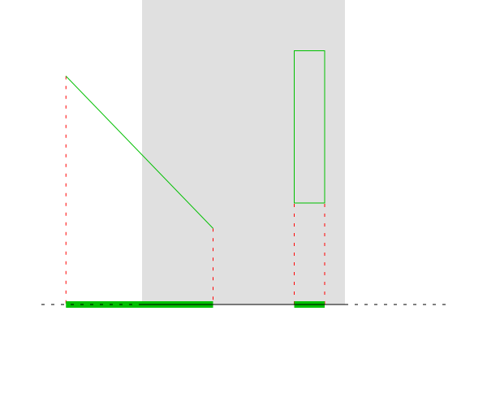

> 2D 到 1D 的正交投影

当投影到任意一条线上时，数学上要复杂一些。但让它成为正交投影的关键在于：垂直于表面的那个维度被一致地取负以完成投影。正因为它既沿垂直方向投影，又是一致的，这才叫正交投影。

人眼并不是通过正交投影来观察世界的。如果真是这样，你所能看到的世界区域就只有你瞳孔那么大。由于我们（除其他原因之外）并不用正交投影来看东西，所以正交投影在我们看来并不特别真实。

相反，我们用针孔相机模型来模拟视觉。这个模型执行的是透视投影。透视投影是一种仿佛透过单点观察世界并投影到某个表面上的投影。2D 到 1D 的透视投影看起来是这样的：

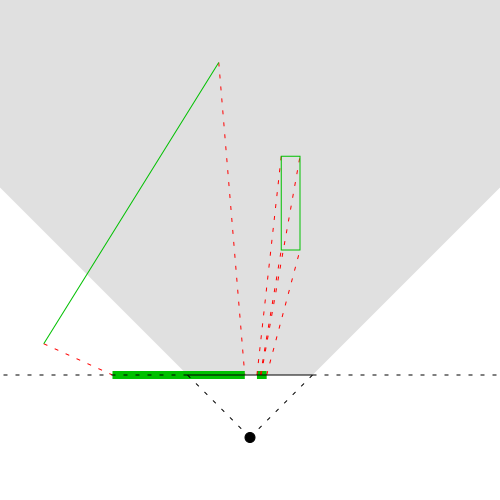

> 2D 到 1D 的透视投影

如你所见，投影是辐射状的，取决于某个特定点的位置。那个点就是投影的眼睛或相机。

仅从投影的形状就能看出，透视投影会让更大范围的几何体被投影到该表面上。正交投影只能捕获投影表面正前方的那块长方体区域，而透视投影捕获的是更大范围的世界空间。

在 2D 中，透视投影的形状是一个普通的梯形（一个只有一对平行边、另一对边斜率相同的四边形）。在 3D 中，这个形状称为视锥；本质上就是一个被削掉顶端的金字塔。

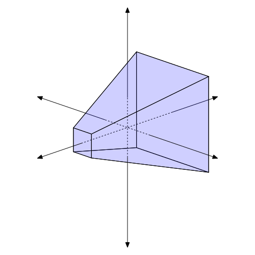

> 视锥

### 数学上的透视

既然我们已经知道要做什么，接下来只需要知道怎么做。

我们将做几个简化的假设：

- 投影平面是轴对齐的，正对 -Z 轴方向。因此，-Z 方向离投影平面更远。
- 视点固定在原点 (0, 0, 0)。
- 投影平面的大小取为 [-1, 1]。所有投影到该范围之外的点都不绘制。

没错，这听起来有点像归一化设备坐标空间。不，这不是巧合。但我们先不深入这一点。

关于投影结果的工作方式，我们已知几件事。透视投影本质上会根据各个顶点的位置，把顶点向眼睛方向移动。Z 方向上离投影前方越远的顶点，移动量比那些更靠近眼睛的顶点要小。而移动量还取决于顶点在 X、Y 方向上离投影平面中心有多远。

这个问题其实只是一个简单的几何问题。下面是 2D 到 1D 透视投影下的等价形式。

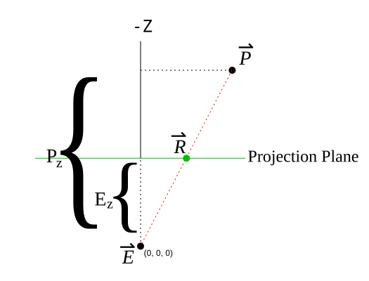

> 2D 到 1D 透视投影示意图

我们得到的是两个相似的直角三角形：由 E、R 和 E <sub>z</sub> 构成的三角形，以及由 E、P 和 P <sub>z</sub> 构成的三角形。我们已知视点位置和未投影点的位置。要求出 R 的位置，只需这样做：


> 透视计算

由于这是一个向量化的函数，这个解法对 2D 和 3D 同样适用。因此，透视投影所做的就是把那个简单的公式应用到顶点着色器所收到的每一个顶点上。

### 透视除法

基本的透视投影函数很简单。非常简单。事实上，它简单到从最早的 3Dfx 显卡、甚至更早的图形硬件开始，就已经被内建在图形硬件中了。

你可能注意到，这个缩放可以表示成一次除法运算（乘以它的倒数）。你或许还记得，裁剪空间与归一化设备坐标空间的差别就在于除以 W 坐标。因此我们不必在着色器里做除法，只要正确设置每个顶点的 W 坐标，交给硬件处理即可。

这一步，也就是从裁剪空间到归一化设备坐标空间的转换，有一个专门的名字：透视除法。之所以这样命名，是因为它通常用于透视投影；正交投影的 W 坐标往往就是 1.0，因此透视除法实际上什么都不做。

**注意**

> 你可能想，为什么会有这个任意的除以 W 的步骤。你也可能想，在如今顶点着色器可以很快完成向量除法的时代，我们为什么还要费心去用硬件的除以 W 步骤。理由有几个。一个我们马上就会讲到——等到讨论矩阵的时候。更重要的理由会在后续教程中说明。简而言之，把透视项放进裁剪空间顶点的 W 坐标是有充分理由的。

### 相机透视

在真正实现透视投影之前，我们需要处理一个新问题。正交投影变换本质上什么都不做。就 OpenGL 使用顶点着色器输出的裁剪空间顶点的方式而言，它是自动的。而透视投影变换要复杂一些。事实上，它从根本上改变了世界的性质。

此前我们的顶点位置一直直接存储在裁剪空间中。我们偶尔会给位置加上一个偏移，把它们挪到更方便的位置。但从所有实际用途来看，缓冲对象中存储的位置值恰好就是顶点着色器输出的东西：裁剪空间位置。

回想一下，除以 W 是 OpenGL 定义的、从裁剪空间位置到 NDC 位置的变换的一部分。透视投影定义的是一个把位置变换*进入*裁剪空间的过程，使得这些裁剪空间位置看上去是 3D 世界的一个透视投影。这个变换有明确定义的输出：裁剪空间位置。但它的*输入*值究竟是什么？

因此我们为位置定义一个新的空间，就称之为相机空间。[^之所以称为相机空间，原因会在后面讨论。]这不是 OpenGL 所认识的空间（不像裁剪空间那样由 GL 显式定义）；它纯粹是用户任意构造出来的。相机空间的定义会影响透视投影的具体过程，因为该投影必须产生正确的裁剪空间位置。因此，基于我们对透视投影一般流程的了解来定义相机空间是很有用的。这样可以把相机空间与裁剪空间的透视形式之间的差异降到最小，也能简化我们的透视投影逻辑。

相机空间在各个方向上的取值范围都是正无穷到负无穷。X 正方向向右延伸，Y 正方向向上延伸，Z 正方向是*向前*。最后这一点与裁剪空间不同，在裁剪空间中 Z 正方向是远离观察者的。

我们的透视投影变换将针对这个空间来定义。如前所述，投影平面在 X 和 Y 轴上取 [-1, 1] 区域，Z 值为 -1。投影是从 -Z 方向的顶点投到该平面上；Z 值为正的顶点位于投影平面之后。

现在我们再做一个简化的假设：透视平面中心的位置在相机空间中固定为 (0, 0, -1)。因此，由于投影平面朝向 -Z 轴方向，视点相对于投影平面的位置就是 (0, 0, -1)。于是 E <sub>z</sub> 值，也就是从投影平面到视点的偏移量，始终是 -1。这意味着我们的透视项，若写成除法而不是乘法，就只是 P <sub>z</sub> /-1：相机空间 Z 坐标的取负。

视点位置和投影平面都固定之后，就很难实现缩放式的效果。通常的做法是相对固定的视点移动平面。不过还是有办法的。你只需要在从相机空间变换到裁剪空间时，把所有的 X 和 Y 值乘上一个常数即可。这样做的效果是让相机看到的世界在 X 和 Y 轴上变小或变大。它实际上让视锥变宽或变窄。

作为对比，相机空间和归一化设备坐标空间（透视除法之后）的 2D 版本看起来是这样的：

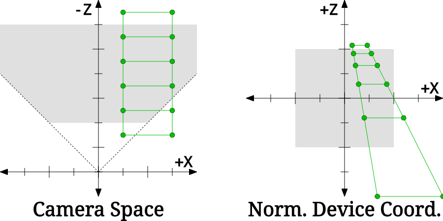

> 2D 中的相机到 NDC 变换

请注意，这张图中相机空间与归一化设备坐标（NDC）空间的 Z 轴方向是相反的。这是因为相机空间和 NDC 空间的观察方向不同。在相机空间中，相机沿 -Z 轴方向观察；Z 值越负就越远。在 NDC 空间中，相机沿 +Z 轴方向观察；Z 值越正就越远。这张图翻转了坐标轴，好让两幅图的观察方向保持一致（上方代表远离观察者）。

如果你从右侧的 NDC 空间做一次正交投影（也就是丢掉 Z 坐标），那么你得到的就是左侧那个世界的透视投影。实际上，我们所做的就是先把物体变换到一个三维空间中，从这个空间做正交投影时看起来就像透视投影一样。

### 深度上的透视

现在我们知道了该拿 X 和 Y 坐标怎么办。但在透视投影中，Z 值又意味着什么？

在下一个教程之前，我们打算忽略 Z 的*含义*。即便如此，我们仍然需要对它做某种变换；如果一个顶点在归一化设备坐标（NDC）空间的任意一个轴上超出了 [-1, 1] 这个盒子的范围，它就位于可视区域之外。而且由于 Z 坐标和 X、Y 坐标一样要经过透视除法，如果我们真想在投影中看到东西，就必须把这一点考虑进去。

我们的 W 坐标将基于相机空间的 Z 坐标。我们需要把 Z 值从相机空间的区间 [0, -∞) 映射到 NDC 空间的区间 [-1, 1]。由于相机空间是无穷范围，而我们要映射到有限范围，因此需要做一些范围限定。视锥在 X 和 Y 方向上已经是有限的了；我们只需再加一个 Z 方向的边界。

一个顶点在被视为不可见之前能够达到的最大距离称为 camera zFar。我们还有一个离视点的最小距离，称为 camera zNear。这为我们的相机空间视点构造出了一个有限的视锥。

**注意**

> 务必记住，这些是*相机*空间的 zNear 和 zFar。下一个教程还会引入一个深度范围，同样使用 zNear 和 zFar 这两个名字。两者相关，但本质上是不同的范围。

camera zNear 看上去似乎能有效决定视点与投影平面之间的偏移。然而事实并非如此。即使 zNear 小于 1，也就是把近 Z 平面放在投影平面*之后*，你仍然会得到一个有效合理的投影。平面之后的物体同样可以像平面之前的物体那样被投影到该平面上；它依然是透视投影。在数学上，这行得通。

它*没有*做到的事情，正是你移动投影平面时期望会发生的事。由于投影平面的大小是固定的（范围 [-1, 1]），移动平面会改变点在投影中呈现的位置。而改变 camera zNear 不会影响投影中点的 X、Y 位置。

把一个有限范围映射到另一个有限范围有若干种做法。有个让人困扰的问题在于透视除法本身；在两个有限空间之间做线性映射很容易，但要在透视除法*之后*仍然保持线性，就完全是另一回事了。由于我们将要除以 -Z 本身（相机空间的 Z，而不是裁剪空间的 Z），其中的数学比你预期的要复杂得多。

出于下一教程会解释得更清楚的原因，我们将使用这个略微复杂的函数来计算裁剪空间的 Z：

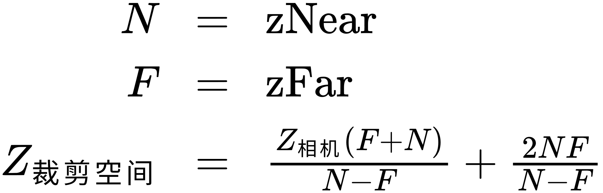

> 深度计算

关于这个公式以及 camera zNear/zFar，有几点很重要。首先，这些值是*正数*；公式在做变换时已经考虑到了这一点。另外，zNear *不能*为 0；它可以非常接近 0，但绝不能正好等于 0。

让我们回顾一下之前那张 2D 空间中相机到 NDC 变换的图：


2D 相机空间与 2D NDC 空间对比的这个例子就是用该公式来计算 Z 值的。仔细看看 Z 坐标是如何对应的。这些 Z 距离在相机空间中是等距的，但在 NDC 空间中却是非线性分布的。然而与此同时，在相机空间中共线的点，在 NDC 空间中仍然共线。

这个事实具备一些有趣的性质，我们将在下一个教程中进一步探究。

### 在透视中绘制

综合以上所有内容，我们现在有了一套把顶点从相机空间变换到裁剪空间的明确步骤。步骤如下：

1. 视锥调整：把相机空间顶点的 X 和 Y 值乘上一个常数。
2. 深度调整：按上文所述，把 Z 值从相机空间变换到裁剪空间。
3. 透视除法项：计算 W 值，其中 E <sub>z</sub> 为 -1。

现在理论部分都讲完了，我们准备好把一切真正地「摆正」到透视之中。这由 `ShaderPerspective` 教程来完成。

我们新的顶点着色器 `data\ManualPerspective.vert` 看起来是这样的：

**示例：ManualPerspective Vertex Shader**

```glsl
#version 330

layout(location = 0) in vec4 position;
layout(location = 1) in vec4 color;

smooth out vec4 theColor;

uniform vec2 offset;
uniform float zNear;
uniform float zFar;
uniform float frustumScale;

void main()
{
    vec4 cameraPos = position + vec4(offset.x, offset.y, 0.0, 0.0);
    vec4 clipPos;
    
    clipPos.xy = cameraPos.xy * frustumScale;
    
    clipPos.z = cameraPos.z * (zNear + zFar) / (zNear - zFar);
    clipPos.z += 2 * zNear * zFar / (zNear - zFar);
    
    clipPos.w = -cameraPos.z;
    
    gl_Position = clipPos;
    theColor = color;
}
```

我们多了几个新的 uniform，但代码本身只算略微复杂了一点。

第一条语句只是施加了一个偏移，就像我们之前见过的顶点着色器那样。它把对象定位在相机空间中，使它偏离视图中心。这里这样写是为了让对象的定位对投影来说更方便。

接下来一条语句对相机空间的 X 和 Y 位置做标量乘法，把结果存进一个临时的 4 维向量中。然后我们据此计算裁剪空间的 Z 位置。

裁剪空间位置的 W 坐标，等于相机空间中的 Z 距离除以从平面（在原点处）到视点的 Z 距离。视点固定在 (0, 0, -1)，所以剩下的就是相机空间 Z 位置的取负。OpenGL 会自动替我们完成这次除法。

之后，我们只需把裁剪空间位置存到 OpenGL 需要的位置，存下颜色，就完成了。片元着色器没有变化。

由于新增了这些 uniform，我们的程序初始化函数也变了：

**示例：Program Initialization**

```cpp
offsetUniform = glGetUniformLocation(theProgram, "offset");

frustumScaleUnif = glGetUniformLocation(theProgram, "frustumScale");
zNearUnif = glGetUniformLocation(theProgram, "zNear");
zFarUnif = glGetUniformLocation(theProgram, "zFar");

glUseProgram(theProgram);
glUniform1f(frustumScaleUnif, 1.0f);
glUniform1f(zNearUnif, 1.0f);
glUniform1f(zFarUnif, 3.0f);
glUseProgram(0);
```

我们只设置一次这些新的 uniform。缩放值 1.0 意味着实际上没有变化。我们定义 Z 从 -1 到 -3（记住，在我们的 Z 公式中，zNear 和 zFar 是正数，但指的是负值）。

长方体的位置也变了。在最初的教程中，它位于 Z 的 0.75 范围上。由于相机空间的 Z 与裁剪空间差别很大，这一位置必须更改。现在，长方体的 Z 位置在 -1.25 到 -2.75 之间。

所有这些让我们得到了这样的结果：

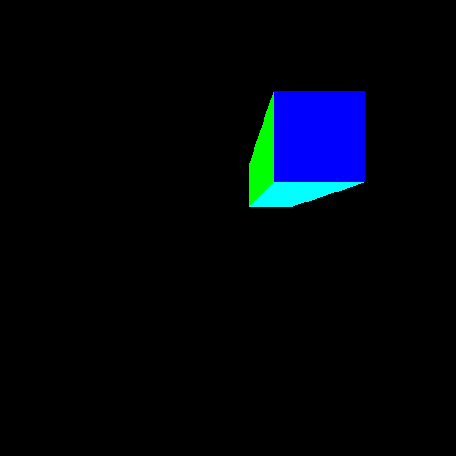

> 透视长方体

现在它看起来确实像个长方体了。一个明亮、色彩鲜艳、不真实的长方体。

### 向量数学

我们略过了顶点着色器中一处值得更多讨论的内容。也就是这一行：

```glsl
clipPos.xy = cameraPos.xy * frustumScale;
```

即便你熟悉其他语言中的向量数学库，这段代码看起来也会相当奇怪。传统的向量库允许你写 `vec.x` 和 `vec.w` 这样的选择符，用来从向量中取某个特定字段。那么 `vec.xy` 这样的写法又是什么意思呢？

嗯，它的意思显而易见：这个表达式返回一个 2D 向量（`vec2`），因为只提到了两个分量（X 和 Y）。这个向量的第一个分量取自 `vec` 的 X 分量，第二个分量取自 `vec` 的 Y 分量。在 GLSL 术语中，这种选择称为 swizzle 选择。返回向量的大小就是你所提到的分量个数，而这些分量的顺序决定了返回分量的顺序。

你可以对向量做任何形式的 swizzle 运算，只需记住下面几条规则：

- 你不能选择源向量中不存在的分量。所以如果你有：

```glsl
vec2 theVec;
```

  你不能写 `theVec.zz`，因为它没有 Z 分量。
- 你不能选择超过 4 个分量。

规则只有这些。所以你可以把一个 `vec2` 通过 swizzle 变成一个 `vec4`（`vec.yyyx`）；你可以重复使用分量；等等。只要遵守上述规则，怎么都行。

你还应当假定 swizzle 是快速的。这在大多数基于 CPU 的向量硬件上并不成立，但自可编程 GPU 出现的第一天起，swizzle 选择就一直是一个显著特性。在早期可编程时代，swizzle 不会造成*任何*性能损失；十有八九这一点至今没有改变。

swizzle 选择也可以用在等号的左侧，就像我们这里做的一样。它允许你设置向量的特定分量，而不改变其他分量。

当你用一个标量（非向量值）乘一个向量时，会执行逐分量乘法，返回一个由标量与向量各分量相乘得到的向量。我们本可以把上面那行写成这样：

```glsl
clipPos.x = cameraPos.x * frustumScale;
clipPos.y = cameraPos.y * frustumScale;
```

但它大概不会像 swizzle 加向量数学的版本那样快。

## 矩阵盯上你了

既然我们已经能把世界放进透视之中，那就用正确的方式来做了。用那种「对当下而言没必要地复杂、但几个教程之后就会明白」的方式。

首先，我们来看一下用于从相机空间计算裁剪坐标的方程组。设 `S` 为视锥缩放因子，`N` 为 zNear，`F` 为 zFar，我们得到下面四个方程。

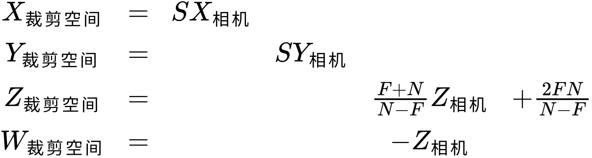

> 相机到裁剪空间的方程

奇怪的间距是故意安排的。权当玩笑吧，我们来加上一堆不改变方程的无意义项，但这样会开始显出一些有趣的模式：

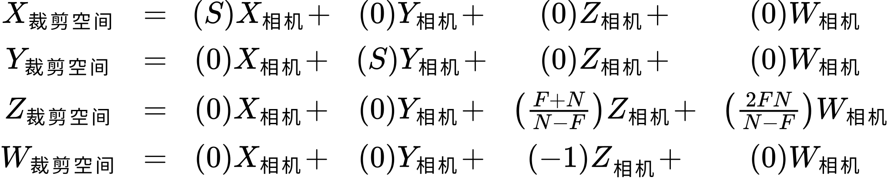

> 相机到裁剪空间的展开方程

我们这里得到的东西被称为线性方程组。这些方程可以表示为一系列系数（即那些要与 XYZW 值相乘的数），这些系数与输入值（XYZW）相乘，产生单个输出。每个单独的输出值都是所有输入值的线性组合。在我们的例子里恰好有很多系数是零，所以在这个特定情况下，输出值只依赖少数几个输入值。

你可能对 Z <sub>clip</sub> 的加性项与相机空间 W 相乘感到奇怪。嗯，我们输入的相机空间位置的 W 坐标始终是 1。所以只要这种情况持续下去，做这个乘法就是合法的。我们之所以能够做接下来要做的事，是相机空间位置值中存在 W 坐标的原因之一（另一个原因是透视除法）。

我们可以用一种特殊的形式重新表达任何线性方程组。你的线性代数知识越深，越可能认得出这种改写：

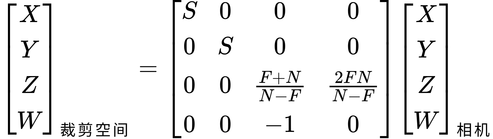

> 相机到裁剪空间的矩阵变换

那两列标为「clip」和「camera」的竖直长列是 4 维向量；也就是裁剪空间和相机空间的位置向量。旁边那一大块数字是一个矩阵。你大概对矩阵数学还不熟悉。如果不熟悉，马上就会解释。

一般而言，矩阵是一块二维的数字阵列（维度超过 2 的矩阵称为「张量」）。矩阵在计算机图形中非常常见。到目前为止，我们一直都能在没有它的情况下继续。但随着我们进入更细致的物体变换，我们会越来越依赖矩阵来简化问题。

在图形工作中，我们通常使用 4x4 矩阵，也就是列数和行数分别为 4 的矩阵。这是由图形工作的性质决定的：我们想用矩阵处理的大多数东西，要么是三维的，要么是带一个额外数据坐标的三维对象。我们的 4D 位置无非就是在 3D 位置末尾加了一个 1。

上面描述的运算是一次向量-矩阵乘法。维度为 `n`x`m` 的矩阵只能乘以维度为 `n` 的向量。这样乘法的结果是一个维度为 `m` 的向量。由于我们这里的矩阵是 4x4，它只能与 4D 向量相乘，而且这次乘法会产生一个 4D 向量。

矩阵乘法所做的就是展开方程例子所做的事。对于矩阵中的每一行，列的各分量值与向量各行中对应的值相乘。这些值再相加；就得到输出向量该行的单一数值。


> 向量矩阵乘法

最终这会导致 16 次浮点乘法和 12 次浮点加法。这数量相当可观，尤其是与我们现在的版本相比。所幸图形硬件正是被设计来让这些运算非常快的。由于每次乘法彼此独立，它们完全可以同时完成，而这恰恰是图形硬件擅长的事情。同理，加法运算也是部分独立的；每一行的求和不依赖任何其他行的值。归根结底，向量矩阵乘法通常在 GPU 机器语言中只生成 4 条指令。

我们可以用矩阵数学而不是显式数学来重新实现上面的透视投影。`MatrixPerspective` 教程就是这么做的。

这种情况下顶点着色器要简单得多：

**示例：MatrixPerspective Vertex Shader**

```glsl
#version 330

layout(location = 0) in vec4 position;
layout(location = 1) in vec4 color;

smooth out vec4 theColor;

uniform vec2 offset;
uniform mat4 perspectiveMatrix;

void main()
{
    vec4 cameraPos = position + vec4(offset.x, offset.y, 0.0, 0.0);
    
    gl_Position = perspectiveMatrix * cameraPos;
    theColor = color;
}
```

OpenGL 着色语言（GLSL）是面向图形运算设计的，因此天然把矩阵作为基本类型。`mat4` 是一个 4x4 矩阵（列数 x 行数）。GLSL 为 2 到 4 之间列数与行数的所有组合都提供了类型。方阵（列数与行数相等的矩阵）只用一个数字表示，就像上面的 `mat4`。因此 `mat3` 是一个 3x3 矩阵。如果矩阵不是方阵，GLSL 使用类似 `mat2x4` 的记法：表示有 2 列 4 行的矩阵。

注意着色器不再自己计算这些值；它被*赋予*了一个矩阵，所有存储的值都作为 uniform 传入。这只是因为没必要让它自己算。特定场景中的所有物体都会用同一个透视矩阵渲染，所以没必要浪费宝贵的顶点着色器时间去做重复计算。

向量矩阵乘法在图形中是如此常见的运算，以至于直接用运算符 * 来执行。因此 `main` 的第二行就是用透视矩阵乘以相机位置。

请注意这个运算的*顺序*。矩阵在左，向量在右。矩阵乘法*不*满足交换律，所以 M* v 不同于 v *M。通常向量被视为 1xN 矩阵（N 是向量大小）。当你把向量放在矩阵左侧时，GLSL 认为它是一个 Nx1 矩阵；这是让乘法成立的唯一方式。这会拿向量的那一行去乘每一列并把结果加起来，生成一个新向量。这*不是*我们想要的。我们想要的是用矩阵的行去乘向量，而不是矩阵的列。所以要把向量放在右边，不要放在左边。

程序初始化函数有几处变化：

**示例：Program Initialization of Perspective Matrix**

```cpp
offsetUniform = glGetUniformLocation(theProgram, "offset");

perspectiveMatrixUnif = glGetUniformLocation(theProgram, "perspectiveMatrix");

float fFrustumScale = 1.0f; float fzNear = 0.5f; float fzFar = 3.0f;

float theMatrix[16];
memset(theMatrix, 0, sizeof(float) * 16);

theMatrix[0] = fFrustumScale;
theMatrix[5] = fFrustumScale;
theMatrix[10] = (fzFar + fzNear) / (fzNear - fzFar);
theMatrix[14] = (2 * fzFar * fzNear) / (fzNear - fzFar);
theMatrix[11] = -1.0f;

glUseProgram(theProgram);
glUniformMatrix4fv(perspectiveMatrixUnif, 1, GL_FALSE, theMatrix);
glUseProgram(0);
```

一个 4x4 矩阵包含 16 个值。所以我们先创建一个名为 `theMatrix` 的、含 16 个浮点数的数组。由于其中大部分值都是零，我们可以直接把整个数组设为零。这可行是因为 IEEE 32 位浮点数用 4 个全为零的字节表示零。

接下来的几行把特定关心的值设置进矩阵。在我们能理解这里发生了什么之前，需要先谈谈顺序。

一个 4x4 矩阵在技术上是 16 个值，所以一个 16 项的数组可以存放一个矩阵。但把矩阵存成数组有两种方式。一种称为列主序，另一种自然是行主序。列主序意味着，对于一个 NxM 矩阵（列数 x 行数），数组中的前 N 个值是第一列（自上而下），接下来的 N 个值是第二列，依此类推。在行主序中，数组中的前 M 个值是第一行（自左而右），接着另外 M 个值是第二行，依此类推。

在这个例子中，矩阵是以列主序存放的。所以数组下标 14 位于第四列的第三行。

整个矩阵是一个单独的 uniform。要把矩阵传给 OpenGL，我们使用 `glUniformMatrix4fv` 函数。第一个参数是我们要上传到的 uniform 位置。这个函数可以用来传输整个矩阵数组（是的，任何类型的 uniform 数组都是可能的），所以第二个参数是数组项数。由于我们只提供一个矩阵，这个值是 1。

第三个参数告诉 OpenGL 矩阵数据的存放顺序。如果是 `GL_TRUE`，那么矩阵数据是行主序。由于我们的数据是列主序，我们把它设为 `GL_FALSE`。最后一个参数就是矩阵数据本身。

运行这个程序会得到：


> 透视矩阵

和之前一样，只不过现在是用矩阵实现的。

## 世界的宽高比

如果你运行上一个程序并调整窗口大小，视口会随之改变。遗憾的是，这也意味着原本正面为正方形的长方体被拉长了。


> 不良的宽高比

这是宽高比的问题，即图像宽度与高度之比。当前，当你改变窗口尺寸时，代码会调用 `glViewport` 把新尺寸告诉 OpenGL。这改变了 OpenGL 的视口变换，即从归一化设备坐标到窗口坐标的变换。NDC 空间是 1:1 的宽高比；NDC 空间的宽和高都是 2x2。只要窗口坐标同样保持 1:1 的宽高比，在 NDC 空间中看起来是正方形的物体在窗口空间中仍然是正方形。一旦窗口空间不再是 1:1，这个变换也就跟着变得不是正方形了。

具体该怎么做呢？这取决于你想通过把窗口变大来实现什么目的。

一个简单的办法是让视口永远保持正方形。只需把 `reshape` 函数改成这样即可：

**示例：Square-only Viewport**

```cpp
void reshape (int w, int h)
{
    if(w < h)
        glViewport(0, 0, (GLsizei) w, (GLsizei) w);
    else
        glViewport(0, 0, (GLsizei) h, (GLsizei) h);
}
```

现在如果你调整窗口大小，视口会始终保持正方形。不过，如果窗口不是正方形，视口区域的右侧或下方就会留下大量空白。这块空间无法用三角形绘制命令渲染出内容（原因我们会在下一个教程中看到）。

这个方案的优点是无论视口形状如何，世界的可视区域都保持固定。它的缺点是浪费窗口空间。

如果我们想尽可能利用窗口，该怎么办？是有办法的。

回到问题的定义。NDC 空间是一个 [-1, 1] 的立方体。如果 NDC 空间中的物体是正方形，那么为了让它在窗口坐标中也是正方形，视口也必须是正方形。反过来，如果你希望窗口坐标不是正方形，那么 NDC 空间中的物体*就不能是正方形*。

所以我们的问题出在一个隐含假设上：相机空间中的正方形需要在整个过程中保持为正方形。事实并非如此。要做到我们想要的，我们需要把物体变换到裁剪空间，使它们呈现为正确的非正方形形状，这样当透视除法和视口变换把它们转换成窗口坐标时，它们又变回正方形。

当前我们的透视矩阵定义的是一个正方形视锥。也就是说，视锥的上下两面（如果把它画在相机空间里）会是正方形。我们真正需要做的是创建一个矩形视锥。

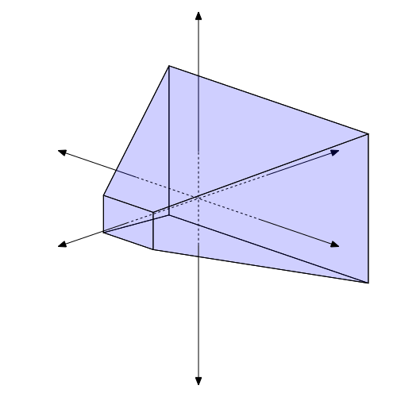

> 宽屏宽高比视锥

我们已经对视锥的形状有了一些控制力。我们最初说过不需要把视点从原点移开，因为我们可以简单地缩放所有物体的 X 和 Y 位置来达到类似效果。这样做时，我们用同一个值缩放 X 和 Y；这产生的是均匀缩放。它同样产生一个正方形视锥，如在相机空间中所见。既然我们要的是矩形视锥，就需要使用非均匀缩放，让 X 和 Y 位置按不同的值缩放。

这样做的效果是显示*更多*的世界。但我们希望朝哪个方向显示更多？人眼的视野倾向于横向多于纵向。这就是电影通常至少采用 16:9 的宽高比（多数电影用的宽高比还更大）的原因。所以通常的做法是针对某个特定的高度设计视野，再根据宽高比调整宽度。

`AspectRatio` 教程就是这么做的。这段代码使用与之前相同的着色器；它只是修改了 `reshape` 函数中的透视矩阵。

**示例：Reshape with Aspect Ratio**

```cpp
void reshape (int w, int h)
{
    perspectiveMatrix[0] = fFrustumScale / (w / (float)h);
    perspectiveMatrix[5] = fFrustumScale;
    
    glUseProgram(theProgram);
    glUniformMatrix4fv(perspectiveMatrixUnif, 1, GL_FALSE, perspectiveMatrix);
    glUseProgram(0);
    
    glViewport(0, 0, (GLsizei) w, (GLsizei) h);
}
```

这个矩阵现在是一个名为 `perspectiveMatrix` 的全局变量，它的其他字段与之前一样来自程序初始化函数。宽高比这段代码只关心 XY 的缩放值。

这里我们根据宽高之比改变 X 的缩放，Y 的缩放保持不变。

此外，用于定位长方体的偏移量从 (0.5, 0.5) 改成了 (1.5, 0.5)。这意味着在你调整窗口大小之前，物体有一部分会偏出视口侧面。改变宽度会显示更多区域；只有改变高度才真正让物体变大。正方形看上去始终是正方形。

## 本章小结

在本教程中，你学到了以下内容：

- 背面剔除可以依据顶点在窗口空间中的顺序，把三角形剔除掉（不予渲染）。
- 透视投影用来让场景呈现出深度感：远处物体相比近处物体显得更小、位置更偏。OpenGL 硬件对透视投影有专门的支持；也就是从裁剪空间到 NDC 空间中除以 W 的那个变换。
- 透视变换可以用一次矩阵乘法来执行。矩阵/向量乘法是一种在单次运算中计算多个线性方程的方法。
- 通过根据窗口宽高比缩放相机空间顶点的 X 和 Y 坐标，可以维持显示图像的正确宽高比。这一变换可以折叠进透视投影矩阵中。

### 进一步学习

试着用给出的程序做下面这些事情。

- 在所有透视教程中，我们的视锥缩放因子始终是 1.0。调整视锥缩放因子，看看它如何影响场景。
- 调整 zNear 距离，使它与长方体相交。看看这会如何影响渲染。类似地调整 zFar 距离，看看会发生什么。
- 我们在透视变换算法中做了几个简化的假设。特别是我们把视点固定在 (0, 0, 0)，把平面固定在 (0, 0, 1)。不过这并非严格必要；我们本可以修改透视变换算法以支持可变的视点。调整 `ShaderPerspective` 以实现任意位置的透视平面（大小仍固定为 [-1, 1]）。你需要分别用 E <sub>x</sub> 和 E <sub>y</sub> 偏移顶点的 X、Y 相机空间位置，但必须在缩放（宽高比处理）*之后*。并且你需要用 -E <sub>z</sub> 而不是仅仅 -1 来除相机空间的 Z 项。
- 做上面的事，但用矩阵形式。记住，任何放在第四列中的项都会加到那个分量上，因为要乘以 W <sub>camera</sub>（它始终是 1.0）。

### 值得注意的 OpenGL 函数

- **glEnable/glDisable**：这些函数用于激活或停用 OpenGL 的某些特性。可启用或禁用的特性有一份很长的清单。在本教程中，我们用 `GL_CULL_FACE` 来启用/禁用背面剔除。
- **glCullFace/glFrontFace**：这两个函数控制背面剔除的工作方式。`glFrontFace` 定义哪种三角形绕序被视为正面。`glCullFace` 定义哪些面被剔除。这个函数也可以剔除*所有*面，不过如果你想真的把东西画出来，这没什么用。

  只有在 `GL_CULL_FACE` 当前已启用的情况下，这两个函数才真正起作用。即便 `GL_CULL_FACE` 未启用，它们仍会在内部设置这些值，因此之后再启用时会使用最新的设置。

## 术语表

- **face culling**：依据三角形的绕序来剔除三角形的能力。在 OpenGL 中，通过用 `glEnable` 配合 `GL_CULL_FACE` 来激活这一功能。哪些面被剔除由 `glCullFace` 和 `glFrontFace` 两个函数决定。
- **winding order**：组成一个三角形的 3 个顶点被接收的顺序，即顺时针或逆时针。这一顺序是在窗口坐标中以二维方式度量的。
- **projection**：把一系列高维物体呈现在低维的过程。把 3D 场景渲染成 2D 图像，就需要把这个场景从三维投影到二维。

  投影总是相对于某个投影表面发生的。把 2D 空间投影到 1D 空间需要一个可供投影的有界线。把 3D 空间投影到 2D 空间需要一个投影平面。这个表面定义在高维度的世界中。
- **orthographic projection**：一种投影形式，它只是把垂直于投影表面方向上的所有偏移取负。做 3D 到 2D 的正交投影时，如果平面是轴对齐的，投影就可以很简单地完成。垂直于投影平面的那个坐标直接被丢弃。如果平面不是轴对齐的，数学会更复杂，但效果是一样的。

  正交投影在投影方向上是一致。正因为这种一致性，高维空间中平行的线保证在低维空间中仍然平行。
- **perspective projection**：一种投影形式，它基于某个位置（视点位置）把物体投影到表面上。透视投影试图模拟针孔相机模型，这与人眼看世界的方式相似。空间中物体的位置会依据视点位置辐射状地投影到投影表面上。

  高维中的平行线*并不*保证在低维中仍然平行。它们可能平行，也可能不平行。
- **frustum**：从几何上说，视锥是一个 3D 形状；一个被削掉顶端的金字塔。从视点穿过投影平面看到的 3D 到 2D 透视投影，其形状就是一个视锥。
- **perspective divide**：从裁剪空间到归一化设备坐标空间这一变换的新名字。之所以这么叫，是因为除以 W 正是让透视投影只靠矩阵数学就能工作的原因；单靠矩阵本身无法完成完整的透视投影运算。
- **camera space**：一个任意定义的、但极其有用的空间，透视投影可以从中相对容易地执行。相机空间是一个无限大的空间，X 正方向向右，Y 正方向向上，Z 正方向朝向观察者。

  在相机空间中，假设透视投影的视点位于 (0, 0, 1)，投影平面是在 X 和 Y 上取 [-1, 1] 并穿过 3D 原点的平面。因此，所有 Z 值为正的点都被认为在相机背后，从而不可见。相机空间中的位置是相对相机所在点定义的，因为相机有一个固定的原点。
- **camera zNear, camera zFar**：归一化设备坐标（NDC）空间在各维度上都被限制在 [-1, 1] 范围内。相机空间是无界的，但透视变换隐含地把被视为可见的范围在 X、Y 轴上限制为 [-1, 1]。这使得 Z 轴仍是无界的，而 NDC 空间不允许这一点。

  camera zNear 和 zFar 这两个值定义了透视投影变换中 Z 的最小和最大范围。这些值是正的，尽管它们在相机空间中表示的是负值。使用标准透视变换时，两个值都必须大于 0，且 zNear 必须小于 zFar。
- **swizzle selection**：swizzle 选择是一种着色语言独有的向量技术，允许你拿一个向量，用其分量任意构造出其他向量。这种选择是完全任意的；你可以用一个 vec2 构造出 vec4，或任何其他你想要的组合，最多 4 个元素。

  Swizzle 选择用「x」「y」「z」「w」的组合从输入向量中挑选分量。Swizzle 运算看起来是这样的：

  ```glsl
  vec2 firstVec;
  vec4 secondVec = firstVec.xyxx;
  vec3 thirdVec = secondVec.wzy;
  ```

  在图形硬件中，swizzle 选择被认为快到可以忽略不计。也就是说，图形硬件的构建就是以 swizzle 选择为前提的。
- **matrix**：数字的一种二维排列。和向量一样，矩阵也可以视为单个元素。矩阵常用来表示线性方程组中的系数；出于这个原因（以及其他原因），矩阵数学常常被称为线性代数。

  矩阵的规模，也就是列数和行数（记作 NxM，N 是列数，M 是行数），决定了矩阵的种类。矩阵运算对参与运算的两个矩阵有特定要求，具体取决于运算类型。只有当左边矩阵的行数等于右边矩阵的列数时，两个矩阵才能相乘。出于这个原因（以及其他原因），矩阵乘法不满足交换律（A *B 不等于 B* A；有时 B*A 甚至无法计算）。

  4x4 矩阵在计算机图形中用于把 3 维或 4 维向量从一个空间变换到另一个空间。多数线性变换都可以用 4x4 矩阵表示。
- **column-major, row-major**：这两个术语定义了把矩阵存成数值数组的两种方式。列主序意味着，对于一个 NxM 矩阵（列数 x 行数），数组中的前 N 个值是第一列（自上而下），接下来的 N 个值是第二列，依此类推。在行主序中，数组中的前 M 个值是第一行（自左而右），接着另外 M 个值是第二行，依此类推。
