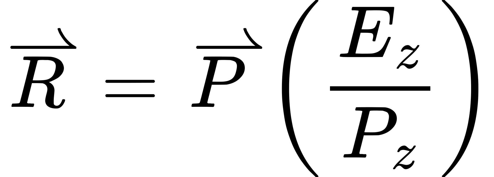
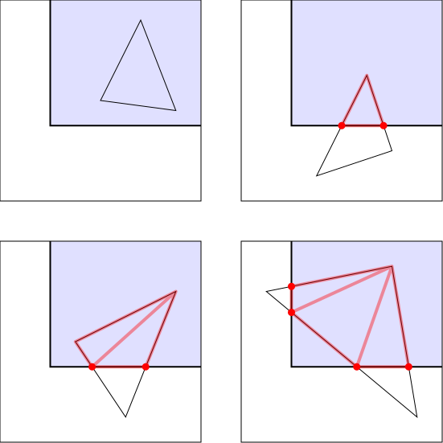

# 深度中的物体

本教程将讨论如何处理多个物体的渲染，以及多个物体相互重叠时会发生什么。

## OpenGL 中的多个物体

要弄清物体重叠时会发生什么，第一步是绘制不止一个物体。这正好让我们来谈谈一个以后会有用的概念。

就所绘制的内容而言，一个物体可以看作单次绘制调用的结果。因此，物体就是在同一组着色器程序状态下绘制的那一串最小的三角形。

### 顶点数组对象

到目前为止，每次我们要绘制任何东西时，都必须在绘制调用之前做一些设置工作。具体来说，对于顶点着色器用到的*每一个*顶点属性，我们都必须做下面几件事：

1. 用 `glEnableVertexAttribArray` 启用该属性。
2. 用 `glBindBuffer`(`GL_ARRAY_BUFFER`) 把存放该属性数据的缓冲对象绑定到上下文。
3. 用 `glVertexAttribPointer` 定义该属性在此前绑定到 `GL_ARRAY_BUFFER` 的缓冲对象中的数据格式。

属性越多，每个物体要做的准备工作就越多。为减轻这份负担，OpenGL 提供了一个对象，用来存放渲染所需的全部状态：**顶点数组对象**（**VAO**）。

VAO 用 `glGenVertexArray` 函数创建。它的用法与 `glGenBuffers` 一样（大多数其他 OpenGL 对象也都如此）：一次调用可以创建多个对象。和之前一样，这些对象是 `GLuint` 类型的。

VAO 通过 `glBindVertexArray` 绑定到上下文；这个函数不像 `glBindBuffer` 那样带目标参数，它只接受要绑定到上下文的那个 VAO。

VAO 绑定之后，某些函数的调用会修改所绑定 VAO 中的数据。严格地说，它们*一直都在*修改 VAO 的状态；前面所有教程的初始化函数里都有下面这两行：

```cpp
glGenVertexArrays(1, &vao);
glBindVertexArray(vao);
```

这创建了一个 VAO，它包含我们一直在设置的顶点数组状态。这意味着在所有教程中我们一直都在修改某个 VAO 的状态，只是当时没有专门讲这一点。

下面这些函数会修改 VAO 状态。因此，如果上下文没有绑定任何 VAO（调用了 `glBindVertexArray(0)`，或者根本没绑定 VAO），那么除了下面注明的情况，这些函数都会失败。

- `glVertexAttribPointer`。还有 `glVertexAttribIPointer`，不过我们还没讲过它。
- `glEnableVertexAttribArray`/`glDisableVertexAttribArray`、`glBindBuffer`(`GL_ELEMENT_ARRAY_BUFFER`)：在未绑定 VAO 的情况下调用这些函数不会失败。

**▌缓冲绑定与属性关联**

> 你可能注意到 `glBindBuffer`(`GL_ARRAY_BUFFER`) 不在上面的列表中，尽管它也是渲染时属性设置的一部分。绑定到 `GL_ARRAY_BUFFER` 不属于 VAO 的组成部分，因为缓冲对象与顶点属性之间的关联*并不是*在你调用 `glBindBuffer`(`GL_ARRAY_BUFFER`) 时建立的。这个关联是在你调用 `glVertexAttribPointer` 时建立的。
>
> 当你调用 `glVertexAttribPointer` 时，OpenGL 会取出*在这一刻*绑定到 `GL_ARRAY_BUFFER` 的缓冲，并把它与给定的顶点属性关联起来。可以把 `GL_ARRAY_BUFFER` 绑定理解为一个全局指针，`glVertexAttribPointer` 会读取它。因此在调用 `glVertexAttribPointer`*之后*，你可以随意把任何缓冲对象、或者什么都不绑定到 `GL_ARRAY_BUFFER`*；它对最终渲染*毫无*影响。所以 VAO 确实会记录哪些缓冲对象与哪些属性关联，但它不会记录 `GL_ARRAY_BUFFER` 绑定本身。
>
> 如果你想知道 `glVertexAttribPointer` 为什么不干脆接收一个缓冲对象，而要绕这么大一圈通过"绑定 + 调用"来实现，那还是因为遗留 API 的包袱。缓冲对象最初引入时，其设计目标是对 API 的影响尽可能小。因此老的 `glVertexAttribPointer` 只是根据 `GL_ARRAY_BUFFER` 上有没有绑定东西来改变自己的行为。如今，既然在 `GL_ARRAY_BUFFER` 上什么都没绑时这个函数会失败，它就纯粹是个麻烦。

这样你就可以在初始化阶段提前把 VAO 设置好，之后只需绑定它并调用渲染函数来绘制物体。以这种方式使用 VAO 时要注意：VAO 并*不是*不可变的。调用上面任何一个函数都会改变 VAO 中存放的数据。

### 索引绘制

上一个教程我们画了一个长方体。如果仔细看顶点数据，你会发现大量顶点数据在反复重复。要画出立方体的一个面，我们需要 6 个顶点；两个三角形共用的那条边上的两个共享顶点，必须在缓冲对象中出现两次。

对我们这样简单的例子而言，这只会让顶点数据略微变大一点。紧凑形式的顶点数据可以是每个面 4 个顶点，总共 24 个顶点；而我们用的展开版本总共需要 36 个顶点。然而放到真实网格上——比如类人角色这类拥有几千乃至几百万个顶点的模型——共享顶点无论对性能还是内存尺寸都是巨大的优势。在很多情况下，去掉重复数据能把顶点数据体积缩小 2 倍甚至更多。

要去掉这些多余数据，我们必须使用**索引绘制**，而不是一直以来用的**数组绘制**。在前面的教程中，我们把 glDrawArrays 在概念上定义成了下面这段伪代码：

**示例：Draw Arrays 的实现**

```cpp
void glDrawArrays(GLenum type, GLint start, GLint count)
{
    for(GLint element = start; element < start + count; element++)
    {
        VertexShader(positionAttribArray[element], colorAttribArray[element]);
    }
}
```

这就定义了**数组绘制**的工作方式。你从 `start` 参数指定的缓冲索引起步，向后依次处理 `count` 个顶点。

为了让多个三角形共享属性数据，我们需要一种随机访问属性数组的方式，而不是顺序访问。这要靠**元素数组**来完成，也叫**索引数组**。

假设你有下面这份属性数组数据：

```cpp
  Position Array:  Pos0, Pos1, Pos2, Pos3
  Color Array:     Clr0, Clr1, Clr2, Clr3
```

你既可以用 `glDrawArrays` 把前 3 个顶点渲染成一个三角形，也可以把后 3 个顶点渲染成一个三角形（`start` 取 1，`count` 取 3）。但有了合适的元素数组，仅用这 4 个顶点就能渲染出 4 个三角形：

```cpp
  Element Array: 0, 1, 2,  0, 2, 3,  0, 3, 1,  1, 2, 3
```

这会让 OpenGL 生成下面这一串顶点：

```cpp
  (Pos0, Clr0), (Pos1, Clr1), (Pos2, Clr2),
  (Pos0, Clr0), (Pos2, Clr2), (Pos3, Clr3),
  (Pos0, Clr0), (Pos3, Clr3), (Pos1, Clr1),
  (Pos1, Clr1), (Pos2, Clr2), (Pos3, Clr3),
```

12 个顶点，生成 4 个三角形。

**▌多属性与索引数组**

> 元素数组只有*一个*，从它取出的索引会用于顶点数组的*所有*属性。所以你不能为位置准备一个元素数组、再为颜色准备另一个；它们必须共用同一个元素数组。
>
> 这意味着某个属性数组内部可能、而且往往会存在一些重复。例如，为了让每个面有纯一的颜色，我们仍然得为三角形的每个顶点复制一份颜色。而两个颜色不同的三角形之间共享的角点位置，也仍然得在不同顶点中重复出现。
>
> 事实证明，对大多数网格来说，这类重复相当少见。多数网格的表面是平滑的，所以不同属性一般不会在一个位置和另一个位置之间突然变化。共享边上的两个三角形通常使用相同的属性。我们使用的这种简单立方体之类，属于少数几个"按属性分别索引"能带来明显收益的情况。

现在我们理解了索引绘制的工作原理，接下来要知道的是在 OpenGL 中如何配置它。索引绘制需要两样东西：一个正确构造的元素数组，以及用一条新的绘制命令来完成索引绘制。

元素数组不出所料也是存放在缓冲对象里的。它们有一个专门的缓冲对象绑定点 `GL_ELEMENT_ARRAY_BUFFER`。你可以像使用 `GL_ARRAY_BUFFER` 那样，用这个绑定点对缓冲对象做常规维护（用 glBufferData 分配内存等）。但它对 OpenGL 还有一层特殊含义：只有当某个缓冲对象绑定到这个绑定点上时，索引绘制才有可能，而元素数组也来自这个缓冲对象。

**注意**

> OpenGL 中所有缓冲对象本质上都是一样的，与它们绑定到什么目标无关；一个缓冲对象可以同时绑定到多个目标。因此，用同一个缓冲对象既存顶点属性又存元素数组完全合法（顺便说一句，OpenGL 中缓冲对象的其他任何用法所用的数据也可以这么放）。显然，不同的数据会放在缓冲中不同的区域里。

要执行索引绘制，我们必须把缓冲绑定到 `GL_ELEMENT_ARRAY_BUFFER`，然后调用 `glDrawElements`。

```cpp
glDrawElements(void);
```

第一个参数与 glDrawArrays 的第一个参数相同。`count` 参数定义要从元素数组中取出多少个索引。`type` 字段定义元素数组中索引的基本类型。例如，如果索引以 16 位无符号短整数（GLushort）存储，这个字段就应填 `GL_UNSIGNED_SHORT`。这让用户可以自由选择索引的尺寸。`GL_UNSIGNED_BYTE` 和 `GL_UNSIGNED_INT`（32 位）同样允许；索引必须是无符号的。

最后一个参数是索引数据在元素数组中起始位置的字节偏移。索引数据（同样地，顶点数据也）应该始终按其自身大小对齐。所以如果我们用 16 位无符号短整数作为索引，那么 `indices` 就应该是一个偶数。

这个函数可以用下面这段伪代码来定义：

**示例：Draw Elements 的实现**

```cpp
GLvoid *elementArray;

void glDrawElements(GLenum type, GLint count, GLenum type, GLsizeiptr indices)
{
    GLtype *ourElementArray = (type*)((GLbyte *)elementArray + indices);

    for(GLint elementIndex = 0; elementIndex < count; elementIndex++)
    {
        GLint element = ourElementArray[elementIndex];
        VertexShader(positionAttribArray[element], colorAttribArray[element]);
    }
}
```

`elementArray` 代表绑定到 `GL_ELEMENT_ARRAY_BUFFER` 的那个缓冲对象。

### 多个物体

本教程的项目 **Overlap No Depth** 使用 VAO 来绘制两个独立的物体。这两个物体都采用索引绘制渲染。其设置过程展示了一种把多个物体的属性数据存放在单个缓冲中的做法。

本教程要绘制两个物体。它们都是楔形，尖端朝向观察者。区别在于，一个在屏幕上横着，另一个竖着。

着色器基本上与之前没有变化。我们沿用上一个教程的透视矩阵着色器，并做了些修改以保持场景的宽高比。唯一的区别是相机前的偏移值；在本教程中它是一个完整的 3D 向量，这让我们可以在场景中摆放每个楔形。

初始化代码做了改动，让我们可以在启动时创建 VAO，然后用它们进行渲染。初始化代码如下：

**示例：VAO 初始化**

```cpp
void InitializeVertexArrayObjects()
{
    glGenVertexArrays(1, &vaoObject1);
    glBindVertexArray(vaoObject1);
    
    size_t colorDataOffset = sizeof(float) * 3 * numberOfVertices;
    
    glBindBuffer(GL_ARRAY_BUFFER, vertexBufferObject);
    glEnableVertexAttribArray(0);
    glEnableVertexAttribArray(1);
    glVertexAttribPointer(0, 3, GL_FLOAT, GL_FALSE, 0, 0);
    glVertexAttribPointer(1, 4, GL_FLOAT, GL_FALSE, 0, (void*)colorDataOffset);
    glBindBuffer(GL_ELEMENT_ARRAY_BUFFER, indexBufferObject);
    
    glBindVertexArray(0);
    
    glGenVertexArrays(1, &vaoObject2);
    glBindVertexArray(vaoObject2);
    
    size_t posDataOffset = sizeof(float) * 3 * (numberOfVertices/2);
    colorDataOffset += sizeof(float) * 4 * (numberOfVertices/2);

    //Use the same buffer object previously bound to GL_ARRAY_BUFFER.
    glEnableVertexAttribArray(0);
    glEnableVertexAttribArray(1);
    glVertexAttribPointer(0, 3, GL_FLOAT, GL_FALSE, 0, (void*)posDataOffset);
    glVertexAttribPointer(1, 4, GL_FLOAT, GL_FALSE, 0, (void*)colorDataOffset);
    glBindBuffer(GL_ELEMENT_ARRAY_BUFFER, indexBufferObject);
    
    glBindVertexArray(0);
}
```

这段代码看起来复杂，但其实不过是我们之前见过的渲染代码。由于 2 个物体的数据存放在同一个缓冲里，`glVertexAttribPointer` 调用中的偏移计算要复杂一些。但整体上代码是一样的。

这段代码生成 2 个 VAO，绑定它们，然后设置它们的状态。回顾一下：`GL_ARRAY_BUFFER` 绑定不属于 VAO 状态的一部分，而 `GL_ELEMENT_ARRAY_BUFFER` 绑定*则*属于该状态。所以这些 VAO 存放了属性数组数据和元素缓冲数据；也就是说，除了真正的绘制调用之外，渲染每个物体所需的一切都在其中。

在这个例子里，两个物体使用的是同一个元素缓冲。不过，由于元素缓冲绑定属于 VAO 状态，它*必须*逐个写入每个 VAO。注意我们只设置了一次 `GL_ARRAY_BUFFER` 绑定，而 `GL_ELEMENT_ARRAY_BUFFER` 则为每个 VAO 分别设置。

**注意**

> 注意看我们的顶点位置属性，它是一个 3 分量的位置向量，但着色器仍然使用 `vec4`。这之所以能行，是因为着色器要用而属性数组没有提供的分量，OpenGL 都会替你补上：补零，除了第四个分量补 1.0。

虽然初始化代码变长了，渲染代码却相当简单：

**示例：VAO 与索引渲染代码**

```cpp
    glClearColor(0.0f, 0.0f, 0.0f, 0.0f);
    glClear(GL_COLOR_BUFFER_BIT);
    
    glUseProgram(theProgram);
    
    glBindVertexArray(vaoObject1);
    glUniform3f(offsetUniform, 0.0f, 0.0f, 0.0f);
    glDrawElements(GL_TRIANGLES, ARRAY_COUNT(indexData), GL_UNSIGNED_SHORT, 0);
    
    glBindVertexArray(vaoObject2);
    glUniform3f(offsetUniform, 0.0f, 0.0f, -1.0f);
    glDrawElements(GL_TRIANGLES, ARRAY_COUNT(indexData), GL_UNSIGNED_SHORT, 0);
    
    glBindVertexArray(0);
    glUseProgram(0);
    
    glutSwapBuffers();
    glutPostRedisplay();
```

我们绑定一个 VAO，设置它的 uniform 数据（在这里是为了把物体摆到合适的位置），然后用一次 `glDrawElements` 调用把它画出来。第二个物体重复同样的步骤。

运行本教程会看到下面这幅图：

*重叠的物体*

这两个物体本质上是同一个楔形物体的翻转变体。其中一个看起来比另一个小，是因为按 Z 距离算它离相机更远。我们用的是透视变换，所以远处的物体显得更小是合理的。但是，如果那个小物体确实在大物体后面，为什么它却渲染在了前面那个的上面？

在解开这个谜团之前，我们先处理一个小问题。

## 优化：基础顶点

使用 VAO 能极大地简化代码。不过 VAO 在性能上并不总是最优方案，尤其是在你使用大量彼此独立的缓冲对象时。

为渲染而绑定一个 VAO 可能代价不菲。因此，如果程序当前的瓶颈在 CPU 上，而又有办法避免绑定 VAO，那就能带来性能提升。

我们的两个物体有很多共同点。它们使用相同的顶点属性索引，因为是用同一个程序对象渲染的。它们的每个属性格式也相同（位置 3 个浮点数，颜色 4 个浮点数）。甚至顶点数据都来自同一个缓冲对象。

事实上，两个物体之间*唯一的*差别只是各属性使用的偏移量不同。而且连这一点也十分微小，因为偏移之间的差值就是各属性大小的一个固定倍数。

看看缓冲对象里的顶点数据：

**示例：顶点属性数据（节选）**

```cpp
//Object 1 positions
LEFT_EXTENT,    TOP_EXTENT,       REAR_EXTENT,
LEFT_EXTENT,    MIDDLE_EXTENT,    FRONT_EXTENT,
RIGHT_EXTENT,   MIDDLE_EXTENT,    FRONT_EXTENT,

...

RIGHT_EXTENT,   TOP_EXTENT,       REAR_EXTENT,
RIGHT_EXTENT,   BOTTOM_EXTENT,    REAR_EXTENT,

//Object 2 positions
TOP_EXTENT,     RIGHT_EXTENT,     REAR_EXTENT,
MIDDLE_EXTENT,  RIGHT_EXTENT,     FRONT_EXTENT,
MIDDLE_EXTENT,  LEFT_EXTENT,      FRONT_EXTENT,

...

TOP_EXTENT,     RIGHT_EXTENT,     REAR_EXTENT,
TOP_EXTENT,     LEFT_EXTENT,      REAR_EXTENT,
BOTTOM_EXTENT,  LEFT_EXTENT,      REAR_EXTENT,

//Object 1 colors
GREEN_COLOR,
GREEN_COLOR,
GREEN_COLOR,

...

BROWN_COLOR,
BROWN_COLOR,

//Object 2 colors
RED_COLOR,
RED_COLOR,
RED_COLOR,

...

GREY_COLOR,
GREY_COLOR,
```

注意看，物体 2 的属性数组紧接着物体 1 对应的属性数组。所以实际上我们并不是有四个属性数组，而只有两个。

如果我们做的是数组绘制，那么只要一个 VAO 就够了，它负责设置好两个合并后属性数组的起点。我们仍然需要 2 次独立的绘制调用，因为每个物体有一个 uniform 值不同。不过渲染代码可以写成这样：

**示例：用一个 VAO 对两个物体做数组绘制**

```cpp
glUseProgram(theProgram);

glBindVertexArray(vaoObject);
glUniform3f(offsetUniform, 0.0f, 0.0f, 0.0f);
glDrawArrays(GL_TRIANGLES, 0, numTrianglesInObject1);

glUniform3f(offsetUniform, 0.0f, 0.0f, -1.0f);
glDrawArrays(GL_TRIANGLES, numTrianglesInObject1, numTrianglesInObject2);

glBindVertexArray(0);
glUseProgram(0);
```

对数组绘制来说这一切都没问题，但我们做的是索引绘制。虽然我们可以用 `glDrawElements` 的 `count` 和 `indices` 参数控制从元素缓冲中读取的位置，但那只指定了从元素缓冲里读哪些索引。我们真正需要的是一种修改索引数据本身的办法。

一个办法是干脆把物体 2 的索引数据也存进元素缓冲。这样我们的元素缓冲就变成下面这样：

**示例：多物体元素缓冲**

```cpp
const GLshort indexData[] =
{
//Object 1
0, 2, 1,        3, 2, 0,
4, 5, 6,        6, 7, 4,
8, 9, 10,       11, 13, 12,
14, 16, 15,     17, 16, 14,

//Object 2
18, 20, 19,     21, 20, 18,
22, 23, 24,     24, 25, 22,
26, 27, 28,     29, 31, 30,
32, 34, 33,     35, 34, 32,
};
```

对我们这个简单例子来说这行得通，但它白占空间。理想的做法是：索引从元素数组中取出之后、用来访问属性数据*之前*，能给索引加上一个偏移值。

既然我都把它提出来了，你肯定会惊讶 OpenGL 居然真的提供了这样的机制。

`glDrawElementsBaseVertex` 函数就提供了这个功能。它的用法就像 `glDrawElements`，只是在末尾多了一个参数，也就是要应用到每个索引上的偏移量。教程项目 **Base Vertex With Overlap** 演示了这一点。

初始化代码变了，只创建一个 VAO。

**示例：基础顶点与单个 VAO**

```cpp
glGenVertexArrays(1, &vao);
glBindVertexArray(vao);

size_t colorDataOffset = sizeof(float) * 3 * numberOfVertices;
glBindBuffer(GL_ARRAY_BUFFER, vertexBufferObject);
glEnableVertexAttribArray(0);
glEnableVertexAttribArray(1);
glVertexAttribPointer(0, 3, GL_FLOAT, GL_FALSE, 0, 0);
glVertexAttribPointer(1, 4, GL_FLOAT, GL_FALSE, 0, (void*)colorDataOffset);
glBindBuffer(GL_ELEMENT_ARRAY_BUFFER, indexBufferObject);

glBindVertexArray(0);
```

这只是绑定了每个数组的起点。渲染代码如下：

**示例：基础顶点渲染**

```cpp
glUseProgram(theProgram);

glBindVertexArray(vao);

glUniform3f(offsetUniform, 0.0f, 0.0f, 0.0f);
glDrawElements(GL_TRIANGLES, ARRAY_COUNT(indexData), GL_UNSIGNED_SHORT, 0);

glUniform3f(offsetUniform, 0.0f, 0.0f, -1.0f);
glDrawElementsBaseVertex(GL_TRIANGLES, ARRAY_COUNT(indexData),
    GL_UNSIGNED_SHORT, 0, numberOfVertices / 2);

glBindVertexArray(0);
glUseProgram(0);
```

第一次绘制调用用的是普通的 glDrawElements 函数，第二次用的是 BaseVertex 版本。

**注意**

> BaseVertex 的这个用法有点人为，因为两个物体用的是同一份索引数据。更有说服力的用法是用于索引数据互不相同的物体。当然，你可能会想，既然物体索引数据不同，为什么还要费劲用 BaseVertex——创建元素缓冲时直接手动给索引加上偏移不就行了吗？
>
> 不该这么做的理由有好几个。其中一个是 `GL_UNSIGNED_INT` 的大小是 `GL_UNSIGNED_SHORT` 的两倍。如果你的数组超过 65,536 项——无论是一个物体还是多个物体——索引就得改用 int 而不是 short。用 int 会损害性能，在带宽较少的旧硬件上尤其如此。而用 BaseVertex，除了某个物体自身超过 65,536 个顶点的情况外，你可以在所有地方都用 short。
>
> 另一个不手动给索引加偏移的理由，是为了更准确地匹配你使用的文件。从文件加载索引网格数据时，索引数据并没有被基础顶点偏移；它们全都是相对于模型起点的。所以只要可能，保持这种方式更合理；把每个物体的 BaseVertex 随物体一起存下来，而不是给全部索引数据加偏移，这样加载代码也更简单更快。

## 重叠与深度缓冲

不管我们怎样渲染这些物体，渲染结果都有一个奇怪的视觉问题：

如果那个小物体确实在大物体后面，为什么它却被渲染在大物体之上？要回答这个问题，我们得先记住 OpenGL 是什么。

OpenGL 规范定义的是一个基于光栅化的渲染器。光栅化器为优化和硬件实现提供了极大的空间，用它也能给程序员很大的力量。然而它们非常笨。光栅化器基本上就是一个三角形绘制器。顶点着色器告诉它顶点位置是什么，片元着色器告诉它在这个三角形里该填什么颜色。但不管多么花哨，基于光栅化的渲染本质上都只是画三角形。

总体上这没问题，因为光栅化器非常快。它们非常擅长画三角形。

但光栅化器只会、也只会做用户要求的事。它们*按给定的顺序*绘制每个三角形。这意味着，如果窗口空间中有多个三角形相互重叠，那么最后被渲染的那个三角形就是最终可见的那个。

这个问题称为**隐藏面消除**。

解决这个问题时，你首先想到的可能是干脆先渲染距离最远的物体。这称为**深度排序**。你可以想象，这个"解决方案"的扩展性极差。对每个三角形都这么做的话代价高得无法接受，在动辄几百万个三角形的场景中尤其如此。

而最糟糕的是，即便你付出了全部努力，它实际上也不奏效——至少不是任何时候都奏效。许多简单情形可以用深度排序解决，但不简单的情形就有真正的麻烦了。你可以摆出 3 个两两重叠的三角形，使得根本不存在任何绘制顺序能得到正确效果。


> 三个互相重叠的三角形

更糟的是，它对相互穿透的三角形毫无作用；也就是那些在 3D 空间中彼此穿过的三角形（而不只是从相机视角看过去重叠）。

深度排序显然不够用；我们显然需要更好的办法。

一个思路可能是给每个片元标记上它到观察者的距离。然后，如果即将写入的某个片元距离更远（即：该片元位于已经画好的内容之后），我们就干脆不把这个片元写入输出图像。这样，当你把一个三角形画在其他三角形后面时，已经写入的片元距离会比新三角形片元的距离更靠近相机。于是那个三角形的相应片元就不会被画出来。由于这是在片元级别工作的，对相交三角形或上面那个 3 三角形布局也同样有效。

这个"标记"就是窗口空间的 Z 值。你可能还记得在**导论**中讲过，片元的窗口空间 Z 位置范围是 0 到 1，0 最近，1 最远。

片元着色器输出的颜色被写入颜色图像缓冲。因此很自然地，深度值会被存进**深度缓冲**（也叫 **z 缓冲**，因为它存的是 Z 值）。深度缓冲是一张与主颜色缓冲同样大小的图像，只不过它以像素形式存储深度值而不是颜色。颜色是 4 分量向量，而深度只是一个浮点值。

和颜色缓冲一样，主窗口的深度缓冲在 OpenGL 初始化时由 OpenGL 自动创建。OpenGL 甚至可以在没有深度缓冲的情况下创建。由于 FreeGLUT 替我们负责初始化 OpenGL，我们在标准的初始化代码中告诉它创建一个带深度缓冲的 OpenGL。

只写入深度还不够。前面这个思路要求：如果该位置当前的深度值在这个片元的深度之前，就要阻止该片元写出任何东西。这称为**深度测试**。在 OpenGL 中，测试方向不必是某个特定方向；任何常见的大小关系运算符（大于、小于等）都可以正常工作。如果测试通过，片元的输出（颜色和深度）就会被写入相应的缓冲；如果失败，则不会写入。

要启用深度测试，必须调用 `glEnable`(`GL_DEPTH_TEST`)；与之对应的 `glDisable` 调用会关闭深度测试。启用测试之后，需要调用 `glDepthFunc` 设置深度测试的比较关系。测试为真时，来到的片元被写入。

测试函数可以是 `GL_ALWAYS`（总是写入片元）、`GL_NEVER`（不写入任何片元）、`GL_LESS`、`GL_GREATER`、`GL_LEQUAL`（<=）、`GL_GEQUAL`（>=）、`GL_EQUAL` 或 `GL_NOTEQUAL`。测试函数把到来的片元深度放在等式左边，右边则是深度缓冲中的深度。所以 GL_LESS 的含义是：当到来的片元深度小于深度缓冲中的深度时，该片元被写入。

片元深度既然是片元输出的一部分，你可能会以为必须自己在片元着色器里算出来。当然可以，但片元深度通常就是该片元的窗口空间 Z 坐标。当 X 和 Y 被算出来时，它就自动算好了。

把窗口空间 Z 值用作片元的输出深度是极其常见的做法，以至于如果你没有特意从片元着色器写出一个深度值，默认就会使用这个值。

### 深度与视口

说到窗口坐标，处理深度时还有一个问题要解决。`glViewport` 函数定义了从归一化设备坐标（范围 [-1, 1]）到窗口坐标的变换。但 `glViewport` 只定义了 NDC 空间顶点位置的 X 和 Y 坐标的变换。

窗口空间 Z 坐标的范围是 [0, 1]；从 NDC 的 [-1, 1] 范围到它的变换由 `glDepthRange` 函数定义。这个函数接受 2 个浮点参数：**范围 zNear** 和 **范围 zFar**。这两个值位于窗口空间；它们定义了一个从 NDC 空间到窗口空间的简单线性映射。所以如果 zNear 是 0.5、zFar 是 1.0，那么 NDC 值 -1 会映射到 0.5，值 1 会得到 1.0。

**注意**

> 不要把范围 zNear/zFar 与透视投影矩阵计算中使用的**相机** zNear/zFar 混淆。

范围 zNear 可以大于范围 zFar；如果确实如此，那么窗口空间的值在"什么算最近、什么算最远"这一点上就会反过来。

前面说过，窗口空间 Z 值为 0 表示最近、1 表示最远。然而，如果我们的裁剪空间 Z 值取负，深度 1 就会离观察者最近、深度 0 最远。但只要把深度测试的方向反过来（GL_LESS 换成 GL_GREATER 等），就能得到完全相同的结果。同理，如果把 glDepthRange 反过来，让 1 成为 zNear 深度、0 成为 zFar 深度，再使用 GL_GREATER，结果也一样。所以这纯粹是个约定。

**▌Z 翻转：永远不要这么做**

> 在显卡的早期年代，调用 `glClear` 是一项慢操作。这很合理：清除图像意味着必须遍历每个像素的图像数据并写入一个值。即使有硬件优化的例程，能避免的话也能省下一些性能。
>
> 于是游戏开发者想出了聪明的办法来避免任何清除操作。他们通过保证每一帧都绘制到屏幕上的每个像素来避免清除图像缓冲。而避免清除深度缓冲就要困难得多。不过深度范围和深度测试给了他们一条路。
>
> 这个技巧相当简单。他们只需要在程序开头清空缓冲一次，之后照下面做就行。
>
> 他们用 `GL_LESS` 深度测试渲染第一帧。不过深度范围设为 [0, 0.5]，这样只会写到深度缓冲的一半。由于深度测试是"小于"，深度缓冲中事先恰好落在 0.5 到 1.0 之间的值无关紧要。而由于如上所述每个像素都会被绘制到，深度缓冲必定被填满小于 0.5 的值。
>
> 下一帧改用 `GL_GREATER` 深度测试来渲染，只是这次深度范围设为 [1, 0.5]。由于上一帧把深度缓冲填成了小于 0.5 的值，这些深度值自动就位于当前所渲染的一切的"后面"。这样深度缓冲就被填成大于 0.5 的值。
>
> 如此循环。这最终牺牲了 1 位深度精度，因为每次渲染只用深度缓冲的一半。但换来的好处是永远不需要清除深度缓冲或颜色缓冲。
>
> 哦对了，*你永远不该这么做。*
>
> 你看，硬件开发者变得非常聪明。他们意识到清除其实根本不必真的逐像素写值，而只要假装做过就行。他们在内存架构中加入了专门的逻辑，使得对那些"已清除"位置的读取会返回清除颜色或清除深度值。
>
> 因此这个 z 翻转技巧毫无用处。还不止如此：在最近 7 年生产的大多数硬件上，它实际上会拖慢渲染。毕竟取一个"已清除"的值并不需要真的读内存；从深度缓冲取到的第一个值是免费的。还有其他一些硬件特有的优化，会让 z 翻转实实在在地损害性能。

### 使用深度渲染

**Depth Buffering** 项目展示了如何开启并使用深度缓冲。它基于前面用 BaseVertex 渲染物体的那套代码。

初始化例程中包含了全部基本的深度测试代码：

**示例：深度缓冲的设置**

```cpp
glEnable(GL_DEPTH_TEST);
glDepthMask(GL_TRUE);
glDepthFunc(GL_LEQUAL);
glDepthRange(0.0f, 1.0f);
```

这是最常见的深度测试参数。它开启深度测试，把测试函数设为"小于等于"，并把范围映射设为完整的可接受范围。

常见做法是用 `GL_LEQUAL` 而不是 `GL_LESS`。这样就能使用多遍算法：用同一个顶点着色器渲染同一份几何体，但链接到不同的片元着色器。我们会在很久很久之后讨论这些。

`glDepthMask` 调用使渲染把片元的深度值写入深度缓冲。仅开启深度测试并不足以真正写入深度值。这让我们可以对某些物体做深度测试，同时不把它们*自身*的深度（到来的片元深度）写入深度缓冲，尽管它们的颜色输出照常写入。这里我们没有用到这一点，但某些特殊算法可能需要这个特性。

**注意**

> 由于 OpenGL 一个奇怪的特性，只要 `GL_DEPTH_TEST` 被禁用，向深度缓冲的写入就始终无效，与深度掩码无关。如果你只是想写入深度缓冲而不真正做测试，就必须启用 `GL_DEPTH_TEST`，并使用 `GL_ALWAYS` 这个深度函数。
>
> 还有一个问题。我们知道片元写入之后深度缓冲里的深度值是多少，但在完全没有任何渲染发生之前它又是多少？深度缓冲和颜色缓冲非常相似；颜色缓冲的初始颜色来自调用 `glClear`。所以你可能会想，深度缓冲应该也有一个类似的调用。

事实证明，两者共用同一个清除调用。回顾一下，`glClearColor` 设置清除颜色缓冲时所用的颜色。同理，`glClearDepth` 设置深度缓冲被清除到的深度值。

要用 `glClear` 清除深度缓冲，必须使用 `GL_DEPTH_BUFFER_BIT`。因此绘制函数开头的清除操作如下：

**示例：清除深度缓冲**

```cpp
glClearColor(0.0f, 0.0f, 0.0f, 0.0f);
glClearDepth(1.0f);
glClear(GL_COLOR_BUFFER_BIT | GL_DEPTH_BUFFER_BIT);
```

这会把深度缓冲中所有深度值设为 1.0，也就是我们的范围 zFar。

**注意**

> 就 OpenGL 本体而言，做深度缓冲只需要这些。不过要在使用深度缓冲，帧缓冲除了图像缓冲之外还必须包含深度缓冲。这段初始化代码与平台相关，但 FreeGLUT 替我们处理了。如果你将来不再使用 FreeGLUT，那么需要深度缓冲时，一定要用适合你平台的初始化机制来创建深度缓冲。

我们的新图像变成了这样：

*深度缓冲*

这样就合理多了。无论我们以什么顺序绘制物体，得到的结果都是合理的。

让我们再深入测试一下深度缓冲。给两个物体制造一点重叠。把 `display` 中第一条偏移 uniform 语句改成这样：

```cpp
glUniform3f(offsetUniform, 0.0f, 0.0f, -0.75f);
```

现在出现了一些重叠，但结果仍然合理：

*轻微重叠*

我们甚至可以把这一行改成造成严重重叠，也不会出问题：

```cpp
glUniform3f(offsetUniform, 0.0f, 0.0f, -1.0f);
```

得到的是：

*严重重叠*

再怎么深度排序也救不了*那种*情况。

## 边界与裁剪

回顾一下**透视投影**教程，我们选择利用图形芯片里的某些专用硬件来完成对 W 坐标的最后一次除法，而不是在顶点着色器中自己完成整个透视投影。当时就说过，我们会看到为什么这是硬件功能，而不是着色器做的事。

让我们回顾一下这里计算的完整数学运算：



> 透视计算

`R` 是透视投影后的位置，P 是相机空间位置，E <sub>z</sub> 是眼点相对于该平面的 Z 位置（假定为 -1），P <sub>z</sub> 是相机空间的 Z 位置。

处理公式时你永远应该问的一个问题是：它会不会除以零？这个方程当然会；只要任何顶点的相机空间位置恰好为 0，我们就有麻烦了。

这时就该裁剪空间出场救场了。你看，在真正**执行**除法之前，一切都没问题。一个 4 维向量即将被第四个分量除，但**尚未**被除，它仍然是合法的，即使第四个分量是 0 也没事。这种坐标系统称为**齐次坐标系统**。它让你能够谈论一些在普通 3D 坐标系统中无法谈论的东西，比如除以零——从视觉角度看，它对应的是无穷远处的坐标。

理论说得再好，我们仍然知道裁剪空间的位置必须除以它们的 W 坐标。那么我们该怎么绕开这个问题？

首先，我们知道 W 为 0 意味着该点的相机空间 Z 位置也是 0。我们还知道这一点**必然**位于相机空间的有效区域之外。这是相机 Z 范围决定的：相机 zNear **必须**严格大于 0。因此任何相机 Z 值为 0 的点都必定在 zNear 之前，从而在可见世界之外。

既然这个顶点坐标反正都不可见，何必还要绘制它并除以那个讨厌的 0？因为这个顶点恰好是某个三角形的一部分，而只要三角形有一部分可见，我们就必须画它。

但我们不必画出它的**全部**。

**裁剪**的过程是：取一个三角形并把它切分成更小的三角形，使原三角形中位于可视区域内的部分被保留下来。这个过程可能只生成一个三角形，也可能生成多个。

与该顶点关联的任何顶点属性都会被插值（依据顶点着色器的插值限定符），以确定裁剪后顶点的相对数值。

你可能已经猜到了，裁剪发生在**裁剪空间**，而不是 NDC 空间——名字就是这么来的。由于裁剪空间是齐次坐标系统，我们不必再担心那些讨厌的 0。遗憾的是，齐次空间不好画，我们没法向你展示它是什么样子。不过我们可以展示如果在相机空间中、以 2D 的方式裁剪会是什么样：



> 三角形裁剪

要看看裁剪的实际效果，运行 **Vertex Clipping** 教程。它和深度缓冲那个教程一样，只是把其中一个物体移到了非常靠近 zNear 平面的位置。近到有一部分越过了 zNear，因此不在可视区域内：

*近平面处的裁剪*

**▌关于裁剪性能的一点说明**

> 我们把裁剪讨论成避免除以零的手段，这是有充分理由的。OpenGL 规范规定，裁剪必须针对可视区域的所有边进行。而它看上去也确实如此：如果你把物体移得足够远，以至于与 zFar 重叠，你就看不到这些物体了。
>
> 你还能看到物体与视锥四条边之间明显的裁剪。要看到这一点，需要用 `glViewport` 修改视口，使窗口只有一部分被渲染。如果把物体移到视口边缘，你会发现它们有一部分在这个区域之外没有被渲染。
>
> 这么说裁剪一直在发生？
>
> 当然不是。裁剪要用 4 维齐次数学把三角形打碎。一个三角形可以碎成好几块；具体碎成几块取决于三角形的位置，可能相当多。把一个三角形变成多个三角形这么一件简单的事，既费劲又费时。
>
> 那么，如果 OpenGL 规定必须这样做，而据称符合 OpenGL 规范的硬件却不做，这到底是怎么回事？
>
> 想想看：如果我们刚才没有告诉你硬件大多数时候不做裁剪，你能察觉吗？不能，而这正是关键：OpenGL 规定的是**表观**行为；规范并不关心你是否真的做了顶点裁剪。规范唯一关心的是，用户无法从输出结果上分辨出差别。
>
> 这就是硬件能够采用前面提到的 early-z 优化的原因。OpenGL 规范说深度测试必须在片元程序执行之后进行。但如果片元着色器并不修改深度，那么它把深度测试提前到片元着色器之前，你能分辨出差别吗？不能；如果通过的话，两种做法都会通过，失败时同理。
>
> 硬件通常不做裁剪；只要三角形有一部分在可见区域内，就直接放行。它从这些三角形生成片元，如果某个片元位于可见窗口之外，就在任何片元处理发生之前把它丢弃。
>
> 不过，如果三角形的任何顶点裁剪空间 W <= 0，硬件通常就没法这么做了。就透视投影而言，这意味着三角形有一部分完全位于眼点之后，而不只是位于相机 zNear 平面之后。这种情况下裁剪就极有可能真的发生。
>
> 即便如此，只有三角形部分可见时才会发生裁剪；完全位于 zNear 平面之前的三角形会被整个丢弃。
>
> 一般而言，你应当尽量避免渲染那些会与眼点平面发生裁剪的东西（裁剪空间 W <= 0，或相机空间 Z >= 0）。不必为此吹毛求疵；长墙之类的完全没问题。但特别是在低端硬件上，大量裁剪确实会严重拖垮性能。

## 深度钳制

以上都挺好，但这个：

这从来都不是好事。当然，它让硬件免于除以零——我想这确实挺重要——但它看起来非常糟糕。你看到的是一个本没有内部的物体的内部。而且你还能看出它没有背面（因为我们做了背面剔除）；你可以直接看穿到它后面的物体。

如果说计算机图形学是一场精心编织的幻觉，那么裁剪就是彻底*粉碎*了这个幻觉。那是一个巨大无比的洞，冲着用户拼命大喊"*这是假的！*"。我们能怎么办？

最常见的做法干脆就是不让它发生。也就是说，了解物体离近裁剪平面（也就是相机）有多近，不让它们近到发生裁剪。

这种做法虽然也能"起作用"，但实在算不上好。它限制了你对物体所能做的一切。

一个更合理的机制是**深度钳制**。它的做法是彻底关闭相机近/远平面裁剪，转而把这些片元的深度钳制到 NDC 空间的 [-1, 1] 范围内。

我们可以在 **Depth Clamping** 教程中看到这个效果。这个教程和顶点裁剪那个完全一样，只是 `keyboard` 函数改成了下面这样：

**示例：开启/关闭深度钳制**

```cpp
void keyboard(unsigned char key, int x, int y)
{
    static bool bDepthClampingActive = false;
    switch (key)
    {
    case 27:
        glutLeaveMainLoop();
        break;
    case 32:
        if(bDepthClampingActive)
            glDisable(GL_DEPTH_CLAMP);
        else
            glEnable(GL_DEPTH_CLAMP);
        
        bDepthClampingActive = !bDepthClampingActive;
        break;
    }
}
```

按下空格键（ASCII 码 32）时，代码会通过 `glEnable`/`glDisable`(`GL_DEPTH_CLAMP`) 调用切换深度钳制的开关。初始状态是关闭的，因为那是 OpenGL 的默认值。

运行这个教程，你会看到上一个教程中的情形；按下空格键会显示：

*深度钳制*

看起来不错；似乎我们的问题全都解决了。

表象可能具有欺骗性。我们看看把另一个物体向前移动、让两者像教程前面那样相交会发生什么：

*带重叠的深度钳制*

糟糕。有一部分看起来是对的，只是深度被钳制的那部分不对。怎么回事？

回顾一下深度钳制的作用：它把超出范围的片元深度值钳制到范围之内。于是小于深度 zNear 的深度值变成深度 zNear，大于深度 zFar 的值变成深度 zFar。

因此，当你渲染第二个物体时，第一个物体被钳制过的片元还留在那里。于是新物体到来的片元深度为 0，而深度缓冲中的一些值深度也是 0。由于我们的深度测试是 `GL_LESS`，到来的 0 并不小于深度缓冲的 0，所以第二个物体的这一部分没有被渲染出来。这基本上与我们最初的处境正好相反：先渲染的物体跑到了后渲染物体前面。我们可以改成 `GL_LEQUAL`，但那也只是回到**恰好**我们一开始的状态。

因此提醒一句：当平面附近有物体重叠时要小心使用深度钳制。远平面也会出现类似问题，不过在某些情况下背面剔除能起点作用。

**注意**

> 我们把深度钳制的定义之一是关闭针对相机近、远平面的裁剪。如果你好奇：开启深度钳制（也就是关闭了裁剪）同时又出现裁剪空间 W <= 0 时会怎样，情况很简单。在相机空间中，近远裁剪表现为把一个棱锥切成视锥：削掉顶部和底部。如果近/远裁剪未启用，视锥就仍然是棱锥。另外 4 个裁剪平面依然完全有效。裁剪空间 W 小于 0 的顶点，必定都在那四个裁剪平面各自边界的外面。
>
> 这个体积内唯一 W 为 0 的裁剪空间点是齐次原点：(0, 0, 0, 0)；其余全都会被裁剪。而由三个位置完全相同的顶点构成的三角形面积为零，本来就不会生成任何片元，完全可以在透视除法之前安全地丢弃。

## 本章小结

在本教程中，你学到了以下内容：

- 顶点数组对象封装了渲染物体所需的全部状态，包括顶点属性数组、为这些数组提供数据的缓冲对象，以及元素缓冲（如果存在的话）。
- 索引渲染通过另一串独立的索引从当前的顶点数组中取数据。这串索引定义了 OpenGL 看到顶点的先后顺序。把索引数据存在缓冲对象中并使用 `glDrawElements`，即可完成索引渲染。
- 索引渲染调用中的索引可以用 `glDrawElementsBaseVertex` 函数加上一个偏移量。
- 隐藏面消除可以通过使用深度缓冲并正确设置深度测试来实现。
- 位于相机 zNear 与 zFar 范围之外的三角形会针对该范围被裁剪。如果模型离相机太近，这就会在模型上开出洞来。
- 只要没有重叠，且三角形在相机空间中不越过 0，裁剪造成的洞在一定程度上可以通过启用深度钳制来修补。

### 值得关注的 OpenGL 函数

- **glGenVertexArrays/glDeleteVertexArrays**：创建/销毁一个或多个顶点数组对象。
- **glBindVertexArray**：把一个顶点数组对象绑定到 `GL_VERTEX_ARRAY` 目标。
- **glDrawElements**：使用当前绑定的 `GL_ELEMENT_ARRAY_BUFFER`（由 VAO 提供）和当前属性数组执行索引渲染。
- **glDrawElementsBaseVertex**：与 `glDrawElements` 一样执行索引渲染，只是在查数组之前给每个元素索引加上一个常量偏移。这有助于减少程序中缓冲对象绑定的次数。
- **glEnable/glDisable(GL_DEPTH_TEST)**：启用/禁用逐片元的深度测试。若深度测试已启用，则把 `glDepthFunc` 设定的深度函数作用于到来的片元深度与目标像素深度所得的结果，决定是否写入该片元。
- **glDepthMask**：设置或取消向深度缓冲写入值。
- **glDepthFunc**：设置深度测试使用的深度比较函数。若未启用 `GL_DEPTH_TEST`，则不起作用。
- **glDepthRange**：设置位置 Z 坐标从 NDC 空间到窗口空间的映射。与之对应的 XY 是 `glViewport`。窗口空间深度的范围必须是 [0, 1]，不过近平面不必小于远平面。范围 zNear 即第一个值，是窗口空间中映射到 NDC 空间 -1 的值；范围 zFar 则映射到 NDC 空间的 +1。
- **glClearDepth**：设置清除深度值。它就是调用带 `GL_DEPTH_BUFFER_BIT` 的 `glClear` 时深度缓冲被清除到的值。
- **glEnable/glDisable(GL_DEPTH_CLAMP)**：启用/禁用深度钳制行为。启用后裁剪被停用，物体本会渲染出的、位于 NDC 空间 [-1, 1] 范围之外的片元都会被钳制到这个范围内。

## 术语表

- **顶点数组对象（VAO）**：顶点数组对象是 OpenGL 对象，存储做一次或多次绘制调用所需的全部状态。包括属性数组的设置信息（来自 `glVertexAttribArray`）、用作属性数组的缓冲对象，以及 `GL_ELEMENT_ARRAY_BUFFER` 绑定——即存放索引数组的缓冲对象（如果需要）。
- **数组绘制**：从当前绑定的属性数组（在顶点数组对象内）取出连续一段顶点进行渲染。这些顶点按从段首到段尾的顺序送出。
- **索引绘制**：从当前绑定的属性数组中取出任意一组顶点进行渲染。这组顶点由元素数组定义，顶点按元素数组指定的顺序渲染。
- **元素数组、索引数组**：一串存储在缓冲对象中的索引，指向当前绑定的属性数组中的元素。
- **隐藏面消除**：能够渲染场景，使被其他物体挡住的物体不会透出来。有好几种方法可以实现这一点。
- **深度排序**：按照物体或三角形到相机的 Z 深度顺序渲染。这是隐藏面消除的一种尝试。
- **深度缓冲、z 缓冲**：帧缓冲中的一张图像，概念上存储像素到相机 zNear 平面的距离。深度缓冲只存一维的值，而不是常规图像缓冲中 4 维的颜色。深度值通常限制在 [0, 1] 范围内。
- **深度测试**：把到来的片元深度值与深度缓冲中该片元将覆盖的那个像素的深度值进行比较的过程。测试通过则写入该片元，失败则不写入。它与深度缓冲结合使用时，可以作为隐藏面消除的好方法。
- **范围 zNear、范围 zFar**：从 NDC 空间 Z 坐标 [-1, 1] 到窗口空间 Z 坐标 [0, 1] 的映射。该映射用 `glDepthRange` 函数设置。这些值以窗口空间坐标给出。NDC 空间中 Z 为 -1 的坐标映射到范围 zNear，Z 为 1 的映射到范围 zFar。范围 zNear 不必小于范围 zFar。
- **齐次坐标系统**：一种用 4 维坐标表示 3 维位置的坐标系统。要算出 3D 位置，就把第四个坐标除进其他 3 个。这种坐标系统让数学运算能在原本会出现未定义值的情况下进行，也就是除以零。
- **裁剪**：把一个三角形拆成一个或多个更小的三角形，使它们都落在可见区域内。真正的裁剪——生成新顶点之类的事——硬件很少去做；它们通常改为剔除落在可视区域之外的片元。
- **深度钳制**：一种渲染模式，其中裁剪被关闭，片元的 Z 值被钳制到深度范围内。它用来防止裁剪在物体上打出洞，尽管这并不是一个万无一失的解决方案。
