# 运动中的物体

本教程将介绍多种变换物体的方式，把它们渲染到世界空间中不同的位置和朝向上。我们还将揭开一个秘密：为什么我们要用那些矩阵把一切搞得如此复杂。

## 空间

在这一系列教程中，我们讨论过若干不同的空间。我们见过 OpenGL 定义的**空间**，比如归一化设备坐标（NDC）空间、裁剪空间和窗口空间；也见过用户定义的空间，比如相机空间。但我们还没有正式讨论过：空间究竟是什么。

**空间**是**坐标系**的简称。就本次讨论而言，一个坐标系或空间包含以下内容：

- 这个空间的维数：2D、3D、4D 等等。
- 这些维数中若干个向量，它们定义了该空间的各条轴。这些方向之间不必彼此正交（互相垂直），但每个维数必须有一条轴。空间中的每个轴向量都有一个名字，比如 X、Y、Z 等。它们称为这个空间的**基向量**。
- 空间中的一个位置，定义为**原点**。原点是空间中其他所有点的参照基准。
- 空间中一个点有效的范围。超出这个范围，位置就是无效的。根据空间的不同，这个范围可以是无限的。

空间中一个位置或顶点定义为各基向量之和，其中每个基向量都乘上一个称为坐标的标量值。从几何上看是这样的：

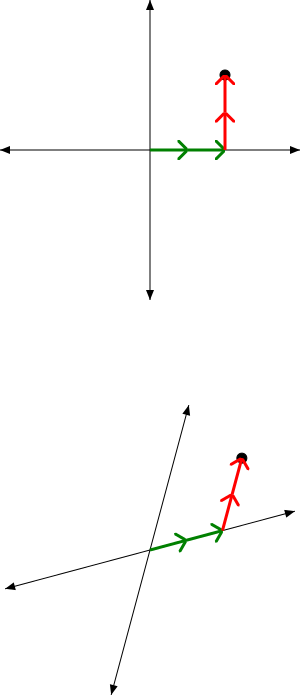

> 两个 2D 坐标系

这是两个不同的坐标系。同一个坐标，在这里是 (2, 2)（每个基向量都加了两遍），从一个中立观察者的视角看，可以对应两个非常不同的位置。有意思的是，在各自的坐标系中，(2, 2) 是同一个值。这意味着，仅凭坐标本身不足以知道它意味着什么；在知道它处于哪个坐标系之前，你对它的含义还一无所知。

坐标系方程的数值形式如下：

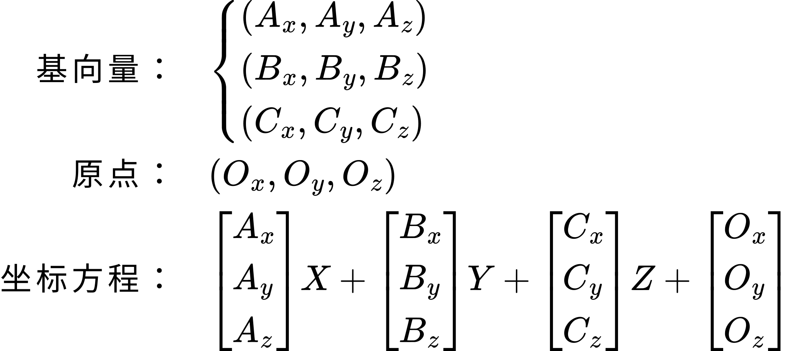

> 坐标系

在处理几何意义上的基向量和原点时，几何形式当然没问题。原点只是一个位置，基向量也只是画出来的。但在数值形式中，给这些概念赋予实际的数字意味着什么？像原点这样的位置，本身就是一个坐标，也就是说它必须相对某个坐标系来定义。基向量也一样。

归根结底，这意味着我们无法孤立地从数值上看一个坐标系。既然坐标值离开坐标系本身就没有意义，那么一个坐标系只能用相对另一个坐标系的关系来数值化表达。

严格来说，坐标系统的几何形式也是一样的道理。几何图中基向量的长度，是相对于我们自身对长度和空间的自定标尺。归根结底，一切都是相对于某个东西而言的，我们很快就会探究这一点。

### 变换

在最近几个教程——也就是处理透视投影的那几个——中，我们一直在取一个坐标系（空间）中的位置，并把它放进另一个坐标系中。具体来说，我们把位于相机空间的物体移入裁剪空间。把一个空间中的坐标指定为另一个空间中的坐标，这个过程称为**变换**。坐标本身的含义并没有改变，改变的只是这个坐标所相对的那个坐标系。

我们已经见过好几种坐标系变换。OpenGL 自身实现了从裁剪空间到 NDC 空间的变换，以及从 NDC 到窗口空间的变换。我们的着色器实现了从相机空间到裁剪空间的变换，这是用一个矩阵做的。透视投影（以及正交投影）不过是变换的一种特殊形式。

本教程将涵盖大量不同类型的变换操作，以及如何在 OpenGL 中实现它们。

### 模型空间

开始之前，我们必须定义一种新的空间：**模型空间**。这是一个用户定义的空间，但与相机空间不同，模型空间并没有一个统一的定义。它更像个统称，指某个特定物体最初所在的空间。缓冲对象中作为顶点属性传给顶点着色器的坐标，**事实上**就处于模型空间中。

模型空间有无穷多种多样。你打算渲染的每个物体都可以、而且通常确实有自己的模型空间，哪怕这些空间的差别只在原点位置上。物体的模型空间通常是为了方便建模者或打算使用该模型的程序员而定义的。

本教程讨论的变换操作，就是从模型空间到相机空间的变换。我们的着色器已经知道如何处理相机空间的数据；它们所缺的只是一个从模型空间变换到相机空间的方法。

## 平移

最简单的空间变换操作是平移。事实上，我们不仅以前见过这个变换，而且在所有带透视投影的教程里都用过它。回忆顶点着色器中的这一行：

```glsl
vec4 cameraPos = position + vec4(offset.x, offset.y, 0.0, 0.0);
```

这是一次**平移**变换：它用来确定初始空间的原点相对于目标空间的位置。由于空间中所有坐标都是相对该空间的原点而言的，平移要做的仅仅是给该空间中的所有坐标加上一个向量。所加的这个向量的值，就是用户希望原点相对于目标坐标系统所处的位置。

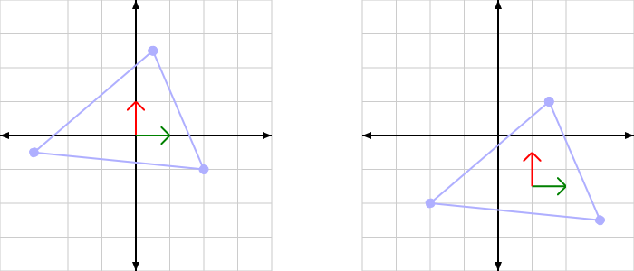

> 2D 中的坐标系平移

来看一个更具体的例子。假设有一个物体，在它的模型空间中靠近自己的原点。这意味着，如果我们想在相机前面看到它，就必须把模型的原点放到相机前面。如果模型在模型空间中的范围只有 [-1, 1]，那么只要给所有模型空间坐标加上这个向量 (0, 0, -3)，就能保证它可见。这相当于把模型的原点放到相机空间中相应的位置。

平移归根结底就是这么简单。那我们就偏偏把它搞得不必要地复杂起来。而最好的工具是：矩阵。哦，我们当然可以直接用一个 3D uniform 向量传一个偏移量来做变换。但矩阵还有一些隐藏的好处，我们很快就会探索到。

我们的所有位置向量都是 4D 向量，最后的 W 坐标恒为 1.0。在**教程 04** 中，我们在透视变换矩阵里利用了这一点。Z 坐标的方程需要一个加性项，于是我们把该项放在变换矩阵的 W 列中。矩阵乘法会让 W 列上的值乘上向量的 W 坐标（也就是 1），再加到其他各项之和上。

但我们怎么才能保证这个矩阵不去动其他各项？我们只想让这个矩阵给位置加一个偏移，并不想让它以别的方式修改位置。

做法是修改一个**单位矩阵**。所谓单位矩阵，是指在矩阵乘法中会把与它相乘的矩阵（或向量）原样返回的矩阵。它有点像普通乘法中的数字 1：1*X = X。4x4 单位矩阵长这样：

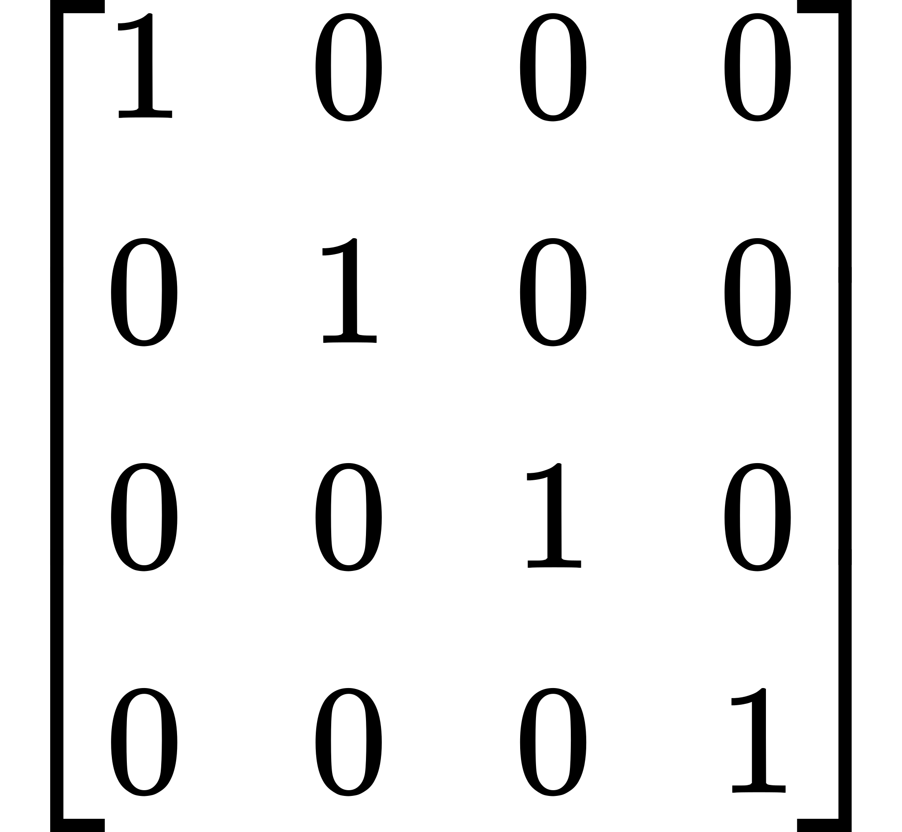

> 单位矩阵

要把单位矩阵改造成一个适合平移的矩阵，只需把偏移量放进单位矩阵的 W 列。

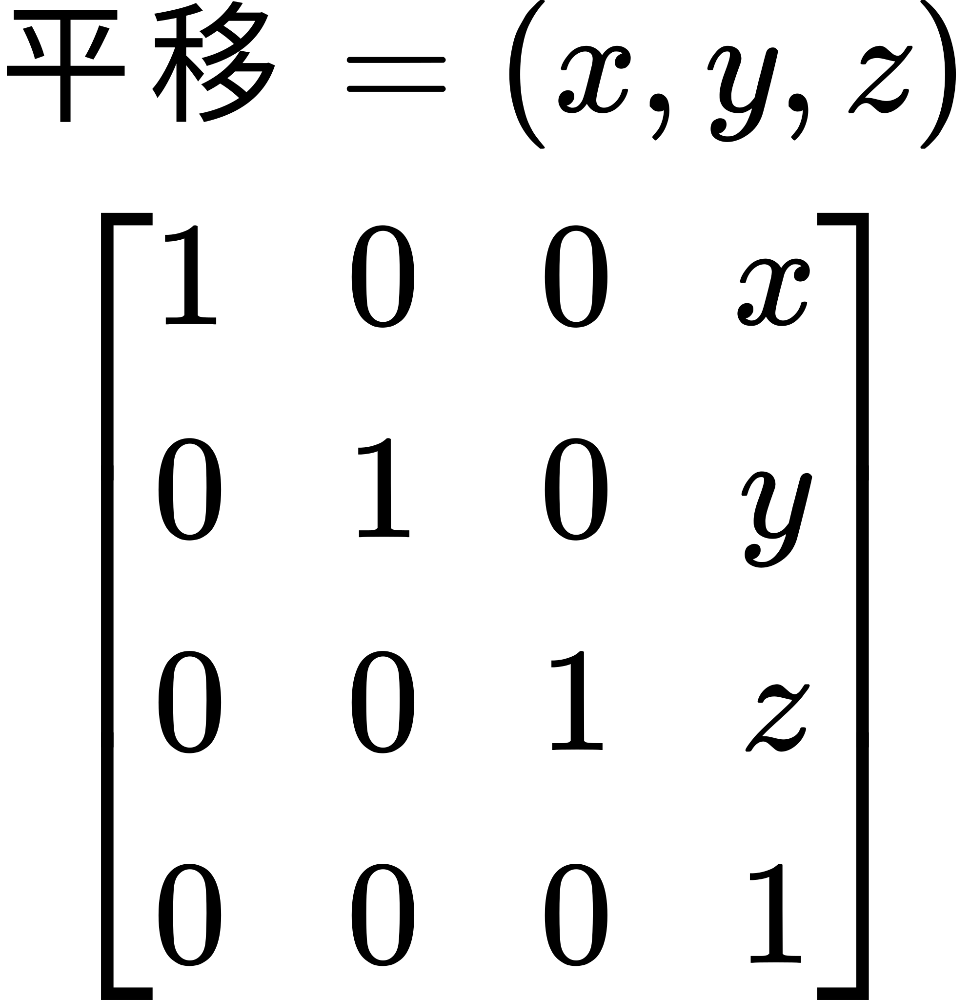

> 平移矩阵

这个标题起得很妙的教程项目 **Translation** 会执行平移操作。

本教程会渲染 3 个相同的物体，位置各不相同。其中一个位于屏幕中央，另外两个以不同的速度绕着它运动。

由于矩阵数学用得如此普遍，这是第一个使用 GLM 数学库的教程。我们来看看着色器程序的初始化代码，看看它是怎么用的。

**示例：平移着色器初始化**

```cpp
void InitializeProgram()
{
    std::vector<GLuint> shaderList;
    
    shaderList.push_back(Framework::LoadShader(GL_VERTEX_SHADER,
        "PosColorLocalTransform.vert"));
    shaderList.push_back(Framework::LoadShader(GL_FRAGMENT_SHADER,
        "ColorPassthrough.frag"));
    
    theProgram = Framework::CreateProgram(shaderList);
    
    positionAttrib = glGetAttribLocation(theProgram, "position");
    colorAttrib = glGetAttribLocation(theProgram, "color");
    
    modelToCameraMatrixUnif = glGetUniformLocation(theProgram,
        "modelToCameraMatrix");
    cameraToClipMatrixUnif = glGetUniformLocation(theProgram,
        "cameraToClipMatrix");
    
    float fzNear = 1.0f; float fzFar = 45.0f;
    
    cameraToClipMatrix[0].x = fFrustumScale;
    cameraToClipMatrix[1].y = fFrustumScale;
    cameraToClipMatrix[2].z = (fzFar + fzNear) / (fzNear - fzFar);
    cameraToClipMatrix[2].w = -1.0f;
    cameraToClipMatrix[3].z = (2 * fzFar * fzNear) / (fzNear - fzFar);
    
    glUseProgram(theProgram);
    glUniformMatrix4fv(cameraToClipMatrixUnif, 1, GL_FALSE,
        glm::value_ptr(cameraToClipMatrix));
    glUseProgram(0);
}
```

GLM 作为向量/矩阵数学库，采取了一种独特的做法。它尽可能地模仿 GLSL 处理向量运算的方式。它利用 C++ 的运算符重载来有效模拟 GLSL。在很多情况下，基于 GLM 写出的表达式放到 GLSL 里也能编译通过。

矩阵 `cameraToClipMatrix` 被定义为 `glm::mat4`，它与 GLSL 的 `mat4` 性质相同。无论 GLM 还是 GLSL 的 `mat4`，用数组下标索引得到的都是矩阵中从 0 开始的**列**，类型为 `vec4`。

`glm::value_ptr` 函数用来获取指向矩阵数据的直接指针，内存布局是列主序的。这在把数据上传给 OpenGL 时很有用，正如 `glUniformMatrix4fv` 调用中所示。

除了多获取一个 uniform 位置（用于我们的模型变换矩阵）之外，这段代码的作用与之前的教程完全一样。

有一点很重要：`fFrustumScale` 不再是 1.0。到目前为止，物体的相对大小并没有特别的意义。现在我们开始处理有特定尺寸的、更复杂的物体，为透视投影选择一个合适的视场角就非常重要了。

新的 `fFrustumScale` 由下面这段代码计算：

**示例：视锥缩放的计算**

```cpp
float CalcFrustumScale(float fFovDeg)
{
    const float degToRad = 3.14159f * 2.0f / 360.0f;
    float fFovRad = fFovDeg * degToRad;
    return 1.0f / tan(fFovRad / 2.0f);
}

const float fFrustumScale = CalcFrustumScale(45.0f);
```

`CalcFrustumScale` 函数根据以度为单位的视场角计算视锥缩放。这里的视场角是前向方向与视野最远延伸方向之间的夹角。

这个项目以及本教程中许多其他项目，都用一段相当复杂的代码来管理各个物体实例的变换矩阵。每个实际物体都有一个 `Instance` 对象；它含有一个函数指针，用来计算该物体的偏移位置。`Instance` 对象再把这个位置连同当前经过时间一起代入下面的函数，算出一个变换矩阵：

**示例：平移矩阵的生成**

```cpp
glm::mat4 ConstructMatrix(float fElapsedTime)
{
    glm::mat4 theMat(1.0f);
    
    theMat[3] = glm::vec4(CalcOffset(fElapsedTime), 1.0f);
    
    return theMat;
}
```

只接受单个值的 `glm::mat4` 构造函数构造的是所谓的**对角矩阵**。也就是除了从左上到右下的对角线上的元素之外全为 0 的矩阵。对角线上的值就是传给构造函数的那些值。单位矩阵就是对角线上值为 1 的对角矩阵。

这个函数只是把该单位矩阵的 W 列替换成偏移值。

最终效果如下：

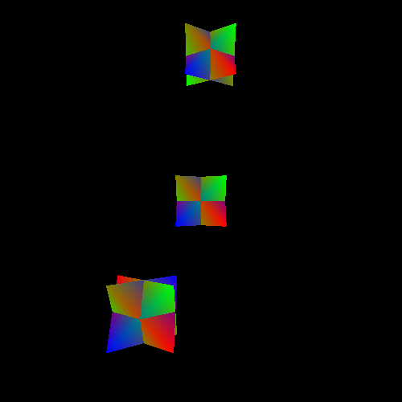

> 平移项目

## 缩放

另一种变换是**缩放**。按照我们之前对坐标系统的定义，这意味着我们的基向量变短或变长了。

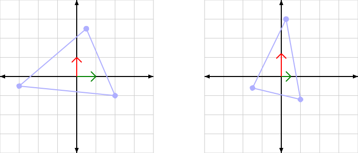

> 2D 中的坐标系缩放

缩放可以是均匀的，也就是每个基向量都乘以同一个值。非均匀缩放则意味着各个基向量可以有不同的缩放系数，或者干脆不缩放。

均匀缩放用来让模型空间中的物体可以使用与相机空间不同的单位。例如，建模者可能以英寸为单位生成了模型，而世界使用的是厘米。这就需要给所有这些模型施加一个均匀缩放来加以补偿。这个缩放系数应为 2.54，也就是从英寸到厘米的换算因子。

注意，缩放始终是相对于被缩放空间的原点进行的。

回忆一下我们是如何定义坐标系依据基向量和原点生成位置的：

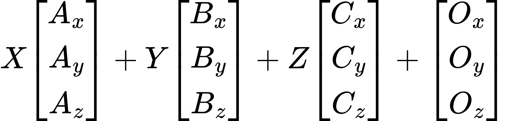

如果你要增加或减少基向量的长度，这等价于用新长度乘以这些基向量。所以我们可以把这个方程改写为：

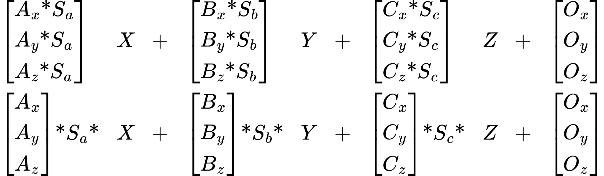

由于标量与向量的乘法既满足结合律也满足交换律，我们可以直接把缩放系数乘进坐标值里，得到同样的效果。所以缩放后的空间可以直接表达为对输入坐标值做乘法。

在 GLSL 里，如果传入一个包含缩放值的向量 uniform，这件事做起来相当简单。但这还不够复杂。显然我们需要让矩阵参与进来，可是怎么做？

就矩阵乘法的工作方式而言，这就要涉及到一些技术细节了。不过回头看看单位矩阵：


这个矩阵依次从与它相乘的向量中挑出每一个坐标。矩阵的每一行与向量的列相乘；所有的 0 把我们不想要的向量分量消掉。每一行上的 1 乘进我们想要的那个分量，于是把它挑了出来。结果就是单位变换：得到我们一开始的那个向量。

可以看到，如果那些 1 换成别的值，我们会得到原向量的一个缩放版本，具体取决于哪些 1 被改动。因此缩放变换矩阵长这样：

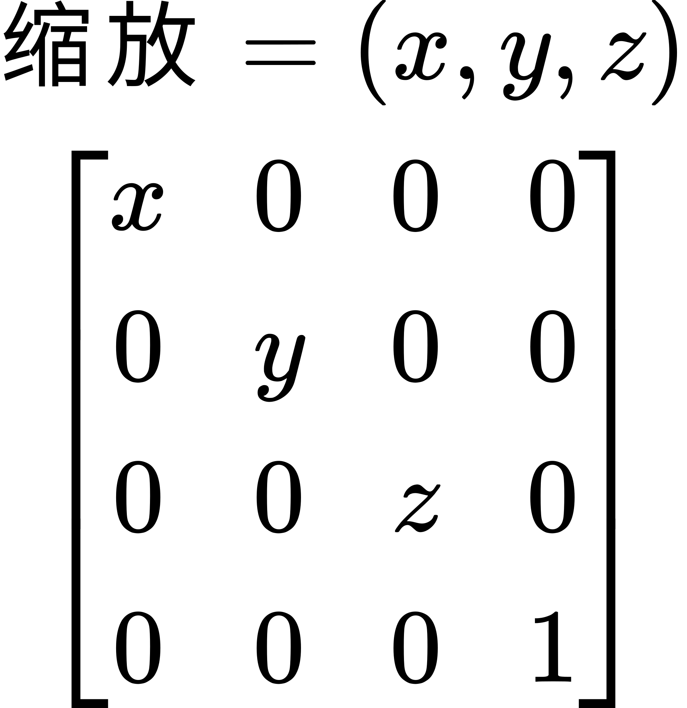

> 缩放变换矩阵

你可能已经开始看出这里浮现出的某种模式，它隐约在提示矩阵为什么非常非常有用。不过我先不揭晓答案。

教程项目 **Scale** 会以不同的缩放显示 5 个物体。所有物体到相机的 Z 距离相同，所以它们之间唯一的尺寸差别就是施加在它们身上的缩放效果。中间的物体没有缩放；其他每个物体都施加了某种缩放函数。

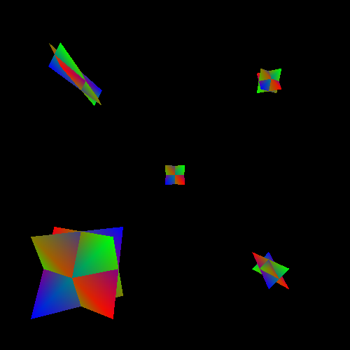

> 缩放项目

除了教程构建矩阵的方式不同，这个教程项目与上一个没有区别。构建矩阵的代码如下：

```cpp
glm::mat4 ConstructMatrix(float fElapsedTime)
{
    glm::vec3 theScale = CalcScale(fElapsedTime);
    glm::mat4 theMat(1.0f);
    theMat[0].x = theScale.x;
    theMat[1].y = theScale.y;
    theMat[2].z = theScale.z;
    theMat[3] = glm::vec4(offset, 1.0f);
    
    return theMat;
}
```

和之前一样，缩放由若干缩放函数提供，具体取决于正在渲染哪个实例。缩放被存放在单位矩阵的各列中。然后再填入矩阵的平移部分。

`offset` 变量同样是 `Instance` 的成员。与上一个教程不同，这里的偏移是一个固定值。施加多个变换会带来什么后果，我们稍后再讨论；目前只需知道这样是可行的。

缩放只比平移稍微复杂一点点。

**▌透视与缩放**

> 我们构造缩放变换矩阵的方式，你可能看着有点眼熟。在教程 4 中，透视变换涉及一个视锥缩放值。它用来弥补我们的投影为投影平面和相机眼点规定了特定位置这一事实。借助这个视锥缩放，我们可以营造出视野更大或更小的效果。事实上，后面我们还用它定义了宽高比以及视场角，用的是本教程前面定义的函数。
>
> 这个视锥缩放说到底无非是施加在 X 和 Y 位置上的一个缩放因子。构造透视矩阵时，我们把视锥缩放用作 X、Y 两个维度上的均匀缩放。宽高比的补偿代码无非是施加了一次*非*均匀缩放。

### 反转与绕序

缩放系数理论上可以是负数，甚至可以是 0。缩放为 0 会让该方向上的基向量完全变成 0。没有长度的基向量意味着某个维度实际上丢失了。得到的变换把该方向上的一切都压扁到原点上。一个 3D 空间就变成了 2D 空间（或者 1D、0D，取决于有多少条轴被缩放了）。

负缩放会改变某条轴的方向。这使得用该缩放变换的顶点沿着该轴方向翻到原点的另一侧。这称为**反转**。它可能带来一些意料之外的后果，特别是它会改变顶点的绕序。

在**教程 4** 中，我们引入了根据顶点在窗口空间中出现的顺序来剔除三角形的能力。相对于相机空间，取决于你取负的是哪条轴，反转可能把顶点预期的绕序翻过来。于是那些在模型空间中朝向正面的三角形，在相机空间中变成了背面，反之亦然。

负缩放还可能带来其他问题。这并不是说反转不能用，而是说必须谨慎使用。

## 旋转

**旋转**变换是指初始空间的朝向与目标空间的朝向不同所产生的变换。空间中的基向量彼此之间的朝向并没有改变，但相对于目标坐标系，它们的指向与在自身坐标系中不同。

旋转看起来是这样的：

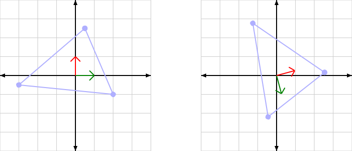

> 2D 中的坐标旋转

旋转通常被认为是基本变换中最复杂的一种，主要原因在于计算变换矩阵所涉及的数学。一般而言，旋转被看作一种操作，比如绕某条特定的基向量旋转之类。教程前面的一部分已经打下了一些基础，会让这件事简单得多。

首先，我们回头看看之前那个用来确定某个坐标相对于特定坐标空间的位置的方程：


这个是不是看着有点眼熟？还没有？那看看这个向量-矩阵乘法的写法，也许能帮你想起来：

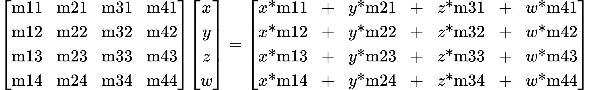

还是没想起来？换个写法也许有帮助：

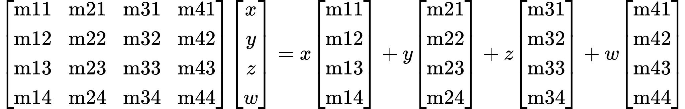

> 向量化的矩阵乘法

现在*是不是*熟悉了？

这告诉我们：变换矩阵的各列一直（*始终*）不过就是某个坐标系统的各条轴。只有第四列例外；因为输入位置的 W 是 1，它起到的是偏移量的作用。

从一个空间变换到另一个空间，归根结底意味着：取出原坐标系中的基向量和原点，并相对目标坐标系重新表达它们。从一个空间到另一个空间的变换矩阵包含了原坐标系的基向量和原点，但这些基向量和原点的*数值*是相对于目标坐标系而言的。

前面我们说过，一个空间的数值坐标必须相对另一个空间来表达。矩阵是一个坐标系统的数值表示，它的数值是在目标坐标系中表达的。因此，变换矩阵接受一个坐标系中的数值并把它们变换到另一个坐标系。它是这样做的：取输入坐标系的基向量和原点，并把它们表示为相对输出空间。换一种说法，从空间 A 到空间 B 的变换，就是站在空间 B 中的观察者所看到的空间 A 的样子。

旋转矩阵不过是一种把输入空间的基向量用不同朝向表达出来的变换。基向量的长度保持不变，原点也不变。此外，基向量之间的夹角也不会变。变的只是所有基向量的相对方向。

因此，旋转矩阵其实并不是真正的"旋转"矩阵，而是**朝向**矩阵。它定义了一个空间相对于另一个空间的朝向。记住这一点，等你开始处理更复杂的变换时，就能避开许多陷阱。

对于任意两个空间，它们之间的朝向变换都可以表达为：把源空间绕某条特定的轴（在初始空间中指定）旋转某个角度。任何朝向变化都是如此。

于是，一个常见的旋转问题就是计算绕任意轴的旋转。更准确地说，是确定一个空间绕任意轴旋转之后的朝向。旋转轴是用初始空间中的量来表达的。在 2D 中，只有一条轴既可以绕之旋转、又仍然留在该 2D 平面内：Z 轴。

在 3D 中，旋转轴有很多可能。它不必是初始空间的某条基轴，可以是任意方向。当然，如果只绕主轴旋转，问题会简单得多。

推导这些矩阵方程超出了本教程的范围；我们直接给出即可。要绕主轴旋转，使用下面这些矩阵：

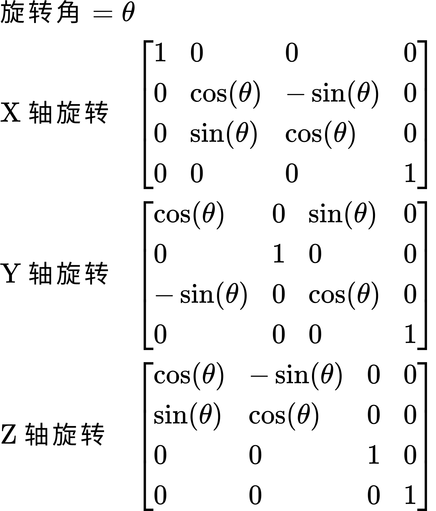

> 各轴旋转矩阵

使用标准 C/C++ 库的 `sin` 和 `cos` 函数时，角度必须用弧度。

这些矩阵固然有用，但更通用的绕任意轴旋转某个角度的方程如下。

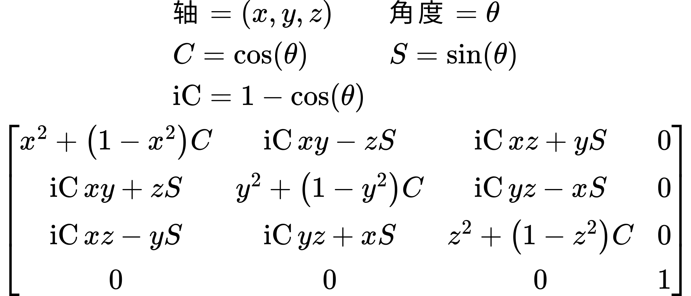

> 角度/轴旋转矩阵

所有这些矩阵都满足：从一个沿旋转轴方向观察的观察者的视角看（轴的正方向指向观察者的眼睛），正角度对应物体逆时针旋转。

**Rotations** 教程会展示上面每一个旋转矩阵函数。和其他例子一样，它根据函数渲染多个实例。

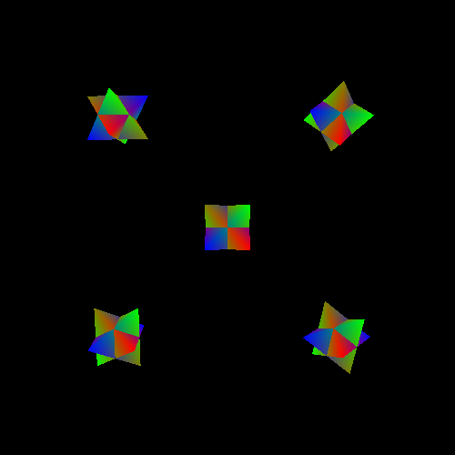

> 旋转项目

构建变换矩阵的函数如下：

**示例：构建旋转变换**

```cpp
glm::mat4 ConstructMatrix(float fElapsedTime)
{
    const glm::mat3 &rotMatrix = CalcRotation(fElapsedTime);
    glm::mat4 theMat(rotMatrix);
    theMat[3] = glm::vec4(offset, 1.0f);
    
    return theMat;
}
```

接受 glm::mat3 的 glm::mat4 构造函数会生成一个 4x4 矩阵：3x3 矩阵放在左上角，其余位置都是 0，只有左下角被设为 1。和 GLM 的大部分特性一样，这在 GLSL 中同样有效。

## 矩阵的乐趣

在前面除平移之外的所有例子中，我们总是把变换和平移操作结合在一起。所以那个缩放变换并不是纯粹的缩放变换，而是一个缩放加平移的变换矩阵。之所以加上平移，主要是为了让我们能把所有东西都看清楚。

但可以进行的变换组合远不止这些。事实上，任意变换操作的组合都是可能的；它们是否有意义、是否有用，取决于你在做什么。

连续进行的变换可以看作一系列连续的乘法运算。例如，如果 S 是纯缩放矩阵、T 是纯平移矩阵、R 是纯旋转矩阵，那么着色器可以这样计算变换结果：

```glsl
vec4 temp;
temp = T * position;
temp = R * temp;
temp = S * temp;
gl_Position = cameraToClipMatrix * temp;
```

用数学术语来说，这就是下面这一串矩阵运算：`Final = C *S* R *T* position`，其中 C 是从相机空间到裁剪空间的变换矩阵。

这能用，但不太灵活：这一串变换被硬编码在着色器里。它也不够快，因为每个顶点都要做四次向量/矩阵乘法。

矩阵数学给了我们一个优化机会。矩阵乘法不满足交换律：`S *R` 与 `R* S` 并不相同。但它满足*结合律*：`(S*R) * T` 与 `S*(R * T)` 相同。顶点变换常用的分组方式是：`Final = C*(S * (R*(T * position)))`。但它很容易被重新组合成：`Final = (((C*S) * R)*T)* position`。

事实上这对着色器来说更慢，因为完整的矩阵与矩阵乘法比矩阵与向量乘法慢得多。但合并后的矩阵 `(((C *S)* R) *T)` 对某个给定物体的所有顶点都是*固定*的。它可以在 CPU 上算好，而我们只需要向 OpenGL 上传一个矩阵。而且既然我们本来就在为每个渲染的物体上传一个矩阵，这对渲染整体的性能特征（对图形硬件而言）没有任何改变。

*这*就是使用矩阵的主要原因之一。你可以搭出一条由几十个变换组合而成的极其复杂的变换序列，然而 GPU 要用它来变换位置，只需要一次向量/矩阵乘法。

### 变换的顺序

前面说过，矩阵乘法不满足交换律。这意味着组合变换 `S *T` 与 `T* S` 并不相同。让我们再深入看看。这两个复合变换矩阵长这样：

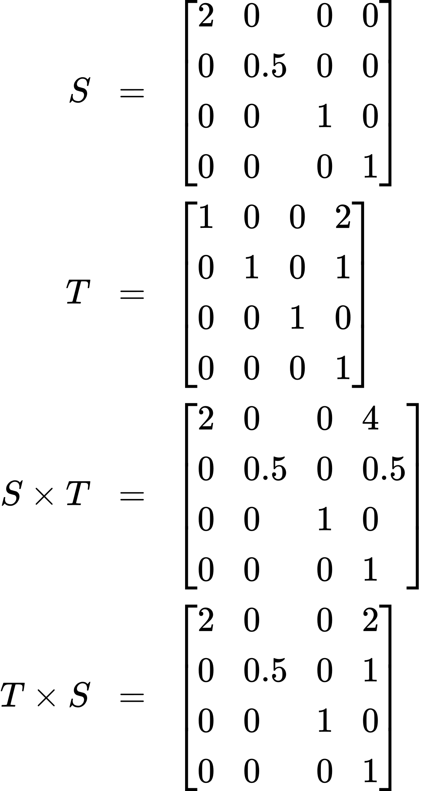

> 变换的顺序

变换 `S *T` 实际上是对结果矩阵的平移部分做了缩放。这意味着顶点不仅会彼此离得更远，还会离目标空间的*原点*更远。区别就在这两个变换之间：

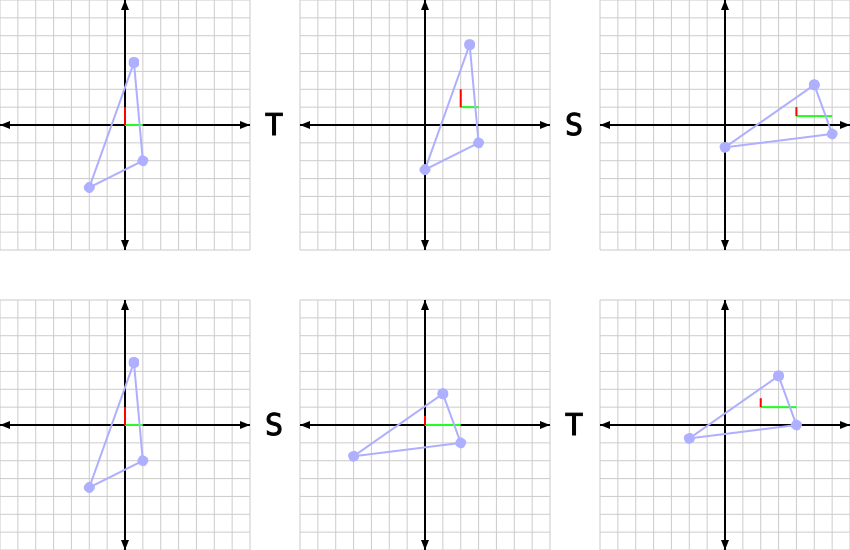

> 变换顺序示意图

从运算顺序的角度想，这就说得通了。即使可以把组合变换 `S*T` 当作一个变换来看，它归根结底还是一个复合操作。变换 T 先发生，物体被平移到新位置。

你必须理解的是，S 和 T 之间发生了一件特殊的事 Namely, S 现在作用的位置不再来自模型空间（原始顶点所在的空间），而是处于**平移后空间**之中。这是由 T 定义的一个中间坐标系统。记住：一个矩阵，哪怕只是平移矩阵，也定义了一个完整的坐标系统。

于是 S 现在作用于顶点在 T 空间中的位置。T 空间有一个原点，在 T 空间中它是 (0, 0, 0)。然而回到模型空间中，这个原点就是矩阵 T 的平移部分。缩放变换矩阵是基于被缩放顶点所在空间的原点来执行缩放的。因此缩放矩阵 S 会让这些点远离 T 空间中的原点。而你（大概）真正想要的是让它们远离**模型空间**中的原点，所以 S 必须排在前面。

朝向（旋转）矩阵也有同样的问题。朝向总是相对于位置所在当前空间中的原点而言的。因此旋转矩阵必须排在平移矩阵之前。缩放一般来说也应该排在朝向之前；如果放在之后，缩放就会相对于*新的*轴朝向，而不是模型空间的轴朝向来进行。如果这是均匀缩放倒也无妨，但非均匀缩放就会出问题。

也有把平移矩阵放在前面的理由。如果模型空间的原点并不是你想绕之旋转或缩放的那个点，那就需要先做一次平移，让顶点处于你想从之出发变换的空间，然后再施加缩放或旋转。多次这样做，就能让你绕两个完全不同的点来缩放和旋转。

### 层级模型

在更复杂的场景中，通常希望把一个模型的变换指定为相对于另一个模型的模型空间变换。这在你希望一个物体（物体 B）捡起另一个物体（物体 A）时很有用。被捡起的物体需要跟随捡起它的那个物体的变换。所以通常最容易的做法是把物体 B 的变换指定为相对于物体 A。

一个概念上是单一模型、但由多个变换组合而成并渲染出多个物体的东西，称为**层级模型**。在这样的层级中，任何一个组成部分的最终变换，都是其父级变换的所有变换再加上它自己的模型空间变换所组成的序列。在这个变换中，各个模型与其他物体之间存在父子关系。

就本次讨论而言，层级中一个模型的完整变换称为一个**节点**。每个节点由一系列特定的变换定义，它们组合起来就得到该节点的完整变换矩阵。通常每个节点会有一个平移、一个旋转和一个缩放，不过具体变换可以完全任意。真正要紧的是完整的变换矩阵是相对于其父节点的空间，而不是相对于相机空间。

所以，如果某个节点的平移是 (3, 0, 4)，那么它就位于其父级变换原点的 X 方向 3 个单位、Z 方向 4 个单位处。节点本身并不知道也不关心父级变换究竟是什么；它只是相对于父级存储一个变换。

严格来说，节点不必拥有网格。在层级模型中，一些节点存在的目的只是为其他可见节点确定位置，这有时很有用；它们也可以充当其他用途的关键点，比如确定枪口的位置以渲染枪口火光。

**Hierarchy** 教程会渲染一个手臂的层级模型。这个教程是可交互的；节点的相对角度可以用键盘命令改变。这些角度被限制在一定范围内，一旦超出，模型就不再继续弯折。命令如下：

**层级模型教程的按键命令**

| 节点角度 | 增加/左转 | 减少/右转 |
| --- | --- | --- |
| 底座旋转 | A | D |
| 手臂抬起 | W | S |
| 肘部抬起 | R | F |
| 手腕抬起 | T | G |
| 手腕旋转 | Z | C |
| 手指张开/握拢 | Q | E |

*层级模型项目*

这个教程的结构非常有意思，展示了若干种用于实现这种渲染的重要数据结构。

`Hierarchy` 类存放我们这个节点层级的信息。它存放每个节点的相对位置，以及每个矩形的角度信息和尺寸信息。`display` 中的渲染代码只做常规的准备工作，然后调用 `Hierarchy::Draw()`，真正的工作都在那里进行。

`Draw` 函数长这样：

**示例：Hierarchy::Draw**

```cpp
void Draw()
{
    MatrixStack modelToCameraStack;
    
    glUseProgram(theProgram);
    glBindVertexArray(vao);
    
    modelToCameraStack.Translate(posBase);
    modelToCameraStack.RotateY(angBase);
    
    //Draw left base.
    {
        modelToCameraStack.Push();
        modelToCameraStack.Translate(posBaseLeft);
        modelToCameraStack.Scale(glm::vec3(1.0f, 1.0f, scaleBaseZ));
        glUniformMatrix4fv(modelToCameraMatrixUnif, 1, GL_FALSE,
            glm::value_ptr(modelToCameraStack.Top()));
        glDrawElements(GL_TRIANGLES, ARRAY_COUNT(indexData),
            GL_UNSIGNED_SHORT, 0);
        modelToCameraStack.Pop();
    }
    
    //Draw right base.
    {
        modelToCameraStack.Push();
        modelToCameraStack.Translate(posBaseRight);
        modelToCameraStack.Scale(glm::vec3(1.0f, 1.0f, scaleBaseZ));
        glUniformMatrix4fv(modelToCameraMatrixUnif, 1, GL_FALSE,
            glm::value_ptr(modelToCameraStack.Top()));
        glDrawElements(GL_TRIANGLES, ARRAY_COUNT(indexData),
            GL_UNSIGNED_SHORT, 0);
        modelToCameraStack.Pop();
    }
    
    //Draw main arm.
    DrawUpperArm(modelToCameraStack);
    
    glBindVertexArray(0);
    glUseProgram(0);
}
```

着色器程序和 VAO 绑定的代码看起来应该很熟悉，但其余大部分代码就相当陌生了。

第一行创建的 `MatrixStack` 对象也是本项目的一部分。它实现了**矩阵栈**的概念。矩阵栈是处理层级模型中各种变换的一种方法。

栈是一种特定的数据结构概念。栈存放一段受控的对象序列。但与数组、链表或其他通用数据结构不同，栈的使用者只能用到 3 个操作：push（压入）、pop（弹出）和 peek（查看）。Push 把一个值放到栈顶。Pop 移除栈顶的值，让原来的次栈顶成为当前栈顶。而 peek 只是返回当前栈顶的值。

矩阵栈基本上就是一个存放 4x4 变换矩阵的栈。矩阵栈与普通栈确实有一些区别。C++ 中有一个对象 `std::stack` 实现了栈的概念。`MatrixStack` 是对该对象的一层封装，提供了额外的矩阵栈功能。

矩阵栈有一个当前矩阵值。刚构造出来的矩阵栈中是单位矩阵。矩阵栈上有若干函数会用某个特定的变换矩阵乘以当前矩阵，结果成为新的当前矩阵。例如，`MatrixStack::RotateX` 函数会用给定角度绕 X 轴的旋转乘以当前矩阵。

`MatrixStack::Push` 函数把当前矩阵压入栈中。`MatrixStack::Pop` 函数把当前矩阵设为栈顶的值，并从栈中移除栈顶。它们的效果是：你可以保存一个矩阵，修改当前矩阵，在用完修改后的版本之后再恢复原来的那个。而且你可以按某个特定顺序存放任意多个矩阵。处理层级模型时，这极为宝贵，因为它让你可以从根节点一路遍历到叶节点，同时保留先前的变换并在需要时取回。

在 `Draw` 代码中，平移先施加到栈上，然后是根据当前角度的 X 轴旋转。注意，这里的运算顺序与我们之前说的*正好相反*。这是因为矩阵栈是以相反的顺序看待变换的。我们之前说旋转应当在平移之前施加，那是相对于*位置*而言的。也就是说，方程应当是 `T* R*v`，其中 v 是位置。我们的意思是 R 应当在 T 之前作用于 v，这意味着 R 要写在 T 的右边。

我们不是在把矩阵施加到顶点上，而是在把矩阵施加到彼此上。矩阵栈的所有函数都执行右乘；被乘到当前矩阵上的新矩阵位于右侧。矩阵栈以单位矩阵开始。要让它保存 T *R，你必须先施加 T 变换，这时当前矩阵变成 I* T。然后施加 R 变换，当前矩阵就成了 I *T* R。

必须使用右乘，因为使用矩阵栈的全部意义就在于：我们能够从层级模型的根节点出发，在从父到子的遍历过程中把每个节点的变换保存到栈中。如果矩阵栈采用左乘，这就根本做不到——我们不得不先施加子节点的变换，再施加父节点的变换。

接下来发生的事情是，通过把矩阵压栈来保留它。在这之后，向矩阵栈施加一次平移和一次缩放。栈的当前矩阵被上传到着色器程序，然后渲染一个模型。接着矩阵栈出栈，恢复原来的变换。这段代码的目的是什么？

这里体现的是这样两种变换的区别：一种需要传递给子节点的变换，另一种是为了正确摆放模型、渲染当前这个节点所必需的变换。源网格数据的模型空间与节点变换所需要的空间不一致，这种做法往往很有用。

在我们这里之所以这么做，是因为我们知道所有部件都是 3D 矩形。3D 矩形说到底就是一个施加了缩放和平移的立方体。缩放把立方体变成合适的尺寸，平移则为我们的模型空间确定原点位置。

我们本可以不使用这个额外的变换，而是真的创建大约 9 个矩形网格，每个渲染出的矩形一个。但那会占用更多缓冲对象空间，也会带来更多不必要的顶点属性变化。这样做顶点着色器一点也不会变慢，它仍然只是乘以矩阵。而那点 CPU 计算时间就是字面意义上的"很少"。

这个概念非常有用，尽管人们通常并不会把它讨论到给它一个专门名字的程度。正如我们看到的，它让模型复用变得容易，但它还有其他性质。例如，它很适合做数据压缩。可以用 16 位或 8 位来存储 [0, 1] 或 [-1, 1] 范围上的值，而不是用 32 位浮点数。只要能施加一个简单的"缩放 + 平移"变换，从这个 [-1, 1] 空间回到模型原本的空间，你就能把数据量减半（甚至更少），而对视觉质量几乎毫无影响。

代码中每一处使用额外变换的地方，都夹在 `MatrixStack::Push` 和 `MatrixStack::Pop` 之间。这就保留了节点的矩阵，以便它能在与其他节点一起渲染时被使用。

绘制底座的函数底部调用了绘制上臂的函数。那个函数和这个函数的样子类似：把模型空间矩阵施加到栈上、压栈、施加一个矩阵、渲染、出栈、再调用各个子部件的函数。所有这些函数或多或少都是这个样子。事实上，它们相似到你大概可以把这套模式抽象成一个非常通用的形式。而场景图之类的东西确实经常这么做。子部件函数与根函数的主要区别在于，根函数把整个函数体都包在一次 push/pop 里。不过既然根函数本来就要创建一个 MatrixStack，这也可以认为是等价的。

**▌矩阵栈约定**

> 矩阵栈的行为有两种可能的约定。可以由调用方负责压栈和出栈，也可以由被调方（被调用的那个函数）负责。这两种约定分别称为"调用方保存"和"被调方保存"。
>
> 在"调用方保存"约定下，它的意思是：一个接收矩阵栈的函数可以随意对当前矩阵做任何事，也可以随意地任意次 push/pop。不过被调方*不能* pop 比 push 更多的次数，尽管这是任何接收矩阵栈的函数都有的普遍要求。毕竟栈不会报告自己有多少个元素，所以你无法知道别人到底有没有 push 过东西。
>
> 在"被调方保存"约定下，它说的是：函数必须对自己想对矩阵栈做的任何改动负责。如果它想改动矩阵栈，就必须先 push，在用完这些改动之后再 pop。
>
> 被调方保存可能是更好的约定。在"调用方保存"下，接收矩阵栈的函数必须假定自己会改动它（如果它是按非 const 引用接收该对象的话），因此它不得不做一次 push/pop。而在"被调方保存"下，你只在明确需要的地方才 push/pop，也就是实际改动矩阵栈的那几行。这样代码的组织性更好。

## 本章小结

在本教程中，你学到了以下内容：

- 坐标系（空间）由 3 条基轴和一个位置定义。
- 从一个 3D 空间到另一个 3D 空间的变换可以由一个 4x4 矩阵定义，该矩阵由那 3 条基轴和位置构造而成。
- 模型空间是某个特定模型相对于相机空间所占据的坐标系。其他模型的模型空间可以依赖于另一些模型的模型空间。
- 缩放、平移和旋转变换都有各自特定的矩阵形式。
- 变换可以通过矩阵乘法组合起来。一个模型的所有变换都可以折叠进单个矩阵，顶点着色器能以固定代价执行它。因此，复杂变换在图形芯片上执行起来并不比简单变换慢。
- 连续变换的施加顺序很重要。矩阵乘法不满足交换律，物体变换同样如此。
- 连续的变换可以用来建立对象的层级结构，每个对象都依赖于其下层对象累积的变换。这通过矩阵栈来实现。

### 进一步学习

试试用给定的程序做下面这些事情。

- 在 Translation 教程中，我们有两个物体绕某个特定点旋转。这是通过在 CPU 上计算旋转后位置的偏移实现的，而不是通过使用旋转变换。把这段代码改成使用旋转变换。要确保物体在被绕着旋转时朝向不发生改变；这需要施加不止一个旋转变换。
- 把 Hierarchy 教程中手腕上两次旋转的施加顺序颠倒过来。注意这对调节手腕的能力有什么影响。
- 重新实现 Hierarchy 教程，改用一个更通用的数据结构。让每个节点都是一个结构体/类，可以作为子节点挂到另一个节点上。每个节点有一个父节点，但可以有多个子节点。整个场景就是根节点，也就是那个没有父节点的节点。各个角度值应存放在节点对象中。节点应有一个渲染函数，接收矩阵栈并渲染自己：先渲染自身，然后递归渲染它的子节点。节点还应有一种方式来定义要绘制的矩形的尺寸（世界空间中）和原点位置。
- 在泛化后的 Hierarchy 代码基础上，去掉矩阵栈，改用在 C++ 栈上创建的矩阵对象。节点的渲染函数接收对某个矩阵的 const& 引用，而不是矩阵栈的引用。

## 术语表

- **空间、坐标系**：它定义了用来指代位置的坐标究竟意味着什么。坐标系具有维数（坐标的个数）、每个维数一条基向量，以及一个原点位置。因此一个 3 维坐标系由 3 个向量和一个位置定义。该坐标系中的 X、Y、Z 坐标，指的是把 X、Y、Z 值分别乘到 X、Y、Z 轴上、再加上原点位置后得到的值。
- **基向量**：定义坐标系的那些向量之一。坐标系的基向量不必彼此正交，也不必是单位长度。
- **变换**：把定义在一个空间中的物体移动到另一个空间中去定义的过程。
- **模型空间**：某个特定模型预期所处的空间。储存在缓冲对象中的顶点数据预期处于模型空间中。
- **平移变换**：两个空间之间的变换，其中两个空间的原点不在同一位置。这会导致物体在两个空间之间变换时发生位移。
- **单位矩阵**：满足下式的矩阵 I：对任意矩阵 M 都有 `MI = M `。单位矩阵只对方阵（列数与行数相同的矩阵）存在。单位矩阵是对角线上（从左上到右下）为 1、其余位置为 0 的矩阵。
- **缩放变换**：两个空间之间的变换，其中源空间的轴向量比目标空间中对应的轴向量更长或更短。这会导致物体在两个空间之间变换时沿各轴拉伸或收缩。
- **缩放反转**：用负值做缩放。这是完全允许的，不过具体效果取决于被缩放的轴，可能会改变三角形的绕序。
- **正交**：如果两个向量互相垂直，它们就是正交的。如果三个向量中每一个都与其余两个垂直，这三个向量就是正交的。
- **旋转变换、朝向变换**：两个空间之间的变换，其中两个空间的轴向量指向不同的方向，但轴向量之间的夹角保持不变。这会导致物体从初始空间变换到目标空间时发生朝向的改变。
- **层级模型**：模型在概念上可以由层级中的多个独立部件组成。该层级中每个组成部分的空间，都是相对于它在层级中的父节点存储的。
- **节点**：模型变换层级中的一个模型空间变换。该节点的变换是相对于它下方的那个节点（称为父节点）的变换存储的。节点可以有单个父节点和多个子节点；子节点的变换是相对于该节点的空间的。
