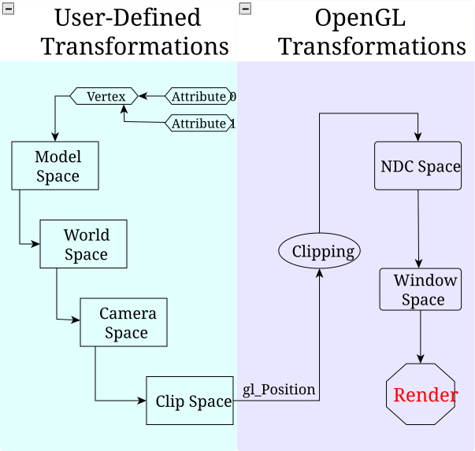
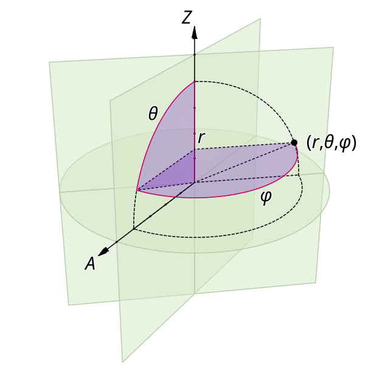
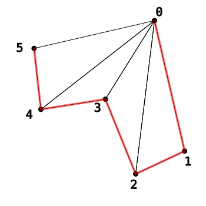
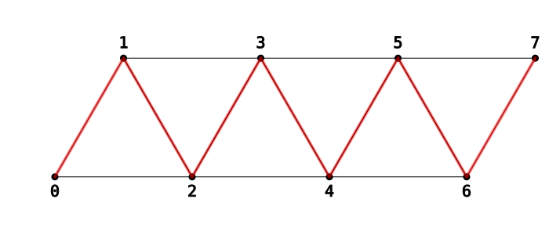
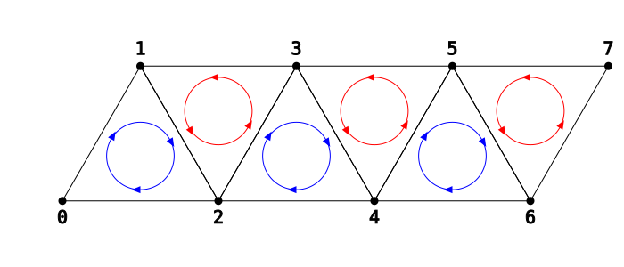
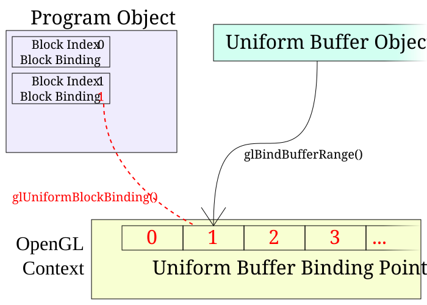

# 运动的世界

在本教程中，我们将展示如何构建一个由众多物体组成的世界，并配上一台动态移动的相机。

## 世界空间

在透视投影教程中，我们定义了一个投影矩阵，把物体从某个特定的相机空间变换到裁剪空间。之所以这样定义相机空间，主要是为了让我们的透视变换尽可能简单。相机本身固定不动，位于原点 (0, 0, 0)。相机始终沿 Z 轴方向观察，Z 值为负的物体被视为位于相机前方。

从那以后我们看过的所有教程，其模型变换都是直接做到相机空间的。这样做固然可行，但它的用处没有那么大。相机空间不是一个特别灵活的坐标空间。如果我们想要一台会移动的相机，显然就得有些东西发生变化。

我们当然可以去修改生成透视矩阵的函数，让它能够投影到任意位置、任意朝向的相机上。但那样改动就太大了；相机空间本身对我们的需求已经够用。更简单的做法是引入一个额外的变换。

### 定义世界

目前的问题在于，我们把所有物体都从各自的模型空间直接变换到相机空间。只有当物体都处于相机空间中时，它们之间才处在同一个空间里。所以我们打算在模型空间与相机空间之间引入一个中间空间，就把它叫做**世界空间**。

所有物体都会被变换到世界空间中。相机本身在世界空间中也有特定的位置和朝向。既然相机的空间是已知的，其相对于世界空间的位置和朝向也是已知的，我们就得到了一个从世界空间到相机空间的变换。这也顺便解释了相机空间为什么叫这个名字：正是在这个空间里，世界被表达为相对于相机的形式。

那么，我们该怎么定义世界空间？前面说过，模型空间是我们直接规定的：它就是顶点位置所处的空间。裁剪空间则是 OpenGL 替我们定义好的。到目前为止，唯一真正由我们选择的空间就是相机空间，而我们定义它的方式，是为了让透视投影矩阵最简单。

最后这一点给了我们一个提示。定义一个空间的，并不是变换到该空间的矩阵，而是从该空间**变换出去**的矩阵。这说得通：变换矩阵中包含的是源空间的基向量和原点，它们都用目标坐标系统表示。定义世界空间，意味着定义世界到相机的变换。

这个变换可以用一个矩阵来定义。但前面说过的一句话给了我们一个对用户更友好的机制。我们提到过，世界空间的一个性质是：相机本身在世界空间中有一个位置和朝向。这个用世界空间表达出来的位置和朝向，构成了相机到世界的变换；请注意这里的顺序：「相机到世界」。而我们要的是相反的方向：世界到相机。

位置部分相当简单。给定相机在世界空间中的位置，世界到相机矩阵的平移分量就是它的取反。这样就把世界空间中的位置转换为相对于相机位置的位置。因此，如果相机在世界空间中的位置是 (3, 15, 4)，那么世界到相机矩阵的平移分量就是 (-3, -15, -4)。

朝向部分则麻烦一些。表达朝向的方式有很多。在上一个教程中，我们把它表达成绕某条轴的旋转。但对相机来说，用更基础的东西来表达朝向要自然得多：一组方向。

用户对相机最想做的事情就是「看向某个东西」。因此，在相机空间中正好居中的方向，也就是沿 -Z 轴的方向，就是第一个方向向量。用户对相机还想做的另一件事是绕视线方向旋转相机。所以第二个方向是相机空间中的「上」方向。在相机空间中，上方向是 +Y。

我们也可以指定第三个方向，但那没必要；它可以由另外两个方向加上一个假设隐式推导出来。因为我们希望这是一个纯朝向矩阵，三个基向量必须两两垂直。因此第三个方向就是垂直于前两个方向的方向。当然，垂直于这两个向量的向量有两个：一个相对相机朝向左，另一个向右。按照惯例，我们选择向右的那个。

所以我们把相机的朝向（在世界空间中）定义为视线方向和上方向。很多时候，用视线方向来定向相机并不是最方便的做法；通常更实用的是在世界空间中选定一个点，让相机看向它。

因此，我们可以根据相机在世界中的位置、世界中的一个注视目标点，以及世界中的一个上方向，来定义相机到世界（再强调一次，注意顺序）变换。要得到世界到相机的变换，则需要费一番功夫。

作为参考，下面这张图给出了顶点位置的完整变换流程：从最初从缓冲对象读入的属性，一直到最终的窗口空间位置。



> 完整的顶点变换管线

### 鸟瞰视角

教程项目 World Space 演示了如何在世界空间场景中使用一台可移动的相机。

*世界空间场景*

本教程的控制方式如下：

**世界空间控制键**

| 功能 | 增大/左 | 减小/右 |
| --- | --- | --- |
| 上下移动相机目标点 | E | Q |
| 水平移动相机目标点 | A | D |
| 竖直移动相机目标点 | W | S |
| 绕目标点水平旋转相机 | L | J |
| 绕目标点竖直旋转相机 | I | K |
| 使相机靠近/远离目标点 | U | O |

此外，如果按住 Shift 键再按上述任意按键，受影响的控制项会变得慢得多。这便于做更精细的移动。空格键用来切换一个物体的显示，它标示出相机目标点的位置。

这个世界比我们此前见过的任何东西都复杂。被渲染的物体很多，而且其中大多数是由多个物体组合而成的。

本教程首次引入了非官方 OpenGL SDK 的一些特性。更具体地说，它使用了 GL Util 库中的 `glutil::MatrixStack` 类，它实现的矩阵栈与我们在上一个教程中看到的非常类似。主要区别在于我们不再使用显式的 push/pop 函数。要把一个矩阵压入栈中，我们改用一个栈对象 `glutil::PushStack`。它的构造函数会把矩阵压栈，析构函数会自动把它弹出。这样我们就永远不会发生栈溢出或栈下溢。[^这种利用构造函数和析构函数来完成这类受作用域限定工作的技术，称为资源获取即初始化（RAII）。它是 C++ 中一种常见的资源管理技术，在网上可以找到更多资料。如果你不熟悉它，我建议你尽快熟悉起来。]

本教程也是第一个使用框架的 mesh 类的教程：`Framework::Mesh`。它实现了从基于 XML 的文件格式加载 mesh。我们将在下一节详细讨论这个类的部分功能。眼下我们只需知道：这个类的 `Mesh::Render` 函数相当于绑定一个顶点数组对象、用一次或多次 `glDraw*` 调用进行渲染，然后解绑该 VAO。它要求上下文中已经绑定了一个合适的程序对象。

### 多个程序

说到合适的程序对象，这将是第一个使用多个程序对象的教程。现在正是提出一个重要问题的时机。

不同的程序之间不共享 uniform 位置。也就是说，如果你在一个程序对象上调用 `glGetUniformLocation`，那么在另一个程序对象上调用它并不一定返回相同的值。无论其他条件如何，都是如此。你可以声明同名、同类型、同顺序的 uniform，但 OpenGL 并不**保证**你拿到的 uniform 位置相同。它甚至不保证在同一个可执行文件的不同运行中拿到的 uniform 位置相同。

这意味着 uniform 位置是程序对象局部的。uniform 数据同样是对象局部的。例如：

**示例：窗口缩放**

```cpp
void reshape (int w, int h)
{
    glutil::MatrixStack persMatrix;
    persMatrix.Perspective(45.0f, (w / (float)h), g_fzNear, g_fzFar);
    
    glUseProgram(UniformColor.theProgram);
    glUniformMatrix4fv(UniformColor.cameraToClipMatrixUnif, 1, GL_FALSE, glm::value_ptr(persMatrix.Top()));
    glUseProgram(ObjectColor.theProgram);
    glUniformMatrix4fv(ObjectColor.cameraToClipMatrixUnif, 1, GL_FALSE, glm::value_ptr(persMatrix.Top()));
    glUseProgram(UniformColorTint.theProgram);
    glUniformMatrix4fv(UniformColorTint.cameraToClipMatrixUnif, 1, GL_FALSE, glm::value_ptr(persMatrix.Top()));
    glUseProgram(0);
    
    glViewport(0, 0, (GLsizei) w, (GLsizei) h);
    glutPostRedisplay();
}
```

这就是我们新的窗口重塑函数，用 `MatrixStack::Perspective` 函数生成正确的透视投影矩阵。注意，我们必须绑定这 3 个独立的程序，并逐个更新它们的相机到裁剪矩阵 uniform。

### 属性与程序

我们的三个程序由 2 个顶点着色器和 3 个片元着色器组成。这些着色器之间的差别，在于它们从哪里获取颜色信息。

我们创建三个程序。第一个期望有一个逐顶点颜色，并用该颜色写入片元颜色。第二个也期望有一个逐顶点颜色，并把它与一个 uniform 颜色相乘，来决定片元颜色。第三个不接受逐顶点颜色，它直接用 uniform 颜色作为片元的颜色。它们都做同样的位置变换，也就是一连串三次矩阵乘法：

**示例：仅含位置的顶点着色器**

```glsl
#version 330

layout(location = 0) in vec4 position;

uniform mat4 cameraToClipMatrix;
uniform mat4 worldToCameraMatrix;
uniform mat4 modelToWorldMatrix;

void main()
{
    vec4 temp = modelToWorldMatrix * position;
    temp = worldToCameraMatrix * temp;
    gl_Position = cameraToClipMatrix * temp;
}
```

**▌属性与程序不匹配**

> 你可能想知道，如果 VAO 提供的属性与顶点着色器的输入不匹配，会发生什么。例如，我们可以用这个仅含位置的顶点着色器去处理一个提供属性 0 和 1 的 mesh，其中 0 是位置，1 是颜色。
>
> OpenGL 在这类事情上其实非常宽容。它还花了些功夫去明确规定：出现不匹配时，顶点着色器到底会拿到什么信息。
>
> VAO 可以提供顶点着色器不使用的属性，而这不会有任何代价。嗯，读到未使用的信息可能会有性能代价，但渲染结果依然正确。
>
> 如果顶点着色器接受了 VAO 没有提供的属性，那么顶点着色器拿到的值将是向量 (0, 0, 0, 1)。如果顶点着色器的输入向量少于 4 个元素，那么它就按这个顺序逐个填充。一个未被 VAO 提供的 vec3 输入将得到 (0, 0, 0)。
>
> 说到这里，如果 VAO 提供的属性向量分量数超过了顶点着色器的预期（VAO 提供了 4 个元素，但顶点着色器的输入是 vec2），那么顶点着色器的输入会被尽可能多地填充。反过来的情况是，如果 VAO 提供的分量不够，那么未填充的值总是由 (0, 0, 0, 1) 补齐。

### 世界中的相机

主渲染函数实现了世界空间与相机的代码。它首先更新世界到相机的矩阵。

**示例：上传世界到相机矩阵**

```cpp
const glm::vec3 &camPos = ResolveCamPosition();

glutil::MatrixStack camMatrix;
camMatrix.SetMatrix(CalcLookAtMatrix(camPos, g_camTarget, glm::vec3(0.0f, 1.0f, 0.0f)));

glUseProgram(UniformColor.theProgram);
glUniformMatrix4fv(UniformColor.worldToCameraMatrixUnif, 1, GL_FALSE, glm::value_ptr(camMatrix.Top()));
glUseProgram(ObjectColor.theProgram);
glUniformMatrix4fv(ObjectColor.worldToCameraMatrixUnif, 1, GL_FALSE, glm::value_ptr(camMatrix.Top()));
glUseProgram(UniformColorTint.theProgram);
glUniformMatrix4fv(UniformColorTint.worldToCameraMatrixUnif, 1, GL_FALSE, glm::value_ptr(camMatrix.Top()));
glUseProgram(0);
```

`ResolveCamPosition` 函数根据用户输入计算出相机的位置。`CalcLookAtMatrix` 函数接受相机在世界中的位置、世界中要看向的一个点，以及一个上向量，并用它们计算世界到相机的矩阵。我们稍后会看看这个函数。

说到 `ResolveCamPosition`，让我们来看看它是怎么工作的。这套相机系统的基本思路是：存在一个可以移动的目标点。相机的位置是相对于这个目标点算出来的，因此目标点移动时，相机会完美地跟随它。

为此我们用了一个特殊的坐标系技巧。我们不在普通坐标系中存储相机的相对位置，而是改用**球坐标系**，也叫**极坐标**。

前面我们说过，一个坐标系由一组向量和一个原点定义。这是对各种可能性的一个有用简化；对于任何遵循欧氏几何规则的坐标系，这话都成立。球坐标（以及许多其他坐标）是非欧氏的。例如在欧氏几何中，任何三角形的内角和都恰好等于 180 度。球面几何或球坐标则不然。原因在于，在球面几何中看到的「直线」，相对于欧氏几何而言是曲线。

球坐标是三维的，因此它有 3 个值。第一个值通常记作「r」（表示半径），代表该坐标到坐标系中心的距离，取值范围是 [0, ∞)。第二个值叫作「φ」（phi），代表椭圆平面内的角度，取值范围是 [0, 360)。第三个值叫作「θ」（theta），代表椭圆平面之上和之下的角度，取值范围是 [0, 180]，其中 0 表示正上方，180 表示正下方。

用图示来看会清楚得多：



> 球坐标

这是一套非常方便的坐标系，适合围绕另一个物体来摆放物体，尤其是当你希望沿着相对于另一个物体的球面移动时。从球坐标变换回欧氏几何坐标的过程在 `ResolveCamPosition` 中实现。

**示例：球坐标到欧氏坐标的变换**

```cpp
glm::vec3 ResolveCamPosition()
{
    glutil::MatrixStack tempMat;
    
    float phi = Framework::DegToRad(g_sphereCamRelPos.x);
    float theta = Framework::DegToRad(g_sphereCamRelPos.y + 90.0f);
    
    float fSinTheta = sinf(theta);
    float fCosTheta = cosf(theta);
    float fCosPhi = cosf(phi);
    float fSinPhi = sinf(phi);
    
    glm::vec3 dirToCamera(fSinTheta * fCosPhi, fCosTheta, fSinTheta * fSinPhi);
    return (dirToCamera * g_sphereCamRelPos.z) + g_camTarget;
}
```

全局变量 `g_sphereCamRelPos` 存放球坐标。X 值是 φ，Y 值是 θ，Z 值是半径。

我们在球坐标中使用的 Theta 值与通常的略有不同。它的取值范围不是 [0, 180]，而是 [-90, 90]；这就是为什么在把 Theta 角换算成弧度之前要加上 90 度。

`dirToCamera` 只是一个方向向量。只有把它乘上半径（`g_sphereCamRelPos.z`），我们才得到从球坐标到欧氏坐标的完整分解。再把相机目标点作为偏移加上，就保持了相机位置相对于目标点的关系。

以上所有内容只是让我们得到了相机的位置，以及相机正在看向的位置。矩阵是这样算出来的：把这些值送入 `CalcLookAtMatrix`。它接受相机的位置、相机应当注视的世界中的一个点，以及一个世界空间中的方向——根据相机的朝向，这个方向应当被视为「上」。

这个函数的实现并不简单。我们不打算详细解释它的工作原理，因为它涉及大量尚未介绍过的复杂数学概念。使用这个函数比理解它如何工作容易得多。即便如此，这个函数（以及任何同类函数）都有一个重要的注意事项。

「上」方向不能与从相机位置指向注视目标的方向共线，这一点非常重要。如果「上」方向非常接近该方向，生成的矩阵就不再有效，一些糟糕的事情就会发生。

既然「上」方向直接位于观察者的正后方或正前方在物理上毫无意义，那么它同样会产生一个毫无意义的矩阵，也就是合情合理的。这类问题通常出现在像这里这样设计的相机系统中：相机朝向某个点并绕该点旋转，却没有同时旋转上方向。在本段代码中，上/下角度被钳制住，永远不会高到引发问题。

### 世界渲染

相机矩阵算好之后，就把它分发给各个程序。之后渲染就相当简单了。

我们为本教程加载的 mesh 都是单位尺寸的。也就是说，它们在各自的主要轴向上都是一个单位宽。它们通常也以原点为中心，位于各自的局部坐标系中。这便于把它们缩放到任意尺寸，以满足各种用途。

地面基于单位平面 mesh。它就是一个边长为 1 的正方形。渲染它的代码如下：

**示例：绘制地面**

```cpp
glutil::PushStack push(modelMatrix);

modelMatrix.Scale(glm::vec3(100.0f, 1.0f, 100.0f));

glUseProgram(UniformColor.theProgram);
glUniformMatrix4fv(UniformColor.modelToWorldMatrixUnif, 1, GL_FALSE, glm::value_ptr(modelMatrix.Top()));
glUniform4f(UniformColor.baseColorUnif, 0.302f, 0.416f, 0.0589f, 1.0f);
g_pPlaneMesh->Render();
glUseProgram(0);
```

单位平面 mesh 没有颜色属性，所以我们使用 `UniformColor` 程序。我们给模型栈施加一个缩放矩阵，把 1x1 的平面变成 100x100。设置好颜色之后，就渲染这个平面。

所有的树都是从 `DrawForest` 函数中画出来的。

**示例：DrawForest 函数**

```cpp
void DrawForest(glutil::MatrixStack &modelMatrix)
{
    for(int iTree = 0; iTree < ARRAY_COUNT(g_forest); iTree++)
    {
        const TreeData &currTree = g_forest[iTree];
        
        glutil::PushStack push(modelMatrix);
        modelMatrix.Translate(glm::vec3(currTree.fXPos, 0.0f, currTree.fZPos));
        DrawTree(modelMatrix, currTree.fTrunkHeight, currTree.fConeHeight);
    }
}
```

这个函数遍历一张很大的表，为表中的每个元素画一棵树。表中的表项决定树在世界空间中画到哪里，以及有多高。位置以平移的形式存入矩阵栈（在压栈之后），树的各属性则传给 `DrawTree` 函数去渲染。

帕特农神庙是从 `DrawParthenon` 函数中画出来的。由于这个绘制函数和 `DrawTree` 一样，都要求矩阵栈已经把它变换到自己的世界空间位置，因此我们看到的第一步就是给栈施加一个平移矩阵。

**示例：调用 DrawParthenon**

```cpp
glutil::PushStack push(modelMatrix);
modelMatrix.Translate(glm::vec3(20.0f, 0.0f, -10.0f));

DrawParthenon(modelMatrix);
```

真正的 `DrawParthenon` 函数相当简单。它用 `DrawColumn` 画出建筑周围各个位置上的所有柱子。底座和顶部用缩放过的立方体来画，建筑正面和内部则使用带颜色的立方体。柱子由缩放过的立方体和圆柱体构成。

### 非世界空间渲染

`display` 函数的最后一部分更有意思。按下 <kbd>Spacebar</kbd> 可以切换相机目标点表示物的绘制。绘制方式如下：

**示例：绘制相机目标点**

```cpp
glDisable(GL_DEPTH_TEST);
glm::mat4 idenity(1.0f);

glutil::PushStack push(modelMatrix);

glm::vec3 cameraAimVec = g_camTarget - camPos;
modelMatrix.Translate(0.0f, 0.0, -glm::length(cameraAimVec));
modelMatrix.Scale(1.0f, 1.0f, 1.0f);

glUseProgram(ObjectColor.theProgram);
glUniformMatrix4fv(ObjectColor.modelToWorldMatrixUnif, 1, GL_FALSE,
    glm::value_ptr(modelMatrix.Top()));
glUniformMatrix4fv(ObjectColor.worldToCameraMatrixUnif, 1, GL_FALSE,
    glm::value_ptr(idenity));
g_pCubeColorMesh->Render();
glUseProgram(0);
glEnable(GL_DEPTH_TEST);
```

首先发生的事是深度测试被关闭。这意味着无论相机目标点在哪里，它始终都能被看到。所以即使你把目标点移到建筑物或某棵树的内部，你仍然能看到它。这对这类 UI 性质的物体来说是个有用的技巧。

接下来重要的一点是，世界到相机的矩阵被设为单位矩阵。这意味着模型到世界的矩阵就起到了模型到相机矩阵的作用。我们又回到了把物体摆放在相机前方，这正是我们真正想要的。这个立方体沿 -Z 轴平移，从而被放在相机正前方。它把这个方块放到距相机与目标点相同的距离上。

在最近几个教程中，我们一直在搭建一套变换框架和层次：模型空间到世界空间，再到相机空间，最后到裁剪空间。但要记住的重要一点是：只有当这套框架做了你希望它做的事，它才对你有用。如果你需要把某个物体直接放在相机前方，那就把世界空间整个从等式中拿掉，直接处理相机空间即可。

我们甚至可以把深度测试重新打开，相机目标点依然能与世界的其余部分正确交互。它是世界的一部分，尽管看起来走的是另一条变换管线。

事实上，你完全可以用一个透视矩阵渲染场景的一部分，用另一个透视矩阵渲染另一部分。这是第一人称射击游戏中的常用手法。主世界用一个透视矩阵渲染，第一人称角色中可见的那部分则用另一个矩阵渲染。

不要过于执着于「事情应该怎么做」，以致忘了如果挣脱这套框架，你原本还能怎么做。永远不要把某一种做法攥得太紧，以至于挡住了你看见用更容易的方式完成某件难事的方法。例如，我们本来可以把相机矩阵的反向变换施加到模型到世界的矩阵上。或者我们干脆把那个矩阵去掉，一切都会变得非常容易、非常简单。

## 图元绘制

我们略过了 `Mesh::Render` 函数以及 mesh 加载的工作原理。现在来补上这一部分。

基于 XML 的 mesh 文件定义了若干个顶点属性数组，后面跟着一系列渲染命令。这个格式完整支持 OpenGL 的所有特性，包括此前没有讨论过的一些选项。其中有一个选项关系到 OpenGL 如何解读顶点数据。

`glDraw*` 命令，无论是使用索引渲染还是数组渲染，都会建立一条**顶点流**。顶点流是一个有序的顶点列表，每个顶点都有一组特定的顶点属性。顶点流会被顶点着色器按顺序处理。

在数组渲染中，顺序由属性数组中顶点的顺序决定。在索引渲染中，顺序由索引的顺序决定。

顶点流被顶点着色器处理之后，必须由 OpenGL 解读成有意义的东西。每个 `glDraw*` 命令的第一个参数都是一个值，它告诉 OpenGL 该如何解读这条顶点流。到目前为止，我们一直使用 `GL_TRIANGLES`，但可选值还有很多。这个参数叫做**渲染模式**，也叫**图元**。

这个参数实际上决定了两件事。它决定的第一件事是顶点流所指的对象是什么种类，这就是**图元类型**。除了三角形，OpenGL 还能渲染点和线。这些都是不同的图元类型。

这个参数决定的另一件事是，针对该图元类型该如何解读顶点流，这就是**图元表示**。`GL_TRIANGLES` 的含义不止于图元类型是三角形。

`GL_TRIANGLES` 的含义是：一条顶点流将按如下方式生成三角形：(0, 1, 2)、(3, 4, 5)、(6, 7, 8)、……。这些数字表示顶点流中的顶点，而不是索引渲染中的索引。除此之外还意味着，顶点流的长度必须是 3 的倍数。对于流中的 N 个顶点，这种表示会生成 N / 3 个三角形。

另外还有两种三角形的图元表示。圆柱 mesh 中同时用到了这两种，我们来看看。

**示例：圆柱网格文件**

```xml
<indices cmd="tri-fan" type="ushort" >0 1 3 5 7 9 11 ...</indices>
<indices cmd="tri-fan" type="ushort" >61 60 58 56 54 ...</indices>
<indices cmd="tri-strip" type="ushort" >1 2 3 4 5 6 7 8 ...</indices>
```

每个 "indices" 元素都对应一次 `glDrawElements` 调用，使用给定的索引数组。"cmd" 属性决定传给 `glDrawElements` 的图元。值 "triangles" 表示使用 `GL_TRIANGLES` 图元。

上面用到的 "tri-fan" 表示使用 `GL_TRIANGLE_FAN` 图元。这个图元的图元类型是三角形，因此这条顶点流会生成三角形，但它采用的是另一种表示方式。`GL_TRIANGLES` 把每一组独立的 3 个顶点当作一个三角形。`GL_TRIANGLE_FAN` 则取第一个顶点并一直保留它。然后对每一对相邻顶点，用这两个顶点加上最初的那个顶点构成一个三角形。所以 `GL_TRIANGLE_FAN` 会按如下方式生成三角形：(0, 1, 2)、(0, 2, 3)、(0, 3, 4)、……。从视觉上看，三角形扇是这样的：



> 三角形扇

这些数字表示各顶点在顶点流中的先后次序。红线表示由顶点流直接指定的三角形边。所有其他边都由图元表示自动生成。

这就是它被称为「扇」的原因。三角形扇顶点流中的顶点数必须大于等于 3，此外可以是任意数量。对于流中的 N 个顶点，三角形扇会生成 N-2 个三角形。

圆柱 mesh 用两个扇来渲染圆柱的两个端面（「盖子」）。

圆柱 mesh 中的 "tri-strip" 表示 `GL_TRIANGLE_STRIP` 图元。正如其名，它具有三角形的图元类型。这种图元表示意味着每 3 个相邻顶点会按顺序生成一个三角形。所以条带按如下方式生成三角形：(0, 1, 2)、(1, 2, 3)、(2, 3, 4)、……。从视觉上看，三角形条带是这样的：



> 三角形条带

和三角形扇一样，顶点数必须大于等于 3，此外可以是任意数量。对于流中的 N 个顶点，三角形条带会生成 N-2 个三角形。

圆柱 mesh 用一条三角形条带来渲染圆柱的侧面。

**绕序**

三角形条带还有另一个问题。它与三角形的绕序有关。

条带中三角形的绕序是这样的：



> 带绕序的三角形条带

注意它是怎样在顺时针和逆时针之间交替的。这意味着，无论你把哪个面当作正面、剔除哪个面，总会损失掉大约一半的面。

不过 OpenGL 在这方面相当聪明。三角形条带的背面剔除方式确实不同。每隔一个三角形，也就是绕序与第一个三角形相反的那个三角形，其绕序在剔除时被视为相反方向。

因此，如果你把正面设为顺时针，并让背面剔除剔除掉背面的三角形，那么只要第一个三角形的绕序正确，一切都会完全按你的预期工作。每个偶数编号的三角形在绕序为顺时针时会被剔除，每个奇数编号的三角形在绕序为逆时针时会被剔除。

## 共享 uniform

World Space 这个示例中有几处让人烦心的地方。其中最让人痛苦的是，每当透视投影矩阵或世界到相机的矩阵发生变化时，我们都必须修改 3 个程序中的 uniform。它们用的都是同一个值；为了修改这些 uniform 却要费这么大劲，实在奇怪。

而且，3 个程序还算是比较简单的情形。遇到真实例子时，程序的数量可能相当多。

有一种办法可以在程序之间共享 uniform。做法是：我们用一个缓冲对象存放 uniform 数据，然后告诉各个程序到这个特定的缓冲对象中去找它的 uniform 数据。存放 uniform 的缓冲对象通常称为**一致性缓冲对象**。

有一点很重要：uniform 缓冲并没有任何特殊之处。你能用普通缓冲对象做的任何事情，都可以用一致性缓冲对象做。你可以把它绑定到 `GL_ARRAY_BUFFER` 并用它存放顶点数据，可以用 `GL_ELEMENT_ARRAY_BUFFER` 做索引渲染，还有很多缓冲对象能干的别的事情。当然，这并不是说你应该这么做，只是说你做得到。

示例 World with UBO 使用一致性缓冲对象来存放相机矩阵和透视矩阵。

### uniform 块

这一切要从顶点着色器是如何定义的开始讲起。

**示例：基于 UBO 的顶点着色器**

```glsl
#version 330

layout(location = 0) in vec4 position;

layout(std140) uniform GlobalMatrices
{
    mat4 cameraToClipMatrix;
    mat4 worldToCameraMatrix;
};

uniform mat4 modelToWorldMatrix;

void main()
{
    vec4 temp = modelToWorldMatrix * position;
    temp = worldToCameraMatrix * temp;
    gl_Position = cameraToClipMatrix * temp;
}
```

`GlobalMatrices` 的定义看起来像结构体定义，但它不是。它定义的是一个 **uniform 块**。uniform 块是一系列 uniform 定义，它们的数据不存放在程序对象中，而是必须来自一个 uniform 缓冲。

名字 `GlobalMatrices` 用来标识这个特定的 uniform 块。这个块有两个成员，都是 mat4 类型。uniform 块中各成员的顺序非常重要。

注意，顶点着色器中其他任何东西都不需要改动。`modelToWorldMatrix` 没有变化，而且使用 uniform 块中的成员时甚至都不需要用 `GlobalMatrices` 这个名字来限定作用域。

"layout(std140)" 这一部分修改了 uniform 块的定义。更确切地说，它指定了 **uniform 块布局**。

缓冲对象是无格式的字节数组。因此，必须有某种东西来规定着色器如何解读一致性缓冲对象的内容。OpenGL 本身对此有明确规范，但布局限定符会修改这个定义。

对于 uniform 块中每个元素的排布方式，OpenGL 的规定非常明确。浮点值就是 C++ 中 float 的表示，因此你可以直接从 `glm::vec4` 这样的对象中复制它们。

矩阵要稍微麻烦一点，因为存在列主序与行主序的问题。`glUniformMatrix*` 系列函数都带有一个参数，用来定义传给函数的矩阵数据采用什么顺序。同理，"layout" 限定符可以指定 "row-major" 或 "column-major"，它们告诉 OpenGL 矩阵在缓冲对象中是如何存储的。默认值是 "column-major"，而 GLM 正是以列主序存储矩阵的，因此我们可以用默认值。

OpenGL 没有直接规定的是 uniform 块中元素**之间**的间距。这让不同硬件可以把元素放在对它们最高效的位置上。有些着色器硬件可以把两个 `vec3` 直接相邻放置，只占用 6 个 float；另一些硬件则处理不了这样，必须把每个 `vec3` 补齐到 4 个 float。

通常来说，这意味着为了往缓冲对象中写入任何值，你都必须向程序对象查询 uniform 块中每个元素的字节偏移。

然而，使用 "std140" 布局就不必这么做了。"std140" 布局有一份由 OpenGL 亲自规定的显式布局规范。它基本上算是各种不同图形硬件之间的一个最小公分母。它的好处是，你不必向 OpenGL 查询就能确切知道布局是什么。它的代价是，在某些硬件上某些节省空间的优化可能无法实现。

"std140" 还有一项额外特性：uniform 块是可共享的。通常，OpenGL 会给 GLSL 编译器相当大的自由度去做优化。在这种情况下，如果 GLSL 编译器发现某个 uniform 在程序中未被使用，它有权把这个 uniform 标记为未使用。`glGetUniformLocation` 会返回 -1。实际上往一个值为 -1 的位置写入数据是合法的，但不会有任何数据真的被写入。

如果一个 uniform 块被标记为 "std140" 布局，那么在该块内部禁用 uniform 的能力就完全被取消了。所有 uniform 都必须有存储空间，即使某个特定程序并不使用它们。这意味着，只要你按同样的顺序在块中声明相同的 uniform，该 uniform 块的存储布局在任何程序中都会是相同的。这又意味着，多个不同的程序可以使用同一个 uniform 缓冲。

"std140" 之外的另两种选择是 "packed" 和 "shared"。默认的 "shared" 会阻止 uniform 优化，从而允许该块的 uniform 缓冲数据在多个程序之间共享。不过，用户仍然必须查询每个 uniform 存储在哪里的布局信息。"packed" 允许 uniform 优化，因此这类块根本无法在程序之间共享。

对我们的需求来说，"std140" 已经足够了。它也是任何实现的一个良好起点；按需要转到 "packed" 或 "shared"，通常只应作为优化手段。"std140" 布局的规则在 OpenGL 规范中有明确阐述。

### uniform 块索引

uniform 块内部的 uniform 没有各自的 uniform 位置。毕竟，它们在程序对象中并没有存储空间，它们的数据来自缓冲对象。

所以我们不用 `glGetUniformLocation`，而是有一个新的函数。

```cpp
data.globalUniformBlockIndex =
    glGetUniformBlockIndex(data.theProgram, "GlobalMatrices");
```

`glGetUniformBlockIndex` 函数接受一个程序对象和一个 uniform 块的名字。它返回一个用于引用该 uniform 块的 **uniform 块索引**。这类似于用 uniform 位置值引用一个 uniform，而不是直接使用它的字符串名字。

### uniform 缓冲的创建

既然程序已经有了 uniform 块，我们就需要创建一个缓冲对象来存放 uniform。

**示例：uniform 缓冲的创建**

```cpp
glGenBuffers(1, &g_GlobalMatricesUBO);
glBindBuffer(GL_UNIFORM_BUFFER, g_GlobalMatricesUBO);
glBufferData(GL_UNIFORM_BUFFER, sizeof(glm::mat4) * 2, NULL, GL_STREAM_DRAW);
glBindBuffer(GL_UNIFORM_BUFFER, 0);
```

就一切实际用途而言，这与我们创建其他缓冲对象的方式完全相同。唯一的区别是使用了 `GL_UNIFORM_BUFFER` 绑定目标。

`GL_ARRAY_BUFFER` 目标有明确的含义。当有东西绑定到该目标时，调用 `glVertexAttribPointer` 会使绑定到该目标的缓冲对象成为该函数调用所定义的那个属性的数据来源。`GL_ELEMENT_ARRAY_BUFFER` 目标也有含义：它指定索引渲染时索引从哪里来。元素数组绑定甚至会作为 VAO 数据的一部分被保存下来（回想一下，数组缓冲绑定*不会*被保存到 VAO 中）。`GL_UNIFORM_BUFFER` 则不像前两者那样有内在含义。对 OpenGL 的其他任何函数来说，有东西绑定到这个绑定点都毫无意义。当然，你可以对它调用缓冲对象函数，比如上面的 `glBufferData`。但它在渲染中没有其他任何角色可扮演。使用它的主要理由是保住那些更有用的绑定点的内容。它同时也在向阅读你代码的人传达：这块缓冲对象将用于存放 uniform 数据。

**注意**

> 这并不完全正确。从技术上讲，OpenGL 允许根据你*首次*用来绑定缓冲对象的目标，推断出一些关于你使用意图的信息。所以，我们用 `GL_UNIFORM_BUFFER` 为这块缓冲分配存储空间，实际上是在向 OpenGL 传递一些信号，而这些信号可能改变它为该缓冲分配存储的方式。
>
> 然而，OpenGL 并不*允许*据此改变任何行为。把在 `GL_UNIFORM_BUFFER` 目标上分配的缓冲当作 `GL_ARRAY_BUFFER` 或用于任何其他缓冲对象用途，依然是合法的。只是它的速度可能没你希望的那么快。

我们知道这块缓冲的大小需要容纳两个 `glm::mat4`。"std140" 布局保证了这一点。再加上 `glm::mat4` 的大小——它恰好与 GLSL 中 `mat4` 存放在 uniform 缓冲里时的大小相当。

可以保证 `reshape` 函数会在我们的 `init` 函数之后被调用。这就是为什么我们分配这块缓冲时不必填入默认矩阵。reshape 函数如下：

**示例：基于 UBO 的透视矩阵**

```cpp
void reshape (int w, int h)
{
    glutil::MatrixStack persMatrix;
    persMatrix.Perspective(45.0f, (w / (float)h), g_fzNear, g_fzFar);
    
    glBindBuffer(GL_UNIFORM_BUFFER, g_GlobalMatricesUBO);
    glBufferSubData(GL_UNIFORM_BUFFER, 0, sizeof(glm::mat4), glm::value_ptr(persMatrix.Top()));
    glBindBuffer(GL_UNIFORM_BUFFER, 0);
    
    glViewport(0, 0, (GLsizei) w, (GLsizei) h);
    glutPostRedisplay();
}
```

这个函数只是用 `glBufferSubData` 把矩阵数据上传到缓冲对象。由于我们把透视矩阵定义为 uniform 块中的第一个矩阵，所以它被上传到第 0 个字节处。

`display` 函数负责把世界到相机的矩阵上传到缓冲对象。它与之前的做法非常相似：

**示例：基于 UBO 的相机矩阵**

```cpp
const glm::vec3 &camPos = ResolveCamPosition();

glutil::MatrixStack camMatrix;
camMatrix.SetMatrix(CalcLookAtMatrix(camPos, g_camTarget, glm::vec3(0.0f, 1.0f, 0.0f)));

glBindBuffer(GL_UNIFORM_BUFFER, g_GlobalMatricesUBO);
glBufferSubData(GL_UNIFORM_BUFFER, sizeof(glm::mat4), sizeof(glm::mat4), glm::value_ptr(camMatrix.Top()));
glBindBuffer(GL_UNIFORM_BUFFER, 0);
```

世界到相机的矩阵是第二个矩阵，因此我们从上一个矩阵的末尾开始上传。

### uniform 缓冲的绑定

到目前为止，我们有了一个用来存放矩阵的一致性缓冲对象，也有一个程序，它的 uniform 块需要一块 uniform 缓冲来获取 uniform。现在最后一步，是建立程序中 uniform 块与一致性缓冲对象本身之间的关联。

你的第一个想法也许是：应该有一个类似 `glUniformBuffer` 的函数，接受一个程序、一个 uniform 块索引以及要与之关联的 uniform 缓冲。但事实并非如此；把 uniform 缓冲附加到程序的块上要复杂得多。而仔细想想，这其实是件好事。

它是这样工作的。OpenGL 上下文（实际上就是一个巨型结构体，包含渲染中用到的每一份数据）带有一个**一致性缓冲绑定点**数组。缓冲对象可以绑定到其中的每一个绑定点。对于程序中的每个 uniform 块，引用它的不是缓冲对象，而是这些一致性缓冲绑定点之一。这个引用就是一个数字索引：0、1、2 等。

下面这张图应该能讲得更清楚：



> 一致性缓冲与块绑定点

程序对象被赋予一个索引，表示上下文中的某个槽位。一致性缓冲被绑定到其中某个槽位。因此，当你用该程序渲染时，位于程序所指定槽位中的那个一致性缓冲，就是程序获取 uniform 数据的来源。

因此，要使用一致性缓冲，第一步必须告诉程序对象该去上下文的哪个绑定点找这块缓冲。这个关联由 `glUniformBlockBinding` 函数建立。

```cpp
glUniformBlockBinding(data.theProgram, data.globalUniformBlockIndex,
    g_iGlobalMatricesBindingIndex);
```

第一个参数是程序，第二个是之前查询到的 uniform 块索引，第三个是该块应当使用的 uniform 缓冲绑定点。

对每个程序做完这件事之后，还必须把一致性缓冲绑定到那个绑定点。这要用到一个新函数 `glBindBufferRange`。

```cpp
glBindBufferRange(GL_UNIFORM_BUFFER, g_iGlobalMatricesBindingIndex,
    g_GlobalMatricesUBO, 0, sizeof(glm::mat4) * 2);
```

这个函数的工作方式与 `glBindBuffer` 类似；除了把缓冲绑定到 `GL_UNIFORM_BUFFER` 目标之外，它还把缓冲绑定到指定的 uniform 缓冲绑定点。最后，它还提供了一个偏移和一个范围，也就是最后两个参数。这让你可以把 uniform 数据放在缓冲对象中的任意位置。你可以*若干个*程序中*多个* uniform 块的 uniform 数据全都放进同一个缓冲对象。范围参数就是用来标明某个块的数据从哪里开始、有多大。

这比直接把缓冲对象绑定到程序对象好在哪里，看看所有这些操作发生的位置就一目了然了。这两个函数都是初始化代码的一部分。`glUniformBlockBinding` 在创建程序之后立刻调用，`glBindBufferRange` 同样在创建缓冲对象之后立即调用。两者都不需要再改动。是的，我们会改变缓冲对象的内容，但它绑定在哪里永远不会变。

全局常量 `g_iGlobalMatricesBindingIndex` 顾名思义是全局的。按照惯例，所有程序都从这个索引获取自己的缓冲数据。凭借这个约定，如果我们想换用另一块缓冲，就不必去更新每一个需要使用该缓冲的程序。当然，对一两个程序来说，这只是个简单的操作。但真实应用中可能有数百个程序。能够建立这样一条约定，会让一致性缓冲对象比直接与程序关联时容易使用得多。

### 视点

在 World Space 示例中，我们直接在相机空间里绘制相机的注视目标，从而绕过了世界到相机的矩阵。改用一致性缓冲的话这会更麻烦，因为在同一次绘制调用中我们得把一致性缓冲的值设置两次。这并不特别难，但可能拖累性能。

另一种做法是，我们只用相机的目标位置计算出一个模型到世界的矩阵，它总能把物体放在目标点上。

**示例：使用 UBO 的视点**

```cpp
glDisable(GL_DEPTH_TEST);

glutil::PushStack push(modelMatrix);

modelMatrix.Translate(g_camTarget);
modelMatrix.Scale(1.0f, 1.0f, 1.0f);

glUseProgram(ObjectColor.theProgram);
glUniformMatrix4fv(ObjectColor.modelToWorldMatrixUnif, 1,
    GL_FALSE, glm::value_ptr(modelMatrix.Top()));
g_pCubeColorMesh->Render();
glUseProgram(0);
glEnable(GL_DEPTH_TEST);
```

不过我们得不到「物体始终朝向相机」这个漂亮效果。我们仍然关掉深度测试，好让这个物体始终可见。

## 世界空间的隐患

世界空间是相机空间与模型空间之间一个非常好用的中介。它让摆放相机之类的事情变得容易。但直接处理世界空间时，还遗留着一个问题，也就是大世界与数值精度的问题。

假设你要建模的是一片非常大的区域，而精度要求又相当精细。你的单位是英寸，精度要求是 0.25 英寸。你想覆盖的区域半径是 1000 英里，也就是 63,360,000 英寸。

再假设，这个世界的各个部分都有各自的模型空间，并通过模型到世界的变换矩阵被变换到各自合适的位置。这个世界就是由各个部分拼装起来的。这几乎在某种程度上总是成立的。

再假设，虽然你有一个很大的世界，但你并不打算在任一时刻渲染它的*全部*。你感兴趣的世界部分，是从相机看得到的部分。你也不需要观看极其遥远的物体；远平面会把距相机超过某个距离的世界剔除掉。

问题在于，一个 32 位浮点数只能保存大约 7 位有效数字。所以到了世界边缘，也就是大约 63,000,000 英寸处，你的精度最好也只有大约 ±10 英寸。这意味着比这更近的顶点位置彼此将无法区分。由于你的世界是按 0.25 英寸的精度建模的，这问题相当严重。事实上，即便只延伸到 6,000,000 英寸，也就是靠近中心十倍的地方，你仍然只有 ±1 英寸的精度，这仍然大于你所需的容差。

一种解决办法是，如果你有支持 OpenGL 4.0 或更高版本的强力硬件，就可以对矩阵和着色器值使用双精度浮点数。双精度浮点数是 64 位，能提供大约 16 位有效数字，足以在距原点 60 多英里之外还能以英寸为单位测量原子的大小。

不过这样做要牺牲大量性能。尽管硬件*能够*做双精度运算，但这样做的性能损失相当可观（取决于 GPU，可能在 25% 到 75% 甚至更多）。而且何必呢，真正的解决办法要简单得多。

我们再看看这个着色器。

```glsl
#version 330

layout(location = 0) in vec4 position;

uniform mat4 cameraToClipMatrix;
uniform mat4 worldToCameraMatrix;
uniform mat4 modelToWorldMatrix;

void main()
{
    vec4 worldPos = modelToWorldMatrix * position;
    vec4 cameraPos = worldToCameraMatrix * worldPos;
    gl_Position = cameraToClipMatrix * cameraPos;
}
```

`position` 相对靠近原点，因为模型坐标往往接近模型空间的原点。所以那里有充足的浮点精度。`cameraPos` 的值也靠近原点。记住，在相机空间中相机*就在*原点。世界到相机的矩阵只是把世界变换到相机所在的位置。而如前所述，我们感兴趣看到的那些世界部分都靠近相机。所以 `cameraPos` 中有相当多的精度可用。

而在 `gl_Position` 中，一切都在裁剪空间里，它同样是相对于相机的。虽然你可能遇到深度缓冲的精度问题，但那只会发生在远离近平面的地方。同样，因为一切都相对于相机，所以不存在精度问题。

唯一的精度问题出在 `worldPos` 上。更确切地说，出在 `modelToWorldMatrix` 中。

不管数值精度如何，想一想 `modelToWorldMatrix` 和 `worldToCameraMatrix` 必须是什么样子。从靠近原点的模型空间走向很远的世界空间，模型到世界的变换会有一个巨大的平移分量。然而，其中几乎全部都会立刻被*取反*，因为你绘制的一切都靠近相机。相机矩阵会有另一个巨大的平移分量，因为相机同样远离原点。

这意味着，如果你把两个矩阵*合并*成一个矩阵，你得到的矩阵会有一个相对较小的平移分量。这样你就不会有精度问题了。

现在，CPU 上的 32 位浮点数并不比 GPU 上的更精确。不过在 CPU 上你可以放心地做双精度运算。而且虽然它比单精度运算慢，CPU 上做的计算量并没有那么多。你不是每个顶点都做向量/矩阵乘法，而是每个*物体*做一次。既然最终的结果实际上能装进 32 位浮点的精度范围，解决办法就显而易见了。

要记住的要点是：避免把一个显式的模型到世界矩阵交给 OpenGL。相反，要生成一个直接从模型空间通往*相机*空间的矩阵。你可以在需要时用双精度计算来生成它；在把矩阵上传给 OpenGL 时，再变回单精度即可。

## 本章小结

在本教程中，你学到了以下内容：

- 世界空间是模型空间与相机空间之间的一个中间空间。所有物体都被变换到其中，而相机的位置和朝向都是相对于它来指定的。
- OpenGL 可以用不同方式把一串顶点数据当作三角形来处理。它可以把顶点当作一个三角形列表、一个三角形扇，或者一条三角形条带。每一种都有自己从顶点序列构造三角形的方式。
- uniform 数据可以存放在缓冲对象中，从而让多个程序共享同一个 uniform。修改缓冲对象的数据会自动改变各程序拿到的数据。
- 让顶点位置处在显式的世界空间中通常不是好主意。如果顶点位置离 0 足够远，这会引出数值精度问题。

### 进一步学习

可以按下面几种方式折腾这些世界空间教程：

- 在 World Space 教程中我们用到了 3 个矩阵。这需要多一次矩阵乘法，而这是逐顶点计算中的一项浪费。试着把相机矩阵折进透视变换矩阵，使得只用两个矩阵。每当某个矩阵的参数发生变化时，记得重新计算两者，并在上传合并后的世界到裁剪空间矩阵之前把它们组合起来。
- 与其把世界到相机的变换折进透视矩阵，不如把它折进模型到世界矩阵。直接把它压到与其他所有内容相同的那个栈上即可。MatrixStack::ApplyMatrix 函数可以用任意矩阵右乘当前矩阵。

### 值得关注的 OpenGL 函数

- **glGetUniformBlockIndex**：从程序中获取某个 uniform 块名字所对应的 uniform 块索引。
- **glUniformBlockBinding**：设置给定程序中某个特定 uniform 块所使用的 uniform 缓冲绑定索引。
- **glBindBufferRange**：把缓冲对象绑定到某个带索引的位置，同时把它绑定到给定的目标。与 GL_UNIFORM_BUFFER 一起使用时，它把缓冲对象绑定到某个特定的 uniform 缓冲绑定点。它还带有范围参数，可以用来有效地把缓冲对象的一部分绑定到某个带索引的位置。

## 术语表

- **世界空间**：模型空间与相机空间之间的一个中间空间。概念上，所有物体都会沿变换链被变换到这个空间中。
- **球坐标系, 极坐标**：一种三维坐标系，其中三个坐标不是由 3 个值乘以向量定义的，而是由两个角和一个半径定义。一个角指定在某个已知平面内绕某点的旋转，另一个角指定在这个平面之上和之下的旋转，而半径指定到原点的距离。球坐标不是欧氏几何。
- **欧氏几何**：一种遵循特定公理集的坐标系统。简单起见，可以把它看作「普通」的坐标系，遵循人们从一张二维纸片上预期的那种简单而显然的规则。
- **顶点流**：由 `glDraw*` 系列函数之一交给 OpenGL 的一段有序顶点序列。
- **图元, 渲染模式**：OpenGL 用来解读和渲染顶点流的机制。每个 `glDraw*` 函数都把渲染模式作为第一个参数。图元模式决定两件事：图元类型和图元表示。
- **图元类型**：OpenGL 依据顶点流绘制的那类对象。OpenGL 绘制三角形，但它也可以绘制点或其他东西。
- **图元表示**：把顶点流转换成一个或多个图元类型的方式。每种图元类型会消耗一定数量的顶点；图元表示则指明长度为 N 的流被转换成 M 个图元的方式。
- **一致性缓冲对象**：用于存放 uniform 块数据的缓冲对象。
- **uniform 块**：一组命名的 uniform 定义。这组 uniform 不存放在程序对象中，而是从一个缓冲对象中取得；该缓冲对象绑定在 OpenGL 渲染上下文的某个缓冲对象绑定点上。

  单个程序对象所能使用的 uniform 块数量是有限的。此外，每个着色器阶段也有相应的数量限制。
- **uniform 块布局**：GLSL 编译器对 uniform 块的排布方式。它决定了 uniform 块能否与其他程序共享，以及用户是否需要查询块内每个 uniform 的位置。
- **uniform 块索引**：从程序对象查询得到的一个数字，代表某个特定的 uniform 块。在其他函数中用这个数字来引用该 uniform 块。
- **一致性缓冲绑定点**：OpenGL 上下文中一组可供一致性缓冲绑定的位置。程序可以把它的 uniform 块关联到这个数组中的某一项。使用这类程序时，它会使用绑定在该位置的缓冲对象来查找该 uniform 块的数据。
