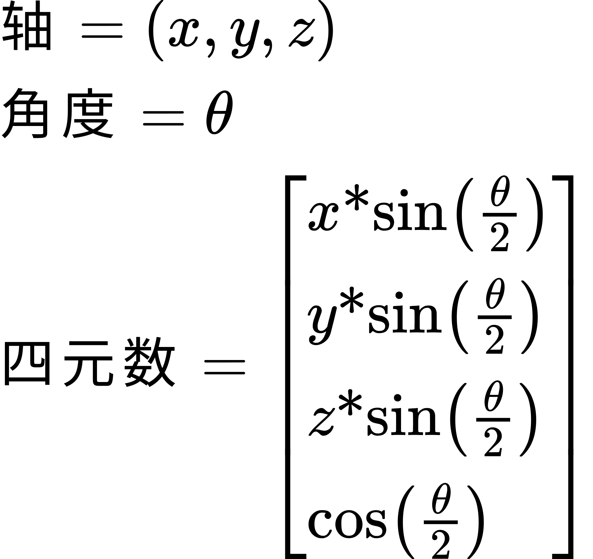
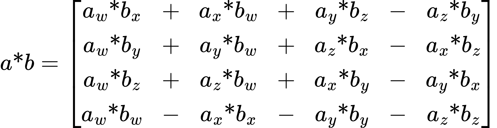
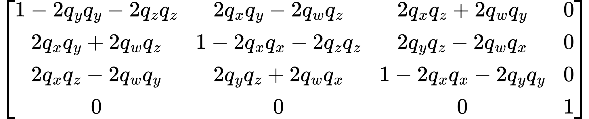
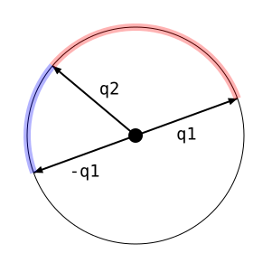

# 确定方向

在本教程中，我们将考察与确定物体朝向有关的若干具体问题。

## 万向节死锁

还记得几个教程之前我说过，旋转矩阵根本不是旋转矩阵，而是朝向矩阵吗？我还说过，忘掉这一点迟早会让你吃苦。好了，这里大概就是最常见的一种情形。

通常，当你要在 3D 空间中确定一个物体（比如一架飞机或一艘飞船）的朝向时，你会希望基于绕 3 条主轴的 3 个旋转来确定它。显而易见的做法就是用一连串 3 个旋转来实现。这意味着程序要存储 3 个角度，并基于这 3 个角度创建 3 个旋转矩阵，再把它们连接起来，从而生成一个旋转矩阵。确实，这 3 个角度往往有专门的名称，源自常见的飞行术语：偏航（yaw）、俯仰（pitch）和滚转（roll）。

俯仰是抬起或压低物体前部的旋转。偏航是让物体左右转动的旋转。滚转是让物体绕自身运动方向自转的旋转。这些术语巧妙地避开了「轴究竟是哪几条」这个问题：它们是用语义上的轴（前、左、运动方向等）来定义的，而不是针对某个特定的模型空间。所以在一个模型空间里，滚转可能是绕 X 轴的旋转，但在另一个模型空间里，它可能就是绕 Z 轴的旋转。

你会注意到的第一个问题是：应用这些旋转的顺序很重要。如前所述，旋转矩阵是一个**朝向**变换。每个变换都定义了一个新的坐标系，下一个变换是基于**新**空间中的物体来进行的。例如，如果先应用滚转，那么随后偏航所绕的轴就已经改变了。

你可以使用任意顺序，只要你理解这些角度的含义。如果先应用滚转，那么你的偏航和俯仰就必须以新的滚转坐标系来表达，而不是以原坐标系来表达。也就是说，一个本意只影响最终空间滚转的改动，可能还需要同时改动偏航或俯仰，才能让它保持相同的表观朝向（当然，除了新的滚转之外）。

但这里还潜伏着一个更加阴险的问题。这个问题在任何时候，只要你要用一连串绕相互垂直的轴的 3 个旋转来计算最终旋转时，都会发生。

教程项目 Gimbal Lock 说明了这个问题。由于该问题最初是在一种叫作 [gimbal](http://en.wikipedia.org/wiki/Gimbal) 的物理装置上诊断出来的，这个问题便得名为**万向节死锁**。

万向节（gimbal）是一种带枢轴的支架，能够绕一根轴旋转。一个万向节可以安装到另一个万向节之内。Gimbal Lock 项目有一组 3 个方形的万向节，每个万向节的枢轴都与另外两个垂直。这实际上模拟了常见的偏航/俯仰/滚转角度装置。

*万向节死锁项目*

你可以分别控制每个万向节的朝向。<kbd>W</kbd> 和 <kbd>S</kbd> 键控制最外层的万向节，<kbd>A</kbd> 和 <kbd>D</kbd> 键控制中间的万向节，<kbd>Q</kbd> 和 <kbd>E</kbd> 键控制最内层的万向节。如果你只想看清飞船的朝向（并加以控制），按下 <kbd>SpaceBar</kbd> 切换万向节环的绘制。

当你试图用这些万向节来确定飞船朝向时，首先发现的事情是：每移动一个万向节，其他万向节的偏航、俯仰和滚转控制都会随之改变。也就是说，当万向节装置处于原始位置时，最外层的万向节控制俯仰。但如果你移动了中间的万向节，它控制的就*不再只是*俯仰了。确定飞船的朝向非常不直观。

更严重的问题是，当两个万向节彼此平行时会发生什么：

*平行的万向节*

回顾一下，这三个万向节的目的是能够调整三个角度中的一个，并把物体定向到特定方向。在飞行模拟游戏中，玩家会有改变偏航、俯仰和滚转的控制装置。不过，看看这张图。

用这些万向节的控制，你能让物体上下俯仰吗？也就是让它机头相对当前位置上下移动？只能略微移动；你可以使用中间的万向节，它有一点俯仰旋转。但那点量远远不够。

我们之所以没有那么多自由度来定向物体，是因为最外层和最内层的万向节现在正绕同一根轴旋转。这意味着，为了定向那个红色万向节，你实际上只能操纵两个万向节。而 3D 朝向无法仅靠 2 个轴向旋转、仅靠 2 个万向节来完全控制。

当万向节处于这样的位置时，你就出现了所谓的**万向节死锁**：你把其中一个万向节锁死到了另一个上，于是两者产生的效果完全相同。

### 渲染

在寻找这个问题的解决办法之前，我们先回顾一下代码。其中大部分你都在别处见过，所以这部分会很快。

这个示例没有显式设置相机矩阵；对它来说这太简单了。三个万向节和上一个教程中一样，是从 mesh 文件加载的。它们被构造成适合放进上面那个数组。飞船也来自 mesh 文件。

渲染函数如下：

**示例：Gimbal Lock 的显示代码**

```cpp
void display()
{
    glClearColor(0.0f, 0.0f, 0.0f, 0.0f);
    glClearDepth(1.0f);
    glClear(GL_COLOR_BUFFER_BIT | GL_DEPTH_BUFFER_BIT);
    
    glutil::MatrixStack currMatrix;
    currMatrix.Translate(glm::vec3(0.0f, 0.0f, -200.0f));
    currMatrix.RotateX(g_angles.fAngleX);
    DrawGimbal(currMatrix, GIMBAL_X_AXIS, glm::vec4(0.4f, 0.4f, 1.0f, 1.0f));
    currMatrix.RotateY(g_angles.fAngleY);
    DrawGimbal(currMatrix, GIMBAL_Y_AXIS, glm::vec4(0.0f, 1.0f, 0.0f, 1.0f));
    currMatrix.RotateZ(g_angles.fAngleZ);
    DrawGimbal(currMatrix, GIMBAL_Z_AXIS, glm::vec4(1.0f, 0.3f, 0.3f, 1.0f));
    
    glUseProgram(theProgram);
    currMatrix.Scale(3.0, 3.0, 3.0);
    currMatrix.RotateX(-90);
    //Set the base color for this object.
    glUniform4f(baseColorUnif, 1.0, 1.0, 1.0, 1.0);
    glUniformMatrix4fv(modelToCameraMatrixUnif, 1, GL_FALSE, glm::value_ptr(currMatrix.Top()));
    
    g_pObject->Render("tint");
    
    glUseProgram(0);
    
    glutSwapBuffers();
}
```

最前面的平移实际上承担了我们相机矩阵的职责：把物体放到足够远的位置，以便舒适地看到。此后，三个万向节带着各自相应的旋转被绘制出来。由于每个旋转都作用在前一个旋转的结果上，最终的朝向由最后一个万向节决定。

`DrawGimbal` 函数自己也做了一些旋转，但这只是为了把万向节适当地摆放到那个数组中。万向节的颜色是用程序方式指定的，也就是 `DrawGimbal` 的第 3 个参数。

构建出旋转矩阵之后，我们绘制飞船。我们用一个缩放让它足够大，然后旋转它，使它相对于最后一个万向节指向正确的方向。在模型空间中，飞船朝向 +Z 轴，而万向节朝向 +Y 轴。所以我们需要一次坐标系转换。

## 四元数

那么，万向节，也就是 3 个累积的轴向旋转，在确定物体朝向上确实不太好用。万向节可能会被锁死，而且控制起来非常不直观。我们该怎么解决这些问题？

问题的一部分在于，我们试图把一个朝向存储成一串 3 个累积的轴向旋转。但朝向就是**朝向**，不是旋转。而朝向当然也不是一串旋转。所以我们需要把飞船的朝向当作朝向本身来对待，当作一个具体的量。

朝这个方向走的第一个想法，是把朝向保留为矩阵。等到需要修改朝向时，我们只要对这个矩阵施加一个变换，把结果存为新的当前朝向。

这意味着，施加到当前朝向上的每一次偏航、俯仰和滚转，都是相对于该朝向前后而言的。而这恰恰正是我们所需要的。如果用户施加一个正向偏航，你希望这个偏航是相对于他当前所指的方向来旋转他，而不是相对于某个固定的坐标系。

这个做法有几个缺点。首先，一个 4x4 矩阵比起 3 个浮点角度来说相当大。但一个困难得多的问题是，连续的浮点运算会累积误差。如果你持续累积对某个物体的一次次变换，哪怕每隔 1/30 秒做一次、持续几分钟或几小时，这些浮点误差也会开始累积。最终，这个朝向不再是纯旋转，而开始带上缩放和切变的特征。

这里的解决办法是在每次施加变换之后对矩阵重新做正交归一化。如果一个坐标系（矩阵所定义的东西）的基向量都是单位长度（没有缩放），并且每根轴都与其他所有轴垂直，就称这个坐标系是**正交归一**的。

遗憾的是，对矩阵做正交归一化并不是一个简单的操作。你可以用常见的向量归一化去归一化每根轴向量，但那并不能确保整个矩阵是正交归一的。它能消除缩放，却不能保证各根轴彼此垂直。

正交归一化当然是能做到的。但还有更好的方案，比如使用一个称为**四元数**的东西。

四元数（就我们当前的讨论而言）是一个被特殊对待的 4 维向量。从一个坐标系到另一个坐标系的任何纯朝向变化，都可以表示为绕某根轴转过某个角度。四元数就是编码这种角度/轴旋转的一种方式：



> 角度/轴到四元数

假定轴本身是单位向量，这样就会生成一个**单位四元数**，也就是长度为 1 的四元数。

四元数可以看作由两部分组成：向量部分和标量部分。按上面显示的顺序，向量部分是前 3 个分量，标量部分是最后那一个。

### 四元数运算

四元数与朝向矩阵是等价的。你可以用一种称为**四元数乘法**的特殊运算把两个朝向四元数组合起来。给定四元数 `a` 和 `b`，它们的乘积是：



> 四元数乘法

如果参与相乘的两个四元数表示的是朝向，那么它们的乘积就是一个复合的朝向。它的作用方式与矩阵乘法相同，只是仅适用于朝向。和矩阵乘法一样，四元数乘法满足结合律（`(a * b) * c = a * (b * c)`），但不满足交换律（`a * b != b * a`）。

就我们的需求而言，矩阵与四元数之间真正重要的差别是：让四元数保持归一化非常容易。每做几次乘法之后，对它做一次向量归一化就行。这让我们可以把大量微小的旋转累加起来，而不会冒出数值精度问题。

还有一件事我们必须能够做到：把四元数转换成旋转矩阵。虽然我们也可以把单位四元数转换回角度/轴旋转，但直接转换要 preferable 得多：



> 四元数到矩阵

这看起来确实与从角度/轴旋转生成矩阵的公式出奇地相似。

### 复合方式

所以我们的目标是把连续的旋转复合成一个最终的朝向。例如，当我们想增大俯仰角时，会取出当前朝向，并把一个表示几度俯仰旋转的四元数乘进去。结果就成为新的朝向。

但乘法应该做在哪一侧呢？四元数乘法不满足交换律，所以这会影响输出结果。它的作用方式与矩阵运算完全一样。

我们的位置（p）处于模型空间中，我们要把它们变换到世界空间。当前变换矩阵由朝向 O 表示。因此要变换这些点，我们使用 `O * p`。现在，我们想通过施加某个微小的俯仰变化来调整朝向 O。模型的俯仰由模型空间定义。因此，俯仰变化（R）是一个把模型空间中的坐标变换到俯仰空间的变换。于是我们的总变换是 `O * R * p`，新的朝向是 `O * R`。

### 偏航俯仰滚转

我们在 Quaternion YPR 教程中实现这一机制。该教程不显示万向节，但偏航、俯仰和滚转变换使用的是同样的控制方式。这里按下 <kbd>SpaceBar</kbd> 可以在「把 YPR 值右乘到当前朝向上」和「把它们左乘到当前朝向上」之间切换。后乘会从世界空间出发施加 YPR 变换。

*Quaternion YPR 项目*

渲染代码相当直白。

**示例：Quaternion YPR 的显示代码**

```cpp
void display()
{
    glClearColor(0.0f, 0.0f, 0.0f, 0.0f);
    glClearDepth(1.0f);
    glClear(GL_COLOR_BUFFER_BIT | GL_DEPTH_BUFFER_BIT);
    
    glutil::MatrixStack currMatrix;
    currMatrix.Translate(glm::vec3(0.0f, 0.0f, -200.0f));
    currMatrix.ApplyMatrix(glm::mat4_cast(g_orientation));
    
    glUseProgram(theProgram);
    currMatrix.Scale(3.0, 3.0, 3.0);
    currMatrix.RotateX(-90);
    //Set the base color for this object.
    glUniform4f(baseColorUnif, 1.0, 1.0, 1.0, 1.0);
    glUniformMatrix4fv(modelToCameraMatrixUnif, 1, GL_FALSE, glm::value_ptr(currMatrix.Top()));
    
    g_pShip->Render("tint");
    
    glUseProgram(0);
    
    glutSwapBuffers();
}
```

虽然 GLSL 没有四元数类型，也没有四元数运算，但 GLM 数学库两者都提供了。`g_orientation` 变量的类型是 `glm::fquat`，即一个浮点四元数。`glm::mat4_cast` 函数把四元数转换成一个 4x4 旋转矩阵。它取代了上一个教程中那一串 3 个旋转。

按键响应会修改 `g_orientation`，即对它施加一个变换。这由 `OffsetOrientation` 函数完成。

**示例：OffsetOrientation 函数**

```cpp
void OffsetOrientation(const glm::vec3 &_axis, float fAngDeg)
{
    float fAngRad = Framework::DegToRad(fAngDeg);
    
    glm::vec3 axis = glm::normalize(_axis);
    
    axis = axis * sinf(fAngRad / 2.0f);
    float scalar = cosf(fAngRad / 2.0f);
    
    glm::fquat offset(scalar, axis.x, axis.y, axis.z);
    
    if(g_bRightMultiply)
        g_orientation = g_orientation * offset;
    else
        g_orientation = offset * g_orientation;
    
    g_orientation = glm::normalize(g_orientation);
}
```

它由一个角度和一根轴生成偏移四元数。由于轴已经归一化，就没必要再对生成的 `offset` 四元数做归一化。然后把这个偏移乘进朝向，并对结果做归一化。

特别要注意右乘与左乘的区别。右乘时，偏移朝向处于模型空间中；左乘时，偏移处于**世界**空间中。两者在不同用途下都可能有用。

## 相机相对朝向

模型空间和世界空间的偏移已经很有用了，但还有一个可能值得用来定向的空间：相机空间。

这主要在建模类应用中有用，但也可以有其他用途。在这类程序中，当用户把相机转到不同角度时，用户可能希望相对视图方向来变换物体。

为了理解这个问题的解法，我们把问题明确地表述出来。我们有处于模型空间中的位置（p），这些位置会先经过当前的模型到世界朝向（O）变换，再经过最终的相机矩阵（C）变换。因此我们的变换方程是 `C * O * p`。

我们想施加一个朝向偏移（R），它作用于相机空间中的点。如果我们想把它施加到相机矩阵上，那只要直接与相机矩阵相乘即可：`R * C * O * p`。这样当然很好，但我们想施加到 O 上，而不是 C 上。

因此，我们需要用已有的变换来生成一个新的朝向偏移（N），使它产生相同的效果：

`C * N * O = R * C * O`

### 求逆

为了解决这个问题，我们需要引入一个新概念。给定一个矩阵 M，可能存在一个矩阵 N，使 `MN = I`，其中 I 是单位矩阵。如果存在这样的矩阵，那么矩阵 N 就称为 M 的**逆矩阵**。M 的逆矩阵记作 M <sup>-1</sup>。<sup>-1</sup> 这个符号并不是把矩阵求 -1 次幂的意思；它表示对矩阵求逆。

矩阵的逆可以类比为标量的乘法逆元（即倒数）。X 的标量乘法逆元是满足 `XY = 1` 的那个数 Y。

在标量求逆的情况下，求解非常容易：`Y = 1/X`。尽管容易，但确实存在一些 X 值没有乘法逆元。好了，这样的实数 X 只有*一个*：0。

逆矩阵的情况要复杂得多。就像标量求逆一样，有些矩阵没有逆。与标量的情况不同的是，没有逆的矩阵有*很多*。此外，计算逆矩阵比单纯取一个数的倒数要复杂*得多*。

最常用的变换矩阵都有逆。对于基本变换矩阵，逆矩阵非常容易计算。对于纯旋转矩阵，只要把生成它的那个角度取反，再算出一个新的旋转矩阵即可。对于平移矩阵，把矩阵中的原点值取反。对于缩放矩阵，对每根轴上的缩放取倒数。

要对一串矩阵求逆，你可以分别求出每个组成矩阵的逆。但你必须按**相反**的顺序做矩阵乘法。所以如果我们有 `M = T * R * S`，那么 `M^-1 = S^-1 * R^-1 * T^-1`。

四元数和矩阵一样，也有乘法逆元。四元数所表示的纯旋转矩阵的逆，就是绕同一根轴、角度取反的旋转。对任意角度 θ 都有 `sin(-θ) = -sin(θ)`，也有 `cos(-θ) = cos(θ)`。由于四元数的向量部分由轴乘以半角的正弦构成，标量部分是半角的余弦，所以任意四元数的逆就是把它的向量部分取反。

你也可以把这理解为：如果你把旋转轴取反，实际上就是绕原来的轴旋转、但把角度取反。事实确实如此，因为旋转轴的方向决定了旋转角度把点推向哪个方向。把轴的方向取反，你就是在往相反的方向旋转。

在四元数的行话里，逆四元数更准确的叫法是**共轭四元数**。我们用同样的逆记号「<sup>-1</sup>」来表示共轭四元数。

顺带一提，单位四元数是旋转角度为零的四元数。0 的余弦是 1，0 的正弦是 0，所以单位四元数的向量部分为零，标量部分为一。

### 解法

有了关于逆矩阵的新知识，我们就可以解决自己的问题了。

`C * N * O = R * C * O`

我们可以在方程两边同时右乘 O 的逆变换：

`(C * N * O) * O^-1 = (R * C * O) * O^-1`

`C * N * I = R * C * I`

这里的 I 是单位变换。从这里出发，我们可以在方程两边同时左乘 C 的逆变换：

`C^-1 * (C * N) = C^-1 * (R * C)`

`N = C^-1 * (R * C)`

因此，给定一个处于相机空间中的偏移，我们可以通过把它乘在相机变换与逆相机变换之间，生成它在世界空间中的等价物。

### 变换空间

事实证明，这是一个广义运算。它的用途远不止朝向变化。

以一个缩放运算为例。缩放总是沿所在空间的主轴施加的。但如果你想沿另一根轴缩放某个东西，该怎么做？

你先把物体旋转到一个坐标系中，使你想缩放的那根轴*就是*某条基轴；然后做缩放；最后用先前那次旋转的逆旋转把它转回来。

实际上，我们所做的事情，是把其他变换矩阵（而不是位置）变换到不同的空间中。变换矩阵有一个输入空间，并定义了一个输出空间。如果我们想在另一个空间中施加该变换，就要执行这个运算。

这一串运算的一般形式如下。假设你有一个变换矩阵 T，它作用于一个名为 F 的空间中的点。你有一些处于空间 P 中的位置。你想要创建一个矩阵来施加 T 的变换操作，只不过它需要作用于空间 P 中的点。给定一个把 P 空间变换到 F 空间的矩阵 M，这个矩阵就是 `M^-1 * T * M`。

### 最终朝向

我们来看看在 Camera Relative 教程中这一切是如何落实到代码里的。它与上一个教程非常相似，但有几点不同。

由于我们做的是相机相对旋转，所以需要一台能够独立于世界移动的真正相机。因此我们把世界空间教程中的相机代码也并了进来。和之前一样，<kbd>I</kbd> 和 <kbd>K</kbd> 键会相对某个中心点上下移动相机，<kbd>J</kbd> 和 <kbd>K</kbd> 键会绕中心点左右移动相机。按住 <kbd>Shift</kbd> 再按这些键，会让相机以更小的步长移动。

<kbd>SpaceBar</kbd> 可以在三种变换之间切换：模型相对（偏航/俯仰/滚转式）、世界相对和相机相对。

我们的场景还包含一个地面平面作为参照。

*Camera Relative 项目*

`display` 函数只在必要之处做了改动，以处理地面平面的绘制以及相机的处理。无论哪种情况，这里都没有你在别处没见过的内容。

实质性的改动都在 `OffsetOrientation` 函数中：

**示例：相机相对的 OffsetOrientation**

```cpp
void OffsetOrientation(const glm::vec3 &_axis, float fAngDeg)
{
    float fAngRad = Framework::DegToRad(fAngDeg);
    
    glm::vec3 axis = glm::normalize(_axis);
    
    axis = axis * sinf(fAngRad / 2.0f);
    float scalar = cosf(fAngRad / 2.0f);
    
    glm::fquat offset(scalar, axis.x, axis.y, axis.z);
    
    switch(g_iOffset)
    {
    case MODEL_RELATIVE:
        g_orientation = g_orientation * offset;
        break;
    case WORLD_RELATIVE:
        g_orientation = offset * g_orientation;
        break;
    case CAMERA_RELATIVE:
        {
            const glm::vec3 &camPos = ResolveCamPosition();
            const glm::mat4 &camMat = CalcLookAtMatrix(camPos, g_camTarget, glm::vec3(0.0f, 1.0f, 0.0f));
            
            glm::fquat viewQuat = glm::quat_cast(camMat);
            glm::fquat invViewQuat = glm::conjugate(viewQuat);
            
            const glm::fquat &worldQuat = (invViewQuat * offset * viewQuat);
            g_orientation = worldQuat * g_orientation;
        }
        break;
    }
    
    g_orientation = glm::normalize(g_orientation);
}
```

这里的变化就是新增了相机相对这个分支。要在四元数运算中做到这一点，我们必须先把世界到相机的矩阵转换成表示该朝向的四元数。这里用 `glm::quat_cast` 完成转换。

共轭四元数用 GLM 计算出来。然后我们只需把它们与偏移相乘，算出世界空间中的偏移朝向，再把它左乘进当前朝向，就完成了。

## 插值

四元数表示一个朝向；它定义了相对于另一个坐标系的坐标系。如果我们有两个朝向，就可以把它们看作同一个物体在两个坐标系中表示出来的朝向。

那么，如果我们想生成一个位于两者中间（按某种「中间」的定义）的朝向，该怎么办？更好一点，考虑在两个朝向之间做任意插值，这样我们就能看着一个物体从一个朝向移动到另一个朝向。这会让我们看到物体平滑地从一个朝向转到另一个朝向。

这是四元数能做到而矩阵做不到的又一个花招。对矩阵的分量做线性插值，得到的东西完全不像是一个中间变换。然而，对一对四元数做线性插值就可以——只要你对结果做归一化。

Interpolation 教程演示了这一点。<kbd>Q</kbd>、<kbd>W</kbd>、<kbd>E</kbd>、<kbd>R</kbd>、<kbd>T</kbd>、<kbd>Y</kbd> 和 <kbd>U</kbd> 键会让飞船插值到一个新朝向。每个键对应一个特定的朝向，其中 <kbd>Q</kbd> 键是初始朝向。

我们能看到有些过渡相当不错，比如从 <kbd>Q</kbd> 到 <kbd>W</kbd> 的过渡。但也有一些过渡看起来不那么好看，比如从 <kbd>Q</kbd> 到 <kbd>E</kbd> 的过渡。到底发生了什么？

### 长路径

单位四元数表示朝向，但它们同时也是向量方向，具体来说是四维空间中的方向。作为单位向量，它们表示半径为 1 的 4D 球面上的点。因此，两个朝向之间的路径可以看作是在 4D 球面上从一个方向移动到另一个方向。

单位四元数确实表示朝向，但四元数并不是一个朝向的*唯一*表示。也就是说，有多个四元数表示同一个朝向。嗯，有两个。

一个四元数的共轭，也就是它逆朝向的对应物，是把该四元数的向量部分取反。但如果你把全部四个分量都取反，得到的却是完全不同的东西：与之前相同的朝向。对四元数取反并不影响它的朝向。

虽然这两个四元数表示同一个朝向，但就插值而言它们并不相同。考虑一个二维的情形：



> 插值方向

如果两个四元数之间的夹角大于 90°，那么它们之间的插值就会走上两个朝向之间的「长路径」。这正是我们在 <kbd>Q</kbd> 到 <kbd>E</kbd> 的过渡中看到的。<kbd>R</kbd> 朝向是 <kbd>E</kbd> 的取反；如果你试图在它们之间插值，什么都不会变。<kbd>Q</kbd> 到 <kbd>R</kbd> 的过渡看起来就要正常得多。

这很容易检测。如果两个四元数之间的 4 维向量点积小于零，就会走长路径。如果你想避免走长路径，只要在检测到这种情况时，在插值之前把其中一个四元数取反即可。同理，如果你想强制走长路径，那么当点积大于零时把一个四元数取反，确保夹角大于 90°。

### 插值速度

还有一个问题。注意到从 <kbd>Q</kbd> 到 <kbd>E</kbd> 的插值有多快了吗？它一开始很慢，然后迅速旋转起来，接近末尾时又慢下来。这是为什么？

线性插值的代码如下：

**示例：四元数线性插值**

```cpp
glm::fquat Lerp(const glm::fquat &v0, const glm::fquat &v1, float alpha)
{
    glm::vec4 start = Vectorize(v0);
    glm::vec4 end = Vectorize(v1);
    glm::vec4 interp = glm::mix(start, end, alpha);
    interp = glm::normalize(interp);
    return glm::fquat(interp.w, interp.x, interp.y, interp.z);
}
```

**注意**

> GLM 对四元数的支持做了件不寻常的事：W 分量被作为第一个参数传给 `fquat` 构造函数。阅读代码时请注意这一点。

`Vectorize` 函数只是接受一个四元数并返回一个 `vec4`；这是必要的，因为 GLM 的 `fquat` 并不支持 GLM `vec4` 所支持的许多运算。本例中用的是 `glm::mix` 函数，它执行逐分量的线性插值。

向量的每个分量都与其余分量分开独立插值。<kbd>Q</kbd> 对应的四元数是 (0.7071f, 0.7071f, 0.0f, 0.0f)，而 <kbd>E</kbd> 对应的四元数是 (-0.4895f, -0.7892f, -0.3700f, -0.02514f)。为了让 Q 的第一个分量到达 E 的第一个分量，它不得不经过零点。

当 alpha 在 0.5 附近，也就是运动进行到一半时，归一化之前的合成向量非常小。但提供朝向的并不是这个向量本身，而是这个 4D 向量的*方向*。这就是为什么它在中间阶段移动得非常快：方向变化得很剧烈。

为了得到平滑的插值，我们需要基于向量的方向来插值。也就是说，沿着两个向量之间的角度进行插值。这种插值称为**球面线性插值**，也叫 **slerp**。

要看清这带来的差别，按下 <kbd>SpaceBar</kbd>；它能在普通线性插值和 slerp 之间切换。slerp 版本要平滑得多。

slerp 的代码相当复杂：

**示例：球面线性插值**

```cpp
glm::fquat Slerp(const glm::fquat &v0, const glm::fquat &v1, float alpha)
{
    float dot = glm::dot(v0, v1);
    
    const float DOT_THRESHOLD = 0.9995f;
    if (dot > DOT_THRESHOLD)
        return Lerp(v0, v1, alpha);
    
    glm::clamp(dot, -1.0f, 1.0f);
    float theta_0 = acosf(dot);
    float theta = theta_0*alpha;
    
    glm::fquat v2 = v1 - v0*dot;
    v2 = glm::normalize(v2);
    
    return v0*cos(theta) + v2*sin(theta);
}
```

**▌Slerp 与性能**

> 了解 slerp 究竟是为了解决什么问题、不能解决什么问题，是很重要的。被插值的两个四元数差异越大，slerp 就越重要。如果你知道两个四元数总是非常接近，那么 slerp 就不值得那份开销。
>
> 仅 slerp 代码中的 `acos` 调用一项，在性能上就相当可观。相比之下，lerp 通常只是一次向量/标量乘法，再加一次向量/向量加法。即使在 CPU 上，这个性能差距也很重要——如果每帧要做上千次的话，比如在动画系统中。

## 本章小结

在本教程中，你学到了以下内容：

- 固定的连续旋转序列会导致其他旋转无法对物体的朝向产生影响。由于先前的旋转会影响后续的旋转，这也使得难以用符合直觉的方式正确定向物体。
- 四元数是能够编码朝向的 4 维向量。它们可以用来把微小的旋转连续地施加到一个朝向上。矩阵在这里失败，是因为难以对它们做正交归一化以避免浮点误差累积。
- 就指定朝向而言，四元数的作用与矩阵几乎完全相同。它们可以直接从角度/轴旋转构造出来，也可以通过四元数乘法相互复合。
- 你可以用另一个矩阵或四元数去变换一个矩阵或四元数，使得到的变换是在另一个空间中指定的。这对于把处于相机空间中的旋转施加到物体朝向上很有用，而物体本身的朝向仍然是一个模型到世界的变换。
- 四元数可以进行插值，既可以逐分量做线性插值，也可以做球面线性插值。如果两个四元数向量之间的夹角大于 90°，那么它们之间的插值会绕道而行。

### 进一步学习

试试用下面这些方式改动这些朝向相关的教程。

- 修改 Interpolation 教程，让它支持同时激活多个动画。`Orientation` 类已经很接近能支持这一点了。它不该存储单个 `Orientation::Animation` 对象，而应该存储一个由它们组成的 `std::deque`。当外部代码加入一个新的动画时，把它压入 deque 的末尾。在更新过程中，最前面的若干项可以结束并被弹出，同时把它的目标索引记录为 `Orientation` 类中新的当前项。要获得朝向，只需依次调用每个动画的朝向函数，把上一次的结果作为下一次的输入。
- 修改 Interpolation 教程，让它能指定在两个朝向之间该走长路径还是短路径。这对线性插值和球面插值都适用。

### 延伸阅读

这一番讨论聚焦于四元数在确定物体朝向上有什么用，而它机巧地回避了四元数究竟*是什么*这个问题。毕竟，说四元数是一个四维复数，并没有解释清楚它们为什么在图形学里有用。对于喜欢古怪数学概念的人来说，这是一个相当迷人的主题。

这一番讨论还略过了四元数在图形学中的若干其他用途，比如如何用四元数直接旋转一个位置或一个方向。这类信息在网上很容易找到。

## 术语表

- **万向节死锁**：当应用 3 个或更多绕彼此正交的轴的连续旋转时，如果两个或更多轴产生了相同的实际旋转效果，导致失去一个旋转自由度，就会发生万向节死锁。
- **正交归一**：如果三个基轴彼此正交、且三根轴都是规范的（长度为 1），那么这个变换就具有正交归一的性质。
- **四元数**：表示朝向的 4 维向量。四元数的前三个分量 X、Y、Z 视为四元数的向量部分，第四个分量是标量部分。
- **逆矩阵**：矩阵 M 的逆矩阵是满足下式的矩阵 N：`MN = I`，其中 I 是单位矩阵。M 的逆通常记作 M <sup>-1</sup>。
- **共轭四元数**：与逆矩阵类似。它由把四元数的向量部分取反计算得到。
- **球面线性插值, slerp**：两个单位向量之间的插值，它基于两者之间的角度而不是向量本身做线性插值。
