# 点亮光源

总是从最简单的情形入手是最佳做法。而由于光照是个大话题，我们就从尽可能简单的场景开始。

## 光源建模

光照很复杂。非常复杂。就物理学而言，表面与光之间的相互作用已经研究得相当透彻。但真要按目前理解的方式去完整计算光照与表面的交互，代价高得令人却步。

因此，任何实时应用中的光照本质上都是对真实世界的某种近似。这种近似的精度如何，一般决定了你离**照片级真实感**有多近。照片级真实感指的是渲染出的场景与真实世界的照片难以分辨。

**注意：非真实感渲染**

> 有些光照模型并不试图模拟现实。它们统称为非真实感渲染（  NPR  ）技术。这些光照模型与渲染技术可以尝试模拟卡通风格（通常称为"卡通渲染"）、画笔效果、铅笔素描，或其他类似的东西。NPR 技术包含光照模型，但它们也做一些与光照无关的其他事情，比如用深色的墨迹颜色勾勒物体轮廓。
>
> 打造出色的 NPR 技术，其难度至少不亚于打造出色的照片级真实感光照模型。本书大部分内容都会聚焦于逼近照片级真实感。

**光照模型**是一个算法、一个数学函数，它决定表面如何与光交互。

在真实世界中，我们的眼睛靠检测射入眼内的光来看见东西。虹膜和晶状体的结构利用若干光感受器（感光细胞）来分辨一对图像。我们看到的光可以有两个来源之一。像太阳或灯这样的发光物体，可以发出被我们眼睛直接捕获的光。或者，一个表面可以反射来自其他光源、被我们眼睛捕获的光。发光物体称为**光源**。

光与表面的交互是光照模型中最重要的部分。它也是最难做对的部分。仅是光与表面上原子如何交互，就涉及难以理解的复杂量子力学原理。而这甚至还没考虑表面既非完全光滑、也非完全不透明这一事实。

事情变得更加复杂，因为光本身就不是单一的东西。世上并不存在所谓的"白光"。几乎所有的光都由若干不同波长构成。每个波长（位于可见光谱内）代表一种颜色。白光由许多波长（颜色）的光组成。彩色光中所含的波长，只是比纯白光要少。

表面对不同波长的光有着不同的交互方式。作为对这一复杂交互的简化，我们假设表面只能做两件事之一：吸收该波长的光，或者反射它。

一个表面在白光下呈现蓝色，是因为该表面吸收了光中所有非蓝色的部分，只反射蓝色的部分。如果改用红光照射该表面，表面会显得非常暗，因为该表面吸收非蓝色的光，而红光中并没有多少蓝光。

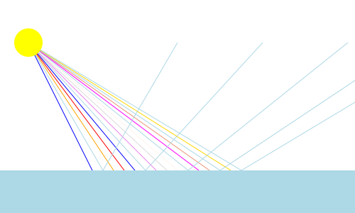

> 表面光吸收

因此，一个表面的表观颜色，是该表面吸收特性（哪些波长被吸收、哪些被反射）与照射到该表面上的光的波长共同作用的结果。

所做的第一个近似是：这些波长并非全都重要。我们不去追踪可见光谱中数百万个波长，而是只追踪 3 个：红、绿、蓝。

从表面上某一点反射回来的光的 RGB 强度，是该点处表面对 RGB 光的吸收特性与照射到该点上 RGB **光强**的组合。所有这些——反射光、光源光以及表面吸收——都可以描述为取值范围在 [0, 1] 的 RGB 颜色。

照射到表面上的光的强度取决于（至少）两件事。第一，它取决于从光源到达该表面的光强。第二，它取决于表面与光之间的夹角。

考虑一个完全平坦的表面。如果你把一束强度已知的光垂直照射到该表面上，那么表面下方每一点处的光强都是一个已知值，它由光强除以投影到表面上的面积得到。

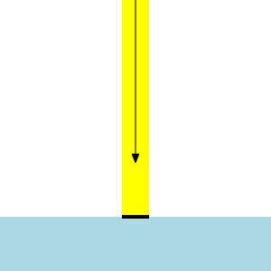

> 垂直入射的光

如果改为以一定角度照射，表面上的面积就大得多。这会把同样的光强分摊到更大的表面积上；结果就是，光下方的每一点"感受到"的光都更弱。

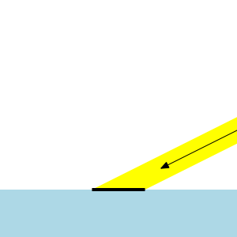

> 斜射的光

因此，照射到表面上的光强是原始光强以及表面与光源之间夹角的函数。这个夹角称为光的**入射角**。

光照模型就是所有这些参数的函数。这还远远不是一份完整的光照参数清单；在后面的讨论中，这份清单会大幅扩充。

### 标准漫反射光照

**漫反射光照**指的是一种特定的光/表面交互：来自光源的光以许多角度从表面反射出去，而不是像完美镜子那样反射。

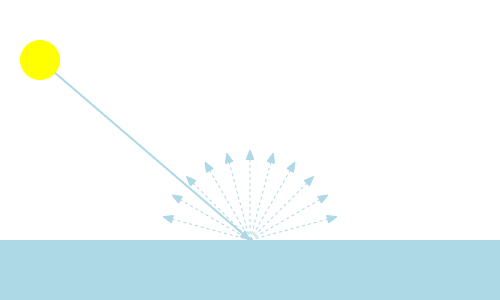

> 漫反射

理想的漫反射材质会向所有方向均匀地反射光，如上图所示。实际中没有任何表面是理想的漫反射材质，但这是一个不错的出发点，看起来也相当不错。

在本教程中，我们将使用漫反射光照的**兰伯特反射**模型。它表示的是上面展示的理想情形，即光向所有方向均匀地反射。这个光照模型的公式相当简单：

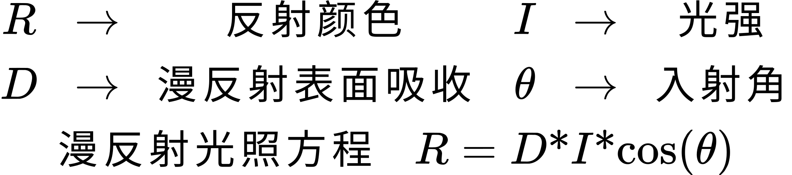

> 漫反射光照公式

之所以使用入射角的余弦，是因为它表示会被反射出去的完整光半球。当入射角为 0° 时，该角的余弦为 1.0，光照达到最亮。当入射角为 90° 时，该角的余弦为 0.0，因此光照为 0。小于 0 的值被钳制到 0。

### 表面朝向

既然我们已经知道需要计算什么，问题就变成了如何计算。具体来说，这意味着如何计算光线的入射角，但同时也意味着该在哪里执行光照计算。

由于我们的网格几何体由三角形构成，每个单独的三角形都是平的。因此，和上面的平面一样，每个三角形都朝向一个方向。这个方向称为**表面法线**或**法线**。它是表面在感兴趣位置所朝向的方向。

单个三角形表面上的每一个点都有相同的几何表面法线。对真正的三角形来说，这完全没问题。但多边形模型通常本应逼近真实的弯曲表面。如果我们把三角形实际拥有的表面法线用于该三角形上的所有点，物体就会显得棱角分明。这当然是对真实三角网格的精确呈现，但它把表面彻底暴露了：它就是弯曲表面的三角网格近似。如果我们想营造出表面确实是弯曲的错觉，就得做点别的。

我们可以不使用三角形的法线，而是为每个顶点指定它在所逼近的表面上*本来*会拥有的法线。也就是说，虽然网格是近似的，顶点的法线却是该表面的真实法线。实际效果出奇地好。

这意味着我们必须扩充顶点的信息。在之前的教程中，顶点带有位置，有时还带有颜色。在这份信息之外，我们再加上一个法线。因此我们需要一个表示法线的顶点属性。

### 哥罗着色

于是每个顶点都有了一个法线。这很有用，但还不够，理由很简单：我们并不绘制三角形的顶点；我们通过光栅化绘制三角形的内部。

计算三角形表面上光照的方式有好几种。其中最容易编码、对渲染也最高效的，是在每个顶点处执行光照计算，再让计算结果在三角形表面上插值。这个过程称为**哥罗着色**。

在使用漫反射光照模型时，哥罗着色是一个相当不错的近似。只要我们继续使用这个光照模型，它看起来通常都不错，而且在过去大约十年里被广泛使用。顶点输出的插值是一个非常快的过程，而不必为三角形生成的每个片元都计算一遍光照，能大幅提升性能。

话虽如此，现代游戏基本上已经放弃了这项技术。部分原因在于逐片元计算已经不像过去那样缓慢、那样受限。而另一个原因在于，游戏往往不再只使用漫反射光照，因此哥罗近似的误差显得更加明显。

### 平行光源

入射角是表面法线与指向光的方向之间的夹角。计算从相关点到光的方向有几种方式。

如果光源离某个物体非常近，那么指向光的方向在该物体表面上可能变化很大。随着光源被移得越来越远，指向光的方向在物体表面上的变化就越小。

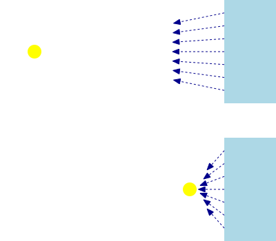

> 近处与远处的光源

如果相对于所渲染场景的尺寸而言光源足够遥远，那么对你渲染的每个物体上的每一点来说，指向光的方向几乎都是相同的。既然方向处处相同，这束光就可以表示为给所有物体的单一方向。我们不需要根据被照亮点的位置来计算这个方向。

这种情况称为**平行光源**。来自这类光源的光实际上从某个特定方向到来，像一堵强度均匀分布在整个场景上的光墙。

相对于地球上一小片区域而言，平行光源是描述太阳这类光源的好模型。但相对于太阳系的其余部分，它就不是好模型了。所以尺度很重要。

光源不一定是场景中渲染出来的物理物体。使用平行光时，我们所需的只是在我们想看到的表面进行渲染时，给光照模型提供一个方向。然而，让光看似凭空出现会损害真实感；应当尽可能避免这种情况。

平行光的替代方案我们会在稍后讨论。

### 法线与空间

法线具有许多位置所没有的性质。法线是向量方向，因此和位置向量一样，它们存在于某个坐标空间中。通常做法是让顶点的法线与这些顶点中的位置处于同一坐标空间，也就是模型空间。

这也意味着法线必须从模型空间变换到另一个空间。那个空间必须与光照方向所在的空间一致；否则这两个向量无法比较。人们可能会认为世界空间是个不错的选择。毕竟光照方向本来就是在世界空间中定义的。

你当然可以用世界空间来做光照。不过就我们的目的而言，我们会使用相机空间。原因之一是为了便于讲解：在后面的教程中，我们会在一些相当不寻常的空间里做光照。使用相机空间能让我们养成把光照方向和表面法线都变换到不同空间中的习惯。

我们会在后面的章节中更详细地讨论法线究竟该如何变换。现在，我们只要用常规的变换矩阵来变换它即可。

### 带光照的绘制

完整的漫反射光照模型——从平行光源计算漫反射，使用逐顶点法线和哥罗着色——如下所示。光源用一个方向和一个光强（颜色）来表示。传给着色器的光照方向预期已经处于相机空间中，因此着色器不负责这次变换。对每个顶点（除位置变换之外），我们：

1. 用模型到相机的变换矩阵把法线从模型空间变换到相机空间。
2. 计算入射角的余弦。
3. 把光强乘以入射角的余弦，再乘以表面的漫反射颜色。
4. 把这个值作为顶点着色器的输出传出去，由片元着色器将其写入屏幕。

这就是 **Basic Lighting** 教程所做的事情。它在一个平坦平面上方渲染一个圆柱，用单个平行光源照亮这两个物体。圆柱的一个好处是它同时具有曲面和平面，因此很适合用来演示光如何与表面交互。

*基础光照*

光照方向是固定的；模型和相机都可以旋转。

**▌鼠标操作**

> 这是第一个使用鼠标移动来控制物体和相机朝向的教程。这些控件会用在本书余下的全部内容中。
>
> 可以用鼠标左键调整相机朝向。左键按下并拖动会让相机绕目标点旋转，既可以水平旋转也可以垂直旋转。把世界想象成一个球体。开始拖动相当于把手指放在球面上。移动鼠标就像移动手指；球体随手指的移动而旋转。如果左键按下时按住 <kbd>Ctrl</kbd>，则只能水平或垂直旋转，具体取决于鼠标移动的方向。哪个方向离最初点击的位置最远，就以哪个方向为旋转轴。
>
> 相机的上方向也可以改变。方法是按住 <kbd>Alt</kbd> 并左键点击。此时只有鼠标的水平移动才会使视图旋转。向左移动是逆时针旋转，向右移动是顺时针旋转。
>
> 相机可以向目标点靠近或远离。方法是上下滚动鼠标滚轮。向上滚动靠近，向下滚动远离。
>
> 物体同样可以用鼠标控制。可以用鼠标右键调整物体朝向。右键按下并拖动会让物体相对于当前相机视图水平与垂直旋转。与相机控制一样，右键点击时按住 <kbd>Ctrl</kbd> 将只允许水平或垂直旋转。
>
> 按住 <kbd>Alt</kbd> 并右键点击可以让物体自旋。与其他物体移动方式一样，自旋是相对于相机当前朝向的。
>
> 这些功能的代码包含在 Unofficial SDK 的 GL Util 库中，具体是 `glutil::ViewPole `和 `glutil::ObjectPole `这两个对象。它们的源码除了 FreeGLUT 处理鼠标输入的方式之外，没有任何没见过的东西。

按下 <kbd>Spacebar</kbd> 可以在漫反射颜色不断变化的圆柱与纯白圆柱之间切换。这展示了光照对一个变化的漫反射颜色的影响。

初始化代码做的是例行公事：加载着色器、从中获取 uniform 值，并加载若干网格模型。这里，它为地面平面加载一个网格模型，为圆柱加载一个网格模型。这两个网格模型的每个顶点都有法线；我们稍后会看看这些网格数据。

显示代码做了一些改动。顶点着色器只用两个矩阵：一个用于模型到相机，一个用于相机到裁剪空间。因此我们的矩阵栈最底层会是相机矩阵。

**示例：相机矩阵代码**

```cpp
glutil::MatrixStack modelMatrix;
modelMatrix.SetMatrix(g_viewPole.CalcMatrix());

glm::vec4 lightDirCameraSpace = modelMatrix.Top() * g_lightDirection;

glUseProgram(g_WhiteDiffuseColor.theProgram);
glUniform3fv(g_WhiteDiffuseColor.dirToLightUnif, 1, glm::value_ptr(lightDirCameraSpace));
glUseProgram(g_VertexDiffuseColor.theProgram);
glUniform3fv(g_VertexDiffuseColor.dirToLightUnif, 1, glm::value_ptr(lightDirCameraSpace));
glUseProgram(0);
```

由于我们的顶点着色器要在相机空间中完成全部光照计算，因此需要把 `g_lightDirection `从世界空间转到相机空间。所以我们用相机矩阵乘上它。注意现在相机矩阵来自 MousePole 对象。

现在我们需要谈一点用矩阵变换向量的事。变换位置时，第四个分量是 1.0；这是为了让矩阵变换中的平移分量被加到每个位置上。

法线表示方向，而不是绝对位置。旋转或缩放一个方向是合理的操作，平移则不是。现在，我们当然可以调整矩阵，在把光变换到相机空间之前把所有平移都去掉。但这完全没必要；我们只要在方向的第四个分量里放 0.0 即可。这样做效果相同，而且我们不用去动矩阵。

这也让我们可以为向量和位置使用同一个变换矩阵。

我们把相机空间的光照方向上传给那两个程序。

渲染地面平面时，我们运行下面这段代码：

**示例：地面平面光照**

```cpp
glutil::PushStack push(modelMatrix);

glUseProgram(g_WhiteDiffuseColor.theProgram);
glUniformMatrix4fv(g_WhiteDiffuseColor.modelToCameraMatrixUnif, 1, GL_FALSE, glm::value_ptr(modelMatrix.Top()));
glm::mat3 normMatrix(modelMatrix.Top());
glUniformMatrix3fv(g_WhiteDiffuseColor.normalModelToCameraMatrixUnif, 1, GL_FALSE, glm::value_ptr(normMatrix));
glUniform4f(g_WhiteDiffuseColor.lightIntensityUnif, 1.0f, 1.0f, 1.0f, 1.0f);
g_pPlaneMesh->Render();
glUseProgram(0);
```

我们上传了两个矩阵。其中一个用于法线，另一个用于位置。法线矩阵只有 3x3 而不是通常的 4x4。这是因为法线用不到平移分量。我们本可以使用之前那个技巧，即用 0.0 作为四分量法线的 W 分量。但这里我们只是把模型到相机矩阵左上角的 3x3 区域取出来传上去。

当然，这个矩阵与模型到相机矩阵相同，只是缺少了平移。为什么需要分开成两个矩阵，后面会派上用场。

我们还上传了光强，设为满亮度的纯白色光。然后渲染网格模型。

渲染圆柱时，我们运行下面这段代码：

**示例：圆柱光照**

```cpp
glutil::PushStack push(modelMatrix);

modelMatrix.ApplyMatrix(g_objtPole.CalcMatrix());

if(g_bDrawColoredCyl)
{
    glUseProgram(g_VertexDiffuseColor.theProgram);
    glUniformMatrix4fv(g_VertexDiffuseColor.modelToCameraMatrixUnif, 1, GL_FALSE, glm::value_ptr(modelMatrix.Top()));
    glm::mat3 normMatrix(modelMatrix.Top());
    glUniformMatrix3fv(g_VertexDiffuseColor.normalModelToCameraMatrixUnif, 1, GL_FALSE, glm::value_ptr(normMatrix));
    glUniform4f(g_VertexDiffuseColor.lightIntensityUnif, 1.0f, 1.0f, 1.0f, 1.0f);
    g_pCylinderMesh->Render("lit-color");
}
else
{
    glUseProgram(g_WhiteDiffuseColor.theProgram);
    glUniformMatrix4fv(g_WhiteDiffuseColor.modelToCameraMatrixUnif, 1, GL_FALSE, glm::value_ptr(modelMatrix.Top()));
    glm::mat3 normMatrix(modelMatrix.Top());
    glUniformMatrix3fv(g_WhiteDiffuseColor.normalModelToCameraMatrixUnif, 1, GL_FALSE, glm::value_ptr(normMatrix));
    glUniform4f(g_WhiteDiffuseColor.lightIntensityUnif, 1.0f, 1.0f, 1.0f, 1.0f);
    g_pCylinderMesh->Render("lit");
}
glUseProgram(0);
```

圆柱完全没有被缩放。它从底到高为一个单位，圆柱直径也是 1。把它向上平移 0.5 只是让它位于地面平面之上。然后我们根据用户输入为它施加一次旋转。

实际上我们根据用户输入绘制两种不同的圆柱。着色圆柱被染成红色，是初始的圆柱。白色圆柱使用的顶点程序不使用逐顶点颜色作为漫反射颜色，而是使用硬编码的纯白色。它们都来自同一个网格文件，但用特殊的名字加以区分。

区别在于，"flat" 网格不传递颜色顶点属性，而 "tint" 网格会传递。

除了用哪个程序渲染以及使用哪个网格名字之外，两者的渲染方式是一样的。

相机到裁剪空间的矩阵在 `reshape `函数中上传给各个程序，正如之前的教程所演示的那样。

### 顶点光照

本教程用到两个顶点着色器。其中一个把颜色顶点属性用作漫反射颜色，另一个则假定漫反射颜色为 (1, 1, 1, 1)。下面这个顶点着色器使用颜色属性，名为 `DirVertexLighting_PCN `：

**示例：光照顶点着色器**

```glsl
#version 330

layout(location = 0) in vec3 position;
layout(location = 1) in vec4 diffuseColor;
layout(location = 2) in vec3 normal;

smooth out vec4 interpColor;

uniform vec3 dirToLight;
uniform vec4 lightIntensity;

uniform mat4 modelToCameraMatrix;
uniform mat3 normalModelToCameraMatrix;

layout(std140) uniform Projection
{
    mat4 cameraToClipMatrix;
};

void main()
{
    gl_Position = cameraToClipMatrix * (modelToCameraMatrix * vec4(position, 1.0));
    
    vec3 normCamSpace = normalize(normalModelToCameraMatrix * normal);
    
    float cosAngIncidence = dot(normCamSpace, dirToLight);
    cosAngIncidence = clamp(cosAngIncidence, 0, 1);
    
    interpColor = lightIntensity * diffuseColor * cosAngIncidence;
}
```

我们定义了一个输出变量 `interpColor `，它会在三角形表面上插值。我们为相机空间的光照方向 `dirToLight `设置了一个 uniform。注意这个名字：它是*从表面指向光*的方向。它不是*从光出发*的方向。

我们还有一个光强 uniform 值，以及两个用于位置的矩阵和一个单独用于法线的矩阵。注意 `cameraToClipMatrix `位于一个 uniform 块中。这样我们只需改变缓冲对象，就能更新所有使用该投影矩阵的程序。

`main `的第一行只是执行我们需要的位置变换，把顶点放到相应位置，这与之前看到的相同。我们不需要保存相机空间的位置，因此可以一步完成整个变换。

接下来一行取出我们的法线，用专用于法线的模型到相机矩阵对它进行变换。如前所述，这个矩阵的内容与 `modelToCameraMatrix `的内容完全相同。`normalize `函数对变换结果进行处理，确保法线长度为 1。这样做的必要性后面会解释。

然后我们计算入射角的余弦。我们很快会解释这段数学是如何算出这个值的。请注意，在计算出入射角的余弦之后，我们还要用 GLSL 内置函数 `clamp `把该值钳制到 0 到 1 之间。

这一步很重要，因为入射角的余弦可能为负。这对应于那些正好背离光源的方向，例如地面平面的底面，以及圆柱上任何背离光的那些部分。取负的光照计算结果毫无意义，因此钳制是必要的。

算出该值之后，我们把它与光强和漫反射颜色相乘。结果随后传给插值后的输出颜色。片元着色器是一个简单的直通着色器，直接写入插值后的颜色。

不使用逐顶点颜色属性的那个顶点着色器版本，只是省去了与 `diffuseColor `的乘法（以及该输入变量的定义）。这等同于乘上一个全为 1.0 的颜色向量。

### 向量点积

在看顶点着色器时，我们略过了一个重要问题：入射角的余弦究竟是怎么算出来的。

给定两个向量，当然可以先算出夹角，再取它的余弦。但算夹角和取余弦这两件事都相当昂贵。因此我们选择用一个向量数学技巧：**向量点积**。

两个向量之间的向量点积可以用数学方法计算如下：

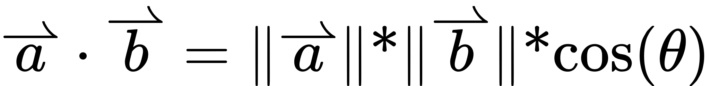

> 点积

如果两个向量的长度都是 1（即它们是单位向量），那么点积的结果就是两向量夹角的余弦。

这也是为什么光照方向是*指向*光的方向而不是从光出发的方向的原因之一。否则我们在做点积之前就必须对该向量取反。

它比直接取夹角余弦更快，原因在于：虽然从几何意义上说点积就是两个单位向量夹角的余弦，但用向量数学计算点积非常简单：

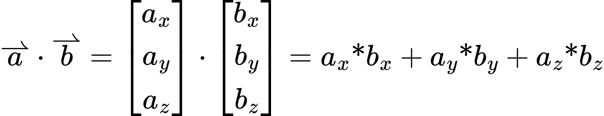

> 用向量数学计算点积

这不需要任何麻烦的余弦超越函数计算，也不需要用三角函数去算两个向量之间的夹角。只是简单的乘法和加法；大多数图形硬件每秒能做几十亿次这样的运算。

显然，GLSL 函数 `dot `计算的就是它两个参数之间的向量点积。

## 法线变换

在上一节中我们看到，对入射角余弦的计算有一些要求。具体来说，参与运算的两个向量——表面法线和光照方向——必须是单位长度。光照方向可以假定为单位长度，因为它是直接作为 uniform 传入的。

表面法线也可以假定为单位长度。*最初*可以。然而，法线要经历一个任意矩阵的变换；没有保证说这次变换不会对该向量施加缩放或其他变换，从而得到一个非单位向量。

当然，修正这一点很容易。GLSL 函数 `normalize `会返回一个单位长度的向量，而不改变输入向量的方向。

虽然在数学上这样可行，但在几何上却毫无意义。举例来说，考虑一个 2D 圆。我们可以对这个圆上的位置施加一个非均匀缩放（各轴缩放比例不同），把它变换成一个椭圆：

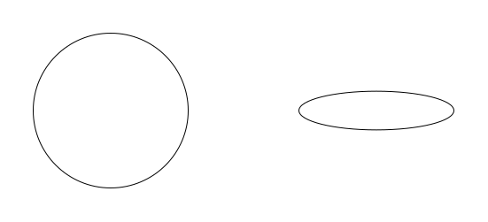

> 圆的缩放

这一切都很好，但再考虑这次变换中的法线：

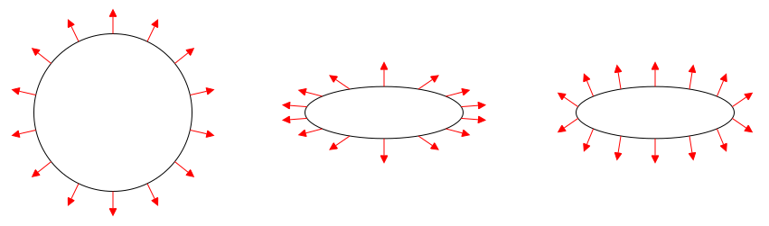

> 带法线的圆缩放

中间那个椭圆拥有的法线，正是你用变换圆所用的同一个矩阵去变换这些法线时会得到的结果。它们可能是单位长度，但它们不再反映椭圆的*形状*。右边那个椭圆的法线才反映了真实的形状。

事实证明，你真正想要做的是让法线承受与位置相同的旋转，但把缩放取逆。也就是说，沿 X 轴缩放 0.5 会把该轴上的位置缩小一半。而对于表面法线，你要做法线的 X 值*加倍*，然后把结果归一化。

如果你的矩阵很简单，这很容易。但由多次连续旋转、缩放及其他操作组合而成的复杂矩阵就没那么容易计算了。

取而代之，我们必须计算一个称为该矩阵**逆转置**的东西。这意味着我们先计算逆矩阵，再计算那个矩阵的**转置**。矩阵的转置就是把同一个矩阵沿对角线翻转。原矩阵的列就是其转置的行。也就是说：

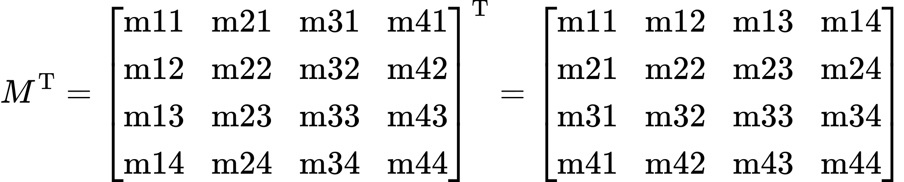

> 矩阵转置

那么这个逆转置究竟如何帮到我们？

请记住：我们想要的是把矩阵中的缩放取逆，同时不影响矩阵的旋转特性。给定一个只由旋转和缩放变换组成的 3x3 矩阵 M，我们可以把这个矩阵重新表示如下：

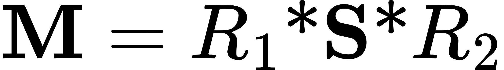

也就是说，这个矩阵可以表示为：先旋转到一个空间，接着做一次单一的缩放变换，再旋转一次。无论构建 M 时用了多少个缩放和旋转矩阵，我们都能*这样*做。也就是说，M 可能是二十个旋转与缩放矩阵的结果，但所有这些都可以被提取成两次旋转加中间的一次缩放。[^我们将跳过它究竟为何成立这一点的推导。如果你感兴趣，可以搜索奇异值分解（Singular Value Decomposition）。但要有心理准备：这里数学内容很重。]

回顾一下，我们想做的是把变换中的缩放取逆。原矩阵中我们按 0.4 缩放的地方，在逆矩阵中希望按 2.5 缩放。纯缩放矩阵的逆矩阵，就是把其中每个缩放分量取逆后的矩阵。因此，我们可以把真正想要的矩阵表示成这样：

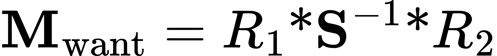

关于纯旋转矩阵有个有趣的事实：任何旋转矩阵的逆*就是*它的转置。另外，对一个矩阵取两次逆会回到原矩阵。因此，你可以把任何纯旋转矩阵表示为它自身的逆转置，而不会对这个矩阵产生任何影响。既然逆就是转置，而对一个矩阵做两次转置不会改变它的值，那么旋转矩阵的逆转置就是一次空操作。

同样，由于纯缩放矩阵中的值都位于对角线上，对缩放矩阵做转置操作什么也不改变。掌握这两条事实之后，我们就能把想要计算的矩阵重新表示为：

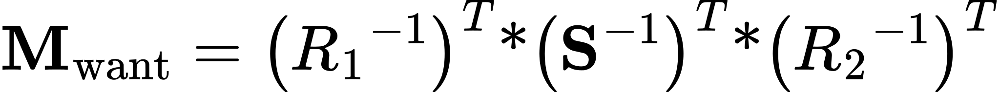

利用矩阵代数，我们可以把转置提取出来，但这么做需要颠倒矩阵乘法的顺序：

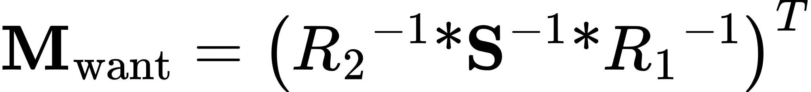

类似地，我们可以把逆运算提取出来，但这又需要再次颠倒顺序：

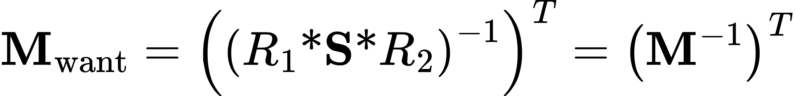

于是，逆转置就解决了我们的问题。而 GLM 和 GLSL 都提供了很好的函数来替我们完成这些操作。不过说真的，如果你能在 GLSL 中避免做逆转置，那么*强烈*建议你这么做；这不是一个平凡的计算。

我们在 **Scale and Lighting** 教程中就是这么做的。它与上一个教程基本相同，只有几处例外。按下空格键可以在普通圆柱和经过缩放的圆柱之间切换。"T" 键则在正确使用逆转置（默认）与不使用逆转置之间切换。圆柱的渲染代码如下：

**示例：使用正确法线变换的光照**

```cpp
glutil::PushStack push(modelMatrix);

modelMatrix.ApplyMatrix(g_objtPole.CalcMatrix());

if(g_bScaleCyl)
{
    modelMatrix.Scale(1.0f, 1.0f, 0.2f);
}

glUseProgram(g_VertexDiffuseColor.theProgram);
glUniformMatrix4fv(g_VertexDiffuseColor.modelToCameraMatrixUnif, 1, GL_FALSE, glm::value_ptr(modelMatrix.Top()));
glm::mat3 normMatrix(modelMatrix.Top());
if(g_bDoInvTranspose)
{
    normMatrix = glm::transpose(glm::inverse(normMatrix));
}
glUniformMatrix3fv(g_VertexDiffuseColor.normalModelToCameraMatrixUnif, 1, GL_FALSE, glm::value_ptr(normMatrix));
glUniform4f(g_VertexDiffuseColor.lightIntensityUnif, 1.0f, 1.0f, 1.0f, 1.0f);
g_pCylinderMesh->Render("lit-color");
glUseProgram(0);
```

这段代码相当不言自明。

*光照与缩放*

在继续之前还有一点需要注意。只有在使用*非均匀*缩放时，做逆转置才真正必要。实际上，使用这种缩放因子在实践中相当少见。我们在这些教程里使用它，是为了让用简单几何组件构建模型更容易。但当建模师为特定目的创建物体时，通常不会使用非均匀缩放。至少在输出的网格里不会。更好的做法是让建模师在其建模应用中按需调整模型。

均匀缩放要常见得多。所以即便你不用逆转置，在用模型到相机矩阵变换之后，仍然需要对法线进行归一化。

## 全局光照

你可能已经注意到，本教程的结果有些非常不真实的地方。例如，看这张图：

*半明半暗*

圆柱上未被照亮的部分完全是、100% 的黑色。这在真实生活中几乎从不发生，即便对于我们感知为"黑色"的物体也是如此。原因有些复杂。

考虑一个户外场景。在正常的日光下，只有一个光源：太阳。处在直射阳光下的物体显得明亮，而与太阳之间隔着某个物体的物体则处在阴影中。

但想想那些阴影看起来是什么样子。它们不是 100% 的黑。它们当然比周围区域更暗，但仍然带有某种颜色。请记住：我们之所以能看见任何东西，是因为眼睛检测到了光。为了看见处在某个光源阴影中的物体，该物体必须要么直接发光，要么反射来自别处的光。草并不以发光能力著称，那么光是从哪里来的？

仔细想想。我们之所以能看见，是因为物体把光反射进了我们的眼睛。但我们的眼睛并不特殊；物体并不是*只*把光反射进我们的眼睛。它向所有方向反射光。不一定每个方向强度都相同，但能反射光的物体总会在一定程度上向所有方向反射。当这些光打到另一个表面上时会发生什么？

就是光打到任何表面时会发生的事：一部分被吸收，一部分以某种方式被反射。

落在太阳阴影中的光来自许多地方。其中一部分是大气效应；太阳太亮了，弱反射性的大气反射的光足以照出一种颜色，通常是淡蓝色。另一部分光来自其他物体。太阳发出的光如此之多，以至于从其他物体反射回来的光足够明亮，成为场景整体光照中相当可观的一份贡献。

这种现象称为**互反射**。能够处理互反射的光照模型称为处理**全局光照**。它代表的是光在射入观看者眼睛之前，在物体之间来回弹跳。只对来自发光表面的直接光照建模，称为**局部光照**或**直接光照**，这正是我们到目前为止一直在做的事情。

可以想象，对全局光照建模很难。*非常*难。它通常是一种微妙的效果，但在许多场景中，特别是户外场景中，要达到相当程度的照片级真实感，几乎必须至少提供基本的全局光照建模。顺带一提，这也在很大程度上解释了为什么大多数游戏往往回避户外场景，或者把户外场景照得像天空多云或阴天那样。这样就恰好避开了做复杂全局光照建模的需要——把太阳的亮度压低到互反射难以察觉的水平。

渲染中出现这样一块完全黑的区域，看起来极其虚假。由于真正做全局光照建模很困难，我们将转而采用一种经过时间检验的技术：**环境光照明**。

环境光照这个"模型"[^我把 model 这个词加上引号，是因为环境光照与现实中的任何东西都相去甚远，其实并不配称为模型。话虽如此，仅仅因为它并没有以任何真实的方式建模全局光照，并不意味着它没有用处。]相当简单。它假设场景中的每个物体上都有一种从各个方向散发出来的、强度一定的光。它从所有方向均匀地来，因此在我们的漫反射计算中没有入射角。它就是环境光强 * 表面漫反射颜色。

我们在 **Ambient Lighting** 教程中这么做。它的控制方式与上一个教程相同，只是空格键改为在两个圆柱（红色和白色）之间切换，<kbd>T</kbd> 键则用于开关环境光照明（默认为关闭）。

*环境光照明*

圆柱暗部所看到的细节完全来自漫反射颜色。而且由于环境光相当弱，表面的漫反射颜色在暗部显得较为黯淡。

现在的渲染代码使用四个顶点着色器而不是两个。其中两个用于非环境光照，用的是我们之前见过的着色器；另外两个使用环境光照。

使用逐顶点颜色的环境光顶点着色器名为 `DirAmbVertexLighting_PCN.vert `，内容如下：

**示例：环境光顶点光照**

```glsl
#version 330

layout(location = 0) in vec3 position;
layout(location = 1) in vec4 diffuseColor;
layout(location = 2) in vec3 normal;

smooth out vec4 interpColor;

uniform vec3 dirToLight;
uniform vec4 lightIntensity;
uniform vec4 ambientIntensity;

uniform mat4 modelToCameraMatrix;
uniform mat3 normalModelToCameraMatrix;

layout(std140) uniform Projection
{
    mat4 cameraToClipMatrix;
};

void main()
{
    gl_Position = cameraToClipMatrix * (modelToCameraMatrix * vec4(position, 1.0));
    
    vec3 normCamSpace = normalize(normalModelToCameraMatrix * normal);
    
    float cosAngIncidence = dot(normCamSpace, dirToLight);
    cosAngIncidence = clamp(cosAngIncidence, 0, 1);
    
    interpColor = (diffuseColor * lightIntensity * cosAngIncidence) +
        (diffuseColor * ambientIntensity);
}
```

它接受两个指定光照强度的 uniform。一个指定漫反射光照的强度，另一个指定环境光照的强度。唯一的另一处改动是着色器的最后一行。通常的漫反射光照结果被加到了环境光照的计算上。同时请注意，来自两个光照模型的贡献是相加在一起的。

特别值得注意的是纯漫反射情形与漫反射加环境光情形在光照强度上的差别：

**示例：光强设置**

```cpp
if(g_bShowAmbient)
{
    glUseProgram(whiteDiffuse.theProgram);
    glUniform4f(whiteDiffuse.lightIntensityUnif, 0.8f, 0.8f, 0.8f, 1.0f);
    glUniform4f(whiteDiffuse.ambientIntensityUnif, 0.2f, 0.2f, 0.2f, 1.0f);
    glUseProgram(vertexDiffuse.theProgram);
    glUniform4f(vertexDiffuse.lightIntensityUnif, 0.8f, 0.8f, 0.8f, 1.0f);
    glUniform4f(vertexDiffuse.ambientIntensityUnif, 0.2f, 0.2f, 0.2f, 1.0f);
}
else
{
    glUseProgram(whiteDiffuse.theProgram);
    glUniform4f(whiteDiffuse.lightIntensityUnif, 1.0f, 1.0f, 1.0f, 1.0f);
    glUseProgram(vertexDiffuse.theProgram);
    glUniform4f(vertexDiffuse.lightIntensityUnif, 1.0f, 1.0f, 1.0f, 1.0f);
}
```

在纯漫反射的情形中，光强是满白。而环境光的情形中，我们刻意把漫反射强度设得比满白低。这一点是刻意为之。

我们以后会更多讨论这个问题，但有一点非常关键：光强值不得超过 1.0。这包括*组合后*的光强值。OpenGL 会把写入输出图像的颜色钳制到 [0, 1] 范围。因此，任何超过 1.0 的光强，无论是单独存在还是与其他光强组合，都会引起令人不快的视觉效果。

有一些办法可以绕过这一点，我们以后会讨论。

## 网格拓扑

到目前为止，我们已经见过三种不同的顶点属性。我们用到了位置、颜色，以及现在的法线。在继续之前，我们需要讨论网格上具有三个相互独立的顶点属性所带来的影响。

网格的**拓扑**定义了顶点之间的连通关系。然而，每个顶点属性都可以有自己的独立拓扑。这怎么可能？

考虑一个简单的立方体。它有 8 个顶点位置。立方体各位置之间的拓扑关系如下：

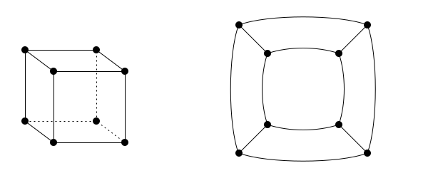

> 立方体位置拓扑

拓扑图中是 8 个不同的位置，每个位置连接着三个邻居。这些连接代表立方体各个面的棱，而连接所围成的区域则代表面本身。所以每个面有 4 条棱和 4 个位置。

现在考虑立方体法线的拓扑。立方体有 6 个面，每个面的法线各不相同。这个拓扑有点不太常规：

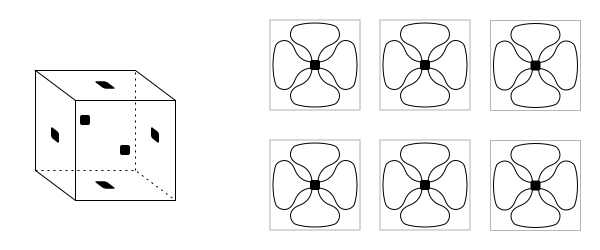

> 立方体法线拓扑

方形点代表不同的法线，而不是空间中的位置。法线之间的连接全都绕回自身。这是因为每个面的每个顶点都使用同一个法线。虽然前面和上面共用两个顶点位置，但它们完全不共用任何顶点法线。因此，前面法线与顶面法线之间不存在拓扑关系。每个法线值与自身连接了四次，但它与别的东西没有任何连接。

我们有 8 个位置和 6 个法线，它们在整个网格上各自有独特的拓扑。要怎么把它们变成可以渲染的东西？

如果我们对 OpenGL 一无所知，这很简单。我们直接用这些拓扑来构建网格。每个面被拆成两个三角形。我们会有一个包含 8 个位置和 6 个法线的数组。而对我们要渲染的每个顶点，都有一份索引列表从这两个数组中取值。

立方体两个面的索引列表可能像这样（使用 C++ 风格的多维列表）：

```cpp
{
  {0, 0}, {1, 0}, {2, 0}, {1, 0}, {3, 0}, {2, 0},
  {0, 1}, {4, 1}, {1, 1}, {4, 1}, {6, 1}, {1, 1},
}
```

列表中每个元素的第一个索引从位置数组取值，第二个索引从法线数组取值。这份列表明确指出了面与拓扑之间的关系：第一个面（由两个三角形组成）包含 4 个位置，但所有顶点都使用同一个法线。第二个面与第一个面共用两个位置，但不用任何法线。

这件事在 OpenGL 中之所以复杂，原因很简单：我们只有*一份*索引列表。当我们用索引数组渲染时，每个属性数组都使用同一份索引。因此我们需要做的，是把上面的索引列表转换为一份顶点属性唯一组合的列表。每一对索引都必须对应一个唯一的索引。

考虑第一个面。它由 4 个唯一顶点组成；索引对 {1, 0} 和 {2, 0} 是重复的，因为必须绘制三角形。既然这些对是重复的，我们可以把它们合并；它们将指向同一个索引。然而，每个顶点都使用同一个法线这一事实必须被完全忽略。因此，我们为第一个面最终使用的索引列表是：

```cpp
{ 0, 1, 2, 1, 3, 2 }
```

这一个面的属性数组包含 4 个位置和 4 个法线。但虽然各个位置各不相同，法线却必须都是同一个值，尽管它们被存放在四个不同的位置。这看起来很浪费内存。

一旦移到下一个面，情况就更糟了。因为我们只能合并完全相同的索引对，第二个面中没有任何顶点与第一个面共享索引。下一个面复用了两个位置这一事实无关紧要：我们必须使用下面这份索引列表：

```cpp
{ 4, 5, 6, 5, 7, 6 }
```

两个面的属性数组包含 8 个位置和 8 个法线。同样，第二个面的法线全都是彼此的重复。而且有两个位置是重复的。从拓扑上讲，我们的立方体顶点拓扑看起来如下：

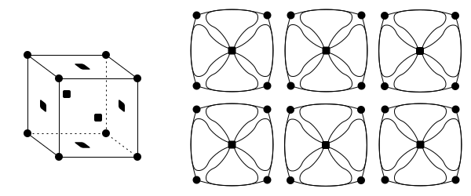

> 完整的立方体拓扑

每个面在拓扑上都与其余部分完全不同。

最终，这给我们的数组带来了 24 个位置和 24 个法线。数组中只有 6 个不同的法线值和 8 个不同的位置值，但两者各有 24 个。所以这意味着我们的数据量显著增加。

不过不必过分担心数据的增长。立方体或任何其他多面体式的物体，都代表这种转换的最坏情况。光滑物体的大多数实际网格，其拓扑的相互连接程度要高得多。

网格拓扑是你需要了解的一件事，把属性拓扑转换为 OpenGL 能直接处理的形式的能力也是。每个属性都有自己的拓扑，这会影响索引列表的构建方式。不同属性可以共享同一个拓扑。例如，我们可以为立方体的每个面关联颜色。此时颜色拓扑就与法线拓扑完全相同。

大多数细节通常都隐藏在各种命令行工具之后，这些工具用来从建模程序导出的文件生成合适的网格。许多电子游戏开发者都有复杂的资产预处理管线，把导出的文件处理成适合加载并直接上传到缓冲对象的二进制格式。但理解网格拓扑的工作原理仍然很重要。

## 本章小结

在本教程中，你学到了以下内容：

- 漫反射光照是一个简单的光照模型，它基于光源与表面法线之间的夹角。
- 表面法线是逐顶点使用的值，用来定义表面在特定位置的方向。它们不必与网格几何体真实的法线一致。
- 如果模型到相机的矩阵可能包含非均匀缩放操作，那么表面法线必须用该矩阵的逆转置来变换。
- 光互反射可以通过添加一个没有方向的光强来近似。
- 每个顶点属性都有自己的拓扑。为了在 OpenGL 中渲染这些顶点，属性数据必须被复制，使每一种唯一的属性组合都具有拓扑。

### 进一步学习

试着在给出的程序中做这些事情。

- 修改环境光照明教程，把漫反射光强提到 1.0。看看这会怎样影响结果。
- 修改环境光照明教程中的着色器，采用前面提到的光强校正。把漫反射颜色除以某个值，然后向着色器传入更大的光强。留意这会如何改变光照的质量。

### 进一步研究

对许多表面来说，兰伯特漫反射是一个相当好的漫反射模型。不过特别粗糙的表面并不表现得符合兰伯特规律。如果你对建模这类表面感兴趣，可以研究 Oren-Nayar 反射模型。

### 值得关注的 GLSL 函数

```cpp
clamp(void);
```

该函数对 `val `的每个分量做钳制操作。所有参数必须是标量或具有相同维度的向量。该函数适用于任何标量或向量类型。它返回一个与参数维度相同的标量或向量，其中 `val `的每个分量都被钳制到闭区间 [`minVal `,`maxVal `]。这对于确保数值落在某个范围内很有用。

`minVal `的所有分量都*必须*小于 `maxVal `对应的各个分量。

```cpp
dot(void);
```

该函数对 `x `和 `y `执行向量点积。结果总是一个标量值。两个参数必须具有相同的维度，并且必须是向量。

```cpp
normalize(void);
```

该函数返回一个与 `x `方向相同、但长度为 1 的向量。`x `的长度必须大于 0（也就是说，它不能是全零向量）。

## 术语表

- **照片级真实感**：当一个渲染系统能够渲染出与真实照片基本无法分辨的静态图像时，它就达到了照片级真实感。
- **光照模型**：定义光如何被表面吸收和反射的数学模型。它可以试图模拟现实，但并非必须如此。
- **光源**：从数学上说，它是产生光并把光加入场景的东西。它不必是世界中显示出来的真实物体。
- **光强**：由发光源发出的光的强度，以 RGB 度量。
- **入射角**：表面法线与指向光的方向之间的夹角。
- **漫反射光照**：假定光从表面向许多方向反射的光照模型，与只向一个方向反射光的平面镜相对。
- **兰伯特反射**：一种特定的漫反射光照模型，表示理想的漫射情形：光照向所有方向均匀反射。
- **表面法线、法线**：表面上特定一点所朝向的方向。
- **哥罗着色**：在每个顶点处执行光照计算，并在三角形表面上对这些计算的结果做插值。
- **平行光源**：沿某个特定方向发光的光源。场景中要渲染的每一个点都接收来自同一方向的光。这模拟的是极为遥远、从单一方向均匀照亮场景的光源。
- **向量点积**：计算一个向量在另一个向量上投影的长度。如果两个向量是单位向量，那么点积就是它们之间夹角的余弦。
- **转置**：沿主对角线翻转矩阵的矩阵操作。原矩阵的列成为转置矩阵的行。
- **逆转置**：一种矩阵操作，先对一个矩阵求逆，再对其转置。
- **互反射**：在到达观察者之前从多个表面反射过的光。
- **全局光照**：一类会把互反射带来的光照贡献考虑在内的光照模型。
- **局部光照、直接光照**：仅根据那些把光直接照到表面上的光源所做的光照计算。
- **环境光照明**：一种光照模型，它把互反射的所有贡献都建模为单个不来自任何特定方向的光强。
- **网格拓扑**：网格中顶点属性不同取值之间的相互连接关系。每个属性都有自己独立的拓扑。在 OpenGL 中渲染需要找出所有唯一的属性组合，并在此基础上建立一份新的拓扑，其中每个属性的拓扑都相同。这可能需要复制属性数据。
