# 点光源

平行光适合用来表示太阳之类的光源，但大多数光源更适合用点光源来表示。

**点光源**是在世界中有一个位置、并向所有方向以相同强度发光的光源。我们那个简单的漫反射光照方程正是这两个性质的函数：

- 该点处的表面法向量。
- 从表面上该点指向光源的方向。

处理平行光时，从某点指向光源的方向是一个常量。它是光照计算的一个参数，但对场景中所有点来说都是同一个值。平行光与点光源的唯一区别就在于：这个方向必须针对场景中的每个位置单独计算。

计算方法相当简单。在我们关心的那个点上，用表面上的点减去光源的位置。我们把结果归一化，得到一个指向光源的单位向量。然后像之前一样使用这个光照方向。为了让这个方程说得通，表面点、光源位置和表面法向量必须全部处在同一个空间中。

## 逐顶点点光照

到目前为止，我们一直在每个顶点处计算光照方程，再把结果插值到三角形表面上。处理点光源时我们还会继续这样做。至少目前如此。

我们在 **Vertex Point Lighting** 教程中以逐顶点方式实现点光源。这个教程中有一个绕着圆柱体旋转的移动点光源。

*Vertex Point Lighting*

按 <kbd>Y</kbd> 键可以切换光源位置的指示器。<kbd>B</kbd> 键用来切换光源的旋转。<kbd>I</kbd> 和 <kbd>K</kbd> 键分别把光源上移和下移，<kbd>J</kbd> 和 <kbd>L</kbd> 键则减小和增大光源的半径。按住 shift 配合这些键使用，移动的步长会更小。

大部分代码我们都没见过。 主要改动在渲染函数的开头。

**示例：逐顶点点光源渲染**

```cpp
glutil::MatrixStack modelMatrix;
modelMatrix.SetMatrix(g_viewPole.CalcMatrix());

const glm::vec4 &worldLightPos = CalcLightPosition();

glm::vec4 lightPosCameraSpace = modelMatrix.Top() * worldLightPos;

glUseProgram(g_WhiteDiffuseColor.theProgram);
glUniform3fv(g_WhiteDiffuseColor.lightPosUnif, 1, glm::value_ptr(lightPosCameraSpace));
glUseProgram(g_VertexDiffuseColor.theProgram);
glUniform3fv(g_VertexDiffuseColor.lightPosUnif, 1, glm::value_ptr(lightPosCameraSpace));
```

光源最初在世界空间中计算，然后被变换到相机空间。相机空间的光源位置被传给两个着色器。之后渲染照常进行。

我们的顶点着色器 `PosVertexLighting_PCN.vert ` 做了几处改动：

**示例：逐顶点点光源顶点着色器**

```glsl
#version 330

layout(location = 0) in vec3 position;
layout(location = 1) in vec4 diffuseColor;
layout(location = 2) in vec3 normal;

smooth out vec4 interpColor;

uniform vec3 lightPos;
uniform vec4 lightIntensity;
uniform vec4 ambientIntensity;

uniform mat4 modelToCameraMatrix;
uniform mat3 normalModelToCameraMatrix;

uniform Projection
{
    mat4 cameraToClipMatrix;
};

void main()
{
    vec4 cameraPosition = (modelToCameraMatrix * vec4(position, 1.0));
    gl_Position = cameraToClipMatrix * cameraPosition;
    
    vec3 normCamSpace = normalize(normalModelToCameraMatrix * normal);
    
    vec3 dirToLight = normalize(lightPos - vec3(cameraPosition));
    
    float cosAngIncidence = dot(normCamSpace, dirToLight);
    cosAngIncidence = clamp(cosAngIncidence, 0, 1);
    
    interpColor = (diffuseColor * lightIntensity * cosAngIncidence) +
        (diffuseColor * ambientIntensity);
}
```

顶点着色器接收的是相机空间的光源位置，而不是相机空间的光照方向。它还在 `main ` 的第一行把相机空间的顶点位置存进一个临时变量，用来计算指向光源的方向。此后的计算就照常进行了。

注意计算 `dirToLight ` 时的运算顺序。`lightPos `在左边，`cameraPosition `在右边。从几何角度看这是正确的。如果你有两个点，想求出从点 A 指向点 B 的方向，就计算 B - A。`normalize `调用只是把它转换成单位向量。

## 插值

可以看到，做点光照相当简单。遗憾的是，视觉效果并不简单。

例如，用控制键显示点光源的位置，然后把它移到靠近地面的地方。看出什么问题了吗？

如果一切工作正常，你应该会看到光源正下方有一块明亮的区域。毕竟从几何上说，情况看起来是这样的：

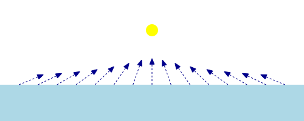

> 光源靠近表面

光源正下方那些区域的表面法向量，几乎与指向光源的方向相同。这意味着入射角很小，该角的余弦接近 1。这本该意味着光源下方有一块明亮区域，而远处逐渐变暗。可我们看到的完全不是这样。这是为什么？

想想我们在做什么。我们在每个三角形的*顶点*处计算光照，然后把结果插值到三角形表面上。而这块地面恰好只由四个顶点组成：四个角点。它们全都离光源很远，入射角非常大。既然没有任何一个顶点具有小入射角，插值到整个表面上的颜色自然也就没有一处是亮的。

把光源放到圆柱体旁边就能明显看出这一点。如果光源在圆柱体的顶部或底部，靠近光源的那片区域会变亮。但如果你把光源移到圆柱体的中部，也就是远离顶部和底部顶点的地方，照度就会暗得多。

逐顶点光照的问题还不止这一个。例如，再运行一次教程，这次不要移动光源。只观察光源绕着圆柱体旋转时，圆柱体表面的光照如何变化。与平行光不同，你很容易就能看出圆柱体表面上一个个的三角形。虽然逐顶点计算本身并没有帮上忙，但这里的主要问题出在这些值的插值上。

如果你把光源移得更远，就会看到三角形变平滑了，彼此之间难以分辨。但这只是因为，只要光源足够远，结果就与平行光难以区分。每个顶点指向光源的方向都和其他顶点指向光源的方向几乎相同。

处理平行光时，逐顶点光照是合理的。但对点光照来说，它实在不是个好主意。问题来了：一开始为什么逐顶点光照用在平行光上就很好？

回顾一下，我们的漫反射光照方程有两个参数：指向光源的方向和表面法向量。在平行光照中，指向光源的方向始终相同。因此，在一个三角形表面上唯一会变化的量就是表面法向量。

向量的线性插值看起来是这样的：

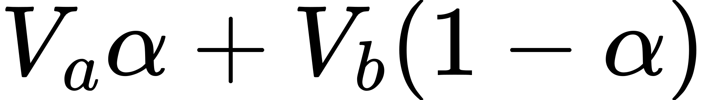

方程中的 α 是两个取值之间的插值因子。α 为 1 时，我们得到 V <sub>a</sub>；为 0 时，我们得到 V <sub>b</sub>。这两个值 V <sub>a</sub> 和 V <sub>b</sub> 可以是标量，也可以是向量。

我们的漫反射光照方程是这样的：

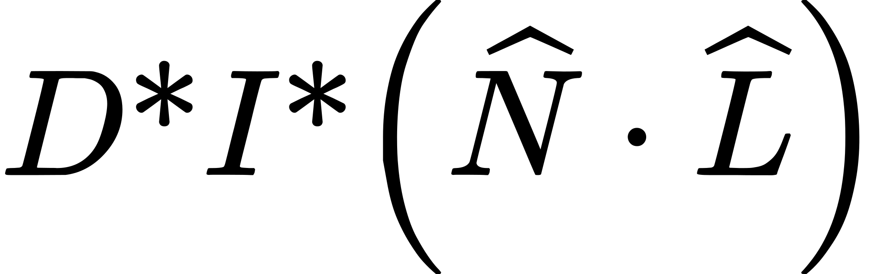

如果被插值的是表面法向量 N，那么在表面上任意一点处，对平行光我们会得到下面这个方程（光照方向 L 不变）：

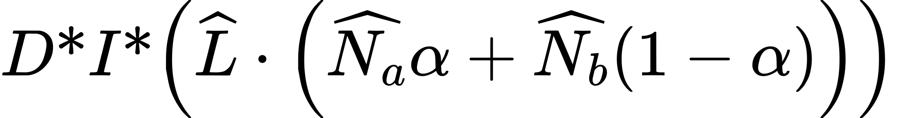

点积与标量乘法一样具有分配性。所以我们可以把 L 分配到点积项的两侧：

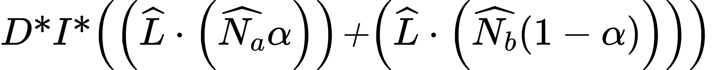

我们可以把线性项从点积中提取出来。还记得吗，点积等于两个向量夹角的余弦乘以这两个向量的长度。那两个缩放项直接改变向量的长度，因此可以把它们提出来：

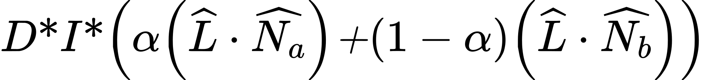

回顾一下，向量与标量的乘法也具有分配性。我们可以把与漫反射颜色、光强的乘法分配到两项上，于是得到：

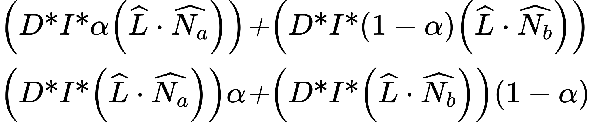

这意味着，如果 L 是常量，那么对 N 做线性插值就与对光照方程的结果做线性插值完全等价。而加上环境光项并不改变这一点，因为它是常量，不会受线性插值影响。

做点光照时，你必须同时插值 N 和 L。而这与对光照方程算出的两个颜色做线性插值并不等价。这正是圆柱体看起来不对的一个重要原因。

更符合物理的方法是在每个渲染出的像素处做光照。要做到这一点，我们必须把光照参数在三角形上插值，并在片元着色器中完成光照计算。

## 逐片元光照

因此，为了处理插值带来的瑕疵，我们需要插值真正的光照方向和法向量，而不是只插值光照方程的结果。这称为**逐片元光照**，简称**片元光照**。

概念上这相当简单。我们只需要在片元着色器中做光照计算。因此片元着色器需要片元的位置、光源的位置（或从该位置指向光源的方向），以及片元在该处的表面法向量。而所有这些值都必须处在同一个坐标空间中。

首先有一个必须处理的问题。法向量不能很好地插值。更准确地说，是差异极大的法向量不能很好地插值。而如果光源相对于三角形来说很近，光照方向在不同顶点之间可能相差很大。

考虑我们这个大平面。只要光源还离平面比较近，每个顶点处指向光源的方向就会有很大差别。

问题的一部分在于沿三角形对角线进行的插值。三角形内部的插值是这样的：对于三角形区域内的任意位置，该位置都可以表示为三个顶点位置的加权和。

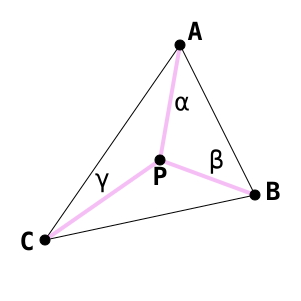

> 三角形插值

`P = αA + βB + γC, where α + β + γ = 1.0 `

α、β、γ 的值并不是从各自的点到关注点的距离。在上面这个例子中，点 P 正好位于三角形的中心，因此这三个值各为 ⅓。

如果关注点位于三角形的一条边上，那么不与这条边共享的那个顶点的贡献为零。

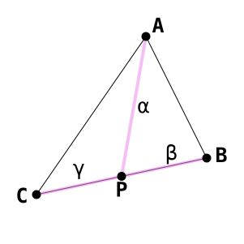

> 三角形边缘插值

这里点 P 正好位于 C 和 B 的中点，因此 β 和 γ 都是 0.5，而 α 是 0.0。如果点 P 位于三角形边界上的任何位置，它最终插值出的值都不从第三个顶点获得任何贡献。所以在三角形的一条边上，它的行为就类似于我们之前见过的那种线性插值。

OpenGL 就是这样插值顶点着色器输出的。它取片元位置对应的 α、β、γ 坐标，用与处理片元位置相同的方式，把它们与三个顶点的顶点输出值组合起来。实际做法比这稍微复杂一些，我们后面再讨论。

我们例子中的地面由两个大三角形组成。它们看起来是这样的：

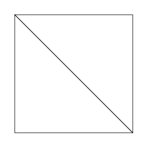

> 两个三角形构成的四边形

如果把右上和左下两点设为黑色，左上和右下两点设为绿色，然后把这些颜色在表面上插值，会得到这样：

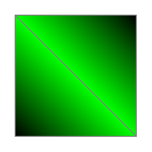

> 两个三角形的插值

沿着对角线颜色是纯绿色。这是因为在三角形的边上，插值得到的值只由该边上的两个顶点的颜色决定。插值只基于每个三角形各自进行，不会用到相邻另一个三角形的额外数据。

对我们的情况来说，这意味着沿主对角线的那些点，其光照方向只由该对角线上两个顶点的方向值构成。这不好。如果光照方向在表面上变化不大，这倒不算什么大问题；但在三角形相对于光源很大时，情况就完全不是这样了。

既然我们无法很好地插值光照方向，就需要改为插值别的东西——某种在插值时能表现出我们所需性质的东西。

位置就插值得很好。把左上位置和右下位置插值起来，就能得到沿对角线的准确位置值。所以我们改为插值光照方向的分量，也就是那两个位置。光源位置是常量，因此我们只需要插值顶点位置。

现在，我们可以在任意空间里做这件事。不过为了说明方便，我们在模型空间中做。也就是说，光源位置和顶点位置都放在模型空间中。

在模型空间中做这件事有一个好处：它摆脱了那个讨厌的矩阵求逆/转置，我们原本必须靠它才能正确变换法向量。事实上，法向量根本不需要被变换。缺点之一是，它要求我们为光源位置计算一个逆矩阵，以便从世界空间转到模型空间。

**Fragment Point Lighting** 教程展示了片元光照的工作方式。

*Fragment Point Lighting*

好多了。

这个教程的控制方式与之前相同，只有几处不同。按 <kbd>t</kbd> 键会切换一个缩放因子，用它对圆柱体施加缩放；按 <kbd>h</kbd> 键则在逐片元光照和逐顶点光照之间切换。

考虑到光照改用模型空间而非相机空间，渲染代码做了一些变化。渲染的开头部分如下：

**示例：逐片元渲染的开头**

```cpp
glutil::MatrixStack modelMatrix;
modelMatrix.SetMatrix(g_viewPole.CalcMatrix());

const glm::vec4 &worldLightPos = CalcLightPosition();

glm::vec4 lightPosCameraSpace = modelMatrix.Top() * worldLightPos;
```

新增的就是最后一行，我们在那里把世界空间的光源变换到相机空间。这样做是为了让数学运算简单得多。由于我们的矩阵栈正在构建从模型空间到相机空间的变换，这个矩阵的逆就是一个从相机空间到模型空间的变换。因此我们需要先把光源位置放进相机空间，再对它施加逆变换。

做完这一步，代码用一个变量在逐顶点光照和逐片元光照之间切换。这只是在选择使用哪一组着色器；两组着色器接收的 uniform 值完全相同，尽管它们在不同的着色器阶段使用这些值。

地面用下面这段代码渲染：

**示例：地面的逐片元渲染**

```cpp
glutil::PushStack push(modelMatrix);

glUseProgram(pWhiteProgram->theProgram);
glUniformMatrix4fv(pWhiteProgram->modelToCameraMatrixUnif, 1, GL_FALSE,
glm::value_ptr(modelMatrix.Top()));

glm::mat4 invTransform = glm::inverse(modelMatrix.Top());
glm::vec4 lightPosModelSpace = invTransform * lightPosCameraSpace;
glUniform3fv(pWhiteProgram->modelSpaceLightPosUnif, 1, glm::value_ptr(lightPosModelSpace));

g_pPlaneMesh->Render();
glUseProgram(0);
```

我们用 `glm::inverse ` 计算逆矩阵并保存下来。然后用它算出模型空间的光源位置，并传给着色器。接着平面就被渲染出来了。

圆柱体用类似的代码渲染。它只是在计算逆矩阵和渲染之前，对模型矩阵做几次变换。

真正的好戏在着色器里。和之前的光照教程一样，这里有两组着色器：一组接收逐顶点颜色，另一组使用恒定的白色。做逐顶点光照计算的顶点着色器应该已经很熟悉了：

**示例：模型空间逐顶点光照顶点着色器**

```glsl
#version 330

layout(location = 0) in vec3 position;
layout(location = 1) in vec4 inDiffuseColor;
layout(location = 2) in vec3 normal;

out vec4 interpColor;

uniform vec3 modelSpaceLightPos;
uniform vec4 lightIntensity;
uniform vec4 ambientIntensity;

uniform mat4 modelToCameraMatrix;
uniform mat3 normalModelToCameraMatrix;

uniform Projection
{
    mat4 cameraToClipMatrix;
};

void main()
{
    gl_Position = cameraToClipMatrix * (modelToCameraMatrix * vec4(position, 1.0));
    
    vec3 dirToLight = normalize(modelSpaceLightPos - position);
    
    float cosAngIncidence = dot( normal, dirToLight);
    cosAngIncidence = clamp(cosAngIncidence, 0, 1);
    
    interpColor = (lightIntensity * cosAngIncidence * inDiffuseColor) +
        (ambientIntensity * inDiffuseColor);
}
```

这个版本与上一个版本的主要差别，正如你从相机空间光照改到模型空间光照时所能预料的那样：逐顶点输入被直接使用，而不再变换到相机空间。还有一个版本省略了 `inDiffuseColor ` 输入。

逐顶点光照有两个顶点着色器：`ModelPosVertexLighting_PCN.vert `和 `ModelPosVertexLighting_PN.vert `。逐片元光照同样有两个着色器：`FragmentLighting_PCN.vert `和 `FragmentLighting_PN.vert `。它们简单得让人失望：

**示例：模型空间逐片元光照顶点着色器**

```glsl
#version 330

layout(location = 0) in vec3 position;
layout(location = 1) in vec4 inDiffuseColor;
layout(location = 2) in vec3 normal;

out vec4 diffuseColor;
out vec3 vertexNormal;
out vec3 modelSpacePosition;

uniform mat4 modelToCameraMatrix;

uniform Projection
{
    mat4 cameraToClipMatrix;
};

void main()
{
    gl_Position = cameraToClipMatrix * (modelToCameraMatrix * vec4(position, 1.0));
    
    modelSpacePosition = position;
    vertexNormal = normal;
    diffuseColor = inDiffuseColor;
}
```

既然光照是在片元着色器中做的，除了把变量传下去并设置输出的裁剪空间位置之外，就没什么可做的了。不接收漫反射颜色的那个版本只是传出一个仅包含 1.0 的 `vec4 `。

片元着色器有趣多了：

**示例：逐片元光照片元着色器**

```glsl
#version 330

in vec4 diffuseColor;
in vec3 vertexNormal;
in vec3 modelSpacePosition;

out vec4 outputColor;

uniform vec3 modelSpaceLightPos;

uniform vec4 lightIntensity;
uniform vec4 ambientIntensity;

void main()
{
    vec3 lightDir = normalize(modelSpaceLightPos - modelSpacePosition);
    
    float cosAngIncidence = dot(normalize(vertexNormal), lightDir);
    cosAngIncidence = clamp(cosAngIncidence, 0, 1);
    
    outputColor = (diffuseColor * lightIntensity * cosAngIncidence) +
        (diffuseColor * ambientIntensity);
}
```

逐顶点与逐片元两种情况下的数学运算基本完全相同。主要差别在于对 `vertexNormal ` 的归一化。这是必需的，因为在两个单位向量之间插值，并不意味着插值之后你得到的还是单位向量。事实上，插值 3 个分量保证了你不会得到单位向量。

### 梯度问题

虽然这看起来已经完美了，但仍然有一个问题。用 Shift + J 把光源移到非常靠近圆柱体的位置，但不要让光源进入圆柱体内部。你应该会看到类似这样的画面：

*近距离照亮的圆柱体*

注意圆柱体上的那些竖直条带。这和之前遇到的插值问题如出一辙。按理说在片元级做光照不就应该解决这个问题了吗？

它与最初的问题相似，但技术上是另一回事。逐顶点光照产生条带是因为颜色插值的瑕疵。而这一次的成因，是相邻的线性梯度造成的一种视觉错觉。

法向量是在表面上做线性插值的。这也意味着光照在表面上有些线性地变化。虽然光照并不是线性变化的，但在一小片表面区域上可以近似为线性。

两个三角形之间的边界会改变光与表面的相互作用。在边界一侧，近似线性的梯度有一个斜率；在另一侧，它有另一个斜率。也就是说，梯度变化率在边界处发生了突变。

下面是一个简单的示例：

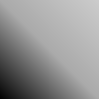

> 相邻的梯度

这是两个相邻的线性梯度，从左下角延伸到右上角。颜色值从左下到右上逐渐变亮。它们在中间沿对角线相接。两个梯度在中间处的颜色值相同，然而看上去中间却有一条比两侧颜色都亮的线。但事实并非如此：对角线右侧的颜色实际上比对角线本身更亮。

这就是那个视觉错觉。下面这张图标示了颜色强度如何跨越上面那个梯度变化：

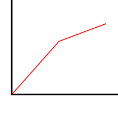

> 梯度强度曲线图

颜色曲线是连续的；没有间断，也没有突然的跳变。但它不是一条光滑的曲线；它有一道锐利的边缘。

事实证明，人眼非常擅长在平滑的梯度中寻找锐利的边缘。每当我们看到一道锐利的边缘，大脑就会试图把它变成某种形状。而如果梯度的交汇处还存在一个形状（比如一条线），我们往往会看到那个交汇处"跳"出来。

我们还没有办法解决这个问题。我们之所以能如此清楚地看到它，是因为该表面的漫反射率（也就是颜色）非常规律。如果表面颜色是不规则的，如果它几乎每个片元都变一次，那这个效果就几乎不可能被察觉。

但问题的真正来源是法向量在做线性插值。虽然这肯定比插值逐顶点光照输出好得多，但它产生的法向量仍然与完美圆柱体的法向量对不上。正确的解决方案——我们最终会讲到——是提供一种在表面上的多个位置编码法向量的方式，而不是简单地插值顶点法向量。

## 遥远的光点

我们当前的例子还有另一个问题。按 <kbd>i</kbd> 键把光源升到很高的位置。注意所有朝上的表面变得多么明亮：

*高处的光源*

你在现实生活中大概从未遇到过这种情况。在现实中，把光源拿得离表面更远并不会让光变亮。显然，现实中发生了某些我们这个简单光照模型没有考虑的事情。

现实中，光源每单位时间发出一定量的光。对于灯泡这类点状光源，它把光沿径向向所有方向发出。离光源越远，这些光最终需要覆盖的面积就越大。

光本质上是一种波。离波源越远，波的强度就越低。对于光，我们把这称为**光衰减**。

我们的模型没有包含光衰减，所以来修正它。

衰减是一个被充分理解的物理现象。在没有其他因素（大气散射等）的情况下，光强随距离的平方倒数变化。一个距光源 2 个单位的物体感受到的光强是四分之一。因此我们的光衰减方程如下：

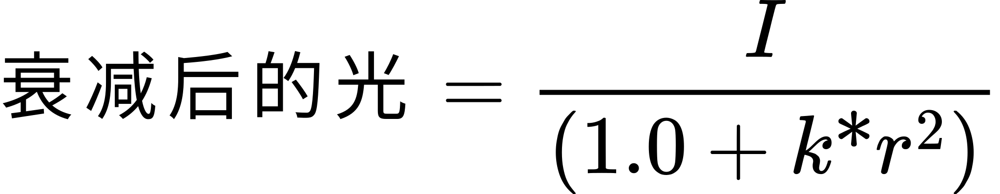

> 物理光衰减

方程中有一个常量，用于单位修正。当然，我们可以（而且确实会）把它当作一个调节因子，让效果看起来合适。

这个常量可以取有物理意义的值。它可以表示损失一半光强所需的距离。要计算这样一个常量，对于半光距离 r <sub>λ</sub>，使用下面这个方程：

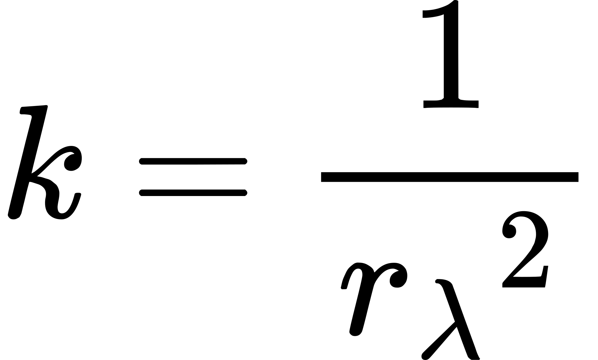

这个方程算出的点光源光衰减在物理上是真实的。但它往往看起来不太好看。这个方程造成的强度下降比人们预期的更陡。

这是有原因的，不过我们暂时还不打算深入讨论。常见的做法是干脆使用距离的倒数，而不是平方倒数：

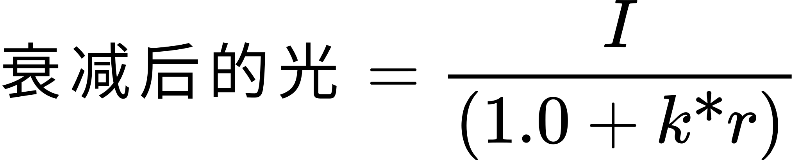

> 距离倒数光衰减

它在较大距离处比物理正确的模型更亮。对简单例子来说这没问题，但随着我们更进一步，这个做法就不可接受了。这个方案其实只是权宜之计；真正的解决方案我们会在几个教程之后讨论。

### 变换的逆

不过，这里有个问题。我们之前是在模型空间中做逐片元光照的。模型空间确实是一个做光照的极好空间，但模型空间并不是世界空间。

我们希望用世界空间的距离来指定衰减常量因子。可我们处理数据用的不是世界空间，而是模型空间。模型空间的距离自然也是模型空间的，而模型空间相对于世界空间很可能做过缩放。在这里，模型到世界变换中的任何缩放都是问题，不只是非均匀缩放。虽然如果存在的是均匀缩放，理论上我们确实可以把该缩放应用到衰减常量上。

于是我们现在不能用模型空间了。幸运的是，相机空间是一个与世界空间尺度相同的空间，只是额外施加了旋转/平移。因此我们可以在这个空间里做光照。

在相机空间中做这件事，需要算出相机空间的位置并传给片元着色器去插值。我们当然可以这么做，但这不够聪明。有没有办法绕过去？

有的。回想一下 `gl_FragCoord `，这是 GLSL 提供给每个片元着色器的内建值。它表示片元在窗口空间中的位置。所以我们不去做从模型空间到相机空间的变换，而是做从窗口空间到相机空间的变换。

**注意**

> 这里使用这种反向变换技术，不应被理解为建议在所有（甚至大多数）类似情形下都这么做。 十有八九，它会比直接把相机空间位置传给片元着色器慢得多。它放在这里主要是为了演示，以及因为它将来会有用。

把一个位置从相机空间变换到窗口空间，所涉及的变换序列如下：

**变换说明**

| 字段名 | 含义 |
| --- | --- |
| M | 从相机到裁剪空间的变换矩阵。 |
| P <sub>camera</sub> | 相机空间的顶点位置。 |
| C | 裁剪空间的顶点位置。 |
| N | 归一化设备坐标下的位置。 |
| V <sub>xy</sub> | 传给 `glViewport ` 的 X 与 Y 值。 |
| V <sub>wh</sub> | 传给 `glViewport ` 的宽与高。 |
| D <sub>nf</sub> | 传给 `glDepthRange ` 的近、远深度值。 |

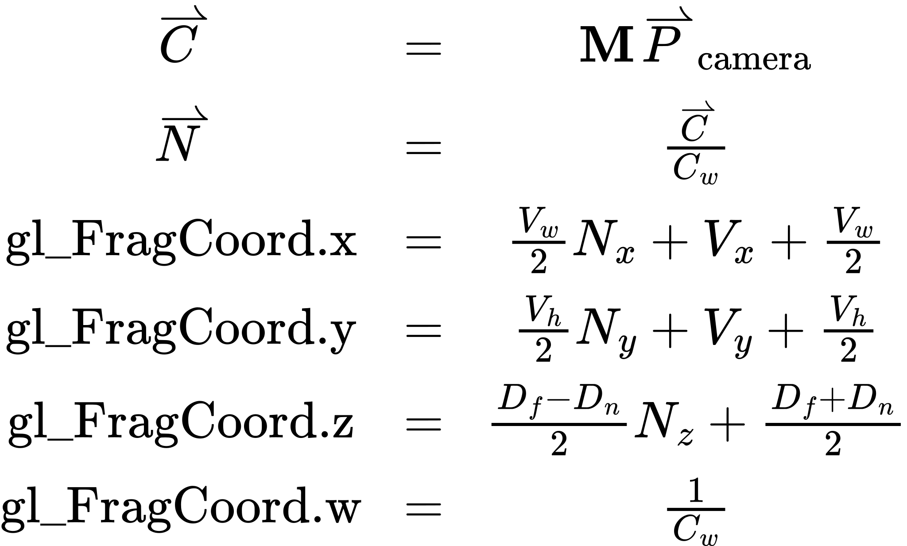

> 从相机空间到窗口空间的变换

因此，给定 `gl_FragCoord `，我们需要执行下面这些变换的逆：

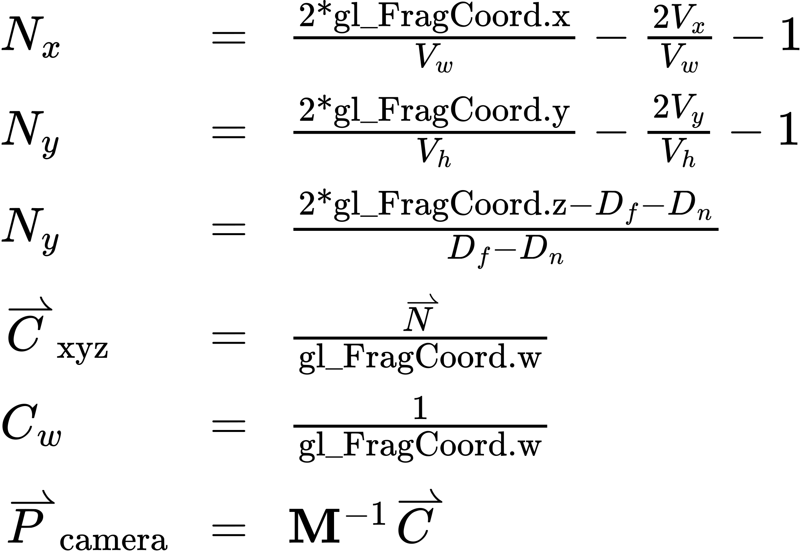

> 从窗口空间到相机空间的变换

为了让片元着色器完成这个变换，必须给它提供以下数值：

- 投影矩阵的逆。
- 视口的宽/高。
- 深度范围。

### 衰减的应用

**Fragment Attenuation** 教程实现逐片元衰减，线性衰减和平方衰减都有。

*Fragment Attenuation*

这个教程的控制方式与之前相同，有以下不同。<kbd>O</kbd> 和 <kbd>U</kbd> 键增大和减小衰减常量。但请记住，减小常量会让衰减变弱，这会让光在特定距离处看起来*更亮*。按住 shift 键配合它们使用，衰减会以更小的步长增大/减小。<kbd>H</kbd> 键在线性衰减和平方衰减函数之间切换。

绘制代码与我们之前在逐顶点点光源教程中看到的差不多，因为这个教程和那个教程都是在相机空间中做光照。顶点着色器也没有新东西：它把顶点法向量和颜色传给片元着色器。顶点法向量会乘以法线矩阵，这让我们可以使用非均匀缩放。

### 新的 uniform 类型

更有意思的是片元着色器。定义部分与上一个相比变化不大，但增加了一些内容：

**示例：光衰减片元着色器定义**

```glsl
uniform float lightAttenuation;
uniform bool bUseRSquare;

uniform UnProjection
{
    mat4 clipToCameraMatrix;
    ivec2 windowSize;
};
```

`lightAttenuation ` uniform 只是一个 float，而 `bUseRSquare ` 用的是一种新类型：布尔型。

GLSL 和 C++ 一样有 `bool ` 类型。`true `和 `false `的作用与 C++ 中对应的值完全一样。不同之处在于 GLSL 还有布尔的向量类型，叫作 `bvec#`，其中 # 可以是 2、3 或 4。我们这里不用它，但值得说明。

不过 OpenGL 的 API 仍然是一个 C API。而 C（至少在 C99 之前）没有 `bool ` 类型。向上着色器上传布尔值看起来是这样的：

```cpp
glUniform1i(g_FragWhiteDiffuseColor.bUseRSquareUnif, g_bUseRSquare ? 1 : 0);
```

这里用的是上传 uniform 的整数形式，不过浮点形式其实也可以。数字 0 表示 false，其他任何数字都表示 true。

`UnProjection ` 这个 uniform 块包含的数据只在窗口变化时才会改变。它和顶点着色器的 `Projection ` 块一起更新。这份数据用于执行前面讨论过的反向变换，从而把 `gl_FragCoord ` 变成相机空间的位置。

注意 `windowSize ` 用的是一种新类型：`ivec2 `。这是一个 2 维的整数向量。

### GLSL 中的函数

我们第一次遇到复杂到值得拆分成不同函数的着色器。于是我们就这么做了。第一个函数用来计算相机空间的位置：

**示例：窗口空间到相机空间的函数**

```glsl
vec3 CalcCameraSpacePosition()
{
    vec4 ndcPos;
    ndcPos.xy = ((gl_FragCoord.xy / windowSize.xy) * 2.0) - 1.0;
    ndcPos.z = (2.0 * gl_FragCoord.z - gl_DepthRange.near - gl_DepthRange.far) /
        (gl_DepthRange.far - gl_DepthRange.near);
    ndcPos.w = 1.0;
    
    vec4 clipPos = ndcPos / gl_FragCoord.w;
    
    return vec3(clipToCameraMatrix * clipPos);
}
```

不出所料，GLSL 函数的定义方式与 C 和 C++ 的函数非常相像。

前三行计算归一化设备坐标下的位置。注意 X 和 Y 坐标的计算相比原函数做了简化。这是因为我们的视口总是把视口的左下角位置设为 (0, 0)。把 0 代入那个方程，得到的就是这个结果。

`gl_DepthRange ` 变量是 GLSL 为片元着色器定义的一个特殊 uniform。顾名思义，它恰好镜像传给 `glDepthRange ` 的值；这样我们就不用把它放进自己的 uniform 块了。

变换到 NDC 空间之后，我们按之前展示的方式计算裁剪空间位置。然后把结果乘上从裁剪空间到相机空间的矩阵，并把该向量返回给调用者。

这是一个只使用 uniform 来计算某个值的简单函数。它不接受参数。第二个函数就没那么简单了。

**示例：光强应用函数**

```glsl
vec4 ApplyLightIntensity(in vec3 cameraSpacePosition, out vec3 lightDirection)
{
    vec3 lightDifference =  cameraSpaceLightPos - cameraSpacePosition;
    float lightDistanceSqr = dot(lightDifference, lightDifference);
    lightDirection = lightDifference * inversesqrt(lightDistanceSqr);
    
    float distFactor = bUseRSquare ? lightDistanceSqr : sqrt(lightDistanceSqr);
    
    return lightIntensity * (1 / ( 1.0 + lightAttenuation * distFactor));
}
```

这个函数头与标准的 C/C++ 函数定义语法看上去相当不同。GLSL 函数的参数被标记为输入、输出，或者既是输入又是输出。

标记为 `in ` 的参数是输入参数。函数可以修改这些值，但不会影响函数调用中所用的变量或表达式。这和 C/C++ 中的默认情况很像，参数改动是局部的。当然，如果你不指定限定符，GLSL 参数默认就是这种行为。

标记为 `out ` 的参数可以被写入，它的值会返回给调用函数。这些参数类似 C++ 中的非 const 引用参数类型。而且和引用参数一样，调用函数时必须用一个真正的变量（所谓的"左值"）来调用它。这个变量还必须是*可修改*的变量，因此你不能把 uniform 或着色器阶段的输入值作为这个参数传入。

不过，声明为输出参数的初始值*不会*从调用函数初始化。这意味着它的初始值是未初始化的，因而是未定义的（也就是说，可能是任何值）。因此，你可以把着色器阶段的输出值作为 `out ` 参数传入。回顾一下，着色器阶段的输出变量可以被写入，但*永远*不能被读取。

标记为 `inout ` 的参数，其值由调用者初始化，最终值也会返回给调用者。这些参数与 C++ 中的非 const 引用参数完全一样。主要区别在于，它的值是用调用者传入的值初始化的，这就禁止把着色器阶段的输出值作为 `inout ` 参数传入。

这个特定的函数半复杂半简单，是出于优化考虑。之前我们的函数只是把顶点位置与光源位置之差归一化。而计算衰减时，我们需要两者之间的距离。归一化这个过程本身就会算出距离。所以我们不调用 GLSL 的归一化函数，而自己来做，这样距离就不会被算两遍（在 GLSL 函数里算一遍，我们自己再算一遍）。

第二行用同一个向量做点积。还记得两个向量的点积等于它们夹角的余弦乘以各自的长度。一个向量与它自身的夹角是 0，而 0 的余弦永远是 1。所以你得到的只是两个向量长度相乘。而且既然两个向量相同，长度也相同。因此，一个向量与它自身的点积就是其长度的平方。

要归一化一个向量，我们必须用该向量除以它的长度。而 `lightDifference ` 的长度就是 `lightDistanceSqr ` 的平方根。`inversesqrt ` 计算给定值的平方根的倒数，也就是 1 / 平方根，所以我们只需要把它与 `lightDifference ` 相乘，就得到了归一化的光照方向。这个值被写入我们的输出变量。

接下来一行计算我们的光照项。注意这里使用了 ?: 运算符。它的作用与 C/C++ 中完全一样。如果我们用的是距离的平方，就存平方；否则取平方根并存下来。

**注意**

> 这里使用 ?: 的假设是，两个表达式中只会有一个被求值。所以开销很大的 `sqrt ` 调用才放在这里。然而实际情况未必如此。着色器完全有可能（而且相当可能）总是把*两个*表达式都求值，然后按需要存其中一个值。所以不要依赖这样的条件逻辑来节省性能。

之后，一切就如预期那样继续了。

把这些拆成独立函数之后，主函数看上去几乎与之前的版本一模一样：

**示例：主函数中的光衰减**

```glsl
void main()
{
    vec3 cameraSpacePosition = CalcCameraSpacePosition();
    
    vec3 lightDir = vec3(0.0);
    vec4 attenIntensity = ApplyLightIntensity(cameraSpacePosition, lightDir);
    
    float cosAngIncidence = dot(normalize(vertexNormal), lightDir);
    cosAngIncidence = clamp(cosAngIncidence, 0, 1);
    
    outputColor = (diffuseColor * attenIntensity * cosAngIncidence) +
        (diffuseColor * ambientIntensity);
}
```

函数调用的样子与 C/C++ 非常相似，除了之前提到的参数方面的例外。先确定相机空间位置，然后计算经过衰减修正的光强，之后就一切照旧。

**▌另一种衰减方案**

> 这些颇为贴近现实的衰减方案虽然不错，但用一种非常不同的方式来建模光衰减往往很有用。它在物理上完全不准，但看起来还算可以。
>
> 我们只是根据距离做线性插值。距离为 0 时，光具有完整强度。距离超过某个给定距离（最大光照范围，逐光源不同）时，强度为 0。
>
> 注意，"还算可以"取决于你的需求。你在其他方面越接近物理准确的光照，就越接近照片级真实感，也就越不能依赖不精确的现象。一边实现包含 Fresnel 因子等内容的复杂次表面散射光照模型，一边同时使用简单的插值光照衰减模型，这样做毫无意义。

## 本章小结

在本教程中，你学到了以下内容：

- 点光源是在世界中有一个位置、向所有方向均匀辐射光的光源。表面上某个特定点处的光照方向，必须用该点的位置和光源的位置计算出来。
- 试图用点光源做逐顶点光照计算会导致瑕疵。
- 可以通过在合适的空间中传递片元的位置来逐片元计算光照。
- 光照可以在模型空间中计算。
- 点光源的光强随距离衰减，这称为衰减。不做衰减处理会引起奇怪的现象：光源离表面越远，看起来反而越亮。光衰减随距离的平方倒数变化，但也可以使用其他衰减模型。
- 片元着色器可以利用 `gl_FragCoord `，以及几个保存了相机到窗口空间变换信息的 uniform 变量，计算出相关片元的相机空间位置。
- GLSL 可以有整数向量、布尔值和函数。

### 进一步学习

试着用给出的程序做下面这些事情。

- 当我们使用基于模型空间的光照计算时，必须对矩阵栈中的矩阵求逆，才能把光源位置从相机空间变换到模型空间。不过，完全可以在构建常规矩阵的同时就构建一个逆矩阵。旋转矩阵的逆就是角度取负的同一个旋转矩阵；缩放的逆就是各缩放因子的乘法逆元；平移的逆就是平移向量取负。
  要做到这一点，你需要从多个方面修改 `MatrixStack `类。它必须保存第二个矩阵，用来表示累积的逆矩阵。当向栈中提交一个变换命令时，它还必须为这个变换生成逆矩阵，并把它*左乘*进累积的逆矩阵中。push/pop 也必须同时 push/pop 那个逆矩阵。它可以使用同一个栈，只要 pop 函数把两个矩阵放回正确的位置。
- 实现本节末尾介绍的另一种衰减方案。

### 值得关注的 GLSL 函数

- **gl_DepthRange**：OpenGL 内建的 uniform，只为片元着色器定义。这个 uniform 保存传给 `glDepthRange ` 的参数。当这些参数变化时，所有程序都会自动更新。

```cpp
inversesqrt(void);
```

该函数计算 x 的平方根的倒数。这是一个逐分量的计算，因此可以使用向量。返回值与 `x ` 类型相同。

```cpp
sqrt(void);
```

该函数计算 `x ` 的平方根。这是一个逐分量的计算，因此可以使用向量。返回值与 `x ` 类型相同。

## 术语表

- **点光源**：从世界中某个特定位置发光的光源。光向各个方向均匀发射。
- **片元光照**：在每个片元处对光照方程求值。

  这也称为 Phong 着色，以区别于 Goroud 着色，但这个叫法已经不太流行了，因为它与其他光照模型的名称过于相似。
- **光衰减**：光强随着离光源距离增加而减小的现象。
