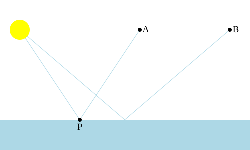
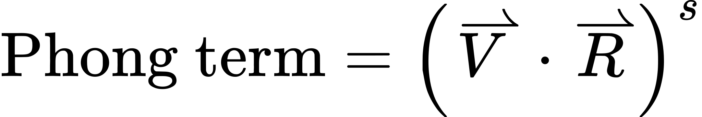
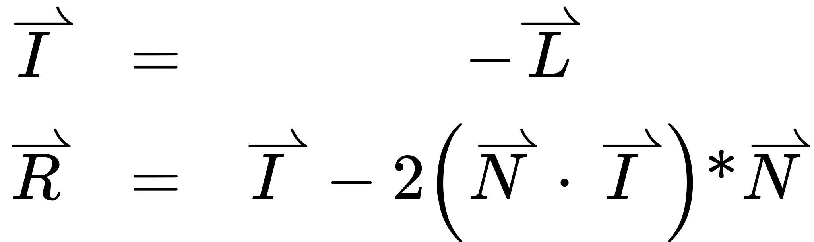
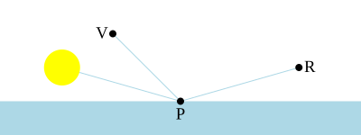
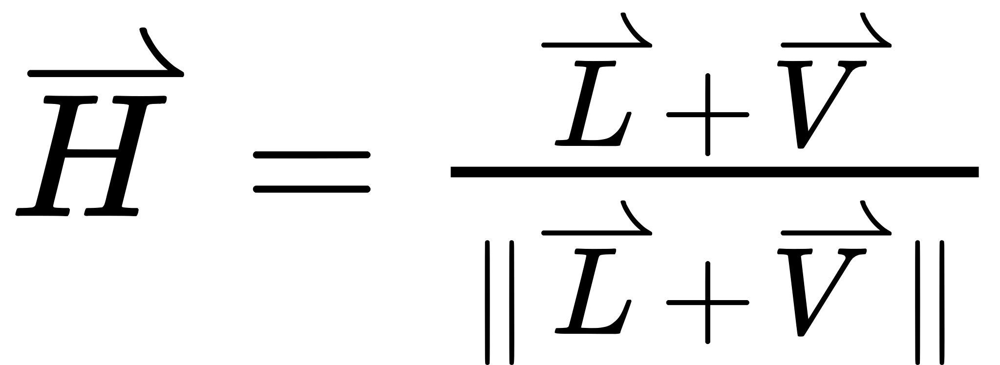
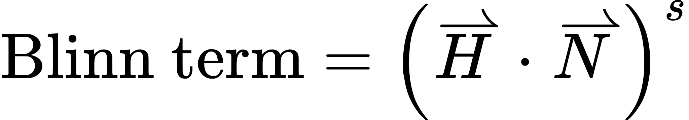
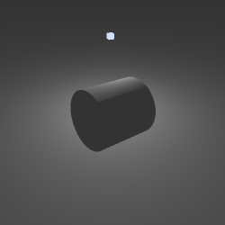
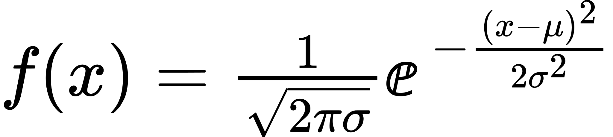
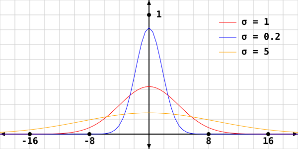
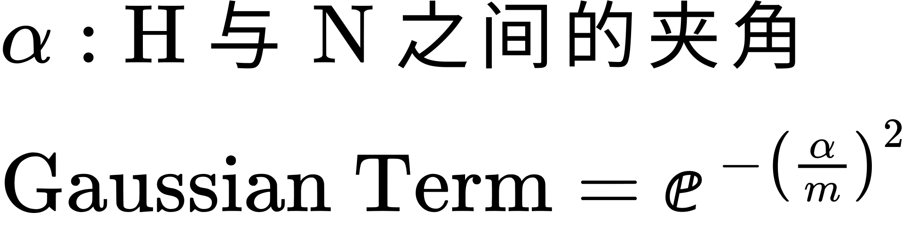

# 高光

漫反射光照模型对于光滑的哑光表面效果相当不错。现实世界中很少有物体符合这一原型。因此，为了更准确地建模真实物体，我们需要在它之上做些改进。让我们把注意力放在让物体显得有光泽上。

有光泽的材质往往在与入射角（表面法向量与入射光方向之间的夹角）相反的方向上更强烈地反射光。这种反射称为**镜面反射**。一个完美的镜面反射体就是一面镜子。

表明一个物体有光泽的一种方式，是为它建模**高光**。高光是物体上由光源直接照射而产生的明亮高亮区域。高光的位置既随视角变化，也随光照方向变化。

建模真实的镜面反射，需要把场景中所有物体反射的光——无论是直接的还是间接的——全部考虑进来。然而对许多物体来说，比如闪亮的塑料之类的，间接镜面反射非常弱。因此，通过只建模直接镜面反射，我们就能让物体显得有光泽，而不必做太多工作。

我们会介绍几种用于高光和镜面反射的模型。兰伯特漫反射模型在建模漫反射光照时还算不错，但镜面反射有若干模型值得考虑。它们在质量和性能上各有取舍。

注意，这些模型并没有抛弃漫反射光照。它们都只是起补充作用，把自己的贡献加进光照方程的总体结果中。

## 微表面

所有这些镜面反射模型都基于对表面特性的某种假设。如果一个表面完全光滑，那么点光源产生的高光会无限小（因为点光源本身也是无限小的）。



> 完美镜面反射

注意，反射光的强度不仅取决于入射角，还取决于指向观察者的方向。这称为**视角**或**观察角**。观察位置 A 能看到从表面 P 点镜面反射过来的光，但观察位置 B 看不到。

然而表面很少是完美的镜面反射体（镜子是最常见的完美反射体）。远看光滑的表面，近看可能很粗糙。在微观层面也是如此，即便是看起来相当光滑的表面。这种粗糙度可以这样建模：假设一个表面由若干**微表面**组成。

微表面是一个朝向单一方向的平面。每个微表面都在它自己的方向上完美地反射光。含有微表面的表面看起来是这样的：


> 光滑与粗糙的微表面

微表面模型的一个假设是：表面上的许多微表面都会对最终图像中单个像素下返回的光有所贡献。因此，渲染图像中每个像素的结果，都是位于该像素所覆盖表面区域之下的那些微表面的聚合结果。

微表面的平均法向量就是该点处的表面法向量。因此，表面的相对光滑程度可以建模为表面上微表面朝向的一个统计分布。光滑表面的分布接近平均值，而粗糙表面的分布则更宽。

因此，一个镜面反射模型中会包含一个定义整体光滑程度的项。这是一个表面特性，用该镜面模型所使用的某种统计分布来表示微表面的分布。各镜面模型之间的主要差异之一，就是它们所采用的统计分布种类不同。

高光之所以形成，是因为即便表面法向量并未朝向能把光从光源直接反射给观察者的方向，某些微表面仍可能恰好朝向能反射一部分该光的方向。微表面分布模型决定了恰好朝向能把光反射给观察者的那部分微表面所占的比例。

光滑表面——其微表面偏离表面法向量的程度不大——会形成又小又亮的高光。粗糙表面——其微表面朝向差异极大——会形成一个大得多、但也暗得多的高光。这些高光的位置和形状取决于入射角和观察角。

注意，镜面反射模型在粗糙度达到极大的极端情况下，并不会退化成漫反射模型。镜面反射代表的是一种与漫反射不同的光/表面相互作用模式。

## Phong 模型

最简单的镜面照明模型是 **Phong 模型**。微表面的分布并不是由某个真实的统计分布决定的，而是靠……凭空编出来的。

**▌关于 Phong 与命名**

> "Phong 着色"这个术语曾经常用来指我们今天所说的逐片元（或逐像素）光照，也就是在表面上对每个片元求值光照方程。这个术语不应与 Phong 镜面光照模型混淆。正因如此，"Phong 着色"这个说法已经不再常用。

Phong 模型其实并不基于任何真实的东西。它完全没有涉及微表面分布。Phong 模型其实就是一种看起来足够不错、计算起来又很便宜的东西。它近似了一个微表面的统计分布，但并不真正基于任何现实。

Phong 模型指出：朝观察者方向反射的光，取决于视角方向与理想反射方向之间夹角的不同。在数学上，Phong 模型是这样的：



> Phong 镜面项

Phong 项要乘以光照方程中的光强。

某一观察方向下高光的明亮程度，取决于把视角方向与反射方向之间夹角的余弦提升到某个幂次。正如前面所说，这个模型并不基于任何真实的东西。它只是制造出表面上一块亮的、略呈圆形的区域。随着观察者偏离理想反射方向越远，这块区域就越暗。

方程中的 `s ` 项表示表面的粗糙度。光滑表面应当有更小的高光，因此它的 `s ` 较大。由于该夹角的余弦是 [0, 1] 上的一个数，把它提升到大于 1.0 的幂次会使这个数变小。所以较大的 `s ` 指数会带来较小的高光。

镜面指数的取值范围可以是 (0, ∞)。较小的指数让外观更粗糙，而较大的指数则表示表面有光泽。

### 镜面吸收

上面算出的 Phong 项随后与光强相乘。它表示沿视角方向反射的最大光量。

不过，和漫反射光照一样，表面也会吸收一部分本应被镜面反射的光。这里我们可以用漫反射颜色乘以镜面项，但对许多类型的物体来说这在物理上并不正确。

许多表面，特别是某些人造颜料和塑料，具有多层结构。最上层会镜面反射一部分光，但也会让一部分光到达更深的层。这些层的漫反射率更强。因此表面上的镜面吸收与下层的漫反射吸收具有不同的特性。通常，镜面层对所有波长的反射都一样，所以高光往往就是光本身的颜色。

值得注意的是，金属并不是这样。金属的漫反射吸收往往与镜面吸收相同。所以白色光下的蓝色塑料有白色的高光，而白色光下的黄金金属则金色的高光。

### 绘制 Phong

**Phong Lighting** 教程演示了 Phong 镜面模型。

*Phong Lighting*

这个教程的控制方式与之前的光照教程类似。点击并拖动右键可以控制圆柱体的朝向。按 <kbd>T</kbd> 键在缩放与未缩放的圆柱体之间切换。<kbd>Y</kbd> 键切换是否绘制光源。<kbd>B</kbd> 键切换光源旋转的开/关。按 <kbd>Space Bar</kbd> 在绘制未着色圆柱体和已着色圆柱体之间切换。

光源位置基本和之前一样，用 <kbd>I</kbd>、<kbd>J</kbd>、<kbd>K</kbd> 和 <kbd>L</kbd> 键控制。镜面值由 <kbd>U</kbd> 和 <kbd>O</kbd> 键控制，它们升高和降低镜面指数。配合 <kbd>Shift</kbd> 使用会以更小的幅度升高/降低指数。

<kbd>G</kbd> 键在漫反射颜色 (1, 1, 1) 和较暗的漫反射颜色 (0.2, 0.2, 0.2) 之间切换。这有助于看在更暗的表面颜色上镜面反射会是什么样子。

<kbd>H</kbd> 键用于在镜面+漫反射、仅镜面、仅漫反射之间选择。环境光项始终会用到。按 Shift + H 可以在仅漫反射与漫反射+镜面之间切换。

渲染代码你在之前的教程里都见过。它加载 6 个程序，用各种控制项来选择用哪一个来渲染。

这里用了两个顶点着色器。一个接收位置和法向量属性，另一个接收它们再加上一个逐顶点颜色。两者都输出相机空间的顶点法向量（用法线矩阵计算）、相机空间的顶点位置以及漫反射颜色。对于不接收逐顶点颜色的那个着色器，漫反射颜色输出取自代码设置的 uniform。

片元着色器更有意思。它们在相机空间中做光照，因此不需要我们之前用过的反向变换技巧。着色器也使用了光衰减，只不过它只随距离的倒数变化，而不是平方倒数。

镜面+漫反射片元着色器的主体部分如下：

**示例：Phong 光照着色器**

```glsl
vec3 lightDir = vec3(0.0);
float atten = CalcAttenuation(cameraSpacePosition, lightDir);
vec4 attenIntensity = atten * lightIntensity;

vec3 surfaceNormal = normalize(vertexNormal);
float cosAngIncidence = dot(surfaceNormal, lightDir);
cosAngIncidence = clamp(cosAngIncidence, 0, 1);

vec3 viewDirection = normalize(-cameraSpacePosition);
vec3 reflectDir = reflect(-lightDir, surfaceNormal);
float phongTerm = dot(viewDirection, reflectDir);
phongTerm = clamp(phongTerm, 0, 1);
phongTerm = cosAngIncidence != 0.0 ? phongTerm : 0.0;
phongTerm = pow(phongTerm, shininessFactor);

outputColor = (diffuseColor * attenIntensity * cosAngIncidence) +
    (specularColor * attenIntensity * phongTerm) +
    (diffuseColor * ambientIntensity);
```

开头那段代码应该已经很熟悉了。Phong 镜面计算从算出指向相机的方向开始。由于我们工作在相机空间中，所以知道相机位于原点 (0, 0, 0)。从点 A 指向点 B 的方向就是 B - A 归一化后的结果。由于目标点在原点，这就简化成了对 -A 归一化。

接下来一行给出已知光照方向和表面法向量时的理想反射方向。这里用的 `reflect ` 函数是一个标准 GLSL 函数，正是为此目的而设。注意该函数要求光照方向是*来自*光源的方向。而我们的光照方向是指向光源的。这就是它被取负的原因。

这个函数很有用，但了解如何自己计算反射方向仍然很重要。公式如下：



> 向量反射

L 向量是指向光源的方向，所以把它取负就得到*来自*光源的向量。

从这里开始，Phong 项通过计算反射方向与视角方向的点积得出，并把结果钳制到 0、1。下一行用到入射角，这非常重要。这一行的作用是：当表面法向量背离光源时，阻止我们产生镜面项。如果没有这一行，高光就可能看起来在*穿透*表面发光。这显然不够真实。

接下来使用 GLSL 标准函数 `pow `把 Phong 项提升到某个幂次。这个函数看起来很通用，但有不少限制。`pow `函数计算 `XY `，其中 X 是第一个参数，Y 是第二个参数。

该函数只对大于或等于 0 的 X 值有效；否则返回未定义值（也就是说，任意值）。对 Phong 项做钳制保证了这一点。另外，如果 X 恰好为 0.0，那么 Y 必须严格大于 0，否则返回未定义值。这些限制的存在是为了让幂函数的计算快得多。

而在 Phong 镜面计算中，这些限制几乎从来不会被触及。该夹角的余弦已被钳制，镜面指数也不允许为零。

注意镜面项是被加到漫反射项和环境光项上的。这与我们之前见过的强度问题有关。如果漫反射颜色和镜面颜色过大，而光衰减又相当小，那么光照方程算出的值在数值上就可能大于 1.0。由于 OpenGL 会自动把颜色钳制到 1.0，这可能造成令人不适的效果：表面上会出现一片非常明亮的白色区域。

### 视觉上的镜面反射

即便只是很弱的镜面项，也能带来显著但微妙的变化。在我们的例子里，材质的镜面颜色相当弱，只有 (0.25, 0.25, 0.25)。但即使高光比较粗糙，表面看起来也更像那么回事了。

特别值得注意的是，使用很暗的漫反射颜色时会发生什么。按 <kbd>G</kbd> 键可以激活它。

*深色漫反射下的 Phong*

如果完全没有镜面项，你几乎什么都看不到。镜面高光即使只有 0.25 这相当弱的镜面反射，也足以让物体从各个角度看起来有层次。这更准确地表现了一个黑色塑料物体可能的样子。

你可能会注意到一件事：如果你把光源靠近表面，镜面区域往往会有非常锐利的边缘。

*Phong 裁剪*

这是镜面反射本性的一部分。如果光几乎垂直于表面，那么当光源几乎被表面遮蔽时，镜面反射会最亮。这会在光源不再可见的那个位置产生一个强烈的不连续。

这种情况在粗糙表面上最常见（指数较小）。表面更光滑时，很少会看到它。但这只是 Phong 在指数较小时视觉怪象之一。

如果你把指数降到代码允许的最小值，就会看到类似这样的画面：

*Phong 失真*

这个环状区域展示了 Phong 模型的主要局限之一。当要表现一个粗糙却仍有镜面高光的表面时，Phong 模型就开始失效了。它不允许来自某个特定区域之外的任何镜面贡献。

这个区域来自反射方向与视角方向之间的夹角。它就是反射方向与视角方向相差超过 90 度的那个区域。

在微表面模型下，即使反射方向急剧偏离，某些微表面仍有可能朝向相机。因此，那些区域本应至少贡献一些镜面分量。但由于计算方式的限制，Phong 模型无法做到这一点。

这一切告诉我们的是：Phong 在较大指数下表现最好。小指数会把它的问题和局限暴露出来。

## Blinn-Phong 模型

Phong 在反射方向与视角方向夹角大于 90 度时的问题，可以通过改变计算方式来解决。这个修改后的模型称为 **Blinn-Phong 镜面模型**，或简称 **Blinn 镜面模型**。

它在物理正确性上并不比 Phong 模型更好。但它确实比 Phong 考虑到了更多情况。

Phong 的主要问题在于：视角方向与反射方向之间的夹角必须小于 90 度，镜面项才不为零。



> 过大的视角与反射夹角

V 与 R 之间的夹角大于 90 度。这类情况 Phong 无法正确建模。该点的某些微表面可能朝向相机，但 Phong 无法恰当地建模这一点。问题在于，视角方向与反射方向之间的点积可能为负，而负值经由方程其余部分运算后得不到合理结果。

Blinn 模型在计算中使用了另一组向量，在所有有效情况下它们之间的夹角都小于 90 度。Blinn 模型需要计算**半角向量**。半角向量是视角方向与光源位置之间的中间方向。


> 几何意义上的半角向量



> 半角向量

当视角方向与反射方向完全对齐时，半角向量就与表面法向量完全对齐。换个说法：半角就是表面法向量必须朝向的方向，才能让观察者看到来自光源的镜面反射。


> 完美反射下的半角向量

因此，Blinn 模型不再把反射向量与视角方向作比较，而是把半角向量与表面法向量作比较。然后把这个值提升到代表表面光泽度的某个幂次。



> Blinn 镜面项

半角向量与法向量之间的夹角总是小于 90 度。因此 Blinn 镜面模型得出的结果与 Phong 模型相近，却没有 Phong 的某些问题。**Blinn vs Phong Lighting** 教程演示了这一点。

*Blinn 光照*

控制方式与上一个教程类似。按 <kbd>H</kbd> 键在 Blinn 和 Phong 镜面反射之间切换。按 Shift + H 会在漫反射+镜面和仅镜面之间切换。由于两种光照模型中镜面指数的含义不同，每个模型都有一个独立的指数。修改指数值的按键只会改变当前正在查看的照明模型的指数值。

这里真正的工作照旧在着色器计算中。下面是计算漫反射 + Blinn 照明的核心代码。

**示例：Blinn-Phong 光照着色器**

```glsl
vec3 lightDir = vec3(0.0);
float atten = CalcAttenuation(cameraSpacePosition, lightDir);
vec4 attenIntensity = atten * lightIntensity;
    
vec3 surfaceNormal = normalize(vertexNormal);
float cosAngIncidence = dot(surfaceNormal, lightDir);
cosAngIncidence = clamp(cosAngIncidence, 0, 1);
    
vec3 viewDirection = normalize(-cameraSpacePosition);
    
vec3 halfAngle = normalize(lightDir + viewDirection);
float blinnTerm = dot(surfaceNormal, halfAngle);
blinnTerm = clamp(blinnTerm, 0, 1);
blinnTerm = cosAngIncidence != 0.0 ? blinnTerm : 0.0;
blinnTerm = pow(blinnTerm, shininessFactor);

outputColor = (diffuseColor * attenIntensity * cosAngIncidence) +
    (specularColor * attenIntensity * blinnTerm) +
    (diffuseColor * ambientIntensity);
```

半角向量是把光照方向向量与视角方向向量相加再归一化得到的。和之前一样，我们把它与表面法向量做点积，做钳制，然后把结果提升到某个幂次。

Blinn 镜面反射解决了 Phong 在反射方向上的问题。

*Blinn 与 Phong 光照对比*

左边是 Blinn 版本，右边是 Phong 版本。

Blinn 的镜面指数与 Phong 指数的含义并不完全相同。一般来说，要产生与 Phong 同样大小的高光，你需要更大的 Blinn 指数。试着调整不同的指数，感受一下 Blinn 和 Phong 各自能做什么、不能做什么。

### 硬性的镜面边缘

渲染结果中仍有几处瑕疵。例如，如果你像下面这样安排光源、物体和相机的位置，就会看到这种现象：



> 光照边缘

圆柱体看起来像有一个非常锐利的棱角。这是怎么造成的？是由着色器中的这一行造成的：

```glsl
blinnTerm = cosAngIncidence != 0.0 ? blinnTerm : 0.0;
```

如果法向量与光照方向之间的夹角大于 90 度，我们就强制把镜面项置零。这背后的理由非常简单：我们假定表面是一个封闭的物体。基于这个假定，如果表面上某处的法向量背离光源，那只可能是表面的另一部分挡在了它与光源之间。因此，该表面不可能被那个光源直接照亮。

这个假定是合理的，在现实中当然也说得通。但现实中的物体并没有这种硬性的镜面分界线。那么我们的模型缺了什么？

我们缺的是：现实世界中并不存在点光源。光的照射并非来自空间中一个无限小的位置。就连太阳相对地球而言也有相当可观的面积。所以这意味着，对于表面上某个给定点，它可能只能看到光源的一部分。想象一下日落时的地球：太阳有一部分在地平线以下，另一部分则没有。

既然从该点只能看到一部分光，那么也只有部分光参与整体照明。因此，在那些本可能出现硬性镜面分界的地方，在更真实的光照条件下，你仍然会得到一种相对平缓的衰减。

这些道理都对，但即使对简单情况来说，建模真实的面积光源也很困难。一个简单得多的解决办法是：不要使用如此低的镜面指数。这个镜面指数相对较小，导致镜面高光非常宽。如果我们把镜面项的使用限制在镜面指数足够大的表面上，就能避免这个瑕疵出现。

下面是同一个场景，但指数更大：


> 改善后的光照边缘

我们也可以调整镜面反射率，让镜面指数较低的表面同时也具有较小的镜面反射率。

## 高斯分布

Phong 和 Blinn 是很好的经验性模型，计算开销也相对很小。但如果你真的打算认真计算高光，就需要一个真正*建模*了微表面的模型。

真实的微表面模型主要基于这样一个问题的答案："这个表面的微表面中，有多大比例的朝向能够把光镜面反射给观察者？"朝向正确的微表面比例越高，反射的光就越强。这个问题归根结底是一个统计问题。

因此，把它建模为一个概率分布是合理的。我们知道微表面的平均朝向就是表面法向量。所以只需开发一个概率密度函数，给定光照方向和视角方向，说明表面上有多少比例的微表面朝向能够提供镜面反射。

在统计学中，要为任何东西建模概率分布，第一个想到的就是**正态分布**或**高斯分布**。它在物理上可能并不是正确描述表面微表面分布的分布，但通常是个不错的起点。

高斯分布就是经典的"钟形曲线"分布。计算高斯分布在某一点 X 处概率密度的数学函数是：



> 高斯分布函数



> 高斯概率分布曲线

它表示分布中满足被建模性质的元素所占的百分比。方程中的 `e `是一个常见的数学常数，等于约 2.718。`μ` 的值是平均值。所以 X 的绝对值并不重要；重要的是 X 离平均值有多远。

`σ2 ` 这个值是高斯分布的方差。不用讲得太技术化，这个值越大，分布就越平坦、越宽。方差指定了离平均值多远才能达到某个概率密度。分布中正负 `σ` 离平均值这个范围内的面积，约占所有可能取值的 68%。离平均值 2 `σ` 的面积则代表约 95% 的可能取值。

我们已经知道我们的平均值是什么：表面法向量。我们可以把从 Blinn 那里学到的做法用进来，通过比较表面法向量与半角向量，来度量偏离理想反射的程度。于是，X 值就表示表面法向量与半角向量之间的夹角。`μ ` 这个平均值是零。

我们用来以高斯分布建模微表面分布的方程，是高斯分布方程的一个略微简化的形式。



> 高斯镜面项

它取代了我们镜面光照方程中的 Phong 项和 Blinn 项，给出了**高斯镜面模型**。`m ` 的取值范围是 (0, 1]，值越大表示表面越粗糙。严格来说，你可以使用大于 1 的值，但结果会开始显得越来越没用。对镜面反射来说，1 已经足够粗糙了；要正确建模极粗糙的表面，除了确定微表面分布之外还需要额外的计算。

**Gaussian Specular Lighting** 教程展示了高斯镜面反射的实现。它可以在 Phong、Blinn 和高斯之间作比较。它的控制方式与上一个教程相同，用 <kbd>H</kbd> 键在三种镜面计算之间切换，用 Shift + H 在漫反射+镜面和仅镜面之间切换。

下面是进行高斯光照的片元着色器。

**示例：高斯光照着色器**

```glsl
vec3 lightDir = vec3(0.0);
float atten = CalcAttenuation(cameraSpacePosition, lightDir);
vec4 attenIntensity = atten * lightIntensity;

vec3 surfaceNormal = normalize(vertexNormal);
float cosAngIncidence = dot(surfaceNormal, lightDir);
cosAngIncidence = clamp(cosAngIncidence, 0, 1);

vec3 viewDirection = normalize(-cameraSpacePosition);

vec3 halfAngle = normalize(lightDir + viewDirection);
float angleNormalHalf = acos(dot(halfAngle, surfaceNormal));
float exponent = angleNormalHalf / shininessFactor;
exponent = -(exponent * exponent);
float gaussianTerm = exp(exponent);

gaussianTerm = cosAngIncidence != 0.0 ? gaussianTerm : 0.0;

outputColor = (diffuseColor * attenIntensity * cosAngIncidence) +
    (specularColor * attenIntensity * gaussianTerm) +
    (diffuseColor * ambientIntensity);
```

计算半角向量与表面法向量之间的夹角需要用到 `acos `函数。我们用点积算出该夹角的余弦，所以需要一个函数来撤销余弦运算。**反余弦**或**逆余弦**函数接受一个余弦值，返回产生该值的角度。

至于幂运算，我们使用 `exp `函数。该函数把常数 `e `提升到参数的幂次。其他一切照常进行。

### 高斯模型的优势

如果你试试那些控制项，就能看出高斯分布相比 Phong 和 Blinn 提供了多少东西。例如，把高斯光滑度值设为 0.05。

*带锐利高光的高斯模型*

要让它那个高光的大小和聚焦程度与 Phong 或 Blinn 相当，需要非常大的指数，远超 100。而要匹配 0.02 的高斯值，则需要更大的指数。

除此之外，高斯与 Blinn 之间的差别相当微妙。对粗糙表面来说，两者没有实质性的区别。但对有光泽的表面，高斯往往能给出更锐利、更分明的高光。

## 关于性能

这里看到的三个镜面高光模型显然比漫反射光照在计算上更昂贵。但它们之间最终哪个更贵呢？

Phong 与 Blinn 的区别在于：Phong 必须计算反射向量，而 Blinn 计算半角向量。计算反射向量的方程是：


这涉及一次向量点积、一次标量乘法、一次向量与标量的乘法，以及一次向量加法（减法）。而计算半角向量需要做一次向量加法并执行一次归一化操作。归一化一个向量需要一次向量点积（向量与自身点积）、对该值开平方，然后再用该值做一次向量与标量的除法。

从前，判断什么更快显而易见。单是出现开平方这一项，就足以让 Blinn 成为较慢的方法。但在现代 3D 图形硬件上，求平方根倒数（1 / √X）通常与做一次向量乘法一样快。这使得 Blinn 的性能大致与 Phong 相当；在某些硬件上，它甚至可能更快。总的来说，两者的性能差异可以忽略不计。

高斯则是另一回事。合理地预期，取任意值的 `xy `的 `pow `函数会比执行 `exp `、`ex ` 更慢。它们的性能可能相同，但如果一定要有一个更快，那么更可能是 `exp `而不是 `pow `。然而高斯还用到了反余弦来计算法向量与半角向量之间的夹角，这几乎完全抵消了性能持平的可能性。反余弦计算肯定不是硬件内置的，因此必须用着色器逻辑来算。而且虽然对幂运算和幂函数而言上述情况很可能成立，但高斯必须做*两遍*这类运算，而 Phong 或 Blinn 只需一遍。

有人可能会考虑用带镜面反射的 Gouraud 着色作为优化手段，也就是逐顶点做镜面反射。由于顶点比片元少，这听起来似乎是个好主意。然而这并不明智。镜面高光根本不做线性插值，所以除非网格划分得足够细，否则一般来说看起来会非常糟糕。

## 本章小结

在本教程中，你学到了以下内容：

- 镜面光照代表来自表面的直接、类似镜子的反射。高光是直接来自光源的类似镜子的反射。即便在粗糙表面上加入微弱的镜面高光，也能提升视觉真实感。
- 镜面反射的微表面模型意味着：对于给定的表面区域，其中存在许多类似镜子的表面。每个微表面都在自己的方向上完美反射。微表面的平均法向量
- Phong 和 Blinn 镜面反射模型使用一个幂函数，根据观察者与理想反射方向的接近程度来近似微表面分布。
- 可以用高斯统计分布来更准确地建模表面上的微表面分布。

### 进一步学习

试着用给出的程序做下面这些事情。

- 修改着色器，让镜面颜色使用漫反射颜色。你可能需要把镜面颜色调低一些，以免场景过亮。用那个着色的圆柱体会特别明显地看出效果。

### 深入探究

你可以猜到，关于镜面反射和高光，这远不是终点。准确建模镜面反射非常困难；而在保持高性能的同时做到这一点，就更难了。

如果你对更准确的高光模型感兴趣，可以使用 Beckmann 分布。这是一种特定的微表面统计分布，比高斯分布更有物理依据。它可能比高斯略贵一点，也可能不是——Beckmann 没有反余弦，但有更多其他数学运算。两者确实都有一个取值范围相同的粗糙度因子 (0, 1]，而且粗糙度在两种分布中的总体含义是一样的。

如果你想走得更远，可以研究镜面反射的 Cook-Torrance 模型。它包含若干项。它用一个统计分布来确定朝向某个方向的微表面数量。这个分布可以是高斯分布、Beckmann 分布或其他某种分布。它根据一个几何分量来修正这个结果，该分量用于建模微表面的自遮蔽以及微表面之间发生多次相互反射的可能性。它还添加一项来补偿 Fresnel 效应：即镜面反射在掠射观察时比在垂直俯视时更强烈的现象。

### 值得关注的 GLSL 函数

```cpp
reflect(void);
```

计算入射向量 `I `关于法向量 `N `反射后得到的向量。如果输入向量是归一化的，返回的向量结果也是归一化的。注意 `I ` 向量是*指向*表面的那个向量。

```cpp
pow(void);
```

逐分量地把 `X `提升到 `Y `次幂。如果 `X `的某个分量小于 0，则结果未定义。如果 `X `恰好为零且 `Y `小于或等于 0，则结果未定义。

```cpp
acos(void);
```

逐分量地返回 `X `的反余弦。返回的是以弧度表示的角度，取值范围是 [0, π]。如果 `X `的某个分量落在 [-1, 1] 范围之外，那么结果的该分量未定义。这是因为一个值的余弦总在 [-1, 1] 上，所以反余弦函数不能接受该范围之外的值。

```cpp
exp(void);
```

逐分量地返回 `eexponent `的值。

## 术语表

- **镜面反射**：光从表面发出的类似镜子的反射。镜面反射会反射光，因此观察者看到的颜色强烈依赖于相对光照的视角。镜面反射通常不会改变入射光的颜色。
- **高光**：直接来自光源的类似镜子的反射。由于光源比其他物体反射的光更亮，只建模高光就能获得有用的真实感，而不必建模场景中其他物体所产生光的反射。
- **视角、观察角**：表面法向量与指向观察者/相机的方向之间的夹角。
- **微表面模型**：把表面描述为若干称为微表面的平面。每个微表面用一个简单的光照模型反射光。表面某一部分的光就是该表面所有微表面发出光的聚合结果。表面上微表面朝向的统计分布成为光照方程中不可或缺的一部分。表面在某点处的法向量，就是该部分表面所有微表面的平均法向量。

  微表面模型可以用来建模粗糙表面的反射特性。
- **Phong 镜面模型**：一种用来生成高光的简单模型。它用一个幂函数来确定表面微表面的分布。该幂函数的底数是视角方向与沿表面法向量的理想反射方向之间夹角的余弦。指数是 (0, ∞) 区间内的任意值；大值描述越来越有光泽的表面，小值则用于粗糙表面。
- **半角向量**：位于指向光源的方向与视角方向中间的那个向量。当半角向量与表面法向量完全对齐时，视角方向就与反射方向对齐了。对于给定的光照方向和视角方向，它是表面法向量必须朝向的方向，才能使来自光源的直接光反射从光源经由表面到达观察者。
- **Blinn-Phong 镜面模型**：一种用来生成高光的简单模型。与标准 Phong 一样，它用一个幂函数来建模微表面的分布。该幂函数的底数是半角向量与表面法向量之间夹角的余弦。指数是 (0, ∞) 区间内的任意值；大值描述越来越有光泽的表面，小值则用于粗糙表面。
- **高斯分布、正态分布**：一种常见的统计分布。它定义了熟悉的"钟形曲线"，平均值位于分布的最高点。
- **高斯镜面模型**：一种用来生成高光的模型。它用高斯分布来建模表面上的微表面分布。它用一个值来控制分布；该值取值范围为 (0, 1]，小数值对应光滑表面，大数值对应粗糙表面。
- **反余弦、逆余弦**：执行与余弦函数相反的操作。余弦函数接受角度，返回 [-1, 1] 区间内的值。反余弦接受 [-1, 1] 区间内的值，返回以弧度表示的角度。
