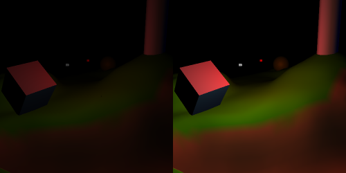
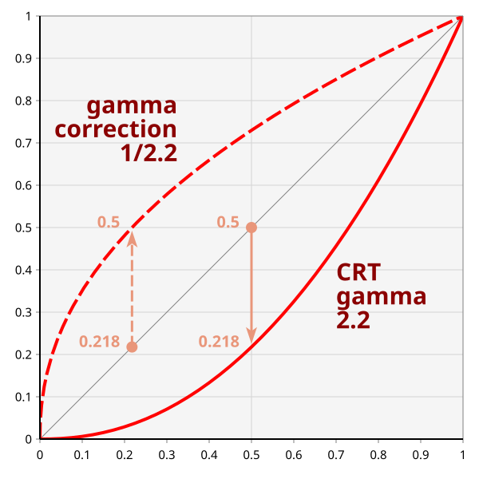

# 动态范围

到目前为止，我们的光照例子都相当平淡。一个光源照亮一个悬浮在平坦地形之上的简单物体。本教程将演示如何在更大的地形中、动态光照环境下使用多个光源。我们会演示如何正确地为场景打光。这一章的重点与其说是场景应该长什么样的艺术性，不如说是如果你希望场景看起来是某个样子，该如何让它呈现那个样子。

## 搭建场景

这个场景的意图是动态的。地形会很大且多丘陵，和之前教程中见过的平坦平原不同。它会在合适的地方使用顶点颜色，从而具备地形般的质感。地形上还会有各种物体，每个物体都有自己的一套反射特性。这有助于展示场景的动态特性。

为场景打光的第一步，是明确地把你想要的东西写清楚；不这么做，你大概找不到通往该目标的路径。在本例中，场景被设定在户外，因此会有一个巨大的平行光从上方照下来。此外还会有若干更小、更弱的光源。所有这些光源都会带动画地运动。

这里最重要的一点是，我们希望场景的照度能动态变化。具体来说，我们想要一个完整的昼夜循环。太阳会下沉，光强逐渐减弱直至消失。它会一直停在那里，直到第二天黎明时分再获得强度并升起。其他光源的总体光强应该远低于太阳。

这需要做到的一件事是动态的环境光范围。回顾一下，环境光是为了解决全局光照问题而提出的：光在场景中四处反弹，因此可能来自许多光源。当太阳处于全强度时，场景的环境光照明也应该同样明亮。这意味着背对阳光的表面仍会相对明亮，这正是我们在室外看到的情形。而到了夜里，环境光应该几乎为零。只有正对某个光源的表面才应当被照亮。

**Scene Lighting** 教程演示了复现这个场景的第一版实现。

*Scene Lighting*

相机的旋转和缩放与之前的教程相同。与之不同的是，本教程相机的目标点可以移动。<kbd>W</kbd>、<kbd>A</kbd>、<kbd>S</kbd> 和 <kbd>D</kbd> 键相对于相机当前的朝向前后左右移动相机。<kbd>Q</kbd> 和 <kbd>E</kbd> 键同样相对于当前朝向升高和降低相机。按住 <kbd>Shift</kbd> 配合这些键使用，移动步长会更小。按 <kbd>T</kbd> 可以切换是否显示当前的目标点。

由于本教程的光照非常依赖时间，因此有一套专门用于操控时间的控制项。定时器分为两组：一组控制太阳的位置（以及与之相关的属性，如太阳光强、环境光强度等），另一组控制场景中其他光源的位置。影响定时器的命令可以只影响太阳、只影响其他光源，或者同时影响两者。

要让定时器命令只影响太阳，按 <kbd>2</kbd>。要只影响其他光源，按 <kbd>3</kbd>。要同时影响两者，按 <kbd>1</kbd>。

要按真实时间回退一秒，按 <kbd>-</kbd>。要向前跳一秒，按 <kbd>=</kbd>。要切换暂停，按 <kbd>p</kbd>。这些命令只影响当前选中的定时器。此外，按 <kbd>SpaceBar</kbd> 会以 24 小时制打印出当前基于太阳的时间。

### 材质与 UBO

本教程的源代码比之前的复杂得多。由于这种复杂性，它分散在多个文件中。本教程的所有教程项目都共享 `Scene.h/cpp `和 `Lights.h/cpp `文件。Scene 文件负责搭建场景中的物体并渲染它们。这个文件包含物体的表面属性。

一个光照函数需要两组特定的参数：表示光源的值，以及表示表面的值。表面属性常常被称为**材质属性**。每个物体都有自己的材质属性，定义在 `Scene.cpp `中。

场景中有 6 个物体：地形、中央的一个高圆柱、一个多色立方体、一个球体、一个旋转的四面体，以及一座神秘的黑色方尖碑。每个物体都有自己的材质属性，由 `GetMaterials `函数定义。

这些属性全部存放在一个一致性缓冲对象中。我们此前已经见过它用于多个程序之间共享的数据；这里我们用它来快速改变一组数值。这些材质属性不随时间变化；我们设置一次，之后永不再改。这主要是为了演示，但它也可能产生实际效果。

每个物体的材质数据定义为下面这个结构体：

**示例：材质 uniform 块**

```glsl
//GLSL
layout(std140) uniform;

uniform Material
{
    vec4 diffuseColor;
    vec4 specularColor;
    float specularShininess;
} Mtl;
```

```cpp
//C++
struct MaterialBlock
{
    glm::vec4 diffuseColor;
    glm::vec4 specularColor;
    float specularShininess;
    float padding[3];
};
```

C++ 定义中的 `padding `变量表明：GLSL 中对这个 uniform 块的定义会被填充到 12 个浮点数的大小。这是"std140"布局本身的特性（你可以自由阅读 OpenGL 规范中相应的章节来了解原因）。注意 uniform 块布局是全局定义的；这会把所有 uniform 块都设为使用"std140"布局，除非它们显式地加以覆盖。这样一来，我们就不必在每个着色器文件里用到的三个 uniform 块上逐一写出 `layout(std140)`。

另外，注意 uniform 块定义末尾的 `Mtl `。这称为接口块的**实例名**。不指定实例名时，uniform 块中的名字就是全局的。如果指定了实例名，就必须用这个名字来限定对该块内部名字的访问。这使得 `in vec4 diffuseColor `可以与材质定义中的 `Mtl.diffuseColor `区分开。

我们想做的是把 6 个材质块放进同一个 uniform 缓冲中。有人可能天真地以为，只要分配一个 6 倍于 `sizeof(MaterialBlock) `的缓冲对象，然后把数据存成一个 C++ 数组就行了。遗憾的是，由于 UBO 的一个限制，这样做行不通。

当你用 `glBindBufferRange `绑定一个 UBO 时，OpenGL 要求 offset 参数——也就是指出 uniform 块数据在缓冲对象中从何处开始的那个参数——必须对齐到某个特定值。也就是说，uniform 缓冲中一个 uniform 块的起始位置必须是某个特定值的整数倍。当然，0 是符合要求的，但既然我们在一个 uniform 缓冲里有多个块，它们就不能全都从缓冲的开头开始。

这个值是多少，你可能会问。欢迎来到"依赖于实现的值"的世界。这意味着它可以（而且几乎肯定会）随你运行的平台而变化。这段代码在两个不同的硬件平台上测试过：一个的最小对齐值是 64，另一个是 256。

要获取这个依赖于实现的值，我们必须用一个此前没见过的函数：`glGetIntegerv `。这个函数只做一件简单的事：从 OpenGL 中获取整数值。不过，所获取值的含义取决于作为第一个参数传入的枚举名。基本上，它提供了一种状态获取函数，可以通过新增枚举名而不是新增函数来轻松扩展。

构建材质 uniform 缓冲的代码如下：

**示例：材质 UBO 的构建**

```cpp
int uniformBufferAlignSize = 0;
glGetIntegerv(GL_UNIFORM_BUFFER_OFFSET_ALIGNMENT, &uniformBufferAlignSize);

m_sizeMaterialBlock = sizeof(MaterialBlock);
m_sizeMaterialBlock += uniformBufferAlignSize -
    (m_sizeMaterialBlock % uniformBufferAlignSize);

int sizeMaterialUniformBuffer = m_sizeMaterialBlock * MATERIAL_COUNT;

std::vector<MaterialBlock> materials;
GetMaterials(materials);
assert(materials.size() == MATERIAL_COUNT);

std::vector<GLubyte> mtlBuffer;
mtlBuffer.resize(sizeMaterialUniformBuffer, 0);

GLubyte *bufferPtr = &mtlBuffer[0];

for(size_t mtl = 0; mtl < materials.size(); ++mtl)
    memcpy(bufferPtr + (mtl * m_sizeMaterialBlock), &materials[mtl], sizeof(MaterialBlock));

glGenBuffers(1, &m_materialUniformBuffer);
glBindBuffer(GL_UNIFORM_BUFFER, m_materialUniformBuffer);
glBufferData(GL_UNIFORM_BUFFER, sizeMaterialUniformBuffer, bufferPtr, GL_STATIC_DRAW);
glBindBuffer(GL_UNIFORM_BUFFER, 0);
```

我们用 `glGetIntegerv `获取对齐要求。然后计算一个材质块的大小，再加上足以满足对齐要求的填充。之后就相当直接了。`mtlBuffer `只是一个巧妙的办法，用来分配一块内存而不必直接使用 new/delete。是的，这完全符合 C++ 规范，是合法的。

场景渲染时，会用 `glBindBufferRange `把缓冲对象中相应的区域绑定进来进行渲染。

### 光照

光照的代码要复杂得多。它利用了框架库的两个方面来完成工作：插值器和定时器。`Framework::Timer `是一个相当通用的类，它可以跟踪一个循环的时间范围，并把它转换到 [0, 1) 范围。插值器则用来把 [0, 1) 范围的一组可能取值转换为某个特定值。它们究竟如何工作超出了本次讨论的范围，不过我们会介绍一些基本信息。

`LightManager `类控制所有定时器。所有快进、回退之类的控制都内置在它里面。它的基本功能是计算某个特定时间点的全部光照值。它依据主教程源文件 `SceneLighting.cpp `提供的信息来做这件事。重要的值通过 `SetupDaytimeLighting `函数传入。

**示例：白天光照**

```cpp
SunlightValue values[] =
{
    { 0.0f/24.0f, /*...*/},
    { 4.5f/24.0f, /*...*/},
    { 6.5f/24.0f, /*...*/},
    { 8.0f/24.0f, /*...*/},
    {18.0f/24.0f, /*...*/},
    {19.5f/24.0f, /*...*/},
    {20.5f/24.0f, /*...*/},
};

g_lights.SetSunlightValues(values, 7);

g_lights.SetPointLightIntensity(0, glm::vec4(0.2f, 0.2f, 0.2f, 1.0f));
g_lights.SetPointLightIntensity(1, glm::vec4(0.0f, 0.0f, 0.3f, 1.0f));
g_lights.SetPointLightIntensity(2, glm::vec4(0.3f, 0.0f, 0.0f, 1.0f));
```

为清晰起见，主表中实际的光照参数已被删去。`SunlightValue `结构体定义了随太阳位置变化而变化的参数，即环境光强度、太阳光强和背景颜色。该结构体的第一个参数是时间，位于 [0, 1) 范围内，表示这些参数应当取该值的时刻。时间 0 表示正午，时间 0.5 表示午夜。为清晰起见，我采用了 24 小时制（其中 0 表示正午而不是午夜）。

我们稍后会讨论实际的光照值。

`LightManager `的主要用途是获取光照参数。这由 `GetLightInformation `函数完成，它接受一个矩阵（用于把光源位置和方向变换到相机空间），并返回一个 `LightBlock `对象。这是一个表示着色器所定义的 uniform 块的对象：

**示例：光照 uniform 块**

```glsl
struct PerLight
{
    vec4 cameraSpaceLightPos;
    vec4 lightIntensity;
};

const int numberOfLights = 4;

uniform Light
{
    vec4 ambientIntensity;
    float lightAttenuation;
    PerLight lights[numberOfLights];
} Lgt;
```

```cpp
struct PerLight
{
    glm::vec4 cameraSpaceLightPos;
    glm::vec4 lightIntensity;
};

const int NUMBER_OF_LIGHTS = 4;

struct LightBlock
{
    glm::vec4 ambientIntensity;
    float lightAttenuation;
    float padding[3];
    PerLight lights[NUMBER_OF_LIGHTS];
};
```

同样，这个结构体的 C++ 版本也需要一些填充。另外，你可能注意到我们第一次在 GLSL 中同时使用数组和结构体。它们的工作方式与 C/C++ 的结构体和数组基本相同（除了指针相关的部分，因为 GLSL 没有指针），不过数组有一些需要特别注意的地方。

### 多光源着色器

本教程中我们使用 4 个着色器。其中两个的漫反射颜色取自顶点着色器传过来的值。另外两个使用材质的漫反射颜色。另一个区别是，两个做镜面反射计算，另两个不做。这体现了我们材质的多样性。

总体来说，这些代码你都没见过。我们使用高斯镜面反射和平方倒数衰减，以便在当前能力范围内尽可能贴近物理正确。一处很大的不同在 `main `函数中。

**示例：多光源的主函数**

```glsl
void main()
{
    vec4 accumLighting = diffuseColor * Lgt.ambientIntensity;
    for(int light = 0; light < numberOfLights; light++)
    {
        accumLighting += ComputeLighting(Lgt.lights[light]);
    }
    
    outputColor = accumLighting;
}
```

这里，我们先计算环境光修正带来的光照。然后遍历每个光源，计算它带来的光照，并累加到我们的累积值中。循环和数组一般都没问题。

另一个技巧是我们如何处理位置光源和方向光源。`PerLight `结构体并没有明确说明某个光源是位置的还是方向的。不过，我们用 `cameraSpaceLightPos `的 W 分量来区分它们；这是一个久经考验的技巧。如果 W 分量为 0.0，那么它是平行光；否则就是点光源。

在光照函数中，平行光和点光源唯一的区别就是衰减（平行光不使用衰减）以及光照方向的计算方式。所以我们只需根据 W 分量来计算这些：

```glsl
vec3 lightDir;
vec4 lightIntensity;
if(lightData.cameraSpaceLightPos.w == 0.0)
{
    lightDir = vec3(lightData.cameraSpaceLightPos);
    lightIntensity = lightData.lightIntensity;
}
else
{
    float atten = CalcAttenuation(cameraSpacePosition,
        lightData.cameraSpaceLightPos.xyz, lightDir);
    lightIntensity = atten * lightData.lightIntensity;
}
```

### 光照问题

我们当前的光照设置有几个问题。在白天看起来（基本上）没问题。移动的点光源视觉效果不大，而且大多不太明显。但这正是大白天的预期情况；手电筒在白天不会有多大影响。

可到了夜里，一切都非常暗。点光源是唯一活跃的照明来源，而它们全都太暗了，看不清楚。地形几乎完全融入黑色的背景。

还有另一套光照参数可以解决这个问题。按 Shift + L；这会切换到针对夜间优化的版本（按 <kbd>L</kbd> 切回针对白天优化的光照）。在这里，点光源在夜间提供了合理的照明。背对光源的地面仍然很暗，但我们能合理地看清东西。



> 黑暗，白天与夜间对比

问题在于，在白天，针对夜间优化的点光源功率过强。它们非常显眼，对场景的影响非常大。而且，当某个点光源处在特定位置时，还会引起一些光照问题。在大约 12:50 的时候，找到立方体附近那个漂浮的白色光源：

*光照裁剪*

注意那块彩虹色的绿色斑块。这是**光照裁剪**或光照钳制，通常是非常不想要的结果。当算出的光强落在 [0, 1] 范围之外时就会发生，通常是在正方向上（就像本例这样）。物体无法被显示得更亮，于是它变成一块纯色，丢失了全部细节。

解决我们光照问题的显然办法，就是根据一天中的时间改变点光源的强度。然而这并不现实；手电筒在夜里其实并不会变得更亮。所以，如果我们不得不做一些与现实背道而驰的事情，那大概说明我们没有正确建模现实中的某个方面。

## 高动态范围

要回答这个问题，我们必须先弄清楚为什么手电筒在夜里比白天显得更亮。答案很大一部分与我们的眼睛有关。

瞳孔是眼睛中让光通过的孔；相机把这个孔叫作光圈。这个孔相对于世界来说很小，这有助于分辨图像。然而，穿过这个孔的光量取决于它有多大。我们的虹膜可以扩张和收缩以控制瞳孔的大小。瞳孔大时，更多光被允许进入眼睛；瞳孔小时，进入的光就更少。

在强光下虹膜会自动收缩，因为过多光线会损伤视网膜（眼睛中感光的表面）。而在没有光的情况下，虹膜会缓慢放松，使瞳孔扩大。这样就允许更多光进入眼睛，从而增加了场景的表观亮度。

所以我们需要的并不是改变整体光照水平，而是把相当于虹膜的东西应用到场景最终的光照计算上。也就是说，我们先确定某一点处的整体照明，再根据一个全局设置过滤掉其中一部分光。在暗的场景中，我们过滤掉较少的光；在亮的场景中，我们过滤掉较多的光。

这个整体过程称为**高动态范围光照**（**HDR**）。它相当简单，与我们当前的模型相比只需要很少的额外数学运算。

**注意**

> 你可能听说过这个词与某些明亮物体似乎在发光的图像联系在一起。虽然 HDR 通常与那种发光效果相关，但那是另一种叫作泛光（bloom）的效果。它被严重滥用，我们稍后会讨论如何实现它。HDR 与泛光确实会相互作用，但你可以只用其中一个而不用另一个。

第一步是破除"光源本身有全局最大亮度"这个迷思。在之前所有例子中，我们的光强值都处在 [0, 1] 范围内。把光强钳制到这个范围根本不能反映现实。现实中，太阳比手电筒亮好几个数量级。我们的光照方程必须为此留出余地。

这也意味着，我们累积起来的光强——也就是最初写入片元着色器输出的那个值——不再位于 [0, 1] 范围内。这就带来了一个问题。我们可以用高动态范围来做光照计算，但显示器只能显示 [0, 1] 范围内的颜色。因此我们必须从 HDR 映射到低动态范围（**LDR**）。

HDR 渲染的这一部分称为**色调映射**。色调映射函数有很多种，但我们会用一个模拟可变光圈的函数。它其实相当简单。首先，我们为场景挑选一个最大强度值；超过这个值的强度会被钳制。然后，只要用 HDR 值除以最大强度就得到 LDR 值。

我们要改变的就是这个最大强度。随着太阳落下，强度也随之下降。这让太阳在白天可以比那些光源亮得多，从而压倒它们对场景照明的贡献。但到了夜里，当最大强度低得多时，其他光源的表观亮度就会更高。

这在 **HDR Lighting** 教程中实现。

这个教程的控制方式与上一个相同，只是 <kbd>K</kbd> 键会启用 HDR 光照。按 <kbd>L</kbd> 或 Shift + L 分别回到上一个教程中针对白天或针对夜间优化的 LDR 光照。

*HDR Lighting*

代码相当直白。我们给 C++ 中的 `Light `uniform 块和 `LightBlock `结构体添加一个浮点字段。严格来说，我们只是"偷"用了其中一个填充浮点数，所以大小保持不变：

**示例：HDR LightBlock**

```cpp
struct LightBlockHDR
{
    glm::vec4 ambientIntensity;
    float lightAttenuation;
    float maxIntensity;
    float padding[2];
    PerLight lights[NUMBER_OF_LIGHTS];
};
```

我们还给 `SunlightValue `添加了一个新字段：最大光强。`LightManager `中也多了一个新函数，用来计算 HDR 版本的光照块：`GetLightInformationHDR `。严格来说，所有这些代码本来就在 `Light.h/cpp `中，因为这里所有教程都共享这些文件。

### HDR 下的场景光照

以 HDR 为一个场景打光，是一个与 LDR 不同的过程。既有一个变化的最大强度值，又能够使用大于 1.0 的光强，这两点会大幅改变你搭建场景的方式。

在本例中，光照中的一切都是这样设计的：白天匹配 LDR 的白天版本，夜里匹配 LDR 的夜间版本。然后再把除以最大强度这一点考虑进去。

**场景光照数值**

|  |  |  |  | HDR |  |  | LDR 白天优化 |  |  | LDR 夜间优化 |
| --- | --- | --- | --- | --- | --- | --- | --- | --- | --- | --- |
| 正午阳光强度 | 1.8 | 1.8 | 1.8 | (3.0) | 0.6 | 0.6 | 0.6 | 0.6 | 0.6 | 0.6 |
| 正午环境光强度 | 0.6 | 0.6 | 0.6 |  | 0.2 | 0.2 | 0.2 | 0.2 | 0.2 | 0.2 |
| 傍晚阳光强度 | 0.45 | 0.15 | 0.15 | (1.5) | 0.3 | 0.1 | 0.1 | 0.3 | 0.1 | 0.1 |
| 傍晚环境光强度 | 0.225 | 0.075 | 0.075 |  | 0.15 | 0.05 | 0.05 | 0.15 | 0.05 | 0.05 |
| 环绕光强度 | 0.6 | 0.6 | 0.6 |  | 0.2 | 0.2 | 0.2 | 0.6 | 0.6 | 0.6 |
| 红色光强度 | 0.7 | 0.0 | 0.0 |  | 0.3 | 0.0 | 0.0 | 0.7 | 0.0 | 0.0 |
| 蓝色光强度 | 0.0 | 0.0 | 0.7 |  | 0.0 | 0.0 | 0.3 | 0.0 | 0.0 | 0.7 |

括号中的数值表示该时刻的最大强度。

为了让白天的光照保持不变，我们只需把 LDR 白天版本中的阳光和环境光强度乘以阳光强度与某个光源强度之间的比值。这个比值是 3:1，因此阳光和环境光强度都被放大了 3 倍。

最大强度也是类似地推导出来的。在 LDR 的情况下，最大强度 (1.0) 与阳光加环境光强度之和之间的差是 0.2（1.0 - (0.6 + 0.2)）。为了保持这个差值，我们把最大强度设为环境光与阳光强度之和，再加上原来比值的 3 倍。

这实际上意味着，就阳光和环境光而言，该光源在 HDR 白天模式下的工作方式与 LDR 白天优化设置中相同。而为了让其他光源在夜间也能工作，我们只需把它们的值保持为 LDR 夜间优化情形下的值。

## 线性与 Gamma

还剩下一个主要问题，而且这个问题从我们开始研究光照以来就被一笔带过了：你的屏幕。

从最开始起，我们所有光照方程背后的基本假设就是：表面颜色和光强都处于一个**线性色彩空间**中。色彩空间定义了我们如何把一组数值转换为真实可见的颜色。如果把某个色彩空间中的任意数值加倍，得到的是一个亮度为原来两倍的色彩，那么这个色彩空间就是**线性色彩空间**。这里的"线性"指的是数值与所得色彩总体亮度之间的关系。

就我们目前的数据而言，这个假设可以被视为理所当然。我们所有的漫反射和镜面颜色值都是自己给出的，所以我们可以知道它们表示的是线性 RGB 色彩空间中的数值。光强同样处于线性色彩空间中。在上一节中把阳光和环境光强度乘以 3 时，我们把亮度提高了 3 倍。而把最大强度乘以 3，效果则是把总体亮度降低到原来的 1/3。

不过只有一个问题：你的屏幕不是这么工作的。是时候来一段简短的电视/显示器历史了。

最早的电视使用电子枪打在荧光屏上产生光和图像；这称为 **CRT** 显示器（阴极射线管）。电子束的强度决定了图像相应部分的亮度。然而，电子束的强度并不随图像亮度线性变化。

在电视时代早期，处理这一点最容易的办法，就是干脆在源头修改输入的图像。电视广播发送的图像数据，其非线性方向与 CRT 固有的非线性方向相反。因此最终输出是线性显示的，正如摄像机最初采集时那样。

把图像"去线性化"以补偿非线性显示器，这个过程称为 **Gamma 校正**。

你可能会奇怪这为什么重要。毕竟你多半没有基于 CRT 的显示器；你大概用的是某种 LCD、等离子、LED 或类似技术。那么 CRT 显示器的这些怪癖对你来说又有什么关系呢？

因为 Gamma 校正无处不在。DVD、录像带、Blu-Ray 光盘里都有它。每台数码相机都会做 Gamma 校正。而且长期以来一直如此。正因如此，你不可能卖出一台试图做线性色彩还原的 LCD 显示器；没人会买，因为面向它的所有媒体（包括你的操作系统）都是按 CRT 式非线性显示器的假设来设计和编写的。

这意味着每一种非 CRT 显示器都必须模仿 CRT 的非线性；这已经内建在每台显示设备的基本视频处理逻辑之中。

所以到目前为止，经过十二个教程，我们一直在向一个期望 Gamma 校正后的非线性 RGB 值的显示设备输出线性 RGB 值。但在开始做光照之前，我们只是随便挑些好看的颜色，所以这无关紧要。现在我们要做点稍微现实一点的东西，就必须进行 Gamma 校正。这样我们才能看到自己*实际*渲染出的东西，而不是被显示器 Gamma 校正电路篡改过的结果。

### Gamma 函数

Gamma 函数就是那个把线性 RGB 空间映射到非线性 RGB 空间的函数。CRT 显示器的 Gamma 函数相当标准，所有非 CRT 显示器都模仿这个标准。它最终基于 CRT 显示器的一个数学函数。电子束的强度由通过它的电压控制。这与光强的关系如下：


> 显示器 Gamma 函数

这个函数之所以叫 Gamma 函数，是因为希腊字母 γ（gamma）。输入信号直接控制电压，因此输入信号需要针对 Gamma 的幂次做校正。

现代显示器通常都有 Gamma 调整选项，允许用户设置显示器的 Gamma 值。默认值通常是 2.2 左右；这是一个折中兼顾的实用值，也是我们 Gamma 校正代码的一个极好的默认选择。

所以，给定上面那个 Gamma 函数，我们需要让着色器输出的值在经过 Gamma 函数之后，得到我们原本的线性值。这就是 Gamma 校正，相应的函数很直接。


> Gamma 校正函数

如果能画出这些函数的图形，推测一下我们在 Gamma 校正后的图像中会看到什么，倒是挺有意思的。



> Gamma 函数曲线图

没有 Gamma 校正时，我们的 linearRGB 颜色（图中那条对角线）会变成图底部那条 CRT Gamma 曲线。这意味着我们一直看到的其实是我们色彩的一个*严重*变暗的版本。linearRGB 值 0.5 会降到 0.218 的强度；超过一半的亮度就这么没了。

有了正确的 Gamma 校正，我们可以预期场景会变得明亮得多。

### Gamma 校正实战

Gamma 校正在 **Gamma Correction** 教程中实现。

<kbd>K</kbd> 键切换 Gamma 校正。默认的 Gamma 值是 2.2，但可以用 <kbd>Y</kbd> 和 <kbd>H</kbd> 键分别升高和降低它。

*Gamma Correction*

这非常明亮；它用的是与前面几个教程相同的基于 HDR 的光照环境。我们来看一些代码。

Gamma 值是一种有点特殊的值。概念上，它本身与光照毫无关系。它是跨多个着色器的全局值，所以它应该放在某个 UBO 里。但它不是材质参数；它不会随物体而变化。本教程中，我们把它塞进 `Light `uniform 块和 `LightBlockGamma `结构体。同样，我们从填充位里"偷"一个浮点数：

**示例：Gamma LightBlock**

```cpp
struct LightBlockGamma
{
    glm::vec4 ambientIntensity;
    float lightAttenuation;
    float maxIntensity;
    float gamma;
    float padding;
    PerLight lights[NUMBER_OF_LIGHTS];
};
```

为了本教程的清晰起见，我们发送的是实际的 Gamma 值。出于性能考虑，我们其实应该发送 1/gamma，这样就不必在每个片元中做一次多余的除法。

Gamma 的应用方式在片元着色器中如下：

**示例：片元 Gamma 校正**

```glsl
accumLighting = accumLighting / Lgt.maxIntensity;
vec4 gamma = vec4(1.0 / Lgt.gamma);
gamma.w = 1.0;
outputColor = pow(accumLighting, gamma);
```

除此之外，代码与 HDR 教程基本没有变化。说到这个，Gamma 校正本身并不需要 HDR，HDR 也不需要 Gamma 校正。然而两者结合起来，有能力在整体视觉质量上带来实质性的提升。

代码中最后一项改动，是针对那些未经任何光照计算就直接写入的光照值。背景色就是帧缓冲的清除色。即便如此，它也需要 Gamma 校正；这在 CPU 端完成，即在绘制之前对该颜色做 Gamma 校正。如果你还有任何其他直接绘制的颜色，*不要*忘了做同样的处理。

### Gamma 校正后的光照

我们之前看到的，是把 HDR 光照应用到一个其光照属性*未经* Gamma 校正定义的场景上会发生什么。看看夜间的场景；点光源极其明亮，它们的光照效果似乎比之前延伸得远得多。最后这一点值得探究一下。

我们第一次讨论光衰减时说过，点光源正确的衰减函数是关于到光源距离的平方倒数关系。我们也说过这样通常看起来不对，所以人们常常使用普通的倒数衰减函数。

原因就是 Gamma。更准确地说，是缺少 Gamma 校正的原因。如果不对显示器的 Gamma 函数做校正，`1/r2 `的衰减实际上会变成 `(1/r2)2.2 `，也就是 `1/r4.4 `。缺少正确的 Gamma 校正会放大光源的有效衰减。简单的 `1/r `关系在没有 Gamma 校正时看起来更好，因为显示器的 Gamma 函数会把它变成更接近线性色彩空间的东西：`1/r2.2 `。

既然这个光照环境不是在看着 Gamma 校正结果的情况下设计的，我们就来看看一些在恰当考虑 Gamma 的前提下开发出来的场景光照。打开 Gamma 校正，并把 Gamma 值设为 2.2（如果你没有改动过，这就是默认值）。然后按 Shift + L：

*Gamma 光照*

这就对多了。

如果这次练习有哪一点值得你记住，那就是：一定要在开始为场景打光*之前*实现 Gamma 校正和 HDR。否则你可能不得不重新调整所有光照参数，甚至可能还需要更换材质。在本例中，我们甚至无法用简单的修正数学来让这个光照环境正常工作。这套光照环境基本上是从零开始开发的。

观察 Gamma 校正后的光照时，我们能注意到一件事：正确的 Gamma 校正能显著改善阴影细节：

*Gamma 阴影细节*

这两张图用的都是 HDR 光照；左边那张没有 Gamma 校正，右边那张有。注意右边图中三角形附近山丘上的细节多么容易辨认。

从 Gamma 函数的角度看，这很说得通。没有正确的 Gamma 校正时，linearRGB 范围中整整一半的值被塞进了可用光强范围的底部五分之一。这几乎不给那些"偏暗但还没暗到看不见任何东西"的区域留下多少空间。

因此，Gamma 校正是生成色彩准确的渲染图像的关键过程。它让暗部细节更容易显现出来。

## 本章小结

在本教程中，你学到了以下内容：

- 如何搭建并为一个包含多个物体和多个光源的场景打光。
- 高动态范围光照意味着使用一个可以逐帧变化的最大照明值，而不是某个单一固定值。
- 颜色值和位置、法向量一样，是有空间的。光照方程工作在线性色彩空间中，在那里把某个值乘以二就能得到两倍的亮度。为了得到正确的成像结果，确保光照的最终结果处于输出显示设备所期望的色彩空间中至关重要。这个过程称为 Gamma 校正。

### 进一步学习

试着用给出的程序做下面这些事情。

- 给 Gamma 校正后的场景添加第五个光源，也就是一个代表月亮的平行光。这需要创建另一组插值器，并扩展 SunlightValues 结构体以容纳月亮的光照强度。这也意味着要把着色器使用的光源数量从 4 个扩展到 5 个（或去掉一个点光源）。月亮应该比太阳暗得多，但仍应对亮度有明显的影响。
- 在 Gamma 校正后的场景中调整环境光强度，特别是在白天部分。少量环境光，即使最大强度高达 10，对提升场景的亮度水平也大有帮助。

### 深入探究

HDR 是一个相当大的领域。本教程讲解的可能是最简单的色调映射形式，但你可以使用的方程还有很多。有些色调映射函数能把完整的 [0, ∞) 范围映射到 [0, 1]。对于需要动态光圈尺寸的场景来说这没什么用，但如果光圈是固定的，它确实能让你使用范围很宽的光照数值。

在使用某种可变光圈设置做色调映射时，计算出正确的最大强度值可能很困难。硬编码一个值——哪怕是用算法算出来的值——对某些场景来说已经够用了。但对于用户能够控制相机朝向的场景，这可能不合适。在许多现代游戏里，他们实际上会把渲染图像的一部分读回 CPU，做一些计算分析，以确定下一帧的最大强度应该是多少。当然这存在延迟，但它换来了一个能根据玩家当前在看什么而变化的光圈，而不是硬编码的值。

只要记住：在你开始搭建场景*之前*就选定你的 HDR 和色调映射算法。如果你打算在中途更换它们，就得重做大量工作。

### 值得关注的 OpenGL 函数

- **glGetIntegerv**：获取依赖于实现的整数值，以及若干上下文状态的整数值。另有 `glGetFloatv `、`glGetBooleanv `以及各种其他带类型的 `glGet* `函数。它获取的数值个数取决于传入的枚举名。

## 术语表

- **材质属性**：光照方程中表示表面特性的一组输入。这包括表面的法向量、漫反射率、镜面反射率、各个镜面幂值等等。这些值的来源可以有很多种：某个物体的 uniform 值、片元着色器输入，或其他潜在来源。
- **实例名**：对于 uniform 块（或其他类型的接口块），这个名字在着色器中用于对块的成员进行名称限定。除非存在命名冲突，或者需要指定数组，否则它是可选的。
- **光照裁剪**：绘制到屏幕上的光照数值被钳制到 [0, 1] 范围。当光照产生的数值落在该范围之外时，就称该光照被这个范围裁剪了。这会在图像中产生一片非常明亮、平坦的区域，丢失了全部细节和层次。最好避免出现这种情况。
- **高动态范围光照**：使用 [0, 1] 范围之外数值的光照。这让完整范围的光照强度得以被使用。
- **色调映射**：把 HDR 值映射到 [0, 1] 范围的过程。这个映射可以是线性的，也可以不是。
- **色彩空间**：一组参考颜色，定义了计算机图形中表示颜色的一种方式，以及在这些参考颜色与实际颜色之间映射的函数。所有颜色都是相对于某个特定色彩空间定义的。
- **线性色彩空间**：一种色彩空间中，色彩的亮度随其数值线性变化。把某个颜色的数值加倍，其亮度也会加倍。
- **Gamma 校正**：从线性色彩空间转换到显示设备所期望的非线性色彩空间的过程，通常通过使用幂函数来实现。这个过程确保显示设备产生的图像是线性的。
