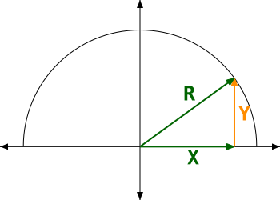
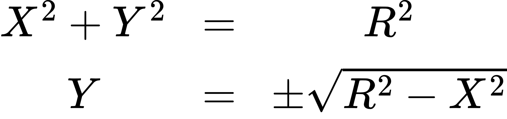
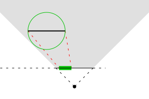
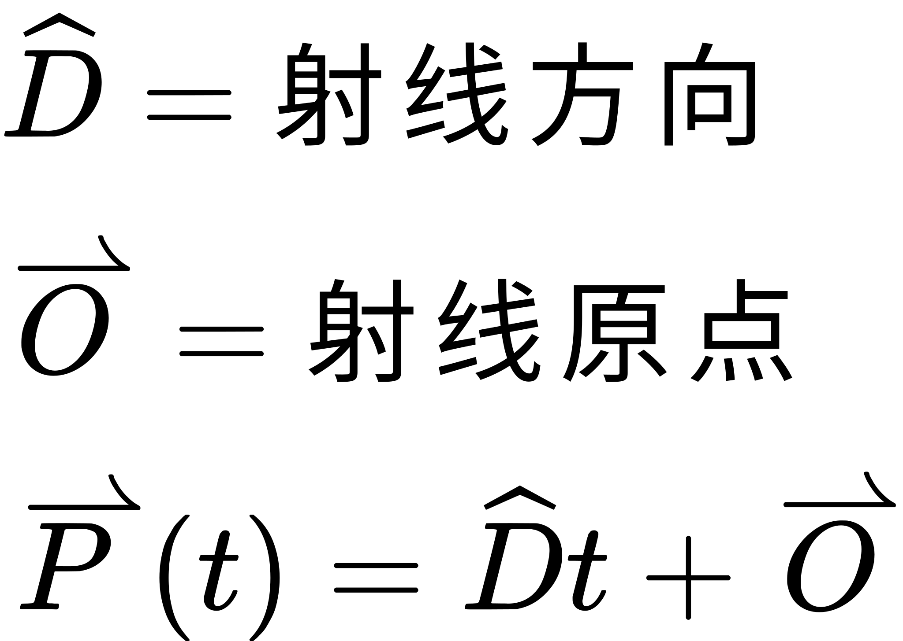
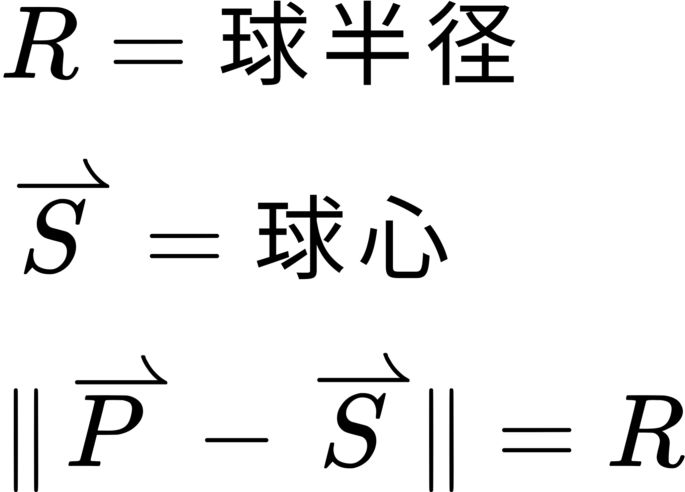
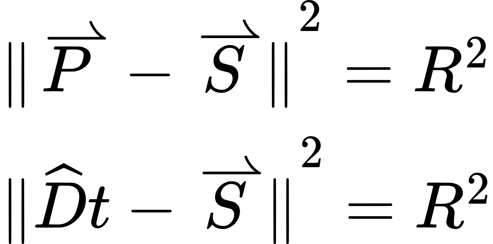
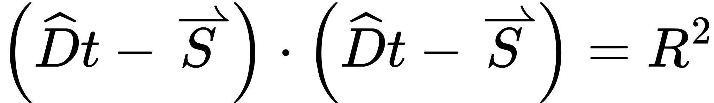
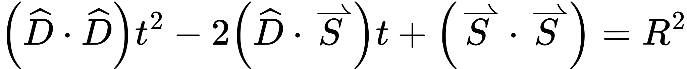
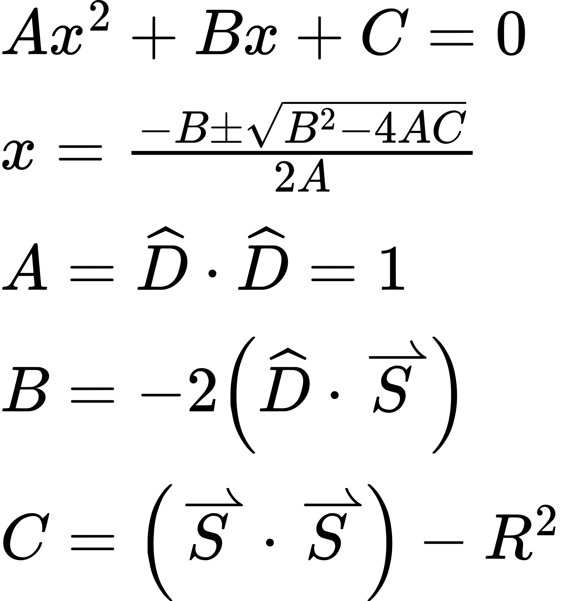

# 谎言与替身

到目前为止，本教程中的光照说到底是一种欺骗。而且是一种越来越逼真的欺骗，但欺骗终归是欺骗。我们并没有真的在渲染球体；我们只是利用光照以及对表面特性的插值，让一个物体看起来像是圆的。有时候，某些瑕疵或视觉错觉会让这个谎言露出马脚。即便谎言几乎完美，模型的几何形状仍然与光照让几何体呈现出来的样子并不一致。

在本教程中，我们将看到这种谎言的终极形态。我们会用光照计算，让一个物体看起来与它的几何形状完全不同。

## 简单的骗局

我们想渲染一个球体。可以像前面几个教程那样来做：生成一个球体的网格并渲染它。但这样得到的球体永远不会是数学上完美的球体。生成具有任意三角形数量的球体很容易，因此可以不断改进逼近程度。但它始终只是一个近似。

从数学角度看，球体非常简单。它就是空间中与某个特定点距离等于某个值的点集。这听起来像是我们可以在着色器里算出来的东西。

我们渲染球体的第一版尝试会相当简单。我们用顶点着色器在裁剪空间中计算一个*正方形*的顶点位置。这个正方形与真正的圆处于相同位置、相同的宽度和高度，并且始终正对相机。在片元着色器中，我们会计算球面上每个点的位置和法向量。通过这样做，我们能把正方形上的每个点映射到我们想渲染的球面上的一个点。这个正方形通常被称为平面卡片（flat card）或广告牌（billboard）。

对于正方形上那些无法映射到球面点的位置（比如四个角），我们必须做特殊处理。片元着色器必须向输出图像写入一个值，但它们同时也具备中途放弃处理的能力——既不写入颜色信息，也不写入深度缓冲。我们将利用这一点来绘制我们的方形球体。

这项技术通常被称为替身。思路是：我们实际上画的是一个正方形，但用片元着色器让它看起来像别的东西。这个几何形状只是一个占位物，一种在屏幕特定区域内触发片元着色器的手段。真正的魔法发生在片元着色器里。

教程工程 `Basic Impostor` 演示了这项技术。它展示了一个包含若干球体、一个平行光源以及一个移动点光源的场景。

*Basic Impostor*

相机移动的控制方式与前面的教程相同。<kbd>T</kbd> 键用于切换显示观察目标的辅助信息。<kbd>-</kbd> 和 <kbd>=</kbd> 键用于让时间倒流和快进，<kbd>P</kbd> 键用于暂停或恢复时间的推进。

教程一开始显示的是网格球体，这样你可以在真实网格和替身球体之间来回切换。每个球体都可以独立控制：

**球体替身按键映射**

| 按键 | 球体 |
| --- | --- |
| 1 | 中央的蓝色球体。 |
| 2 | 环绕运行的灰色球体。 |
| 3 | 左侧的黑色大理石球。 |
| 4 | 右侧的金色球体。 |

本教程使用的渲染配置与上一个教程类似。着色器使用 uniform 块来控制大多数 uniform。有一个共享的全局光照 uniform 块，另有一个用于投影矩阵的 uniform 块。

### 行骗的几何体

这个程序渲染替身几何体的方式很有意思。顶点着色器如下：

**示例：Basic Impostor Vertex Shader**

```glsl
#version 330

layout(std140) uniform;

out vec2 mapping;

uniform Projection
{
    mat4 cameraToClipMatrix;
};

uniform float sphereRadius;
uniform vec3 cameraSpherePos;

void main()
{
    vec2 offset;
    switch(gl_VertexID)
    {
    case 0:
        //Bottom-left
        mapping = vec2(-1.0, -1.0);
        offset = vec2(-sphereRadius, -sphereRadius);
        break;
    case 1:
        //Top-left
        mapping = vec2(-1.0, 1.0);
        offset = vec2(-sphereRadius, sphereRadius);
        break;
    case 2:
        //Bottom-right
        mapping = vec2(1.0, -1.0);
        offset = vec2(sphereRadius, -sphereRadius);
        break;
    case 3:
        //Top-right
        mapping = vec2(1.0, 1.0);
        offset = vec2(sphereRadius, sphereRadius);
        break;
    }
    
    vec4 cameraCornerPos = vec4(cameraSpherePos, 1.0);
    cameraCornerPos.xy += offset;
    
    gl_Position = cameraToClipMatrix * cameraCornerPos;
}
```

注意到少了什么吗？在这个顶点着色器里，任何地方都没有声明输入变量。

它确实用到了一个输入变量：`gl_VertexID`。这是一个内建输入变量，包含当前这个顶点的索引。使用数组绘制时，它就是当前所处的顶点序号；使用索引绘制时，它就是这个顶点的索引。

渲染这个网格时，我们用 `GL_TRIANGLE_STRIP` 绘制 4 个顶点。这是以数组绘制模式渲染的，因此 `gl_VertexID` 会在 0 到 3 之间变化。我们的 switch/case 语句决定当前渲染的是哪个顶点。由于我们想用三角形条带渲染一个正方形，顶点顺序必须与之相适应。

算出要渲染哪个顶点之后，我们把这个基于半径的偏移量作为偏置加到相机空间的球体位置上。球体位置的 Z 值保持不变，因为对我们的正方形来说它总是正确的。之后我们照常把相机空间的位置变换到裁剪空间。

输出变量 `mapping` 供片元着色器使用，稍后会看到它的作用。

**顶点数组对象为空** 由于这个顶点着色器不接受任何输入，我们的顶点数组对象也不需要包含任何内容。也就是说，我们从不在 VAO 上调用 `glEnableVertexAttribArray`。既然没有启用任何属性数组，我们也不需要缓冲对象来存放顶点数组数据，因此从不调用 `glVertexAttribPointer`。我们只用 `glGenVertexArrays` 生成一个空的 VAO，然后原样使用它，不做任何修改。

### 敲诈式光栅化

我们此前的光照方程只需要相机空间中的位置和法向量（以及其他的材质与光照参数）就能工作。因此，片元着色器的任务就是提供它们。即便这些值与实际三角形的对应值毫无关系。

下面是替身片元着色器中新增的关键部分：

**示例：Basic Impostor Fragment Shader**

```glsl
in vec2 mapping;

void Impostor(out vec3 cameraPos, out vec3 cameraNormal)
{
    float lensqr = dot(mapping, mapping);
    if(lensqr > 1.0)
        discard;
        
    cameraNormal = vec3(mapping, sqrt(1.0 - lensqr));
    cameraPos = (cameraNormal * sphereRadius) + cameraSpherePos;
}

void main()
{
    vec3 cameraPos;
    vec3 cameraNormal;
    
    Impostor(cameraPos, cameraNormal);
    
    vec4 accumLighting = Mtl.diffuseColor * Lgt.ambientIntensity;
    for(int light = 0; light < numberOfLights; light++)
    {
        accumLighting += ComputeLighting(Lgt.lights[light],
            cameraPos, cameraNormal);
    }
    
    outputColor = sqrt(accumLighting); //2.0 gamma correction
}
```

为了计算位置和法向量，我们首先需要找到球面上与当前所在的正方形位置相对应的那个点。要做到这一点，我们需要一种能告诉我们「在正方形上的什么位置」的手段。

用 `gl_FragCoord` 帮不上忙，因为它是相对于整个屏幕的。我们需要的是一个只相对于替身正方形的值，这正是 `mapping` 变量的用途。当这个变量位于 (0, 0) 时，我们处在正方形中心，也就是球心；当它位于 (-1, -1) 时，我们处在正方形的左下角。

有了这个值，我们就可以直接计算正方形上某个点「正上方」的球面点，这正是 `Impostor` 函数的职责。

不过在计算球面点之前，我们必须先确认当前这个点的正上方确实有球面。这只需要一次简单的距离检查。由于正方形的边长等于球体的半径，如果 `mapping` 变量到其 (0, 0) 点的距离大于 1，我们就说明这个点不在球面上。

这里我们用了一个取长度的小技巧；我们其实没有这么做。我们计算的是长度的平方。我们知道，如果 `X2 > Y2` 成立，那么对所有正实数 X 和 Y，`X > Y` 也必然成立。所以我们直接对平方做比较，而不必开平方求真正的长度。

如果这个点不在球面下方，我们就执行一个新东西：`discard`。`discard` 关键字是片元着色器独有的。它告诉 OpenGL 这个片元无效，它的数据不应写入图像缓冲和深度缓冲。这让我们能够在平面正方形中挖出一个形状，把它变成一个圆。

**▌关于 discard 的一点说明**

> 使用 `discard` 听起来很像抛出一个异常。既然这个片元的输出会被忽略和丢弃，你可能会以为执行这条指令就会让片元着色器停止执行。事情并不一定如此。
>
> 由于着色器的工作方式，同一个着色器的多个执行实例常常是同时运行的。它们彼此严格同步；它们在同一时刻执行指令，只是处理的数据集不同。如果其中某一个执行了丢弃，它仍然必须继续做手上的事，因为另外三个可能并没有丢弃——毕竟丢弃是基于数据的，而各实例之间的数据可能不同。这也是着色器中的分支通常两个分支都会执行、而不是真正分叉的原因；这样能让着色器逻辑更简单。
>
> 不过，这并不意味着 `discard` 在阻止不需要的处理方面毫无用处。如果所有一起运行的着色器都命中了 `discard`，那么它们全都可以安全地中止。硬件在可能的情况下也常常这么做。所以，如果丢弃操作在空间上具有很好的连贯性，这仍然很有用。

法向量的计算基于简单的三角学。球体的法向量不随球体半径而改变。因此我们可以在 mapping 的空间里计算法向量，那里使用的球体半径归一化为 1。球面上某点的法向量，方向与从球心指向该点的方向相同。

我们来看 2D 的情况。要得到一个 2D 向量方向，我们需要一个 X 分量和一个 Y 分量。如果只有 X，但我们知道这个向量的长度，那么根据勾股定理就可以算出 Y 分量：



> 圆上点的计算



我们只是用它的 3D 版本。X 和 Y 来自 `mapping`，而长度已知是 1.0，所以 Z 值很容易算出来。而且由于我们只关心球体的前半部分，Z 值必然为正。

位置的计算同样简单。球面上某点的位置，等于该处的法向量乘以半径，再加上球心偏移。

最后一件事。留意累积光照结果末尾的那个开平方。它实际上模拟了 gamma 为 2.0 的效果，但省掉了昂贵的 `pow` 函数调用。`sqrt` 调用便宜得多，而且更有可能被直接固化在着色器硬件里。是的，这并不完全准确，因为大多数显示器模拟的是 CRT 显示器的 2.2 gamma。但它比完全不做校正要准确得多。在后面的教程中，我们会讨论一种便宜得多的、正确施加 Gamma 校正的方法。

## 正确的老千手法

我们的完美球体看起来相当不错。它没有多边形轮廓，而且可以无限放大。不过遗憾的是，它错得很厉害。

要看出来的话，按 <kbd>1</kbd> 切换回网格球体渲染（中央那个蓝色的）。然后移动相机，让球体位于屏幕的左边缘。接着再切换回替身渲染。

*Bad Impostor*

这里发生了什么？网格球体看起来比替身球体要宽。这一定说明网格球体做了某件我们的替身没做的事。这跟网格球体不精确有关吗？

事实恰恰相反。网格球体是正确的。问题在于我们的替身太过简单。

回头看我们是怎么做计算的。我们把一个球体映射到一个平面上。问题在于，这里的「向下」是相机空间的 Z 方向。球面与球体之间的映射是静态的；它不会随视角变化。

考虑这个 2D 的情况：



> 圆的透视投影

穿过圆的那条暗线代表我们画出的正方形。像这样从侧面观察球体时，我们不应该能看到球体左侧那些垂直于相机的表面；同时我们应该能看到球体右侧有一部分位于该平面之后。

那么我们怎么解决这个问题？

用更好的数学。我们上一个算法在球体比较小时是个不错的近似。但如果球体足够大（这也意味着它可能离相机很近），那么我们的近似就显得非常假。新算法必须把这一点考虑进去。

这个算法基于一个你或许听过的术语：光线追踪。这里我们不会实现完整的光线追踪算法；我们只用它来获取某个位置上球体的位置和法向量。

一条光线由一个方向和一个位置构成；它表示从该位置沿该方向延伸的一条直线。光线上的点可以用下面的方程表示：



> 光线方程

`t` 的值可以为正也可以为负，但就我们的需求而言，我们只取正值。

对于每个片元，我们想从相机位置出发，沿着指向替身正方形上那个点的方向构造一条光线。然后我们想检测它是否命中球面上的某个点。如果光线与球体求交成功，我们就用该点及其法向量代入光照方程。

这部分数学相当简单。球面上各点的方程是：



> 球面方程

对于任意一点 P，如果这个方程成立，也就是该点到球心的距离等于半径，那么 P 就在球面上。于是我们可以把 P 替换成我们的光线方程：


我们的光线从相机射入场景。由于我们在相机空间中，相机位于原点，所以方程中的 O 可以消去。要解出 `t`，我们需要消掉那个长度项。一种做法是把球面方程重新写成长度平方的形式，于是我们得到：



向量长度的平方等于该向量与自身做点积。所以我们就这么做：



点积满足分配律。事实上，它遵循标量乘法的绝大多数规则。于是我们得到：



虽然这个方程里有不少向量元素，但就 t 而言它是一个标量方程。事实上，它是一个关于 t 的二次方程。啊，多么熟悉的代数。



如果你还记得的话，二次公式中根号下面的那一项叫做判别式。如果这个值为负，方程就无解。就我们的光线测试而言，这意味着光线射偏了，没有命中球体。

你可能还记得，开方结果可能为正也可能为负。这会给出两个 t 值。这说得通：光线在两处命中球体，一次是射入时，一次是射出时。我们感兴趣的那个正确的 t 值是最小的那个。拿到它之后，我们就可以用光线方程算出命中点。有了命中点和球心，我们就能算出法向量。于是我们又可以正常干活了。

### 勒索与扩张

要看实际效果，打开上一个教程工程。由于它们使用的是完全相同的源码，着色器也使用相同的 uniform 和其他接口，所以没必要再为它新建一个代码工程。要看光线追踪版本，按 <kbd>J</kbd> 键，所有替身都会改用透视版本。要回到平面版本，按 <kbd>L</kbd>。

*Bad vs. Good*

上面是原来的替身，中间是真实网格，下面是我们新的光线追踪替身。

新片元着色器中的 `Impostor` 函数实现了我们的光线追踪算法。比起这个更重要的是顶点着色器中替身正方形计算方式的改动：

**示例：Ray Traced Impostor Square**

```glsl
const float g_boxCorrection = 1.5;

void main()
{
    vec2 offset;
    switch(gl_VertexID)
    {
    case 0:
        //Bottom-left
        mapping = vec2(-1.0, -1.0) * g_boxCorrection;
        offset = vec2(-sphereRadius, -sphereRadius);
        break;
    case 1:
        //Top-left
        mapping = vec2(-1.0, 1.0) * g_boxCorrection;
        offset = vec2(-sphereRadius, sphereRadius);
        break;
    case 2:
        //Bottom-right
        mapping = vec2(1.0, -1.0) * g_boxCorrection;
        offset = vec2(sphereRadius, -sphereRadius);
        break;
    case 3:
        //Top-right
        mapping = vec2(1.0, 1.0) * g_boxCorrection;
        offset = vec2(sphereRadius, sphereRadius);
        break;
    }

    vec4 cameraCornerPos = vec4(cameraSpherePos, 1.0);
    cameraCornerPos.xy += offset * g_boxCorrection;
    
    gl_Position = cameraToClipMatrix * cameraCornerPos;
}
```

我们把正方形的尺寸扩大了 50%。这么做的目的是什么呢？我们再看一下那张 2D 图。


黑线代表我们最初使用的正方形。投影左侧有一部分我们应该能看到。不过在正确的光线追踪下，它无法容纳在那个半径大小的正方形区域内。

这意味着我们需要扩大正方形的尺寸。与其想办法巧妙地算出球面投影到正方形上的精确范围，让正方形变大要容易得多。考虑到这样的数学还必须把视口、透视矩阵之类的东西都考虑进去，就更是如此了。当然，我们会让光栅化器做的工作超出严格必要的范围。但总体上要简单得多。

## 深度上的欺骗

透视版本看起来很棒，但还剩下一个问题。拖动时间，直到那个旋转的灰色球体钻到地面以下。

*Bad Intersection*

嗯。尽管我们让它看上去像一个数学上完美的球体，但它对深度缓冲的表现并不像一个球体。在深度缓冲看来，它就是一个圆（记住：`discard` 同时也阻止深度写入和深度测试）。

替身就到此为止了吗？远没有。

片元着色器的输出中有一部分是深度值。如果你不写这个值，OpenGL 就会乐于把 `gl_FragCoord.z` 当作片元着色器输出的深度。这个值会与当前深度值做深度测试，测试通过就写入深度缓冲。

不过我们确实有能力自己写入深度值。要看这是怎么做到的，加载这个教程（仍然用同一份代码）并按 <kbd>H</kbd> 键，这会让所有替身改用深度修正的着色器。

*Depth Correct Impostor*

这个着色器与光线追踪版本完全相同，只有片元着色器中的这几行不一样：

**示例：Depth Correct Fragment Shader**

```glsl
Impostor(cameraPos, cameraNormal);
    
//Set the depth based on the new cameraPos.
vec4 clipPos = cameraToClipMatrix * vec4(cameraPos, 1.0);
float ndcDepth = clipPos.z / clipPos.w;
gl_FragDepth = ((gl_DepthRange.diff * ndcDepth) +
    gl_DepthRange.near + gl_DepthRange.far) / 2.0;
```

基本上，我们是把 OpenGL 平时计算深度的那套流程走了一遍，只不过对象换成了我们用光线追踪函数算出的相机空间位置。这个位置被变换到裁剪空间，接着做透视除法，转换到归一化设备坐标（NDC）空间，然后应用深度范围函数，把片元着色器中的 [-1, 1] 范围强制转换到用户通过 `glDepthRange` 提供的范围。最后我们把深度写入内建输出变量 `gl_FragDepth`。

**▌片元与深度**

> OpenGL 的默认行为是：如果片元着色器没有写入输出深度，就直接拿 `gl_FragCoord.z` 的深度作为该片元的深度。当然，你也可以手动这么做。可以在任何使用默认深度值的片元着色器中加入下面这条语句：
>

> ```glsl
> gl_FragDepth = gl_FragCoord.z
> ```

>
> 就行为而言这等于什么都没做；它做的事情 OpenGL 本来也会自己做。但就*性能*而言，这是天壤之别。
>
> 片元着色器并不被要求在所有地方都写上这一行，正是为了留出某些优化的余地。如果 OpenGL 驱动能够看出你在片元着色器中任何地方都没有设置 `gl_FragDepth`，那么在某些情况下它就能大幅提升性能。
>
> 如果驱动知道输出的片元深度与自动生成的深度相同，它就可以在执行片元着色器*之前*完成整个深度测试。这称为**早期深度测试**或 **early-z**。这意味着它可以在浪费宝贵时间执行可能相当复杂的片元着色器之前就*丢弃*片元。事实上，如今大多数硬件都有复杂的早期 z 剔除硬件，能用一次测试剔除多个片元。
>
> 你的片元着色器一旦往 `gl_FragDepth` 写了东西，所有这些优化就都必须放弃。所以一般来说，只有在*真的*需要时才自己写深度值。
>
> 另外，如果你的着色器在任何地方写了 `gl_FragDepth`，它就必须保证这个值*总是*被写入，无论你的着色器使用什么样的条件分支。这个值不会被初始化为一个默认值；你要么始终写它，要么在片元着色器中根本不提「`gl_FragDepth`」。当然，你不一定每次都写同一个值，可以按条件写入不同的值。但你不能一条路径上写、另一条路径上不写。如果你非要这么做，就用 `gl_FragCoord.z` 显式初始化它。

## 偷来的图元

我们渲染替身球体的方法与渲染网格球体的方法非常相似。两种情况下，我们都是设置 uniform 来定义球体的位置和半径，绑定材质 uniform 缓冲，然后绑定一个 VAO 并执行绘制命令。每个球体都来一遍。

不过对替身来说，这看起来相当浪费。我们的替身所需的逐顶点数据实际上就是一个位置和一个半径。如果我们能把这份数据发送 4 次，每个正方形一次，那么就可以把所有位置和半径值放进一个缓冲对象，用一次绘制调用渲染出所有球体。当然，我们还需要想办法告诉它该使用哪个材质。

我们在 `Geometry Impostor` 教程工程中完成这项任务。它看上去与之前完全一样；它始终绘制替身，并使用深度精确的着色器。

### 替身交错

要看这是如何工作的，我们从渲染管线的前端开始，顺着数据往下走。第一站是我们用于渲染的缓冲对象和顶点数组对象。

**示例：Impostor Geometry Creation**

```cpp
glBindBuffer(GL_ARRAY_BUFFER, g_imposterVBO);
glBufferData(GL_ARRAY_BUFFER, NUMBER_OF_SPHERES * 4 * sizeof(float), NULL, GL_STREAM_DRAW);

glGenVertexArrays(1, &g_imposterVAO);
glBindVertexArray(g_imposterVAO);
glEnableVertexAttribArray(0);
glVertexAttribPointer(0, 3, GL_FLOAT, GL_FALSE, 4 * sizeof(float), (void*)(0));
glEnableVertexAttribArray(1);
glVertexAttribPointer(1, 1, GL_FLOAT, GL_FALSE, 4 * sizeof(float), (void*)(12));

glBindVertexArray(0);
glBindBuffer(GL_ARRAY_BUFFER, 0);
```

这段代码让我们见识了 `glVertexAttribPointer` 的一个新特性。在此前所有情形中，第五个参数都是 0。现在它是 `4 * sizeof(float)`。这个参数是什么意思？

这个参数是该数组的 `stride`，即缓冲中属于该属性的下一个值与当前值之间相隔的字节数。当这个参数为 0 时，实际步长等于基本类型（我们这里是 `GL_FLOAT`）的大小乘以分量数。当步长非零时，它必须大于那个值。

对我们的顶点数据来说，这意味着前 3 个浮点数表示属性 0，接下来那个浮点数表示属性 1。后面 3 个浮点数是下一个顶点的属性 0，再后面那个浮点数是该顶点的属性 1。依此类推。

把同一个顶点的各个属性并排存放称为**交错**。这是一项非常实用的技术；实际上，出于性能原因，数据通常都应当尽可能交错存放。它带来的好处之一，是我们可以用一个结构体来组织顶点数据：

```cpp
struct VertexData
{
    glm::vec3 cameraPosition;
    float sphereRadius;
};
```

我们的顶点数组对象恰好完整描述了 `VertexData` 对象数组中的数据布局。因此，当我们把位置和半径上传到缓冲对象时，只要创建一个由这些结构体组成的数组，填入数值，再用 `glBufferData` 上传即可。

### 名不副实与错位对齐

现在我们的顶点数据由一个位置和一个半径组成。但我们需要画四个顶点，而不是一个。怎么做？

我们可以把每份顶点数据复制 4 次，然后在顶点着色器里用一些简单的 `gl_VertexID` 数学运算判断当前用的是哪个角。或者我们也可以把事情搞复杂一点，学点新东西。这个新东西是一个全新的可编程着色器阶段：几何着色器。

我们最初讨论管线时略过了这个着色器阶段，因为它是管线中完全可选的一部分。如果一个程序对象不包含几何着色器，OpenGL 就照常做它该做的事。

几何着色器最令人困惑的地方在于它并不为几何体着色。顶点着色器以一个顶点为输入，写出一个顶点作为输出。片元着色器以一个片元为输入，并可能写出一个片元作为输出。几何着色器以一个*图元*为输入，输出零个或多个图元。按理说，它们应该叫作「图元着色器」。

不管怎样，几何着色器在硬件把顶点着色器的输出收集成一个图元之后被调用，但在任何裁剪、变换或光栅化发生之前运行。几何着色器接收多个顶点着色器输出的值，对它们进行任意计算，然后输出一组或多组值，构成新的图元。

在我们的例子里，逻辑从我们的绘制调用开始：

```cpp
glBindVertexArray(g_imposterVAO);
glDrawArrays(GL_POINTS, 0, NUMBER_OF_SPHERES);
glBindVertexArray(0);
```

这引入了一个全新的图元种类和图元类型：`GL_POINTS`。回想一下，多个图元可以共用同一种基本类型。`GL_TRIANGLE_STRIP` 和 `GL_TRIANGLES` 是彼此独立的图元，但它们都生成三角形。`GL_POINTS` 不生成三角形图元，它生成点图元。

`GL_POINTS` 把每个单独的顶点解释为一个独立的点图元。点图元没有其他形式，因为点只包含一个顶点那么多信息。

顶点着色器相当简单，不过它确实给我们展示了一些新东西：

**示例：Vertex Shader for Points**

```glsl
#version 330

layout(location = 0) in vec3 cameraSpherePos;
layout(location = 1) in float sphereRadius;

out VertexData
{
    vec3 cameraSpherePos;
    float sphereRadius
} outData;

void main()
{
    outData.cameraSpherePos = cameraSpherePos;
    outData.sphereRadius = sphereRadius;
}
```

`VertexData` 并不是结构体定义，尽管它看上去很像。它是一个**接口块**定义。uniform 块是接口块的一种，但输入和输出也可以有接口块。

用于输入和输出的接口块是一种把这些变量归类分组的方式。它们的主要用途之一，是借助接口名（这里是 `outData`）来划分输入与输出的命名空间。这使得我们可以让输入和对应的输出使用相同的名字。它们还有其他好处，我们很快就会看到。

请注意，这个顶点着色器并没有写 `gl_Position`。当顶点着色器与几何着色器配对使用时，这是不必要的。

说到这个，让我们看看几何着色器的全局定义。

**示例：Geometry Shader Definitions**

```glsl
#version 330
#extension GL_EXT_gpu_shader4 : enable

layout(std140) uniform;
layout(points) in;
layout(triangle_strip, max_vertices=4) out;

uniform Projection
{
    mat4 cameraToClipMatrix;
};

in VertexData
{
    vec3 cameraSpherePos;
    float sphereRadius;
} vert[];

out FragData
{
    flat vec3 cameraSpherePos;
    flat float sphereRadius;
    smooth vec2 mapping;
};
```

**注意**

> `#extension` 那一行是为了绕过 NVIDIA 的 OpenGL 的一个编译器缺陷。它本来是不必要的。

我们看到了一些 `layout` 指令的新用法。`layout(points) in` 这条命令是几何着色器专用的。它告诉 OpenGL 这个几何着色器专用于接收点图元。这是必需的；而且如果你试图通过这个几何着色器绘制 `GL_POINTS` 以外的东西，OpenGL 会渲染失败。

类似地，输出布局定义说明这个几何着色器输出三角形条带。`max_vertices` 说明我们最多会写 4 个顶点。`max_vertices` 能有多大是有实现定义的限制的。这两条声明对几何着色器来说都是必需的。

在 `Projection` uniform 块下面，我们有两个接口块。第一个与顶点着色器中的定义一致，只有两处不同：它的接口名不同，而这个接口名上还带有一个数组限定符。

几何着色器接收的是图元，而图元被定义为按特定顺序排列的若干顶点。输入接口块定义了输入的顶点数据，但这里的顶点数据不止一组。因此接口块必须定义为数组。当然，在我们的例子里它是一个长度为 1 的数组，因为点图元只有一个顶点。但即便如此也仍然必须这样写。

我们还有另一个输出片元块。它与片元着色器中的定义一致，稍后我们就会看到。它没有实例名。另外注意，其中几个值使用了 `flat` 限定符。我们本可以用 `smooth`，因为我们给所有三角形传的都是同样的值。但对于本来就不该被插值的值，使用 `flat` 限定符更能表达意图，甚至可能省下一些性能。

下面是计算输出三角形条带中某一个顶点的几何着色器代码：

**示例：Geometry Shader Vertex Computation**

```glsl
//Bottom-left
mapping = vec2(-1.0, -1.0) * g_boxCorrection;
cameraSpherePos = vec3(vert[0].cameraSpherePos);
sphereRadius = vert[0].sphereRadius;
cameraCornerPos = vec4(vert[0].cameraSpherePos, 1.0);
cameraCornerPos.xy += vec2(-vert[0].sphereRadius, -vert[0].sphereRadius) * g_boxCorrection;
gl_Position = cameraToClipMatrix * cameraCornerPos;
gl_PrimitiveID = gl_PrimitiveIDIn;
EmitVertex();
```

这段代码之后还跟着三段类似代码，针对正方形不同的角使用不同的 mapping 值和偏移量。`cameraCornerPos` 是一个局部变量，被重复用作临时存储。

要输出一个顶点，就要往每个输出变量里写值。在这个例子里，我们有来自输出接口块的三个变量，以及内建变量 `gl_Position` 和 `gl_PrimitiveID`（我们稍后会更详细地讨论）。然后调用 `EmitVertex()`；这会把输出变量中的所有值转换成一个顶点，并送入输出图元类型。调用这个函数之后，那些输出的内容就变成未定义了。所以如果你想在多个顶点上使用同一个值，就得把该值存进另一个变量，或者重新计算一次。

注意，裁剪、背面剔除之类的事情都发生在几何着色器之后。这意味着我们必须确保输出位置的顺序在当前绕序下是正确的。

`gl_PrimitiveIDIn` 是一个特殊的输入值。它和顶点着色器中的 `gl_VertexID` 很像，`gl_PrimitiveIDIn` 表示几何着色器当前正在处理的图元（这也是把它叫作图元着色器的又一个理由）。我们把它写进内建输出 `gl_PrimitiveID`，以便片元着色器可以用它来选择使用哪个材质。

既然说到了片元着色器，是时候看看它了。

**示例：Fragment Shader Changes**

```glsl
in FragData
{
    flat vec3 cameraSpherePos;
    flat float sphereRadius;
    smooth vec2 mapping;
};

out vec4 outputColor;

layout(std140) uniform;

struct MaterialEntry
{
    vec4 diffuseColor;
    vec4 specularColor;
    vec4 specularShininess;        //ATI Array Bug fix. Not really a vec4.
};

const int NUMBER_OF_SPHERES = 4;

uniform Material
{
    MaterialEntry material[NUMBER_OF_SPHERES];
} Mtl;
```

这个输入接口正好是几何着色器输出的镜像。更有意思的是我们的材质块发生了什么变化。

在最初的代码里，我们在 C++ 中把一组 uniform 块存进单个 uniform 缓冲，想要用某种材质渲染时就绑定这个材质块的特定部分。但现在我们要用一次绘制调用渲染多个球体，这样做就行不通了。

于是，我们不再是一组 uniform 块，而是一个*包含*数组的 uniform 块。我们把所有材质都绑定给着色器，让着色器按需挑选它想要的那个。实现这件事的源码相当直接。

**注意**

> 注意，材质的 `specularShininess` 变成了 `vec4` 而不是简单的 `float`。这是 ATI 的 OpenGL 实现中一个不幸的缺陷所致。

至于材质选择是如何发生的，这很简单。在我们的例子里，我们用的是图元标识。从顶点着色器写出的 `gl_PrimitiveID` 值被用来索引 `Mtl.material[]` 数组。

请注意，uniform 块的大小上限取决于硬件。如果我们想拥有一套上千种材质的大型调色板，就可能超出这个限制。到那时，我们就需要一套全新的方式来处理这些数据。这个我们还没学到。

当然，我们也可以干脆把它拆成多次绘制调用，而不是一次。

## 本章小结

在本教程中，你学到了以下内容：

- 替身是指几何表示与观察者看到的东西几乎或完全不相同的物体。它们通常通过剔除片元以程序化方式生成出物体形状，然后用该形状的法向量做光照计算。
- 片元可以在片元着色器中被丢弃，这会阻止着色器的输出被写入最终图像。
- 片元着色器可以利用光线追踪来确定某个点的位置和法向量。这些值可以代入光照方程，得到一个颜色值。
- 片元着色器可以改变用于深度测试并写入帧缓冲的深度值。
- 几何着色器是位于顶点着色器与光栅化器之间的一个着色器阶段。它以图元为输入，输出一个或多个图元。

### 进一步学习

试试用给出的程序完成下面这些事情。

- 我们的第一版替身是一个球体近似。对于相对较大的球体它没什么用，但对小球体可能还是有点用的。不过那个近似并没有正确计算片元的深度。做一个能正确计算深度的版本。
- 修改几何替身教程，让它接收另一个顶点输入：要使用的材质。顶点着色器应该把它传给几何着色器，几何着色器再把它交给片元着色器。你仍然可以用 `gl_PrimitiveID` 作为通知片元着色器的手段。无论你怎么传，最终都需要在某个时刻把该值转换成整数。这可以用这种类构造函数语法完成：`int(value_to_convert)`。

### 延伸阅读

这只是替身概念的一份入门介绍。事实上，我们所做的那种光线追踪经常被用来渲染更复杂的形状，比如圆柱面或二次曲面。但替身能做到的事情远不止这些。

实际上，替身让你可以用片元着色器直接往屏幕的某个区域上画东西。它们可以用来光栅化出完美的圆，而不必绘制基于直线的近似图形。还有人甚至用它们来完美地光栅化贝塞尔曲线。

还有别的基于替身的方案。大多数粒子系统（这是一个庞大而活跃的主题，值得你去研究）都用平面卡片来绘制在空间中运动的图像。这些图像可以做成动画的，随时间从一张图像变成另一张；而大量这样的粒子可以用来模拟烟雾、火焰之类的各种现象。

所有这些主题都值得你花时间研究。当然，让图像在空间中运动意味着必须能够绘制图像，也就是需要纹理——巧合的是，这正是下一节的主题。

### 值得关注的 GLSL 特性

- **discard**：这个仅用于片元着色器的指令会让片元的输出被忽略。片元输出，包括隐含的深度，都不会被写入帧缓冲。
- **gl_VertexID**：顶点着色器的一个 `int` 类型的输入，表示当前处理的顶点的索引。
- **gl_FragDepth**：片元着色器的一个 `float` 类型的输出，表示该片元的深度。如果片元着色器完全不使用这个值，那么深度会用 `gl_FragCoord.z` 自动写入。如果片元着色器在某处写了它，那么就必须保证*所有*代码路径都写它。
- **gl_PrimitiveID**：几何着色器的输出，以及片元着色器中对应的输入，类型为 `int`。如果不存在几何着色器，那么该值就是本次绘制调用中先前已渲染的图元数量。如果存在几何着色器但它没有写这个值，那么该值是未定义的。
- **gl_PrimitiveIDin**：几何着色器的一个输入，表示本次绘制调用中先前已处理的图元数量。

```cpp
EmitVertex(void);
```

在几何着色器中可用。调用这个函数时，此前由几何着色器设置的所有输出变量都会被取出并转换成一个顶点。调用这个函数之后，那些变量的值变成未定义。

## 术语表

- **billboard, flat card**：用于描述替身所用实际几何形状的说法，这类替身基于渲染与相机对齐的形状。
- **impostor**：任何几何形状与最终渲染结果连表面相似性都没有的物体。在这种情况下，网格几何通常只是用来指定屏幕上一块需要绘制的区域，真正干活的是片元着色器。
- **ray tracing**：就本书而言，光线追踪是一种把某个数学对象与一条光线（方向 + 位置）做测试、检验光线是否与该对象相交的技术。在相交点上可以生成一个法向量。有了位置和法向量，就可以用光照方程生成图像。
- **early depth test, early-z**：深度测试中的一种优化，传入片元的深度值在片元着色器执行*之前*就被测试。如果片元着色器很耗时，这能省下大量时间。如果片元着色器用到了修改或替换片元深度这一选项，那么早期深度测试这项优化就不会生效。
- **interleaving**：在缓冲对象中存放顶点属性的一种方式。它把各属性数据交织在一起，使每个顶点的大部分或全部属性在缓冲对象中空间相邻，与给每个顶点属性单独分配一个数组相对。在顶点传输受限的情况下，交错能提升渲染性能。
- **geometry shaders**：位于顶点着色器与裁剪/光栅化阶段之间的一个可编程阶段。几何着色器以某种类型的图元为输入，输出零个或多个可能属于其他类型的图元。输入的顶点数据不必与输出的顶点数据一致，但几何着色器的输出接口必须与片元着色器的输入接口一致。
- **interface block**：对 uniform、着色器输入或着色器输出的一种有序分组。用于 uniform 时，这些块被称为 uniform 块。它们的作用之一是划分命名作用域，让输入和输出可以使用最方便、最贴切的名称。
