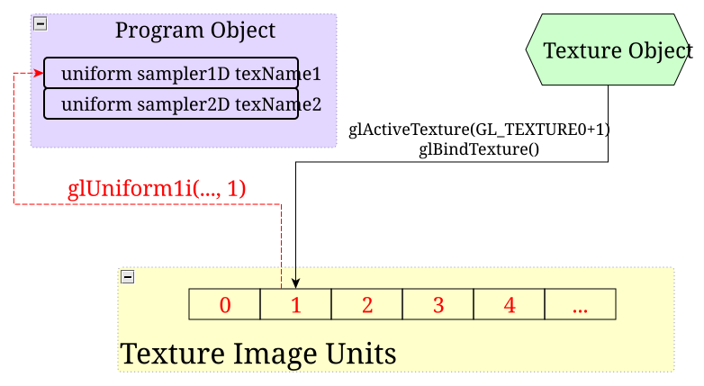
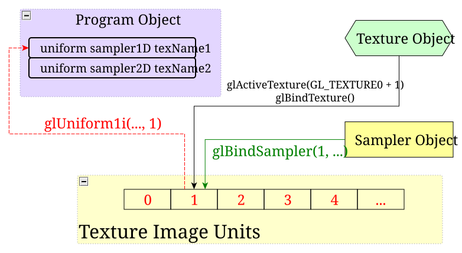
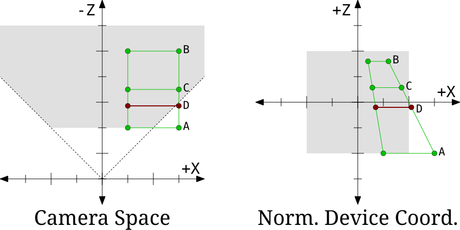
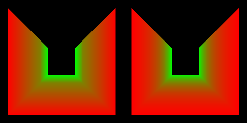
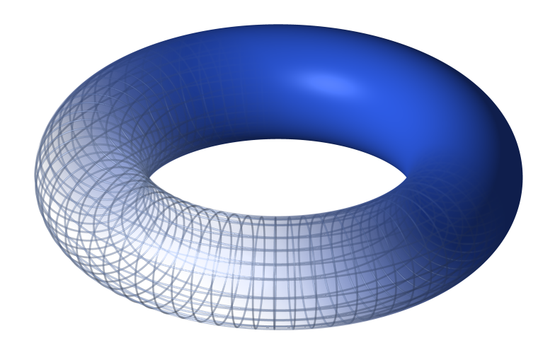

# 纹理不是图片

关于纹理，最常见的误解是把纹理当成图片：皮肤、岩石之类可以拿图像编辑器打开看的图像。虽然许多纹理确实是某些东西的图像，但把思考纹理的方式局限在图片上是不对的。遗憾的是，OpenGL 强化了这种看法：纹理中的数据是「颜色」，而许多与纹理有关的函数名字里都带着「image」。

避免这种思维方式的最好办法，就是让我们的第一批纹理属于那些非图片类型的纹理。所以作为纹理世界的入门介绍，我们来定义一个不用成为图片也能解决的问题。

我们已经看到，高斯镜面反射函数是一个相当好用的镜面反射函数。它的光泽度取值范围 (0, 1] 很合适，视觉效果也不错。它产生的瑕疵比不那么复杂的 Blinn-Phong 函数更少。但它有一个严重的问题：高斯的计算代价要高得多。Blinn-Phong 只需要一次幂函数；而高斯不仅需要指数运算，还需要反余弦函数。除此之外还有把指数平方之类的其他运算。

假设我们已经认定高斯镜面反射函数效果不错，但对我们的需求来说太昂贵了。[^这仅用于演示目的。除非你已经通过恰当的性能分析确认镜面反射函数是一个应当着手缓解的性能问题，否则不应在真实项目中走这个流程。]于是我们想找一种办法，既得到与高斯镜面反射相当的质量，又有更好的性能。我们有哪些选择？

优化数学函数时常用的一招是查找表。这就是一些数组，它们表示某个函数。对于任何函数 `F(x)`，只要 x 在某个范围 [a, b] 上有效，你就可以定义一张表，存储该函数在 x 的有效范围内若干取值处的结果。显然，如果 x 的范围是无穷的就有问题。但如果 x 的范围有限，就可以选定该范围上的若干取值并存进表里。

这种做法显而易见的缺点是，你得到的质量取决于这张表有多大。也就是说，取决于函数被求值并存储了多少次。

高斯镜面反射函数有三个参数：表面法向量、半角向量，以及表面的镜面光泽度。不过，如果我们用表面法向量与半角向量的点积来重新定义镜面反射函数，就能把参数数量减到两个。另外，镜面光泽度在一个网格上是个常量。因此，对任何一个给定的网格，镜面反射函数是一个单参数函数：半角向量与表面法向量之间的点积。


> 高斯作为单变量函数

那么我们怎样把查找表交给着色器呢？可以用最直接的办法：建立一个包含浮点数数组的一致性缓冲对象。我们把点积乘以表中的条目数，再根据这个值选取表中的一项。到这一步，你应该已经能把它写出来了。

但假设我们想要另一个方案：还能怎么办？我们可以把查找表放进一张纹理里。

## 第一张纹理

纹理是一个对象，其中包含一个或多个数据数组，每个数组都有各自的维度。纹理的存储由 OpenGL 和 GPU 持有，就像它们持有缓冲对象的存储一样。纹理可以在着色器中被访问，着色器从纹理内部某个数组的特定位置取回数据。

纹理内部的数组称为图像（image）；这是一个遗留术语，但它们就是这么叫的。纹理有一种纹理类型（texture type）；它定义了整张纹理的一些特性，比如图像的维数以及其他若干特殊之处。

我们第一次使用纹理是在 `Basic Texture` 教程中。这个教程展示了一个包含金色无穷大符号的场景，配有一个平行光源和第二个移动的点光源。

*Basic Texture*

相机和物体可以分别用鼠标左右键旋转。按 <kbd>空格键</kbd> 可以在基于着色器的高斯镜面反射与基于纹理的镜面反射之间切换。<kbd>1</kbd> 到 <kbd>4</kbd> 键会切换到分辨率依次更高的纹理，这样你就能看出更高分辨率的查找表对视觉效果的影响。

### 归一化整数

为了理解纹理的工作方式，我们沿着数据流走一遍：从最初生成查找表，一直到 GLSL 着色器访问它们。函数 `BuildGaussianData` 生成我们想放进 OpenGL 纹理的数据。

**示例：BuildGaussianData function**

```cpp
void BuildGaussianData(std::vector<GLubyte> &textureData,
                       int cosAngleResolution)
{
    textureData.resize(cosAngleResolution);

    std::vector<GLubyte>::iterator currIt = textureData.begin();
    for(int iCosAng = 0; iCosAng < cosAngleResolution; iCosAng++)
    {
        float cosAng = iCosAng / (float)(cosAngleResolution - 1);
        float angle = acosf(cosAng);
        float exponent = angle / g_specularShininess;
        exponent = -(exponent * exponent);
        float gaussianTerm = glm::exp(exponent);
        
        *currIt++ = (GLubyte)(gaussianTerm * 255.0f);
    }
}
```

这个函数用一个 `std::vector` 填充表示我们查找表的字节。它是个相当简单的函数。参数 `cosAngleResolution` 指定表中的条目数量。当我们遍历这个范围时，把这些值转换成余弦值，然后执行高斯镜面反射的计算。

不过，这个计算的结果是 `float`，而不是 `GLubyte`。但我们的数组里存放的是字节。这里我们必须引入一个在纹理中广泛使用的新概念：**归一化整数**。

归一化整数是一种在 [0, 1] 范围内存储浮点值的做法，所需的位数远少于普通 `float` 的 32 位。其思路是把整数的整个范围映射到 [0, 1] 范围。无符号整数的整个范围是 [0, 255]，所以要把它映射到 [0, 1] 的浮点范围，只需把值除以 255。

上面这段代码取 `gaussianTerm` 并把它转换成归一化整数。

这省下了大量内存。在纹理中使用归一化整数，相比浮点纹理能省下 4 倍的内存。就纹理而言，省内存往往就意味着提性能。而既然我们做的是一次相对着色器计算的性能优化，使用归一化整数就是理所当然的。

### 纹理对象

函数 `CreateGaussianTexture` 调用 `BuildGaussianData` 来生成归一化整数数组。该函数的其余部分用这个数组构建 OpenGL 纹理对象：

**示例：CreateGaussianTexture function**

```cpp
GLuint CreateGaussianTexture(int cosAngleResolution)
{
    std::vector<GLubyte> textureData;
    BuildGaussianData(textureData, cosAngleResolution);
    
    GLuint gaussTexture;
    glGenTextures(1, &gaussTexture);
    glBindTexture(GL_TEXTURE_1D, gaussTexture);
    glTexImage1D(GL_TEXTURE_1D, 0, GL_R8, cosAngleResolution, 0,
        GL_RED, GL_UNSIGNED_BYTE, &textureData[0]);
    glTexParameteri(GL_TEXTURE_1D, GL_TEXTURE_BASE_LEVEL, 0);
    glTexParameteri(GL_TEXTURE_1D, GL_TEXTURE_MAX_LEVEL, 0);
    glBindTexture(GL_TEXTURE_1D, 0);
    
    return gaussTexture;
}
```

`glGenTextures` 函数创建一个纹理对象，与我们见过的其他 `glGen*` 函数类似。`glBindTexture` 把纹理对象绑定到上下文。第一个参数指定纹理的类型。注意，一旦你已经以某种类型把纹理绑定到上下文，它就必须*始终*以同一个类型绑定。`GL_TEXTURE_1D` 意味着这张纹理包含一维的图像。

接下来的函数 `glTexImage1D` 是我们为纹理分配存储并把数据传入纹理的方式。它与 `glBufferData` 类似，不过参数要多得多。第一个参数指定当前绑定的纹理类型。与缓冲对象一样，可以把多张纹理绑定到不同的纹理类型位置。所以你可以把一张纹理绑定到 `GL_TEXTURE_1D`，另一张绑定到 `GL_TEXTURE_2D`。但试图利用这一点是很糟糕的做法。最好一次只绑定一个目标。

第二个参数我们会在下一个教程中讨论。第三个参数是 OpenGL 用来存储纹理数据的格式。第四个参数是图像的宽度，对应我们查找表的长度。第五个参数必须始终为 0；它代表一个已不再支持的旧特性。

所有形如 `glTexImage*` 的函数，最后三个参数都是特殊的。它们告诉 OpenGL 如何读取我们数组中的纹理数据。这看起来是多余的，因为我们已经用第三个参数告诉过 OpenGL 数据格式是什么了。这一点值得进一步探究。

纹理与缓冲对象有很多相似之处。它们都代表由 OpenGL 拥有的内存，用户可以用各种函数修改这段内存。除了纹理对象可以包含多张图像这一点，主要差别在于 GPU 存储数据时的数据布局方式。

缓冲对象是线性的内存数组。OpenGL 存储的数据必须与用户通过 `glBuffer(Sub)Data` 调用指定的数据逐位相同。缓冲对象中数据的格式由缓冲对象之外的机制定义。用于顶点属性的缓冲对象，其格式由 `glVertexAttribPointer` 定义。存储 uniform 数据的缓冲对象，其格式由 GLSL uniform 块中类型的排列方式定义。

缓冲对象还有其他一些用法，允许 OpenGL 调用直接往它们填数据。但在所有情况下，待存储数据的二进制格式都由用户严格控制。确保存进去的数据符合 OpenGL 被告知的预期格式，这是*用户*的责任——即便数据是由 OpenGL 自己生成的。

纹理的工作方式不同。存储在纹理中的图像，其格式由 OpenGL 自己控制。用户告诉它使用什么格式，但字节的具体排布由 OpenGL 决定。这让不同硬件可以用各自最优的方式存储纹理。

正因如此，在用户提供的数据与实际存储在纹理中的数据之间存在一个中间环节。用户提供的数据必须转换成 OpenGL 内部为纹理数据所使用的格式。因此，`glTexImage*` 函数必须同时指定预期的内部格式，以及纹理数据在用户数组中存储方式的描述。

**像素传输与格式**

这个过程，也就是图像内部格式与用户提供的数组之间的转换，称为**像素传输**操作。这些操作有些复杂，但并不难理解。

纹理中的每个像素更准确地说叫作**纹素**（texel）。由于在 OpenGL 中访问纹理数据是以纹素为单位的，我们希望归一化无符号整数数组中的每个值都存放在一个纹素里。因此我们的输入数据每个纹素只有一个值，该值大小为 8 位，表示一个归一化无符号整数。

最后三个参数就是向 OpenGL 描述这些的。参数 `GL_RED` 说明我们上传的是单个分量，也就是红色分量。纹素的分量是按颜色分量命名的。由于这个参数不以「_INTEGER」结尾，OpenGL 知道我们上传的数据要么是浮点值，要么是归一化整数值（着色器访问时会转换成浮点数）。

参数 `GL_UNSIGNED_BYTE` 说明我们上传的每个分量都存放在一个 8 位无符号字节中。加上数据指针，这就是 OpenGL 读取我们数据所需的全部信息。

以上描述的是我们提供数据时的格式。格式参数，也就是 `glTexImage*` 函数的第三个参数，描述的是纹理内部存储的格式。这是 OpenGL *自己*存储纹素数据的方式；它不必与你提供的格式完全一致。纹理的格式定义了存放在该纹理中的纹素的属性：

- 纹素中存储的分量。可以使用多个分量，但只允许特定的分量组合。这些分量包括颜色的 RGBA，以及我们稍后会讨论的一些更特殊的值。
- 每个分量在 OpenGL 中存储时占用的位数。同一个纹素中的不同分量可以有不同的位深。
- 分量的数据类型。某些特殊格式可以让不同分量使用不同类型，但大多数格式会让每个分量使用相同的数据类型。数据类型包括归一化无符号整数、浮点数、非归一化有符号整数等等。

参数 `GL_R8` 定义了所有这些。「R」代表所存储的分量，也就是「红色」分量。由于纹理过去总是用来表示图像数据，这些分量是按一个颜色 vec4 的分量命名的。每个分量占「8」位。格式的后缀表示数据类型。由于无符号归一化值如此常见，它们得到了「无后缀」这个后缀；所有其他数据类型都有各自特定的后缀。浮点格式使用「f」；一个红色 32 位浮点的内部格式会使用 `GL_R32F`。

注意这与我们生成的纹理数据完全吻合。我们告诉 OpenGL 让纹理存储无符号归一化的 8 位整数，而输入数据提供的也是无符号归一化的 8 位整数。

这并非严格要求。我们本可以用 `GL_R16` 作为格式。OpenGL 会创建一张包含 16 位无符号归一化整数的纹理，然后不得不把我们的 8 位输入数据转换成 16 位格式。出于性能考虑，最好让纹理的格式与你上传给 OpenGL 的数据格式相匹配，以避免转换。

对 `glTexParameter` 的调用会设置纹理对象上的参数。这些参数定义了纹理的某些属性。它们具体在做什么，我们会在下一个教程中讨论。

### 着色器中的纹理

好，我们现在有了一个纹理对象，它有一种纹理类型。我们需要某种方式在 GLSL 中表示这张纹理。这要用到一个叫作 **GLSL 采样器**的东西。采样器是 OpenGL 中特殊的类型；它们代表一张已绑定到 OpenGL 上下文的纹理。每一种 OpenGL 纹理类型都对应一种采样器类型。所以类型为 `GL_TEXTURE_1D` 的纹理配对的是 `sampler1D` 类型的采样器。

GLSL 采样器类型非常不同寻常。事实上，最好不要把它当成一个普通的基本类型来看待。不如把它想成着色器中一个特定的钩子，用户可以用它来提供一张纹理。对采样器类型变量的限制如下：

- 采样器只能以 `uniform` 的形式在全局作用域声明，或者带 `in` 限定符出现在函数参数列表中。它们甚至不能声明为局部变量。
- 采样器不能是结构体或 uniform 块的成员。
- 采样器可以放进数组，但采样器数组的索引必须是编译期常量。
- 采样器没有值。任何数学表达式都不能使用采样器变量。
- 采样器类型变量唯一的用途是作为函数参数。用户自定义函数可以接收它们作为参数，另外还有若干内建函数也接受采样器。

在着色器 `TextureGaussian.frag` 中，我们有一个创建采样器的例子：

```glsl
uniform sampler1D gaussianTexture;
```

这创建了一个用于一维纹理类型的采样器；用户不能用这个采样器搭配其他类型的纹理。

**纹理采样**

从纹理中某个特定位置取回数据的过程称为**采样**。这一步是在着色器中作为光照计算的一部分完成的：

**示例：Shader Texture Access**

```glsl
vec3 halfAngle = normalize(lightDir + viewDirection);
float texCoord = dot(halfAngle, surfaceNormal);
float gaussianTerm = texture(gaussianTexture, texCoord).r;

gaussianTerm = cosAngIncidence != 0.0 ? gaussianTerm : 0.0;
```

第三行就是访问纹理的地方。函数 `texture` 访问由第一个参数所指定的纹理（即要从中取数据的那个采样器）。它从第二个参数所指定的位置读取纹理中的值。这个取数位置的第二个参数称为**纹理坐标**。由于我们的纹理只有一个维度，我们的纹理坐标也只有一个维度。

用于一维纹理的 `texture` 函数要求纹理坐标是归一化的。这有点像归一化整数的意思。一个归一化的纹理坐标是指：坐标值从 [0, 1] 范围内的纹素坐标（也就是纹理内像素的坐标）映射到 [0, 纹理大小]。

这意味着我们的纹理坐标不必关心纹理有多大。我们可以改变纹理的大小，而不用改动纹理坐标的计算方式。坐标 0.5 永远表示纹理的中点，与该纹理的实际尺寸无关。

落在 [0, 1] 范围之外的纹理坐标值仍然必须映射到纹理上的某个位置。这类坐标会发生什么，取决于 OpenGL 中我们稍后会看到的一些设置值。

`texture` 函数的返回值总是一个 vec4，与纹理的图像格式无关。所以即使我们的纹理格式是 `GL_R8`，也就是只持有一个通道的数据，我们在着色器中拿到的仍然是四个分量。另外三个分量分别是 0、0 和 1。

我们拿回浮点数据，是因为我们的采样器是浮点采样器。采样器使用与 `vec` 类型相同的前缀。`ivec4` 表示 4 个整数构成的向量，而 `vec4` 表示 4 个浮点数构成的向量。因此 `isampler1D` 表示返回整数的纹理，而 `sampler1D` 表示返回浮点数的纹理。回想一下，8 位归一化无符号整数不过是存储浮点数的一种廉价方式，所以这里一切都对得上。

### 纹理绑定

我们有了一个纹理对象，它是一个 OpenGL 对象，保存着我们图像数据并带有特定格式。我们有了一个着色器，其中包含一个采样器 uniform，代表着色器正在访问的一张纹理。那么我们怎样把纹理对象与着色器中的采样器关联起来？

尽管出于遗留原因这个 API 略显晦涩，但这种关联的建立方式本质上与一致性缓冲对象相同。

OpenGL 上下文中有一组称为**纹理图像单元**的槽位，也叫**图像单元**或**纹理单元**。每个图像单元代表一张纹理。着色器中的一个采样器 uniform 被设定到某个图像单元上；这就建立了着色器与图像单元之间的关联。要把图像单元与纹理对象关联起来，我们就把纹理绑定到该单元上。



> 纹理绑定与上下文

虽然思路基本相同，但 UBO 机制与纹理机制之间在 API 上有许多差异。我们先把采样器 uniform 设置到一个图像单元。

在 UBO 中这用的是一套与普通 uniform 不同的 API。由于采样器就是实际的 uniform，采样器 API 就是 uniform API：

```cpp
GLuint gaussianTextureUnif = glGetUniformLocation(data.theProgram, "gaussianTexture");
glUseProgram(data.theProgram);
glUniform1i(gaussianTextureUnif, g_gaussTexUnit);
```

在 OpenGL 侧看来，采样器 uniform 被视作一维（标量）整数值。别忘了，在 GLSL 侧采样器根本没有值。

到了把纹理对象绑定到那个图像单元的时候，OpenGL 再次重载了已有的 API，而不像 UBO 那样另建一套：

```cpp
glActiveTexture(GL_TEXTURE0 + g_gaussTexUnit);
glBindTexture(GL_TEXTURE_1D, g_gaussTextures[g_currTexture]);
```

`glActiveTexture` 函数改变当前的纹理单元。之后所有的纹理操作，无论是 `glBindTexture`、`glTexImage`、`glTexParameter` 还是别的，都会作用于绑定在当前纹理单元上的纹理。换个说法：在 UBO 中，我们可以把缓冲对象绑定到 `GL_UNIFORM_BUFFER` 而不覆盖任何一致性缓冲绑定点。这是因为缓冲对象绑定有两个函数：`glBindBuffer` 只绑定到目标，而 `glBindBufferRange` 会绑定到目标和一个带索引的位置。

纹理单元没有这种机制。绑定函数只有一个，就是 `glBindTexture`，而且它总是绑定到当前的那个纹理单元，也就是上一次调用 `glActiveTexture` 所设定的那一个。

这意味着，如果你想修改一张纹理，就必须覆盖一个可能已经被占用的纹理单元。这通常不算什么大问题，因为你很少会在用于渲染的那段代码里修改纹理。但你应该知道这个 API 的怪癖。

还要注意 `glActiveTexture` 在指定图像单元时那套奇特的语法：`GL_TEXTURE0 + g_gaussTexUnit`。这才是指定纹理单元的正确方式，因为 `glActiveTexture` 是以枚举量而非整数图像单元来定义的。

如果你去看渲染函数，会发现即便在不用纹理渲染时，纹理也总是处于绑定状态。这完全无害；除非某个程序有一个与该图像单元关联的采样器 uniform，否则纹理图像单元中的内容会被忽略。

### 采样器对象

在纹理与程序的采样器 uniform 之间的关联建立好之后，渲染之前还有一件事需要处理。用户可以设置若干影响纹理数据如何被取回的参数。

在我们的例子里，我们希望确保着色器无法访问到纹理范围之外的纹素。如果着色器试图这么做，我们希望它拿到离该值最近的纹素。所以如果着色器传入的纹理坐标是 -0.3，我们希望它拿到的纹素与传入 0.0 时相同。简而言之，我们想把纹理坐标钳制到纹理的范围内。

这类设置由一个叫作**采样器对象**的 OpenGL 对象控制。为我们的纹理创建采样器对象的代码在 `CreateGaussianTextures` 函数中。

**示例：Sampler Object Creation**

```cpp
glGenSamplers(1, &g_gaussSampler);
glSamplerParameteri(g_gaussSampler, GL_TEXTURE_MAG_FILTER, GL_NEAREST);
glSamplerParameteri(g_gaussSampler, GL_TEXTURE_MIN_FILTER, GL_NEAREST);
glSamplerParameteri(g_gaussSampler, GL_TEXTURE_WRAP_S, GL_CLAMP_TO_EDGE);
```

和大多数 OpenGL 对象一样，我们用 `glGenSamplers` 创建采样器对象。不过请注意接下来这组函数中有些不寻常的地方。我们既不把采样器绑定到上下文去设置其中的参数，`glSamplerParameter` 也不接受上下文目标。我们只是把对象直接传给函数。

在上面的代码中，我们设置了三个参数。前两个参数会在下一个教程中讨论。第三个参数 `GL_TEXTURE_WRAP_S` 是我们告诉 OpenGL 纹理坐标应当被钳制到纹理范围内的方式。

OpenGL 把纹理坐标的分量命名为「strq」，而不是常见的「xyzw」或「uvw」。事实上，OpenGL 对这些分量有两套不同的名字：主 API 中用「strq」，而在 GLSL 着色器中用「stpq」。和「rgba」一样，你可以用「stpq」作为任意向量的分量选择符，替代传统的「xyzw」。

**注意**

> 这套奇怪命名的原因是 OpenGL 试图避免向量后缀之间冲突。「uvw」行不通，因为「w」已经是「xyzw」后缀的一部分。在 GLSL 中，「strq」里的「r」与「rgba」冲突，所以他们只能改用「stpq」。

`GL_TEXTURE_WRAP_S` 参数定义了纹理坐标的「s」分量在落到 [0, 1] 范围之外时如何调整。把它设为 `GL_CLAMP_TO_EDGE` 会把纹理坐标的这个分量钳制到纹理边缘。纹理坐标的每个分量都可以有各自的环绕模式。由于我们的纹理是一维纹理，它的纹理坐标只有一个分量。

采样器对象的用法与纹理同 GLSL 采样器关联的方式类似：我们把它们绑定到一个纹理图像单元上。这个 API 比我们之前看到的纹理那套要简单得多：

```cpp
glBindSampler(g_gaussTexUnit, g_gaussSampler);
```

我们直接传入纹理单元；不需要再加上 `GL_TEXTURE0` 把它转换成枚举量。这实际上相当于给每个纹理单元添加了一个附加值。



> 采样器绑定与上下文

**注意**

> 严格来说，我们并不强制使用采样器对象。我们给采样器用的那些参数本来也可以用 `glTexParameter` 直接设置到纹理对象上。相比把值设在纹理里，采样器对象有很多优势，而且绑定的采样器对象会覆盖纹理中设置的参数。仍然有一些参数必须放在纹理对象里，这些不会被采样器对象覆盖。

### 纹理分辨率

本教程创建了多张不同分辨率的纹理。对应 <kbd>1</kbd> 的分辨率最低，而对应 <kbd>4</kbd> 的分辨率最高。

使用分辨率 <kbd>1</kbd> 时，我们能看到它是一个相当粗糙的近似。我们可以非常清楚地看到查找表中不同纹素之间的差别。它是一个 64 纹素的查找表。

切换到 <kbd>3</kbd> 对应的分辨率会显示出更多的层次，看起来也更像着色器的计算结果。这一张宽 256 个纹素。

最大分辨率的 <kbd>4</kbd> 是 512 个纹素，看起来与纯着色器版本几乎完全一样。

## 插值回顾

使用纹理时，下一步是把纹理与物体表面上的位置关联起来。但在此之前，我们需要先讨论清楚，在一个三角形上对某个值进行插值究竟意味着什么。

到目前为止，我们或多或少忽略了插值的细节。前面在解释为什么某些函数不适合逐顶点光照、以及为什么法向量插值效果不好时，我们稍微展开过这个话题。但现在我们要把三角形的顶点与纹理上的位置关联起来，因此需要完整地解释插值究竟是什么。

核心话题是线性。在前面的讨论中我们反复强调插值是线性的。那个被绕着弯子提的问题既简单又晦涩：在哪个空间里是线性的？

透视投影是一个非线性变换；这正是为什么单靠一次矩阵乘法不足以表达它。矩阵只能处理线性变换，而透视投影需要除法，除法是非线性的。我们此前已经见识过这个非线性变换的效果：



> 投影与插值

从归一化设备坐标空间到窗口空间的变换是完全线性的。所以问题出在从相机空间到 NDC 空间的变换，也就是透视投影。

从这张图中我们看到，在相机空间中平行的线在 NDC 空间中不一定平行；这正是非线性变换的一个特征。但最重要的一点是，物体之间的距离发生了非线性变化。在相机空间中，平行于 Z 轴的线是等间距的。在 NDC 空间中则不是。

看看 A 和 B 这两条线。假设它们是这个物体仅有的两个顶点。在相机空间中，两者的中点是 C。但在 NDC 空间中，两者的中点是 D。C 和 D 在任何一个空间里都不算靠得很近。

那么，OpenGL 一直是在哪个空间里为我们做插值的呢？说是在窗口空间里似乎理所当然，因为窗口空间正是光栅化器（执行插值的硬件）所看到并使用的空间。但如果真是那样，我们就会遇到大量的插值问题。

考虑对相机空间位置做插值。这只有在插值发生于相机空间中（或其某个线性变换中）时才成立。再看一遍那张图；对于 NDC 中的位置 D，会算出相机空间位置 C。那就完全错了。

那么，尽管光栅化器只看得到窗口空间，我们的插值却不知怎么地一直发生在相机空间中。是什么机制造成了这一点？

能够在投影前空间中线性插值值的能力称为**透视校正插值**。现在我们可以得到最后一个理由，来解释为什么顶点着色器提供的是裁剪空间的值，而不是由着色器自己执行透视除法。裁剪空间的 W 分量对于进行透视校正插值至关重要。

这就说得通了；裁剪空间的 W 毕竟正是让我们的变换成为非线性变换的原因。透视校正只是利用裁剪空间的 W 来调整插值，使插值发生在一个相对于裁剪空间是线性的空间中。而由于裁剪空间是相机空间的线性变换（使用四维齐次坐标），一切就都顺了。严格来说，透视校正插值并不是让插值发生在相机空间中，而是在一个由相机空间线性变换而来的空间中插值。

要最直观地看到透视校正的效果，请运行 `Perspective Interpolation` 工程。

这个演示中没有相机控制；相机是固定的，以便让呈现出来的这个幻象得以成立。按 <kbd>P</kbd> 键可以在透视校正插值与窗口空间线性插值之间切换。



> 透视校正插值

有意思的地方如下。切换到透视校正版本（控制台窗口中会出现一条消息），然后按 <kbd>S</kbd> 键。现在 <kbd>P</kbd> 键似乎不再有任何作用；我们仿佛被困在线性插值里出不来。

原因是 <kbd>S</kbd> 键会切换网格。那个「假的」网格其实不是走廊；它是完全平的。它差不多是一个顶点位置处于 NDC 空间中的网格，也就是把原来的走廊乘上透视矩阵之后的结果。区别在于它没有 W 坐标；它就是一个平面物体，一个视觉幻象。透视校正逻辑没有任何透视信息可供依据，所以它看起来就和窗口空间线性插值一样。

用来开启或关闭透视校正插值的开关是插值限定符。前面我们说过有三个限定符：`flat`、`smooth` 和 `noperspective`。第三个之前一直没有定义；现在你大概能猜到它是做什么的了。

我们近期不会用到 `noperspective`。事实上，在透视投影下使用窗口空间插值极为罕见，比 `flat` 罕见得多。本节要理解的关键一点是：插值方式是有影响的。而 `smooth` 将是我们的默认插值方式；所幸这也是 OpenGL 的默认方式。

## 纹理映射

纹理最重要的用途之一，是让材质参数在一个表面上发生变化。此前，我们能对材质参数施加的最细粒度是逐顶点的值。纹理让我们把粒度细化到纹素级别。我们本可以针对纹理控制的最常见材质参数（也就是漫反射颜色）来做这件事，但我们打算看一个不那么常见的东西。我们要改变的是镜面光泽度因子。

要实现镜面光泽度的这种变化，我们必须先找到一种方法，把三角形上的点与纹理上的纹素关联起来。这种关联称为**纹理映射**，因为它是在三角形上的点与纹理上的位置之间做映射。它通过使用与表面上位置相对应的纹理坐标来实现。

**注意**

> 有些人把纹理本身称为「texture map」。这个说法流传甚广令人遗憾，但它是错的。本书不会这样称呼它们，也强烈建议你不要这么叫。

在上一个例子中，纹理坐标是根据光照参数计算出来的一个值。而访问光泽度纹理所用的纹理坐标，将来自逐顶点参数的插值。这就是前面要讨论插值细节的原因。

在简单情形下，我们可以直接从顶点位置生成纹理坐标。在后面某些教程里我们也会这么做。然而在绝大多数情况下，用于纹理映射的纹理坐标会作为逐顶点属性数据的一部分。

由于纹理映射的坐标来自逐顶点属性，这会影响我们的网格拓扑。它又增加了带有自身拓扑的一个通道，而这套拓扑必须被整合进网格的整体拓扑之中。

要看纹理映射的实际效果，请加载 `Material Texture` 教程。这个教程使用与之前相同的场景，但无穷大符号可以用一张纹理来定义该物体的镜面光泽度。

*Material Texture*

<kbd>空格键</kbd> 在三种渲染模式之间切换：固定光泽度配高斯查找表、基于纹理的光泽度配高斯查找表，以及基于纹理的光泽度配着色器计算的高斯项。<kbd>Y</kbd> 键在无穷大符号与一个平面之间切换；这有助于更明显地看出光泽度的样子。<kbd>9</kbd> 键切换到一种漫反射色较暗、镜面反射色明亮的材质；这会让光泽度纹理的效果更容易被察觉。按 <kbd>8</kbd> 键回到金色材质。

### 二维纹理

<kbd>1</kbd> 到 <kbd>4</kbd> 键仍然用于切换不同分辨率的高斯纹理。说到这个，现在它的行为可不太一样了。

此前我们假定镜面光泽度在整个表面上是个固定值。现在我们的光泽度值可以来自纹理，情况就不一样了。在固定光泽度下，我们有一个单参数的函数：半角向量与法向量的点积。但有了可变的光泽度，我们就有了一个双参数函数。两个变量的函数常被称为「二维的」。

因此，我们用一张二维纹理来建模这样一个函数并不令人意外。S 纹理坐标表示点积，T 纹理坐标表示光泽度值。两者都取值于 [0, 1]，因此都落在纹理坐标的预期范围之内。

我们构建高斯项数据的新函数如下：

**示例：BuildGaussianData in 2D**

```cpp
void BuildGaussianData(std::vector<GLubyte> &textureData,
                       int cosAngleResolution,
                       int shininessResolution)
{
    textureData.resize(shininessResolution * cosAngleResolution);
    
    std::vector<unsigned char>::iterator currIt = textureData.begin();
    for(int iShin = 1; iShin <= shininessResolution; iShin++)
    {
        float shininess = iShin / (float)(shininessResolution);
        for(int iCosAng = 0; iCosAng < cosAngleResolution; iCosAng++)
        {
            float cosAng = iCosAng / (float)(cosAngleResolution - 1);
            float angle = acosf(cosAng);
            float exponent = angle / shininess;
            exponent = -(exponent * exponent);
            float gaussianTerm = glm::exp(exponent);
            
            *currIt = (unsigned char)(gaussianTerm * 255.0f);
            ++currIt;
        }
    }
}
```

这个函数把数据写进一个一维数组。它先为某个特定的光泽度写入一整组值，然后为下一个光泽度写入下一组值，依此类推。这是几乎所有图像格式存储图像数据最标准的方式。当然，OpenGL 接收数据的方式也是这样。

不过要注意，纹理数据期望的是左下角原点：第一行对应最小的光泽度值（T 值为 0），它就是*第一*行。遗憾的是，大多数图像格式并不是这样存储像素数据行的；它们往往采用左上角朝向，所以大多数图像格式中的第一行是最上面那一行。

这就引出了我们如何把这些数据交给 OpenGL 的问题。这个函数与我们之前看到的类似，只是有几处改动。

**示例：CreateGaussianTexture in 2D**

```cpp
GLuint CreateGaussianTexture(int cosAngleResolution, int shininessResolution)
{
    std::vector<unsigned char> textureData;
    BuildGaussianData(textureData, cosAngleResolution, shininessResolution);
    
    GLuint gaussTexture;
    glGenTextures(1, &gaussTexture);
    glBindTexture(GL_TEXTURE_2D, gaussTexture);
    glTexImage2D(GL_TEXTURE_2D, 0, GL_R8, cosAngleResolution, shininessResolution, 0,
        GL_RED, GL_UNSIGNED_BYTE, &textureData[0]);
    glTexParameteri(GL_TEXTURE_2D, GL_TEXTURE_BASE_LEVEL, 0);
    glTexParameteri(GL_TEXTURE_2D, GL_TEXTURE_MAX_LEVEL, 0);
    glBindTexture(GL_TEXTURE_2D, 0);
    
    return gaussTexture;
}
```

这里可以看到，我们用的是 `GL_TEXTURE_2D` 目标，而不是一维版本。同时也用 `glTexImage2D` 取代了一维版本。它同时接受宽度和高度。除此之外，代码与前一版非常相似。

### 从文件加载图像

我们的高斯纹理来自我们计算出的数据，但镜面光泽度纹理是由一个文件定义的。为此我们使用 OpenGL SDK 自带的 GL Image 库。虽然 GL Image 库提供了直接为我们创建纹理的函数，但看看更手动的流程是有好处的。

**示例：CreateShininessTexture function**

```cpp
void CreateShininessTexture()
{
    std::auto_ptr<glimg::ImageSet> pImageSet;
    
    try
    {
        pImageSet.reset(glimg::loaders::dds::LoadFromFile("data\\main.dds"));
        std::auto_ptr<glimg::Image> pImage(pImageSet->GetImage(0, 0, 0));
        
        glimg::Dimensions dims = pImage->GetDimensions();
        
        glGenTextures(1, &g_shineTexture);
        glBindTexture(GL_TEXTURE_2D, g_shineTexture);
        glTexImage2D(GL_TEXTURE_2D, 0, GL_R8, dims.width, dims.height, 0,
            GL_RED, GL_UNSIGNED_BYTE, pImage->GetImageData());
        glTexParameteri(GL_TEXTURE_2D, GL_TEXTURE_BASE_LEVEL, 0);
        glTexParameteri(GL_TEXTURE_2D, GL_TEXTURE_MAX_LEVEL, 0);
        glBindTexture(GL_TEXTURE_2D, 0);
    }
    catch(glimg::ImageCreationException &e)
    {
        printf(e.what());
        throw;
    }
}
```

GL Image 库为多种图像格式提供了若干加载器；我们在 try 块第一行用的是 DDS 加载器。DDS 代表「Direct Draw Surface」，但它其实与 Direct3D 或 DirectX 毫无关系。它在所有图像文件格式中是独一无二的

`glimg::ImageSet` 对象同样支持纹理的所有独特性质；一个 `ImageSet` 表示某张纹理的全部图像。要访问图像数据，我们先用 `GetImage` 函数选定一张图像。我们稍后会讨论这些参数具体代表什么，而 (0, 0, 0) 表示的是该 DDS 文件所含的那一张图像。

纹理中的图像可以有不同尺寸，所以每个 `glimg::Image` 对象都有自己的尺寸信息，我们要把它们取出来。之后我们用常规方法上传纹理。`GetImageData` 对象返回一个指向该图像数据的指针，数据是从 DDS 文件加载而来的。

### 着色器中的二维纹理

由于我们使用的是 `GL_TEXTURE_2D` 类型的纹理对象，着色器中就必须使用 `sampler2D` 采样器。

```glsl
uniform sampler2D gaussianTexture;
uniform sampler2D shininessTexture;
```

我们有两张纹理。光泽度纹理决定我们的镜面光泽度值。它在片元着色器的 main 函数中、循环遍历各个光源之前被访问：

**示例：Shininess Texture Access**

```glsl
void main()
{
    float specularShininess = texture(shininessTexture, shinTexCoord).r;
    
    vec4 accumLighting = Mtl.diffuseColor * Lgt.ambientIntensity;
    for(int light = 0; light < numberOfLights; light++)
    {
        accumLighting += ComputeLighting(Lgt.lights[light],
            cameraSpacePosition, vertexNormal, specularShininess);
    }
    
    outputColor = sqrt(accumLighting); //2.0 gamma correction
}
```

`ComputeLighting` 函数现在把镜面反射项作为一个参数接收。它在访问高斯纹理时把这一项作为其中一部分使用：

**示例：Gaussian Texture with Specular**

```glsl
vec3 halfAngle = normalize(lightDir + viewDirection);
vec2 texCoord;
texCoord.s = dot(halfAngle, surfaceNormal);
texCoord.t = specularShininess;
float gaussianTerm = texture(gaussianTexture, texCoord).r;

gaussianTerm = cosAngIncidence != 0.0 ? gaussianTerm : 0.0;
```

使用 S 和 T 分量的方式与我们生成查找纹理的方式一致。计算高斯项的着色器使用传入的镜面反射项，除此之外与通常的高斯计算没有多少区别。

### 带光泽度渲染

在这个例子中我们有两张纹理，但没有两个采样器对象（记住：采样器对象与 GLSL 中的采样器类型不是一回事）。我们可以用同一个采样器对象访问这两张纹理。

由于它们是二维纹理，因此要用两个纹理坐标来访问：S 和 T。所以我们需要在采样器对象中同时钳制 S 和 T：

```cpp
glGenSamplers(1, &g_textureSampler);
glSamplerParameteri(g_textureSampler, GL_TEXTURE_MAG_FILTER, GL_NEAREST);
glSamplerParameteri(g_textureSampler, GL_TEXTURE_MIN_FILTER, GL_NEAREST);
glSamplerParameteri(g_textureSampler, GL_TEXTURE_WRAP_S, GL_CLAMP_TO_EDGE);
glSamplerParameteri(g_textureSampler, GL_TEXTURE_WRAP_T, GL_CLAMP_TO_EDGE);
```

到了渲染的时候，采样器被绑定到两个纹理图像单元上：

```cpp
glActiveTexture(GL_TEXTURE0 + g_gaussTexUnit);
glBindTexture(GL_TEXTURE_2D, g_gaussTextures[g_currTexture]);
glBindSampler(g_gaussTexUnit, g_textureSampler);

glActiveTexture(GL_TEXTURE0 + g_shineTexUnit);
glBindTexture(GL_TEXTURE_2D, g_shineTexture);
glBindSampler(g_shineTexUnit, g_textureSampler);
```

把同一个采样器绑定到多个纹理单元是完全合法的。事实上，很多程序可能有数百张各不相同的纹理，却只有不到 10 个不同的采样器。把同一张纹理绑定到挂着不同采样器的不同单元上，同样完全合法。

### 映射之道

本教程中我们用到两个物体：一个平面和一个无穷大符号。平面的映射相当明显，但无穷大符号的映射更有意思。从拓扑上讲，无穷大符号与圆环没有区别。



> 一个圆环

也就是说，无穷大符号和圆环的顶点连接关系是相同的；这些顶点只是处在不同的位置上。

把一个物体映射到二维平面上，一般意味着要找到一种把这个物体切成若干片、让它们能铺到该平面上的办法。然而从拓扑上讲，圆环等价于一个平面。这个平面被卷成管状，再弯曲起来，使得每一侧都直接与对侧相连。因此，把纹理映射到它上面就意味着把这个过程反过来。把管子在一端切开，得到一个圆柱。然后沿轴向切开，就像切开一个汽车轮胎那样，再把它压平成一个平面。

这些切口具体切在什么位置是随意的。而且由于镜面纹理在 S 和 T 两个方向上都是完美镜像对称的，我们无法分辨拓扑上的接缝究竟在哪里。但它们必须存在。

这确实意味着，沿着同一条经线的顶点具有重复的位置和法向量。由于它们的纹理坐标不同，它们共享的位置和法向量必须被复制出来，以符合 OpenGL 的需要。

### 玻璃上的污渍

理解光泽度纹理如何影响渲染结果，最好的办法是按 <kbd>9</kbd> 键切换到深色材质。平面也能比弯曲的无穷大符号更直观地展现这一点。

*Surface smudges*

光泽度较低的区域，也就是那些明亮区域，看起来像是一道道污渍。在高光泽区域里，亮斑只有当光源几乎处于完美反射方向时才会反光；而光泽度较低的区域能反射来自大得多的角度的光。

有一件有意思的事值得注意：我们的查找表在平面上的表现如何。即便在最高分辨率下，也就是 512 个独立取值，这张查找表也相当糟糕；可以明显看到很多同心圆环。在无穷大符号上它看起来要合理一些，因为那个物体弯曲得很厉害，因此高光区域也小得多。在这个平面上，视觉瑕疵就明显得多了。可以按 <kbd>空格键</kbd> 切换到着色器方式的计算，看看正确的版本是什么样子。

如果我们的本意是表现一块带污渍的金属或者高反射率的黑色表面，那么我们还可以再施加一张改变镜面反射率的纹理来增强效果。带污渍的区域通常不会像光亮区域那样强烈地反光。我们可以使用同一套纹理映射（即同一套纹理坐标），而且这张镜面纹理甚至不必与我们的光泽度纹理尺寸相同。

关于光泽度纹理还有一点要注意。这张纹理的尺寸是 1024x256。这么做的原因是，这张纹理本来是打算用在无穷大符号上的。这个物体在模型空间中沿长度方向比沿周长方向更长。通过让纹理映射在对应 S 坐标的那个轴向上长 4 倍，我们就能比在这里看到的这个平面更好地保持纹理上物体的宽高比。你看到的那些椭圆形的污渍痕迹，在纹理中实际上是正圆的。不过在无穷大符号上，它们仍然是略微呈卵形并且被拉伸了。

一般来说，确保映射后物体的宽高比与拉伸程度对纹理而言保持合理，是创建该纹理映射的美术人员的职责。在最理想的情况下，纹理中的每个纹素都映射到物体表面上相同的物理尺寸。对图形程序员来说，幸好这不是你的工作。

当然，除非你的工作正是编写那个帮助美术人员完成这一过程的工具。

## 本章小结

在本教程中，你学到了以下内容：

- 纹理是存储一个或多个具有某个维度的数据数组的对象。它们可以在 OpenGL 中创建并填入数据。着色器可以用采样器类型引用它们，并用纹理函数访问它们。纹理中的值具有特定的含义；永远不要忘记这张纹理及其存储的数据代表什么。
- 纹理中的数据可以表示任意信息。它们可以用来让材质参数在一个表面上发生变化，用查找表替换复杂函数，或者用于任何其他你需要一个多维数值数组的场景。
- 顶点着色器或几何着色器的输出在多边形上插值时，既可以在窗口空间中线性插值，也可以在投影前空间中线性插值。GLSL 的插值限定符控制着发生的是哪一种插值。
- 通过给顶点属性赋予纹理坐标，可以让纹理与表面上的点关联起来。纹理坐标在三角形表面上插值，然后用于从纹理中取回值。这还只是纹理用途的一部分。

### 进一步学习

试试用给出的程序完成下面这些事情。

- 如果你看一下我们镜面反射函数的查找表，会发现其中很大一部分非常暗，甚至实际上是 0.0。即便点积接近 1.0，也用不了多久镜面反射值就变得可以忽略不计。在不必使用更大纹理的前提下改进查找表的一个办法，是改变我们索引纹理的方式。如果我们用点积的平方根来索引纹理，那么表中就有更多空间留给接近 1.0 的值，更少空间留给接近 0.0 的值。这与 Gamma 校正的工作方式有些相似。实现方法是：按点积的平方根把值存入表中，然后在着色器中访问纹理之前先对点积开平方根。
- 让纹理映射教程中的纹理坐标动起来。做法是向片元着色器发送一个偏移量，并把它应用到纹理坐标上。你可以根据 `Framework::Timer` 的 `g_lightTimer` 生成这个偏移量。一定要对纹理坐标使用值为 1.0 的 `mod` 函数，这样纹理坐标才会始终保持在 [0, 1] 范围内。

### 值得关注的 OpenGL 函数

- **glGenTextures, glBindTexture, glActiveTexture**：这些函数创建纹理对象，并把它们绑定到 OpenGL 上下文中的某个纹理目标。`glActiveTexture` 选择所有纹理对象命令（包括 `glBindTexture`）所指向的纹理单元。纹理第一次被绑定到某个目标时，该纹理对象就取得与该目标关联的纹理类型。此后把它绑定到其他目标就成为非法操作。所以如果你第一次把纹理绑定到 `GL_TEXTURE_2D`，就永远不能再把它绑定到任何其他目标。
- **glTexImage1D, glTexImage2D**：为当前活动纹理单元中当前绑定的纹理分配一张图像的存储。如果最后一个参数不是 NULL，这些函数还会把数据上传到那张图像。否则该图像的内容未定义。
- **glTexParameter**：设置当前活动纹理单元中当前绑定纹理里的一个参数。
- **glGenSamplers, glBindSampler**：这些函数创建采样器对象并把它们绑定到上下文以供使用。
- **glSamplerParameter**：为给定的采样器对象设置一个参数。与大多数操作对象的 OpenGL 函数不同，这个函数接受一个采样器对象作为参数；它不要求采样器对象已绑定到上下文。

### 值得关注的 GLSL 函数

```cpp
texture(void);
```

访问与 `texSampler` 关联的纹理中由 `texCoord` 给出的位置。`sampler` 类型可以是任意一种采样器类型。`vec` 的分量数取决于所用的 `sampler` 类型；`sampler1D` 接受单个浮点数，而 `sampler2D` 接受一个 `vec2`。

## 术语表

- **look-up table**：一张用于表示某个昂贵函数计算的表。函数在离散间隔处被采样。要访问该函数时，函数的输入值被转换成表中的一个离散位置，然后返回该处的值。
- **texture**：一个对象，其中包含一张或多张某个维度的图像。图像中的数据可以在着色器中由用户取回。纹理有一种类型，用来表示这张特定纹理的性质。
- **image**：一个具有某个维度的数据数组。图像可以是 1D、2D 或 3D。图像中的数据点是四维向量值，可以是浮点数也可以是整数。
- **texture type**：表示纹理的基本性质。纹理类型定义了它所存储图像的维数。它还定义了纹理所用纹理坐标的尺寸、纹理最多能包含多少张图像，以及关于纹理的其他各种信息。
- **normalized integers**：一种整数，无符号时表示 [0, 1] 范围内的浮点值，有符号时表示 [-1, 1] 范围内的浮点值。归一化整数用其全部位范围来表示一个浮点值。该整数位深对应的最大值表示浮点值的最大值，位深对应的最小值表示浮点值的最小值。
- **pixel transfer**：在 OpenGL 中把像素数据送入图像，或从 OpenGL 接收像素数据的行为。
- **texel**：纹理图像中的一个像素。用于区分目标图像中的像素与纹理图像中的像素。
- **GLSL sampler**：GLSL 中若干个类型的统称，表示绑定到 OpenGL 上下文某个纹理图像单元上的纹理。OpenGL 中的每一种纹理类型都有对应的采样器类型。GLSL 中采样器的使用有不少限制。它们只能作为 uniform 在全局作用域声明，或作为函数的输入参数。它们只能用作传给函数的值，无论该函数是用户自定义的还是内建的。
- **sampling**：使用一个特定的纹理坐标访问纹理中一张或多张图像的数据的过程。
- **texture coordinate**：用于访问纹理内部位置的值。每种纹理类型都定义了自己使用什么维度的纹理坐标（注意纹理类型定义的纹理坐标维数可能与图像维数不同）。纹理坐标通常在 [0, 1] 范围内归一化。这让纹理坐标可以无视它所配合的那张纹理的具体尺寸。

  纹理坐标由 S、T、R、Q 分量构成，就像普通的向量由 X、Y、Z、W 分量构成一样。在 GLSL 中，R 分量被称为「P」。
- **texture image unit**：OpenGL 上下文中一组位置，纹理对象被绑定到其中。程序可以把它的 GLSL 采样器 uniform 与这个数组中的某一项关联起来。使用这类程序时，它会使用绑定在该位置上的纹理对象来为对应的 GLSL 采样器找到纹理。
- **sampler object**：一个 OpenGL 对象，定义纹理在着色器中是如何被访问的。设在采样器对象上的参数同样可以设在纹理对象上，但如果采样器与纹理绑定在同一个图像单元上，那么采样器优先。
- **perspective-correct interpolation**：一种在投影前空间中跨三角形表面插值值的方案。在使用透视投影时这是必需的。它是 OpenGL 的默认插值方案；可以用 `noperspective` GLSL 限定符有选择地关闭它。
- **texture mapping**：一张或多张纹理与表面上位置之间的关联。这种关联通过把纹理坐标放进逐顶点属性数据来建立。因此每个三角形顶点都有一个纹理坐标。
