# 多张图像

在上一个教程中，我们看到的纹理并不是图片。现在我们要来看作为图片的纹理。不过与上一个教程不同：那里纹理表示的是光照方程中的某个参数，而这里我们会直接输出从纹理中读到的值。

**▌图形效果的微调**

> 不过在开始之前，你可能需要先做一件事。安装图形驱动时，通常会一并安装一个应用程序，让你为图形驱动设置各种选项。这些设置会影响图形应用程序的渲染方式等。
>
> 到目前为止，那些设置与我们基本无关，因为我们做的一切都完全在自己掌控之中。OpenGL 规范几乎精确地规定了能发生什么、不能发生什么；除了驱动本身的 bug，我们得到的结果是可复现的，并且在各种硬件上几乎完全一致。
>
> 从本教程开始，情况不再如此。
>
> 长期以来，纹理都是图形驱动可以随意发挥、篡改结果的领域。OpenGL 规范在纹理的某些方面留有相当大的自由度。而随着显卡厂商对高性能和高画质的要求越来越迫切，图形驱动的编写者可以在用户要求下干脆无视 OpenGL 规范在纹理方面的某些条款。
>
> 图形驱动中的画质设置就是用来控制这一点的。你可以用它们告诉图形驱动：不要管应用认为该怎么做，按你自己的方式来。对游戏来说这没问题，但我们现在是在学习其中的原理。如果驱动开始假装我们设置了某个我们明显没有设置的参数，结果就会被污染，我们也很难弄清楚哪些参数导致了哪些效果。
>
> 因此，你需要进入图形驱动应用程序，把所有这些设置都改成「按应用所说的做」的那一项。否则你看到的视觉结果可能与本文给出的图片相差很大。这其中也包括抗锯齿的设置。

## 棋盘格

我们先来绘制一个又大又平的平面。这个平面上贴着一张棋盘格纹理。相机悬停在平面上方望向地平线，仿佛这个平面就是地面。这是在 `Many Images` 教程工程中实现的。

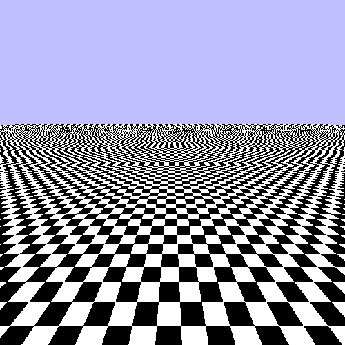

> 基础棋盘格平面

相机会自动控制，不过可以用 <kbd>P</kbd> 键暂停它的运动。教程中的其他功能会在用到时逐一说明。

如果你查看 `BigPlane.xml` 文件，会发现纹理坐标远远超出了我们习惯的 [0, 1] 范围。现在的取值范围是 [-64, 64]，而纹理本身只在 [0, 1] 范围内有效。

回想上一个教程，采样器对象有一个参数，用来控制 [0, 1] 范围之外的纹理坐标意味着什么。本教程会用到多个采样器，但我们的所有采样器都使用相同的 S 与 T 环绕模式：

```cpp
glSamplerParameteri(g_samplers[samplerIx], GL_TEXTURE_WRAP_S, GL_REPEAT);
glSamplerParameteri(g_samplers[samplerIx], GL_TEXTURE_WRAP_T, GL_REPEAT);
```

我们把 S 与 T 的环绕模式设为 `GL_REPEAT`。这意味着落在 [0, 1] 之外的取值会绕回到范围之内。于是纹理坐标 1.1 变成 0.1，纹理坐标 -0.1 变成 0.9。其思路是让纹理仿佛无限大，有无数份副本一遍又一遍地重复。

**注意**

> 为不同的坐标分量设置不同的纹理坐标环绕模式完全是合理的。当然，通常是这样；这对某些纹理类型不适用，但只是因为这些纹理类型带有特殊含义的纹理坐标。对它们来说，环绕模式会被完全忽略。

你可以用 <kbd>Y</kbd> 键在两个网格之间切换。另一个网格是一条又长又方的走廊。

这里用到的着色器非常简单。顶点着色器以位置和纹理坐标为输入，直接输出纹理坐标。片元着色器接收纹理坐标，用它取回一张纹理的颜色值，并把该颜色值作为输出写出。这里连 Gamma 校正都没有用到。

所涉及的纹理尺寸为 128x128，每一边有 4 个黑白相间的方块。每个黑色或白色的方块边长 32 像素。

## 线性过滤

这个例子虽然确实画出了棋盘格，但你能看出一些视觉问题。我们先从最不明显的问题开始找解决办法。

看看屏幕最底部的某一个方块。注意它的边线在左右移动时显得参差不齐。当它在平面上移动时，你能隐约看到它的像素在上下爬行。

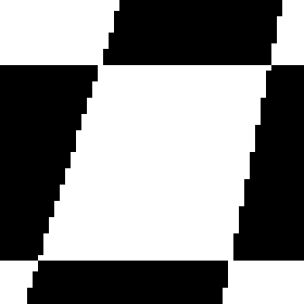

> 锯齿状的纹理边缘

这是由我们访问纹理的离散特性造成的。纹理坐标全都是浮点值。GLSL 的 `texture` 函数在内部会把这些纹理坐标转换成纹理中具体的纹素值。那么，如果纹理坐标正好落在两个纹素的中间，会得到什么值？

这由一个称为**纹理过滤**的过程决定。过滤可以在两个方向上发生：放大和缩小。当纹理映射让纹理在屏幕空间中的显示尺寸大于其实际分辨率时，就发生了放大。相对于映射而言，如果你离纹理更近，那么纹理相对其原始分辨率就被放大了。缩小则相反：纹理相对其原始分辨率被缩小。

在 OpenGL 中，放大过滤与缩小过滤是各自独立设置的。`GL_TEXTURE_MAG_FILTER` 和 `GL_TEXTURE_MIN_FILTER` 这两个采样器参数控制的就是这件事。我们目前两者都用 `GL_NEAREST`；这称为**最近邻过滤**。这种模式意味着每个纹理坐标都取离它最近的那个纹素值。对我们的棋盘格来说，这意味着我们只会得到黑色或白色。

现在这听起来或许没问题，因为我们的纹理是棋盘格，实际只有两种颜色。然而，正是这种离散采样导致了像素爬行效应。一个正好落在白色与黑色中间的纹理坐标，不是白色就是黑色；相机的一点点移动就会让它瞬间从黑跳到白，或从白跳到黑。

每一个被渲染的片元在屏幕上占据一定大小的空间，也就是该片元所对应的目标像素的面积。被渲染表面到纹理的纹理映射，会给表面上的每个点一个纹理坐标。但像素并不是表面上无限小的一个点；它代表的是表面上一块有限大的区域。

因此，我们可以反向使用纹理映射。我们可以取一个像素区域的四个角，并由它们求出纹理坐标。这个四边形在纹理空间中的面积，就是被映射到屏幕上该位置的那部分纹理面积。在一个完美的纹理访问系统中，从 GLSL `texture` 函数得到的值会是该区域内颜色的平均值。

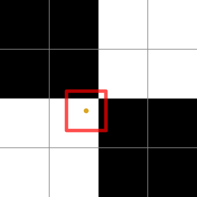

> 最近邻采样

图中的点表示纹理坐标在纹理上的位置。方框表示该片元覆盖的区域。问题在于，一个映射到纹理空间中的片元区域可能同时覆盖一部分白色区域和一部分黑色区域。由于最近邻只取一个纹素，而它不是黑就是白，因此它无法准确表示该片元所映射的区域。

平滑这些差异的一个显而易见办法，就是直接去平均它们。与其为每个纹理坐标只取一个样本，不如取最近的 4 个样本，再根据它们各自与纹理坐标的接近程度对其值进行插值。为此，我们把放大与缩小过滤器都设为 `GL_LINEAR`。

```cpp
glSamplerParameteri(g_samplers[1], GL_TEXTURE_MAG_FILTER, GL_LINEAR);
glSamplerParameteri(g_samplers[1], GL_TEXTURE_MIN_FILTER, GL_LINEAR);
```

出人意料地，这称为**线性过滤**。在本教程中按 <kbd>2</kbd> 键看看线性过滤是什么样子；按 <kbd>1</kbd> 键回到最近邻采样。

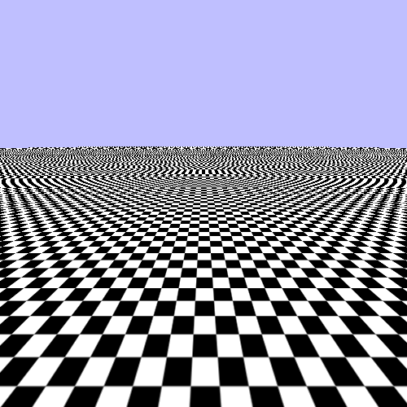

> 线性过滤

对于靠近相机的方块，这样看起来好多了。它会带来一点模糊，但这通常比像素爬行容易让观者接受得多。人类视觉容易被运动吸引，而像点状爬行这样的假运动会让人分心。

## 需要更多图片

说到让人分心，我们来谈谈远处的情况。相机移动时，纹理中距离较远的部分看起来像一团乱麻。即使暂停相机运动，它也依然不像棋盘格。

那里发生的事情其实很简单。我们的过滤方式是：对一个给定的纹理坐标，要么取最近的纹素值，要么取最近的 4 个纹素并插值。问题在于，对于表面上距离较远的区域，我们片元所覆盖的纹理空间面积比 4 个纹素大得多。

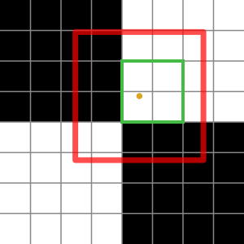

> 大范围缩小采样

内层的方框表示最近的纹素，外层的方框表示整个片元所映射的区域。我们可以看到，用最近邻采样得到的值会是纯白，因为最近的四个取值都是白色。但根据覆盖区域来判断，我们本该得到的其实是某种灰度。

要准确表示这块纹理区域，我们需要从不止 4 个纹素中采样。GPU 完全有能力检测出片元区域，并从纹理中采样足够多的取值来代表它。但这在纹理带宽和计算量两方面都会极其昂贵。

那么，如果我们不必采样更多纹素，而是拥有若干个更小的纹理版本会怎样？这些小版本实际上预先算好了一组组纹素。这样一来，我们只需从一张尺寸与片元区域足够接近的纹理中取 4 个纹素即可。

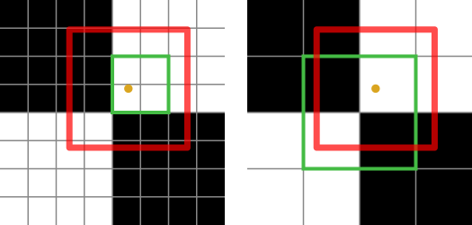

> mipmap 缩小采样

图像的这些较小版本称为 **mipmap**；它们有时也叫 mipmap 层级。之前我们说过，纹理可以存储多张图像。对于许多纹理类型来说，这些额外的图像就是 mipmap。通过对一个更低的 mipmap 层级做线性采样，我们得到的灰度值虽然还不是覆盖区域所暗示的精确颜色，但已经比在大 mipmap 上做线性过滤接近我们想要的结果得多。

在 OpenGL 中，mipmap 从 0 开始编号。0 号图像是最大的 mipmap，也就是通常所说的纹理主图像。当人们说一张纹理具有某个尺寸时，指的是 mipmap 层级 0 的分辨率。每个 mipmap 的尺寸是前一个的一半。所以，如果我们的主图像也就是 mipmap 层级 0 的尺寸是 128x128，那么下一个 mipmap 也就是层级 1 就是 64x64。再下一个是 32x32。如此类推，一直到最小的 mipmap，也就是 1x1。

对于非正方形的纹理（正如我们在上一个教程中看到的，这完全合法），mipmap 链会一直延续到所有维度都为 1。所以一张尺寸为 128x16 的纹理（记住：纹理的尺寸指最大 mipmap 的尺寸）会有与 128x128 纹理一样多的 mipmap 层级。128x16 纹理的 mipmap 层级 4 是 8x1；下一个 mipmap 是 4x1。

**注意**

> 纹理尺寸不是 2 的幂也完全合法。对这些纹理，mipmap 尺寸总是向下取整。所以 129x129 纹理的 mipmap 1 是 64x64。131x131 纹理的 mipmap 1 是 65x65，mipmap 2 是 32x32。

DDS 图像格式是少数几个真正支持把一张纹理的所有 mipmap 存储在同一个文件中的图像格式。大多数图像格式只允许在一个文件里放一张图像。我们那张带 mipmap 的 128x128 纹理的加载代码如下：

**示例：带 mipmap 的 DDS 纹理加载**

```cpp
std::string filename(LOCAL_FILE_DIR);
filename += "checker.dds";

std::auto_ptr<glimg::ImageSet> pImageSet(glimg::loaders::dds::LoadFromFile(filename.c_str()));

glGenTextures(1, &g_checkerTexture);
glBindTexture(GL_TEXTURE_2D, g_checkerTexture);

for(int mipmapLevel = 0; mipmapLevel < pImageSet->GetMipmapCount(); mipmapLevel++)
{
    glimg::SingleImage image = pImageSet->GetImage(mipmapLevel, 0, 0);
    glimg::Dimensions dims = pImage->GetDimensions();
    
    glTexImage2D(GL_TEXTURE_2D, mipmapLevel, GL_RGB8, dims.width, dims.height, 0,
        GL_BGRA, GL_UNSIGNED_INT_8_8_8_8_REV, image.GetImageData());
}

glTexParameteri(GL_TEXTURE_2D, GL_TEXTURE_BASE_LEVEL, 0);
glTexParameteri(GL_TEXTURE_2D, GL_TEXTURE_MAX_LEVEL, pImageSet->GetMipmapCount() - 1);
glBindTexture(GL_TEXTURE_2D, 0);
```

由于该文件包含多个 mipmap，我们必须逐个加载。GL Image 库把每个 mipmap 都视为独立的图像。`glimg::SingleImage` 的 `GetDimensions` 成员返回该特定 mipmap 的尺寸。

`glTexImage2D` 函数的第二个参数是要加载的 mipmap 层级。宽度与高度参数表示当前这个 mipmap 的尺寸，而不是基础层级的尺寸。

注意最后几条语句发生了变化。`GL_TEXTURE_BASE_LEVEL` 和 `GL_TEXTURE_MAX_LEVEL` 参数告诉 OpenGL 我们纹理中哪些 mipmap 可以使用。这是一个闭区间。由于 128x128 的纹理有 8 个 mipmap，我们使用区间 [0, 7]。纹理的基础层级是最大的可用 mipmap 层级，而最大层级是最小的可用层级。可以省略其中一些较小的 mipmap 层级。注意层级 0 始终是可能的最大 mipmap 层级。

基于 mipmap 的过滤不出所料地称为 **mipmap 过滤**。本教程并没有加载两张棋盘格纹理；它自始至终只使用一张棋盘格。之所以直到现在才用上 mipmap，是因为 mipmap 过滤没有被启用。只设置基础层级和最大层级是不够的；还必须告诉采样器对象使用 mipmap 过滤。否则它只会使用基础层级。

Mipmap 过滤只对缩小有效，因为缩小意味着片元区域大于纹理的分辨率。要启用它，我们使用缩小过滤的一种特殊 `MIPMAP` 模式。

```cpp
glSamplerParameteri(g_samplers[2], GL_TEXTURE_MAG_FILTER, GL_LINEAR);
glSamplerParameteri(g_samplers[2], GL_TEXTURE_MIN_FILTER, GL_LINEAR_MIPMAP_NEAREST);
```

`GL_LINEAR_MIPMAP_NEAREST` 缩小过滤器的含义如下。对于 GLSL `texture` 函数的某一次具体调用，它会检测哪个 mipmap 离我们的片元区域最近。这个检测依据是表面相对于相机视角的角度[^这是一种简化说法，后面会更深入地讨论。]。然后，当它从那个 mipmap 采样时，会在该 mipmap 内部对最近的 4 个样本使用线性过滤。

在本教程中按 <kbd>3</kbd> 键，可以看到这种过滤模式的效果。

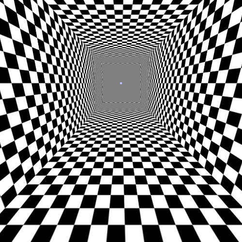

> 使用 mipmap 的走廊

这看起来合理多了。虽然还不够完美，但比之前远处那种随机的抖动要好得多。

在使用普通纹理与 mipmap 时，要真正理解 mipmap 过滤的效果并不容易。因此，按 <kbd>空格键</kbd> 时，本教程会切换到一张特殊纹理。它不是从文件加载的，而是在运行时构建出来的。

通常，mipmap 就是较大图像的缩小版本，用线性过滤或其他各种算法算出合理的缩放结果。这张特殊纹理的每个 mipmap 都是纯色，但各个 mipmap 的颜色各不相同。这样就能非常清楚地看出每个 mipmap 各自在哪里。

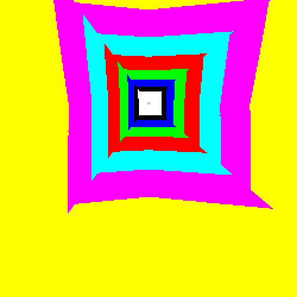

> 使用特殊纹理的走廊

现在我们能真正看出不同的 mipmap 分别在哪里了。它们在边角处并没有完全对齐。但请记住：这只是显示出 mipmap 的边界，而不是纹理坐标本身。

### 特殊纹理的生成

这张用于观察 mipmap 的特殊纹理很有意思，因为它演示了你在上传某些纹理时可能需要处理的一个问题：对齐。

棋盘格纹理虽然只存储黑色和白色取值，但它实际上带有全部三个颜色通道，再加上第四个值。由于每个通道都存为 8 位无符号归一化整数，每个像素占 4 * 8，也就是 32 位，即 4 字节。

OpenGL 的图像上传与下载是按图像数据的水平行来进行的。每一行都有特定的字节对齐要求。OpenGL 的默认值是 4 字节；由于我们的像素长度为 4 字节，所以每个 mipmap 每行的字节大小都是 4 字节的整数倍。即便是 1x1 的 mipmap 层级大小也是 4 字节。

注意我们提供的内部格式是 `GL_RGB8`，尽管我们传输的分量是 `GL_BGRA`（A 是第四个分量）。这意味着 OpenGL 会或多或少地丢弃我们上传的第四个分量。没关系。

特殊纹理的像素数据问题在于，它的长度不是 4 字节。用于生成特殊纹理某个 mipmap 层级的函数如下：

**示例：特殊纹理数据**

```cpp
void FillWithColor(std::vector<GLubyte> &buffer,
                   GLubyte red, GLubyte green, GLubyte blue,
                   int width, int height)
{
    int numTexels = width * height;
    buffer.resize(numTexels * 3);
    
    std::vector<GLubyte>::iterator it = buffer.begin();
    while(it != buffer.end())
    {
        *it++ = red;
        *it++ = green;
        *it++ = blue;
    }
}
```

这创建了一张像素为 24 位的纹理；每个像素包含 3 字节。

对任何 4 的倍数宽度来说都没问题。但如果宽度是 2，那么每行像素数据就是 6 字节长。这不是 4 的整数倍，因此破坏了对齐。

因此，我们必须改变 OpenGL 使用的像素对齐方式。`LoadMipmapTexture` 函数就是生成这张特殊纹理的。它的开头几行是这样的：

```cpp
GLint oldAlign = 0;
glGetIntegerv(GL_UNPACK_ALIGNMENT, &oldAlign);
glPixelStorei(GL_UNPACK_ALIGNMENT, 1);
```

前两行取得原有的对齐方式，以便我们完成后能把它重置回去。最后一行使用 `glPixelStorei`。注意 GL Image 库确实提供了对齐取值；它是图像 `Dimensions` 结构体的一部分。我们只是还没有用到它。在上一个教程中，我们的行宽是按 4 字节对齐的，所以不可能出问题。在本教程中，我们的图像数据像素大小是 4 字节，因此它本身就总是按 4 字节对齐。

话虽如此，你始终应该把行对齐放在心上了，尤其是在处理 mipmap 的时候。

### mipmap 之间的过滤

我们的 mipmap 过滤相比之前的做法有了显著的改善。不过它确实会产生瑕疵。其中特别值得关心的一项是 mipmap 层级之间的切换。它是突兀的，在运动场景中相当容易被察觉。也许有办法把它平滑掉。

我们当前的缩小过滤会选定单个 mipmap 层级，并从中取一个样本。如果能选中最近的两个 mipmap 层级，并把从这两张纹理取到的值混合起来就更好了。这样就能从一个 mipmap 层级到下一个层级有更平滑的过渡。

这是通过使用 `GL_LINEAR_MIPMAP_LINEAR` 缩小过滤实现的。第一个 `LINEAR` 表示在单个 mipmap 层级内部所做的过滤，第二个 `LINEAR` 表示在 mipmap 层级之间所做的过滤。

要看看它的实际效果，按 <kbd>4</kbd> 键。

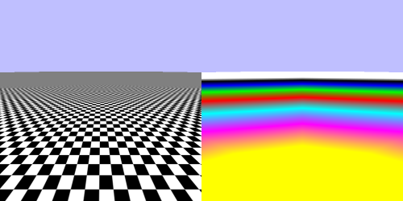

> 线性 mipmap 线性对比

这是一个改进。仍然有一些问题有待解决，但一个 mipmap 在哪里结束、另一个从哪里开始已经难以辨认了。

OpenGL 实际上允许在缩小过滤中把 `NEAREST` 与 `LINEAR` 任意组合。在 mipmap 层级内部使用最近邻过滤、同时在层级之间使用线性过滤（`GL_NEAREST_MIPMAP_LINEAR`）是可行的，但实践中用处不大。

**▌过滤术语辨析**

> 如果你从其他资料中了解过纹理过滤，可能听说过「双线性过滤」和「三线性过滤」这两个词。你也许还知道，mipmap 层级之间的线性过滤通常被称为三线性过滤。
>
> 本书不使用这套术语。而且有充分的理由：「三线性过滤」是一个误称。
>
> 要理解其中的问题，首先必须理解「双线性过滤」是什么意思。双线性中的「双」来自沿二维纹理的两个轴做线性过滤。因此在 S 和 T 方向上都有线性过滤（记住：标准 OpenGL 术语把二维纹理的坐标轴称为 S 和 T）；既然是两个方向，就称为「双线性过滤」。于是「三线性」来自增加了第三个线性过滤方向：mipmap 层级之间。
>
> 因此，人们可以把 `GL_LINEAR` 的放大与缩小过滤称为双线性过滤，把 `GL_LINEAR_MIPMAP_LINEAR` 称为三线性过滤。
>
> 这些说法对二维纹理来说是成立的。可对一维纹理又如何呢？由于一维纹理只有一个维度，`GL_LINEAR` 的放大与缩小过滤只在一个方向上过滤：S。因此，把一维的 `GL_LINEAR` 过滤简单称为「线性过滤」是合理的。事实上，对一维纹理的 mipmap 层级之间做过滤（没错，一维纹理也可以有 mipmap）反倒必须称为「双线性过滤」。
>
> 然后还有三维纹理。`GL_LINEAR` 的放大与缩小过滤会在全部 3 个方向上过滤：S、T 和 R。因此那反倒必须称为「三线性过滤」。而如果在此之上再加上线性 mipmap 过滤（没错，三维纹理也可以有 mipmap），那就得称为「四线性过滤」。
>
> 因此，「三线性过滤」这个词若不先知道纹理类型，就完全没有意义。相比之下，`GL_LINEAR_MIPMAP_LINEAR` 无论纹理类型是什么，都有明确的含义。
>
> 与几何着色器（它本该叫作图元着色器）不同，OpenGL 并没有把这个常见误称写进自己的 API。并不存在 `GL_TRILINEAR` 这个枚举量。因此，在本书中我们可以而且会使用这些方式的正确叫法。

## 各向异性

线性 mipmap 过滤很好；它消除了远处大部分的抖动和怪异现象。问题在于，它把很多这类抖动替换成了……灰色。基于 mipmap 的过滤工作得相当不错，但它往往补偿过度。

例如，看屏幕左侧或右侧那条对角线上的方块链。如果需要，可以在水平方向上拉大窗口。

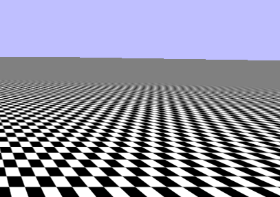

> 主对角线

沿着这条对角线的像素应该基本是黑色的。随着它们越来越远，相对于纹素区域而言，片元区域在长度方向上的畸变会越来越严重：

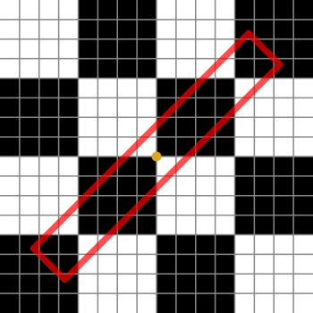

> 狭长的片元区域

如果过滤是完美的，我们应该得到一个基本为黑色的值。但实际得到的却是浅得多的灰色。原因必然与 mipmap 及 mipmap 选择的具体机制有关。

Mipmap 是主纹理预先过滤好的版本。问题在于它们在两个方向上的过滤程度是一样的。如果片元区域是正方的，这没问题；但对于长条形区域，mipmap 的选择就变得棘手得多。所用的算法非常保守。它会为该片元区域选择尽可能小的 mipmap 层级。因此就纹理函数所取到的值而言，细长的区域与正方形区域没有任何区别。

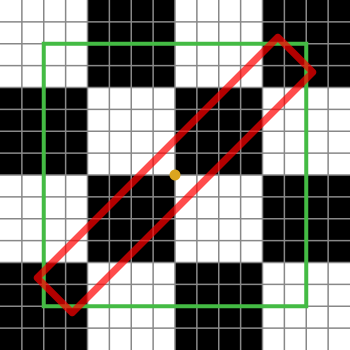

> 带采样区域的狭长片元

大正方形表示有效的过滤盒，而那个斜的长条区域才是我们实际采样的区域。Mipmap 过滤常常会把采样区域之外的纹素值也合并进来，而在这个格外退化的情形下，它拉进来的纹素值来自离采样区域非常远的地方。

这发生在过滤盒不是正方形的时候。正方形的过滤盒被称为各向同性的：它在所有方向上都一致。因此，非正方形的过滤盒就是各向异性的。把某个过滤盒的各向异性考虑在内的过滤，自然就叫作**各向异性过滤**。

OpenGL 规范对大多数事情通常都非常严格。它会解释选中哪个 mipmap 的细节，也会解释 mipmap 之间线性插值时「接近」是如何定义的。但对于各向异性过滤，规范对它究竟如何工作却非常宽松。

大致思路是这样的。实现会取若干个样本，用它们在纹理中近似过滤盒的形状。它会从 mipmap 中选择，但只选择那些代表了更接近版本过滤结果的 mipmap。下面是一个例子：

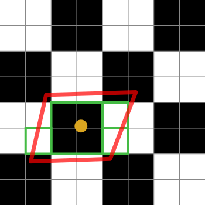

> 平行四边形采样区域

那些完全落在采样区域内的样本中，有一部分可以使用更小的 mipmap，从而减少实际要取的样本数量。上图只需要四个样本就能近似该采样区域：三个小方框，加上中心那个较大的方框。

所有样本值都会按某种加权算法一起平均，而该算法的目标是最好地表示每个样本对过滤盒的贡献。再次强调，这些说法都非常笼统；具体算法取决于实现。

再运行一次本教程。<kbd>5</kbd> 键会激活一种各向异性过滤。

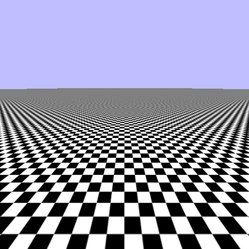

> 各向异性过滤

这是一个改进。

### 采样控制

各向异性过滤需要从各个 mipmap 中取多个样本。控制各向异性过滤质量的关键在于限制所用的样本数量。提高所取样本数上限通常会让结果看起来更好，但也会降低性能。

这是通过设置 `GL_TEXTURE_MAX_ANISOTROPY_EXT` 采样器参数来完成的：

```cpp
glSamplerParameteri(g_samplers[4], GL_TEXTURE_MAG_FILTER, GL_LINEAR);
glSamplerParameteri(g_samplers[4], GL_TEXTURE_MIN_FILTER, GL_LINEAR_MIPMAP_LINEAR);
glSamplerParameterf(g_samplers[4], GL_TEXTURE_MAX_ANISOTROPY_EXT, 4.0f);
```

它表示通过这个采样器进行任何纹理访问时，所取样本数量的上限。注意我们仍然把线性 mipmap 过滤与各向异性过滤结合使用。理论上你可以在没有 mipmap 的情况下使用各向异性过滤，但与线性 mipmap 过滤搭配使用，性能会好得多。

最大各向异性是一个浮点值，部分原因在于各向异性过滤的具体性质留给了硬件决定。不过一般而言，你可以把它当作整数值来对待。

我们能提供的最大各向异性有一个上限。这个上限由实现自行定义；由于该值是浮点数而非整数，所以可以用 `glGetFloatv` 查询。要把最大各向异性设为可能的最大值，我们这样做：

```cpp
GLfloat maxAniso = 0.0f;
glGetFloatv(GL_MAX_TEXTURE_MAX_ANISOTROPY_EXT, &maxAniso);

glSamplerParameteri(g_samplers[5], GL_TEXTURE_MAG_FILTER, GL_LINEAR);
glSamplerParameteri(g_samplers[5], GL_TEXTURE_MIN_FILTER, GL_LINEAR_MIPMAP_LINEAR);
glSamplerParameterf(g_samplers[5], GL_TEXTURE_MAX_ANISOTROPY_EXT, maxAniso);
```

要看看它的效果，按 <kbd>6</kbd> 键。


> 最大各向异性过滤

现在看起来相当不错了。远处仍然有一些问题。记住，你看到的画面可能不完全一样，因为各向异性过滤的具体细节与实现有关。

你可能担心的是：所有这些过滤技术都无法给出完美的结果，即便是最大各向异性也不行。在远处，纹理即便沿对角线方向看仍然会变成一片没有细节的灰色。原因是，从纹理过滤的角度看，渲染一张大面积的棋盘格或许是最困难的问题之一。当它像这里这样被侧着看时，情况还会更糟。

事实上，选择这种重复的棋盘格纹理，正是因为它能非常明显地凸显出这些问题。一张更传统的漫反射颜色纹理，在采用合理过滤之后通常会好看得多。另外还有一个我们目前没有涉及的问题，它会在下一个教程中处理。

### 关于 EXT

你可能已经注意到 `GL_TEXTURE_MAX_ANISOTROPY_EXT` 上的「EXT」后缀。这个后缀意味着该枚举量来自某个 OpenGL 扩展。首先也是最重要的一点，这意味着该枚举量不属于 OpenGL 规范。

OpenGL 扩展是由某个特定实现公开提供的对 OpenGL 的修改。扩展都有公开的文档，说明它们如何改变标准的 GL 规范；这使用户能够正确地使用它们。由于 OpenGL 的不同实现会实现不同的扩展集合，因此有一套机制可以查询某个扩展是否已实现。这让用户代码能够检测某些硬件特性是否可用，并按需使用或不使用。

扩展有若干种。有些是专有扩展；它们由某个特定厂商创建，几乎从不被其他厂商实现。在某些情况下，它们基于该厂商拥有的知识产权，因此在没有明确许可的情况下无法被实现。这些扩展的枚举量与函数名以基于扩展所有者的后缀结尾。例如，仅限 NVIDIA 的扩展会以「NV」结尾。

ARB 扩展是一类特殊的扩展，由 OpenGL ARB（负责管理 OpenGL 规范的机构）认可。它们通常由 ARB 的多个成员协作创建。历史上，它们代表的是实现方被强烈建议实现的功能。

EXT 扩展则介于前两者之间。它们不是专有扩展，而且常常由 ARB 成员协作创建。但与此同时，它们也没有得到 ARB 的「认可」。历史上，EXT 扩展被用作某些功能和 API 的试验场，以便在把某个特性提升为 OpenGL 核心功能或 ARB 扩展之前，先确认这套 API 是合理的。

`GL_TEXTURE_MAX_ANISOTROPY_EXT` 枚举量属于 `EXT_texture_filter_anisotropic` 扩展。由于它是扩展而不是核心功能，用户通常必须自行检测该扩展是否可用，只在可用时才使用它。如果你通读教程代码，会发现没有任何代码做这个测试。

原因很简单：没必要。这个扩展本身可以追溯到 1999 年的 GeForce 256（不是 GeForce 250GT，而是最初的 GeForce）。此后几乎所有 GPU 都实现了各向异性过滤，并通过这个扩展公开出来。这就是教程不去检查该扩展是否存在的原因；如果你的硬件能运行这些教程，那它就公开了这个扩展。

既然它如此普遍，为什么 ARB 没有把这个功能采纳进 OpenGL 核心？为什么各向异性过滤必须是一个事实上有保证、但在技术上不属于 OpenGL 的扩展？原因在于 OpenGL 必须是开放的。

OpenGL 中的「开放」既指规范本身可获取，也指任何人都可以实现它。事实证明，各向异性过滤牵涉到知识产权问题。如果它被采纳进核心，那么核心 OpenGL 就必须从知识产权持有者那里获得技术许可才能实现。它之所以不是专有扩展，是因为没有任何 ARB 成员拥有该知识产权；它掌握在第三方手中。

因此，你可以假定各向异性过滤可以通过 OpenGL 使用。但它在技术上是一个扩展。

## mipmap 选择是如何工作的

之前我们结合与物体几何形状相关的概念讨论了 mipmap 选择与插值。这话没错，但那只在我们处理简单纹理映射方案时才成立，比如纹理坐标直接附着在顶点位置上的情形。但正如我们在第一个纹理教程中看到的，纹理坐标完全可以是任意的。那么这时 mipmap 选择和各向异性过滤又是如何工作的呢？

非常小心地。

想象屏幕上有一块 2x2 的像素区域。现在想象有四个片元着色器在同时为这块屏幕区域执行，它们都来自同一个三角形。由于来自同一三角形的片元着色器保证拥有相同的 uniform 和相同的代码，它们之间唯一不同的就是片元输入。而且由于它们执行的是同一段代码，你可以设想它们是齐步执行的。也就是说，每个着色器在同一时刻、各自的数据上执行同一条指令。

在这个假设下，对于片元着色器中的任何一个特定取值，你都可以在其他同时执行的片元着色器中挑出对应的另外 3 个值。如果该取值仅仅基于 uniform 或常量数据，那么每个着色器的取值都相同。但如果它基于输入值（部分或全部基于），那么每个着色器的取值都可能不同，取决于它是怎么算出来的以及那些输入是什么。

那么，我们来看纹理坐标取值，也就是用来访问纹理的那个特定取值。每个着色器都有一个。如果该取值是通过透视校正插值之类的方式与三角形的顶点关联起来的，那么各着色器取值之间的*差值*就表示了该三角形在窗口空间中的几何形状。差值有两个维度，因此也就有两个差值：窗口空间 X 轴上的差值，以及窗口空间 Y 轴上的差值。

这两个差值有时也叫作梯度或导数，它们正是 mipmap 实际的工作方式。如果所用的纹理坐标只是一个插值得到的输入值，并且它本身直接与位置相关，那么这些梯度就表示三角形在窗口空间中的几何形状。如果纹理坐标是用更不寻常的方式算出来的，它依然成立，因为梯度表示的是纹理坐标在三角形表面上如何变化。

有了两个梯度，就可以检测各向异性。因此，它提供了足够的信息来合理地应用各向异性过滤算法。

现在你也许注意到了，这个过程是有条件的。具体来说，它要求你有 4 个齐步执行的片元着色器。有两种情况可能做不到这一点。

最明显的一种是在三角形边缘，此时无法在不越出三角形区域的前提下凑出一个 2x2 的相邻片元块。这种情况其实被 GPU 轻松覆盖。无论如何，GPU 都会以 2x2 为块来光栅化每个三角形。即便其中某些块实际上并不属于目标三角形，它们仍然会分到片元着色器的执行时间。这看起来似乎效率不高，但在三角形不是极小或极细的情况下（这种情形相当常见），它还是相当合理的。三角形之外由片元着色器产生的结果会被直接丢弃。

另一种情况是通过用户有意介入。每个齐步执行的片元着色器都有相同的 uniform，但输入不同。由于输入不同，它们有可能基于这些输入执行条件分支（if 语句或其他条件判断）。例如，这可能使 2x2 方块的左半边执行某段代码，而右半边执行另一段代码。这 4 个片元着色器就不再齐步了。GPU 如何处理这种情况？

嗯……它并不处理。解决这一点需要用户手动介入，这是我们稍后要讨论的话题。只需说，它让一切都变复杂了。

## 性能

Mipmap 有一些出人意料的性能特性。一张拥有完整 mipmap 金字塔的纹理所占空间比只有基础层级大约多 33%。所以确实存在一些内存开销。出人意料的是，这其实是用内存换速度，因为 mipmap 通常会提升性能。

如果一张纹理将被大幅缩小，提供 mipmap 对性能是有益的。原因是这样的：对于一张高度缩小的纹理，相邻片元着色器的纹理访问点会相隔很远。纹理采样单元喜欢局部性很高的纹理访问模式，也就是相邻片元着色器访问的纹素彼此非常接近。它们相隔越远，纹理采样器中的优化就越没用。事实上，如果相隔足够远，这些优化会开始变成性能负担。

用作查找表的纹理一般不应该使用 mipmap。但其他类型的纹理，比如用来提供表面细节的纹理，在合理的情况下可以而且应该使用 mipmap。

虽然 mipmap 映射本身是免费的，但线性 mipmap 过滤 `GL_LINEAR_MIPMAP_LINEAR` 一般不是免费的。不过如今它的代价相当小。对于那些 mipmap 插值有意义的纹理，就应该使用它。

各向异性过滤的代价更高，这正如人们所料。毕竟它意味着要取更多纹理样本才能覆盖某个纹理区域。不过，各向异性过滤几乎总是自适应实现的。这意味着它只会为那些它检测出确有必要的片元取额外样本。而且它只会取足以填满该区域的样本数，当然不会超过用户给出的上限。因此，打开各向异性过滤，哪怕只是 2 倍或 4 倍，也只会给真正需要它的片元带来损失。

## 本章小结

在本教程中，你学到了以下内容：

- 由于纹理的离散特性，贴有纹理的物体上可能出现视觉瑕疵。当纹理映射后的尺寸大于或小于其实际尺寸时，这些瑕疵最为明显。
- 各种过滤技术可以减轻这些瑕疵，把视觉上的跳变变成更易接受的效果。在纹理放大这一环节最容易做到。
- Mipmap 是图像的缩小版本。它们的用意是充当图像预先过滤好的版本，从而让纹理采样硬件能够一次有效地采样并过滤大量纹素。缺点是它看起来会过滤过度，使纹理在本来还能保留细节的区域也混合降到更低的 mipmap 上。
- 过滤可以在 mipmap 层级之间进行。Mipmap 过滤能产生相当合理的结果，而性能代价相对可以忽略。
- 各向异性过滤试图根据纹理访问的覆盖区域来过滤，从而纠正 mipmap 过滤过度的问题。各向异性过滤由一个最大值控制，它表示纹理访问在合成最终颜色时最多会额外使用多少个样本。

### 进一步学习

试试用给出的程序完成下面这些事情。

- 把各向异性过滤与基于 mipmap 的版本作对比，在不用 mipmap 过滤的情况下使用各向异性过滤。
- 修改棋盘格纹理的 `GL_TEXTURE_MAX_LEVEL`。从算出的最大层级中减去 3。这会阻止 OpenGL 访问最下面 3 个 mipmap：1x1、2x2 和 4x4。看看会发生什么。注意远处的灰色变少了，但我们在不用 mipmap 的版本中看到的那些闪烁又回来了。
- 回到上一个教程中的 `Basic Texture`，修改采样器，让它在这张一维纹理上使用线性放大与缩小过滤。看看线性过滤是否让这张表的低分辨率版本变得顺眼一些。如果你把这个做法用在 `Material Texture` 教程中的那张二维查找纹理上，它会在 S 和 T 两个坐标方向上都进行过滤，这意味着它也会跨光泽度进行过滤。试试看，并观察结果如何变化。也试着对光泽度纹理使用线性过滤。

## 术语表

- **纹理过滤**：在某个特定纹理坐标处取回纹理值的过程，可能涉及把多个纹素值组合在一起。

  过滤可以在两个方向上发生：放大和缩小。当片元区域投影到纹理中后小于纹素本身时，发生的是放大。当片元区域的投影大于一个纹素时，发生的是缩小。
- **最近邻过滤**：返回与纹理坐标最接近的那个纹素值的纹理过滤。
- **线性过滤**：在纹理的每个维度上分别取最接近的纹素值，并根据纹理坐标与这些值的接近程度做线性插值的纹理过滤。对一维纹理，这会取两个值并插值。对二维纹理取四个；对三维纹理则选 8 个。
- **mipmap、mipmap 层级**：纹理的子图像。纹理的每一级后续 mipmap 都是前一张图像尺寸的一半并向下取整。最大的 mipmap 就是基础层级。许多纹理类型可以有 mipmap，但有些不能。
- **mipmap 过滤**：使用 mipmap 的纹理过滤。使用 mipmap 过滤时所选的 mipmap，取决于纹理坐标相对于屏幕的角度。

  Mipmap 过滤可以是最近邻的，也可以是线性的。最近邻 mipmap 过滤只选一个 mipmap，并返回从该 mipmap 取到的值。线性 mipmap 过滤会从最近的两个 mipmap 中各取样本，并在两者之间做线性插值。两种情况下返回的样本，在该 mipmap 内部都可以再应用线性或最近邻过滤。
- **各向异性过滤**：把纹理访问的各向异性考虑在内的纹理过滤。这需要从一个覆盖表面不规则区域的表面上取多个样本。它与 mipmap 过滤搭配时效果更好。
- **OpenGL 扩展**：不属于 OpenGL 本体、但可以由 OpenGL 的不同实现有条件地公开出来的功能。
