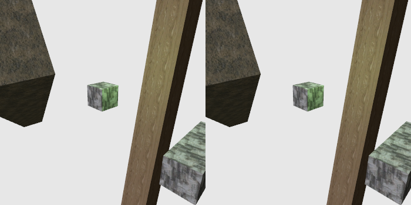
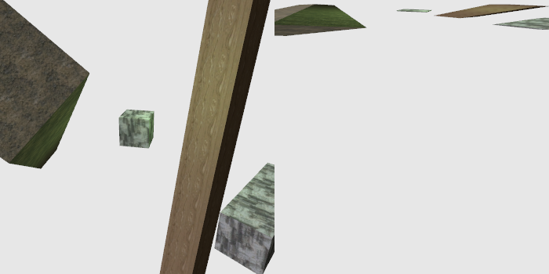
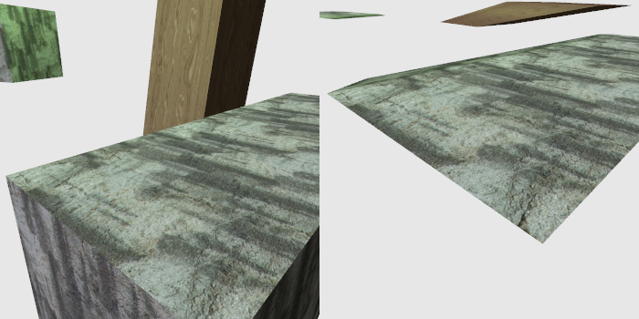
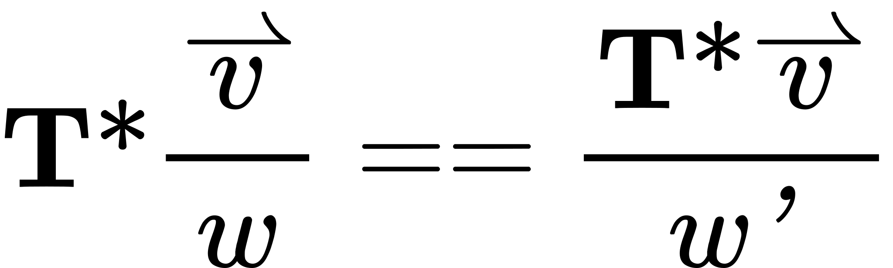
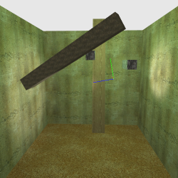
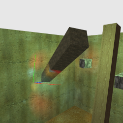
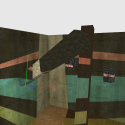
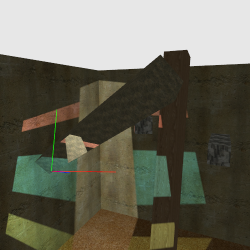
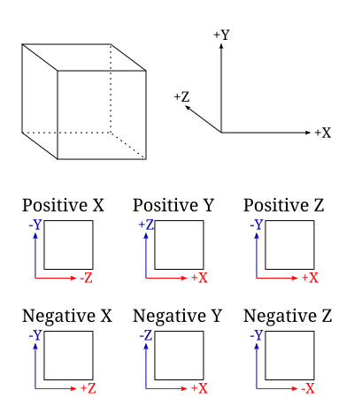

# 聚焦纹理

此前我们看到纹理被用来改变表面参数。但我们还可以用纹理来改变别的东西：光强。这样我们就能模拟出光强随距离之外的因素变化的光源。

我们改变光强的第一步，将是构造一支白炽手电筒。由于反射镜聚焦光线的方式，手电筒射出的光束并不是单一恒定的强度。用纹理来定义这种光强分布是最简单的办法。

## 投影后空间

在我们讨论如何用纹理做出一支手电筒之前，需要先稍微插叙一下。透视投影会是我们把纹理变成手电筒的一个重要环节，所以我们要重新审视透视投影。具体来说，我们要看看在透视投影操作之后再做变换会发生什么。

打开名为 `Double Projection` 的工程。它渲染了四个物体，使用了各种纹理，场景中有一盏平行光源和一盏绿色点光源。



> 双重投影

本教程显示的是同一个场景的两幅图像。左边一幅是从一个相机看到的场景，右边一幅是从另一个相机看到的场景。两个相机的差别主要在于相机变换矩阵被应用的位置。

左侧相机的工作方式是正常的。它像往常一样由鼠标左键、滚轮和 WASD 键控制。而右侧相机提供的是在透视投影矩阵之后才应用的视角方向。因此变换的顺序是这样的：模型 -> 左相机 -> 投影 -> 右相机。右相机由鼠标右键控制，只有方向控制对它有效。

其思路是让我们能够看到物体在透视投影之后的归一化设备坐标（NDC）空间中的形状。NDC 空间是一个以原点为中心的 [-1, 1] 立方体；在 NDC 空间中旋转物体，就能看到这些物体从另一个视角看起来是什么样子。按 <kbd>空格键</kbd> 会把右相机重置到中性的视角。

注意透视投影之后的空间中物体会被严重扭曲，在 Z 方向上尤其如此。另外，回想一下透视投影的一个基本技巧：它会根据物体到相机的 Z 距离对物体重新缩放。因此，距离越远的物体在 NDC 空间中物理上就越小。于是，绕着 NDC 空间旋转会产生一些并非你直觉所预期的结果，一开始可能会让人非常晕头转向。

例如，如果相对于左相机把右相机旋转到俯视角度，我们会看到所有物体似乎都缩小成了一条很窄的宽度。



> 顶视投影

这是由于透视投影对 Z 坐标所起作用的特殊方式。NDC 空间中的 Z 坐标是裁剪空间 Z 除以相机空间 Z 的相反数的结果。这把它强行压入 [-1, 1] 范围，而裁剪空间 Z 同时还受透视矩阵的 zNear 与 zFar 影响。这两个值越大，Z 被压缩得越窄。离相机较远的物体会被压缩进更小的 Z 范围；我们在考察相机 Z 范围对精度的影响时已经看到过这一点。近处的物体比远处物体占据了 [-1, 1] 范围中更大的一部分。

把左相机移近某个物体就能看到这一点。从自上而下的视角看，右相机看到的该物体在 Z 方向上要厚得多。



> 近视投影

按 <kbd>Y</kbd> 键会切换右相机中的深度钳制。这可以解释在那里看到的一些异常现象。有时错误的物体会互相叠在一起；发生这种情况时，几乎总是由于深度被钳制了。

深度钳制在右侧屏幕中之所以如此重要，原因一想就很明显。NDC 空间是一个 [-1, 1] 立方体。但那并不是我们真正渲染到的 NDC 空间。我们渲染的是这个空间中旋转过来的一部分。因此，真正被裁剪或钳制的 [-1, 1] 空间与我们所看到的那个是不同的。我们实际上是旋转着一个立方体，并把恰好落在立方体观察区域之外的部分切掉。而由于最初的立方体被强烈地偏向大的 Z 值，世界的很大一部分常常会掉出观察立方体。

### 场景图

这是本教程中第一处使用框架场景图部分的代码。**场景图**这个词指的是一段软件，它管理一组对象，通常组织成某种对象层次结构。在这里，框架中的 `Scene.h` 部分包含一个类，它加载场景的 XML 描述。这个描述包括要加载的网格、着色器和纹理。然后这些资源会与场景中具名的对象关联起来。因此，一个网格配合一个着色器就可以用一张或多张纹理来渲染。

这套系统的目的是把*大量*样板代码从教程文件中剔除掉。场景图的设置工作远没有之前教程中那么复杂。

举个例子，下面是加载并链接某个着色器的场景图：

**示例：场景图着色器定义**

```xml
<prog
    xml:id="p_unlit"
    vert="Unlit.vert"
    frag="Unlit.frag"
    model-to-camera="modelToCameraMatrix">
    <block name="Projection" binding="0"/>
</prog>
```

`xml:id` 给了它一个名字；场景中的对象用它来引用这个程序。它也为其他代码提供了一条与它通信的途径。其余部分大多不言自明。`model-to-camera` 值得解释一下。

渲染场景图的做法是调用场景图的渲染函数并传入一个相机矩阵。由于场景图中的对象各自保存着自己的变换，场景图会把每个对象的局部变换与给定的相机矩阵组合起来。但它仍需要知道如何把该矩阵提供给着色器。因此，`model-to-camera` 指定了接收模型到相机变换矩阵的那个 `mat4` uniform 的名称。另有一个用于法向量的类似矩阵，其值是模型到相机矩阵的逆转置。

`block` 元素是把程序中的一个 uniform 块与某个 uniform 块绑定点关联起来的方式。`sampler` 也有一个类似的元素，用来指定某个 GLSL 采样器绑定到哪个纹理单元。

场景图系统中的对象传统上称为「节点」，这个场景图也不例外。

**示例：场景图节点定义**

```xml
<node
    name="spinBar"
    mesh="m_longBar"
    prog="p_lit"
    pos="-7 0 8"
    orient="-0.148446 0.554035 0.212003 0.791242"
    scale="4">
    <texture name="t_stone_pillar" unit="0" sampler="anisotropic"/>
</node>
```

节点有若干属性。它们有一个名字，以便其他代码引用。它们有一个要渲染的网格，以及渲染该网格所用的程序。它们有位置、朝向和缩放这几个变换。朝向以四元数指定，W 分量放在最后（这与 `glm::fquat` 的指定方式不同，那里的 W 排在最前）。这些变换的顺序是先缩放，再朝向，最后平移。

这个节点还绑定了一张纹理。`t_stone_pillar` 是在一条 `texture` 命令中加载的纹理。`unit` 属性指定要使用的纹理单元。而 `sampler` 属性定义使用哪个预定义采样器。在这个例子中，它使用了一个各向异性过滤开到硬件允许的最大程度的采样器。该采样器的纹理环绕模式是对 S 和 T 坐标进行重复。

这就是整个场景的 C++ 设置代码：

**示例：Double Projection 的 LoadAndSetupScene**

```cpp
std::auto_ptr<Framework::Scene> pScene(new Framework::Scene("dp_scene.xml"));

std::vector<Framework::NodeRef> nodes;
nodes.push_back(pScene->FindNode("cube"));
nodes.push_back(pScene->FindNode("rightBar"));
nodes.push_back(pScene->FindNode("leaningBar"));
nodes.push_back(pScene->FindNode("spinBar"));

AssociateUniformWithNodes(nodes, g_lightNumBinder, "numberOfLights");
SetStateBinderWithNodes(nodes, g_lightNumBinder);

GLuint unlit = pScene->FindProgram("p_unlit");
Framework::Mesh *pSphereMesh = pScene->FindMesh("m_sphere");

//No more things that can throw.
g_spinBarOrient = nodes[3].NodeGetOrient();
g_unlitProg = unlit;
g_unlitModelToCameraMatrixUnif = glGetUniformLocation(unlit, "modelToCameraMatrix");
g_unlitObjectColorUnif = glGetUniformLocation(unlit, "objectColor");

std::swap(nodes, g_nodes);
nodes.clear();    //If something was there already, delete it.

std::swap(pSphereMesh, g_pSphereMesh);

Framework::Scene *pOldScene = g_pScene;
g_pScene = pScene.release();
pScene.reset(pOldScene);    //If something was there already, delete it.
```

这段代码做的事情相当简单。场景图系统很好，但我们仍然需要能够从外部代码中手动控制那些不在块里的 uniform。具体在这个例子中，光源数量是一个 uniform，而不是一个 uniform 块。为此，我们需要使用一个 uniform 状态绑定器 `g_lightNumBinder`，并把它设置到场景中所有节点上。这个绑定器让我们可以为所有对象设置该 uniform（无论它们使用哪个程序）。

`p_unlit` 着色器实际上从未在场景图中被使用；我们只是把场景图当作加载该着色器的一种便捷方式。同样，`m_sphere` 网格也没有用在任何场景图节点上。我们把这两者的引用从图中取出来，在需要的地方自行使用。我们从 unlit 着色器中取出了一些 uniform 的位置，以便能用颜色绘制不受光物体。

**注意**

> 这里写出的代码是按异常安全的方式设计的。大多数按名字查找节点的函数在找不到名字时都会抛出异常。这项异常安全的含义是，让场景变得容易重新加载：只有在执行完所有可能抛出异常的代码之后，它才会替换全局变量中的旧值。这样一来，按 <kbd>Enter</kbd> 就可以重新加载整个场景以及其中所有的网格、纹理和着色器。如果出了什么问题，新场景不会被加载，并会显示一条错误信息。

场景中有两个物体在旋转。用我们的对象列表很容易处理这一点。在 `display` 方法中，我们访问特定的节点并修改它们的变换：

```cpp
g_nodes[0].NodeSetOrient(glm::rotate(glm::fquat(),
    360.0f * g_timer.GetAlpha(), glm::vec3(0.0f, 1.0f, 0.0f)));

g_nodes[3].NodeSetOrient(g_spinBarOrient * glm::rotate(glm::fquat(),
    360.0f * g_timer.GetAlpha(), glm::vec3(0.0f, 0.0f, 1.0f)));
```

我们只是根据一个计时器来设置朝向。对于第二个，我们此前在加载后保存了该物体的朝向，并用它作为参考。这使我们能够绕它自身的局部 Z 轴旋转。

### 多场景

这里用到的分屏技巧其实相当简单。这也是场景图的优势之一：能够方便地多次重新渲染同一个场景。

首先必须改变的是，投影矩阵不能再在原来的 `reshape` 函数中设置。那个函数现在只把屏幕的新宽度和高度设置到全局变量中。这一点很重要，因为我们会用到两个投影矩阵。

左侧场景所用的投影矩阵这样建立：

**示例：左侧投影矩阵**

```cpp
glm::ivec2 displaySize(g_displayWidth / 2, g_displayHeight);

{
    glutil::MatrixStack persMatrix;
    persMatrix.Perspective(60.0f, (displaySize.x / (float)displaySize.y), g_fzNear, g_fzFar);
    
    ProjectionBlock projData;
    projData.cameraToClipMatrix = persMatrix.Top();
    
    glBindBuffer(GL_UNIFORM_BUFFER, g_projectionUniformBuffer);
    glBufferData(GL_UNIFORM_BUFFER, sizeof(ProjectionBlock), &projData, GL_STREAM_DRAW);
    glBindBuffer(GL_UNIFORM_BUFFER, 0);
}

glViewport(0, 0, (GLsizei)displaySize.x, (GLsizei)displaySize.y);
g_pScene->Render(modelMatrix.Top());
```

注意 `displaySize` 只用了宽度的一半。而这个半宽也被传入了 `glViewport` 调用。它还用于生成透视投影矩阵的宽高比。正是 `glViewport` 函数让我们的窗口被分成两半。

更有意思的是右侧投影矩阵的计算：

**示例：右侧投影矩阵**

```cpp
{
    glutil::MatrixStack persMatrix;
    persMatrix.ApplyMatrix(glm::mat4(glm::mat3(g_persViewPole.CalcMatrix())));
    persMatrix.Perspective(60.0f, (displaySize.x / (float)displaySize.y), g_fzNear, g_fzFar);
    
    ProjectionBlock projData;
    projData.cameraToClipMatrix = persMatrix.Top();
    
    glBindBuffer(GL_UNIFORM_BUFFER, g_projectionUniformBuffer);
    glBufferData(GL_UNIFORM_BUFFER, sizeof(ProjectionBlock), &projData, GL_STREAM_DRAW);
    glBindBuffer(GL_UNIFORM_BUFFER, 0);
}

if(!g_bDepthClampProj)
    glDisable(GL_DEPTH_CLAMP);
glViewport(displaySize.x + (g_displayWidth % 2), 0,
    (GLsizei)displaySize.x, (GLsizei)displaySize.y);
g_pScene->Render(modelMatrix.Top());
glEnable(GL_DEPTH_CLAMP);
```

注意我们首先从透视视图中取出相机矩阵，在透视投影本身之前把它应用到矩阵栈上。记住，应用到栈上的变换是以*相反*顺序发生的。这意味着顶点先被投影到四维齐次裁剪空间坐标，然后由一个矩阵进行变换。这里只使用了右相机矩阵中的旋转部分。转换到 `mat3` 会去掉平移部分（它只取矩阵左上角的 3x3 部分，而如你所记得，那里面是旋转），然后再把它转回 `mat4`。

还要注意，视口的 X 位置会根据显示宽度是否为奇数而有所偏移（`g_displayWidth % 2` 在宽度为偶数时是 0，为奇数时是 1）。这意味着如果宽度被拉伸成奇数，场景的两个视图之间会出现一像素的间隙。

### 中间的投影

你可能会想到一个问题：既然右相机被应用在投影矩阵的末尾，它怎么可能在 NDC 空间中提供一个旋转？毕竟投影矩阵是从相机空间到*裁剪*空间的。从裁剪空间到 NDC 空间的变换是由 OpenGL 在我们的顶点着色器完成这次矩阵乘法之后才做的。我们难道不需要着色器先把裁剪空间取值除以 W，然后再做旋转吗？

显然不需要，因为这段代码确实能工作。但代码碰巧能行并不意味着它就应该这样。所以我们来看能否证明它确实可行。为此，我们必须证明下式：



由于这些运算具有结合律，这看上去也许只需一眼就能看出证明，但并非如此。原因相当简单：w 与 w' 未必相同。w 的值是 v 的第四个分量；w' 是 T*v 所得结果的第四个分量。如果 T 改变了 w，那么等式就不成立。但与此同时，如果 T 不改变 w，即 w == w'，那么等式就成立。

好吧，这就把事情变得相当简单了。我们只需确保我们的 T 不改变 w。矩阵乘法告诉我们，w' 是 v 与 T 最后一行的点积。


因此，如果 T 的最后一行是 (0, 0, 0, 1)，那么 w == w'。于是我们就可以在除法之前使用 T。幸运的是，我们唯一具有不同最后一行的矩阵就是投影矩阵，而 T 是我们在投影之后施加的旋转矩阵。

所以只要用对矩阵，这样就行。我们可以像对待投影后的 NDC 空间那样，对投影后的裁剪空间做旋转、平移和缩放。这很好，因为这样我们就保留了 w 分量以供透视校正插值使用。

这里要记住的教训非常简单：就变换而言，投影并没有那么特殊。投影后空间大多就只是另一个空间。它可能是一个四维齐次坐标系统，而这可能是件不太容易彻底理解的事。但这并不意味着你不能在这个空间中对物体施加普通的矩阵。

## 投影纹理

为了做出我们的手电筒效果，我们需要做一件称为**投影纹理**的事。投影纹理是纹理映射的一种特殊形式。它是一种为纹理生成纹理坐标的方法，使得纹理看上去像是被投影到了场景上，与电影放映机投射光线的方式大致相同。因此我们需要做两件事：实现投影纹理，然后把我们从投影纹理中采样到的值用作光强。

理解投影纹理的关键，是与我们试图达成的视觉效果反过来思考。我们想拿一张二维纹理，让它看起来像是被投影到了场景上。为此我们反其道而行之：我们把*场景*投影到那张二维纹理上。我们想取场景中每个物体的顶点位置，并把它们投影到纹理空间中。

由于这是一个透视投影操作，并且涉及变换顶点位置，我们自然需要一个矩阵。这是我们已经熟悉的数学：我们有位于对象空间的顶点位置。我们把它们变换到一个相机空间，这个空间与我们用于观察场景的那个不同。然后我们用一个透视投影矩阵把它们变换到裁剪空间；这个矩阵和这个裁剪空间同样与我们用来渲染场景的空间不同。再做一次透视除法，就完成了。

最后这一点是个小障碍。你看，在透视除法之后，可见的世界，也就是被投影到纹理上的那部分世界，存在于一个大小为 [-1, 1] 的立方体中。那是 NDC 空间的大小，不过它又一次不同于我们用来渲染的那个 NDC 空间。问题在于，纹理坐标的范围，也就是二维纹理自身的空间，是 [0, 1]。

这就是我们为什么需要前面讨论投影后变换。因为这里我们需要做一次投影后变换：必须把投影位置的 XY 坐标从 [-1, 1] 变换到 [0, 1] 空间。而且我们同样不希望自己做透视除法；OpenGL 有专门用于带除法纹理访问的函数。因此，我们把平移和缩放编码为一次投影后变换。如先前所演示的，这在数学上与除法之后做该变换完全等价。

整个过程代表了一种新的光源。我们已经见过平行光源，它由来自单一方向的光强表示。我们也见过点光源，它由世界中的一个位置表示，向所有方向投射光线。我们现在定义的东西通常称为**聚光灯**：一种具有位置、方向，并且往往还有若干其他字段来限制光斑效果大小与性质的光源。聚光灯把光投射到一个锥形区域上。

我们在 `Projected Light` 工程中通过投影纹理来实现聚光灯。本教程使用的场景与上一个类似，只是光照数值略有不同。场景上的主要差别是增加了一个带纹理的背景盒。

*Projected Light*

相机控制的工作方式与之前一样。投影出来的手电筒由红、绿、蓝三条坐标轴表示，用 IJKL 键移动，O 和 U 键分别向上和向下移动。鼠标右键让手电筒绕自身旋转；蓝线指示光线方向。手电筒的位置与朝向是围绕相机控制构造出来的，因此它绕手电筒前方的一个点旋转。它也会相对于当前朝向做平移。和往常一样，按住 <kbd>Shift</kbd> 键会让手电筒移动得更慢。

按 <kbd>G</kbd> 键会关闭再打开所有常规光照。这样就更容易只看清来自我们投影纹理的光。

### 让灯光闪起来

我们先看看投影纹理效果是如何实现的。我们想取顶点的模型空间位置并把它们投影到纹理上。不过有一个小问题：场景图系统提供的是从模型空间到可见相机空间的变换。我们需要的是到我们特殊的投影纹理相机空间的变换，而后者具有不同的位置和朝向。

我们用取巧的办法解决它。我们已经有位于观察相机空间中的位置。所以我们干脆就从那里出发，构造一个从观察相机空间到我们纹理相机空间的矩阵。

**示例：观察相机到投影纹理的变换**

```cpp
glutil::MatrixStack lightProjStack;
//Texture-space transform
lightProjStack.Translate(0.5f, 0.5f, 0.0f);
lightProjStack.Scale(0.5f, 0.5f, 1.0f);
//Project. Z-range is irrelevant.
lightProjStack.Perspective(g_lightFOVs[g_currFOVIndex], 1.0f, 1.0f, 100.0f);
//Transform from main camera space to light camera space.
lightProjStack.ApplyMatrix(lightView);
lightProjStack.ApplyMatrix(glm::inverse(cameraMatrix));

g_lightProjMatBinder.SetValue(lightProjStack.Top());
```

自下而上阅读对 `lightProjStack` 的这些修改，我们第一步使用观察相机矩阵的逆矩阵。由于观察相机矩阵是一个 world-to-camera 矩阵，这会把我们所有的顶点位置变回世界空间。接着我们应用 world-to-texture-camera 矩阵。然后是一个投影矩阵，它的宽高比为 1.0。最后两个变换把我们从 [-1, 1] 的 NDC 空间带到 [0, 1] 的纹理空间。

投影矩阵的 zNear 与 zFar 完全无关紧要。它们必须是你的透视矩阵所允许的合法取值（严格大于 0，且 zFar 必须大于 zNear），但这些数值本身毫无意义。稍后我们会把 Z 坐标整个丢弃。

我们用矩阵 uniform 绑定器把那个变换矩阵与场景中所有对象关联起来。就矩阵数学而言，这就是设置投影所需的全部工作。

我们的顶点着色器（`projLight.vert`）以显而易见的方式处理了这些事情：

```glsl
lightProjPosition = cameraToLightProjMatrix * vec4(cameraSpacePosition, 1.0);
```

注意这一行属于顶点着色器；`lightProjPosition` 被传给片元着色器。人们可能会以为在片元着色器中做投影效果最好，但逐顶点来做其实完全够用。只有在使用替身或者以其他方式修改片元深度时，才需要逐片元做投影。确实，正因为它与简单的逐顶点矩阵变换配合得这么好，投影纹理曾经是许多场景下实现廉价光照的首选方案。

在片元着色器 `projLight.frag` 中，我们想把投影纹理当作光源来用。我们有来自前面教程的 `ComputeLighting` 函数。我们要做的只是让我们的投影光源看起来像一盏常规光源。

```glsl
PerLight currLight;
currLight.cameraSpaceLightPos = vec4(cameraSpaceProjLightPos, 1.0);
currLight.lightIntensity =
    textureProj(lightProjTex, lightProjPosition.xyw) * 4.0;

currLight.lightIntensity = lightProjPosition.w > 0 ?
    currLight.lightIntensity : vec4(0.0);
```

我们创建了一个简单的结构体并填充它。之后我们把这个结构体传给 `ComputeLighting`，它会做平常该做的事。

投影光源在观察相机空间中的位置是作为 uniform 传入的。我们的手电筒需要它来正确遵守衰减规律，也需要它来确定指向光源的方向。

接下来这一行才是我们真正做纹理投影的地方。`textureProj` 是一个执行投影纹理的纹理访问函数。即使 `lightProjTex` 是一个 `sampler2D`（对应二维纹理），它的纹理坐标却有三个维度。所有形式的 `textureProj` 都比普通的 `texture` 函数多接受一个纹理坐标分量。这个多出来的分量会先除到前一个分量上，然后再用于访问纹理。因此，它替我们完成了透视除法。

**注意**

> 在数学上，使用 `textureProj` 与我们自己做完除法再把结果传给 `texture` 几乎没有区别。虽然数学上可能没有区别，性能上却很可能有区别。可能存在专门的硬件，能比着色器中的通用指令快得多地完成除法。当然，也未必如此。不过在一般情况下，使用 `textureProj` 肯定不会比 `texture` 更慢，所以它仍然是个好主意。

注意从纹理中取出的值被乘以了 4.0。这样做是因为纹理中存储的颜色取值被钳制在 [0, 1] 范围内。要把它提升到我们的高动态范围，就需要适当地缩放强度。

被投影的纹理全局绑定在一个已知的纹理单元上；场景图已经把这个投影着色器与那个纹理单元关联起来了。所以不需要在场景图中做任何特殊工作就能让对象使用该纹理。

最后一条语句是特殊的。它把插值后位置的 W 分量与零作比较，并在 W 分量小于或等于 0 时把光强设为零。这样做是为了什么？

它是为了防止出现这种情况：



> 被背面投影的光

投影数学并不关心物体处于投影中心的哪一侧；两种情况下它都能工作。而由于我们实际上并没有对纹理投影做裁剪，我们就需要某种办法来防止背面投影发生。我们实际上需要做某种形式的裁剪。

回想一下，在标准透视变换下，W 分量是相机空间 Z 的相反数。由于在我们的相机空间中相机沿 Z 轴负方向观察，所有位于相机之前的位置必然具有 W > 0。因此，如果 W 小于或等于 0，那么该位置就在相机背后。

### 聚光灯技巧

手电筒的大小只需修改纹理投影矩阵中的视场角就能改变。按 <kbd>Y</kbd> 键会增大 FOV，按 <kbd>N</kbd> 键会减小它。增大 FOV 意味着光线被投射到更大的区域上。在很大的 FOV 下，我们实际上拥有的是整个半球的光。

另一个我们可以玩的有趣技巧是使用多色光源。按 <kbd>2</kbd>，这会切换到一张包含各种不同颜色光斑的纹理。



> 彩色聚光灯

不使用纹理是不可能做出这种复杂发光体的。当然，不用纹理也许也能做，但那需要比几次矩阵乘法、一次片元着色器中的除法加一次纹理访问多得多的处理能力。按 <kbd>1</kbd> 键回到手电筒纹理。

投影纹理会遇到并且必然遇到的最后一个问题是：当纹理坐标落在 [0, 1] 边界之外时会发生什么。在之前的纹理中，我们对 S 和 T 纹理坐标的环绕模式用的是 `GL_CLAMP_TO_EDGE` 或 `GL_REPEAT`。重复在这里显然不是好主意；到目前为止，我们的采样器对象一直钳制到纹理边缘。那之所以没问题，是因为我们的边缘纹素一直都是零。要看看它们不为零时会怎样，按 <kbd>3</kbd> 键。



> 边缘钳制的光

这相当地破坏了效果。幸运的是，OpenGL 确实提供了一种解决方式。它给了我们一种手段，可以指定落在 [0, 1] 范围之外取回的纹素应当返回某个特定颜色。和之前一样，这通过采样器对象来设置：

**示例：边界钳制采样器对象**

```cpp
glSamplerParameteri(g_samplers[1], GL_TEXTURE_WRAP_S, GL_CLAMP_TO_BORDER);
glSamplerParameteri(g_samplers[1], GL_TEXTURE_WRAP_T, GL_CLAMP_TO_BORDER);

float color[4] = {0.0f, 0.0f, 0.0f, 1.0f};
glSamplerParameterfv(g_samplers[1], GL_TEXTURE_BORDER_COLOR, color);
```

S 与 T 的环绕模式被设为 `GL_CLAMP_TO_BORDER`。然后把边界颜色设为零。要在边缘钳制采样器与边界钳制采样器之间切换，按 <kbd>H</kbd> 键。



> 边界钳制的光

现在好得多了。

**▌画线**

> 你也许已经注意到，光源的位置与朝向是由三条线表示的，它们构成一个坐标轴的三个方向。这是一种新的图元类型：线。
>
> 无论离相机远近，线都有统一的宽度。点图元由一个顶点定义，三角形图元由 3 个顶点定义。因此线由两个顶点定义是合理的。
>
> 就像三角形有带状和扇形这两种形式，线也有自己的变体。`GL_LINES` 类似 `GL_TRIANGLES`：一组独立的线，每条线来自各自成对的顶点。`GL_LINE_STRIP` 表示一串首尾相接的线；每个顶点都与列表中前一个和后一个顶点相连。`GL_LINE_LOOP` 与带状类似，只是最后一个顶点与第一个顶点之间也由一条线相连。
>
> 这些都封装在框架的 `Mesh` 类中。这里用到的坐标轴（以及后面教程中用到的）是一个简单的

## 指向性投影

聚光灯表示的是一种具有位置、方向，或许还有 FOV 和某种宽高比的光源。通过投影纹理，我们可以做出具有任意光强的聚光灯，而不必依赖统一取值或着色器函数去计算光强。对聚光灯来说这当然很好，但还有其他形式的光可能也需要变化的光强。

让平行光的光强发生变化其实说不通。毕竟，平行光的全部意义就在于它们位于无限远处，因此它们发出的光在强度和方向上都是均匀的。

改变点光源的光强则是一个更合理的可能。我们可以基于两个可能的参数之一来改变点光源的光强：光源的位置，以及从光源指向场景中某一点的方向。后者显然有用得多；它表示一盏在不同方向上亮度不同或相同的光源。

要做到这一点，我们需要的是一张可以有效地通过方向来访问的纹理。虽然有办法把三维向量方向转换成二维纹理坐标，但我们不会用其中任何一种。我们会改用一种专门为这类事情而创建的特殊纹理类型。

这类纹理的通用名称是**立方体贴图**，尽管它是一张纹理而不是一次纹理映射。立方体贴图是一种每个 mipmap 层级都由 6 张二维图像组成、而不是只有一张的纹理。这 6 张图像中的每一张表示立方体的一个面。立方体贴图的纹理坐标是一个三维向量方向；纹理采样硬件根据该方向决定选取哪个面以及选取哪个纹素。

知道立方体贴图的 6 个面是如何拼合起来至关重要。OpenGL 根据 X、Y、Z 轴的正负方向来定义这 6 个面。下图说明了各个面的 S 与 T 坐标轴相对于立方体中各面朝向的取向。



> 立方体贴图各面的朝向

这些信息对于了解如何构建立方体贴图的各种面至关重要。注意立方体的四个侧面，而不是顶面和底面，实际上是上下颠倒的。T 坐标指向 -Y，而不是更符合直觉的 +Y。

要用立方体贴图来指定点光源光强的变化，我们只需做下面几件事。首先，求出从光源到目标表面点的方向。然后用该方向从立方体贴图中采样。之后的一切就都正常了。

问题在于如何得到从光源到表面点的方向。此前点光源没有朝向，这是合理的。它向所有方向均匀地投射光线，因此即便它有朝向，你也永远看不出它在那里。现在我们的光强可以变化了，点光源就需要能够为立方体贴图确定朝向。

处理这一点最简单的办法是一个简单的变换技巧。光源的位置与朝向着实一个空间。如果我们把物体的位置变换到那个空间中，那么从光源出发的方向就很容易得到。毕竟，光源相对它自身的位置就是零。所以我们需要把位置从某个空间变换到光源的空间。我们马上就会看到这是怎么做的。

立方体贴图点光源在 `Cube Point Light` 工程中实现。它在场景中央放置了一盏使用立方体贴图的固定点光源。可以用鼠标右键改变光源的朝向。

*Cube Point Light*

这张立方体纹理的不同侧面有着各式各样的光源排布。其中一面甚至写着绿色的文字。和之前一样，你可以用 <kbd>G</kbd> 键关闭非立方体贴图的光源。

按 <kbd>2</kbd> 键会切换到一张看起来有点像天象馆表演的纹理。按 <kbd>1</kbd> 切回第一张纹理。

### 立方体纹理加载

到现在我们已经看过二维纹理是怎么加载的，看过了 3 个教程，所以这里我们直接用 GL Image 的函数从一个 `ImageSet` 创建纹理。立方体贴图纹理需要特殊处理，现在就来看一下。

**示例：立方体纹理加载**

```cpp
std::string filename(Framework::FindFileOrThrow(g_texDefs[tex].filename));
std::auto_ptr<glimg::ImageSet> pImageSet(glimg::loaders::dds::LoadFromFile(filename.c_str()));

glBindTexture(GL_TEXTURE_CUBE_MAP, g_lightTextures[tex]);
glTexParameteri(GL_TEXTURE_CUBE_MAP, GL_TEXTURE_BASE_LEVEL, 0);
glTexParameteri(GL_TEXTURE_CUBE_MAP, GL_TEXTURE_MAX_LEVEL, 0);

glimg::Dimensions dims = pImageSet->GetDimensions();
GLenum imageFormat = (GLenum)glimg::GetInternalFormat(pImageSet->GetFormat(), 0);

for(int face = 0; face < 6; ++face)
{
    glimg::SingleImage img = pImageSet->GetImage(0, 0, face);
    glCompressedTexImage2D(GL_TEXTURE_CUBE_MAP_POSITIVE_X + face,
        0, imageFormat, dims.width, dims.height, 0,
        img.GetImageByteSize(), img.GetImageData());
}

glBindTexture(GL_TEXTURE_CUBE_MAP, 0);
```

DDS 格式是少数几个真正能够存储立方体贴图全部 6 个面的图像文件格式之一。同样，`glimg::ImageSet` 类也可以存储立方体贴图的面。

加载立方体贴图各面之后的第一步，是把纹理绑定到 `GL_TEXTURE_CUBE_MAP` 纹理绑定目标上。由于这张立方体贴图没有 mipmap（没错，立方体贴图是可以有 mipmap 的），我们把基础层级和最大层级都设为零。调用 `glimg::GetInternalFormat` 是为了让 GL Image 告诉我们，与所加载纹理数据的格式相对应的 OpenGL 图像格式。

之后，我们遍历纹理的 6 个面，取出该面对应的 `SingleImage`，并把每个面加载进 OpenGL 纹理。暂时把对 `glCompressedTexImage2D` 的调用当成对 `glTexImage2D` 的调用吧；两者做的事情类似，只是最后几个参数不同。在上传到立方体贴图纹理时却调用一个 TexImage2D 函数，看起来也许有些奇怪。毕竟，立方体贴图纹理与二维纹理是完全不同的纹理类型。

然而，「TexImage」这一族函数所指定的是它们所分配和上传的图像数据的维度，而不是具体的纹理类型。这有点令人困惑；最容易的理解方式是把它看作创建一张某个维度的「图像」。由于立方体贴图无非是 6 组二维图像，它使用「TexImage2D」函数来分配各个面和 mipmap。指定哪个面由第一个参数决定。

OpenGL 有六个形如 `GL_TEXTURE_CUBE_MAP_POSITIVE/NEGATIVE_X/Y/Z` 的枚举量。这些枚举量是有序的，从 positive X 开始，因此我们只需给 positive X 枚举量加上 [0, 5] 之间的数就能遍历全部。我们上面就是这么做的。这些枚举量的顺序是：

1. POSITIVE_X
2. NEGATIVE_X
3. POSITIVE_Y
4. NEGATIVE_Y
5. POSITIVE_Z
6. NEGATIVE_Z

这与 `ImageSet` 存储它们的顺序（顺便说，也是 DDS 文件中的顺序）一致。

立方体贴图纹理的采样器也需要做一些调整：

```cpp
glSamplerParameteri(g_samplers[0], GL_TEXTURE_WRAP_S, GL_CLAMP_TO_EDGE);
glSamplerParameteri(g_samplers[0], GL_TEXTURE_WRAP_T, GL_CLAMP_TO_EDGE);
glSamplerParameteri(g_samplers[0], GL_TEXTURE_WRAP_R, GL_CLAMP_TO_EDGE);
```

立方体贴图接受三维纹理坐标，所以必须为纹理坐标的每一个维度指定环绕模式。由于这张立方体贴图没有 mipmap，过滤器直接设为 `GL_LINEAR` 即可。

### 纹理压缩

现在我们来看看为什么我们要用 `glCompressedTexImage2D`。这需要先讨论图像格式与尺寸。

图像占用大量内存。虽然磁盘空间乃至主存如今都相当充裕，但 GPU 内存始终十分紧张。如果你有大量纹理而且这些纹理相当大，情况就更是如此。纹理数据能有多小，你在复杂场景中就能放入越多越大的纹理。

让这些数据变小，第一步是使用更小的图像格式。例如，标准的 RGB 颜色格式把每个通道存为一个 8 位无符号整数。这通常会填充对齐到 4 字节，或者加入第四个分量（alpha），从而构成 RGBA 颜色。那是每纹素 32 位，也就是 `GL_RGBA8` 所指定的规格。让这些数据变小的第一步是用更少的位来存储。OpenGL 为不需要第四个分量的人提供了 `GL_RGB565`，为需要第四个分量的人提供了 `GL_RGBA4`。两者都是每纹素 16 位。

这两者也都可能在纹理上产生令人不快的视觉瑕疵。而且 OpenGL 不允许这类纹理处于 sRGB 颜色空间；并不存在 `GL_SRGB565` 格式。

对于文件来说，这已经是一个解决了的问题。传统上有很多压缩图像格式：PNG、JPEG、GIF 等。有些是无损的，意味着可以重建出完全一致的输入图像。另一些是有损的，意味着只能返回图像的一个近似值。无论如何，这些格式各有优点和缺点。但就视觉质量和空间占用而言，它们全都优于每纹素 16 位的图像格式。

它们还有另一个共同点：就 GPU 硬件而言，它们对*纹理*而言糟糕透顶。这些格式的设计前提是一次性完成解压；你想看图像时，就把整张图像解压出来。GPU 不想这么干。GPU 一般是分块访问纹理的；它们访问某个 mipmap 层级中的某些区块，然后再访问其他区块，如此等等。GPU 的性能来自极高的并行度：片元着色器的多个不同调用可以同时运行，而且它们都可以在访问不同的纹理等等。

为了看一张 50KB 的 PNG 而中止这个解压过程，几乎会彻底摧毁渲染性能。这些格式用来把文件存在磁盘上或许还行。但它们确实不是适合以压缩形式存在图形内存中的格式。

取而代之的是，有专门为压缩纹理而设计的特殊格式。这些**纹理压缩**格式是专门为方便纹理访问而设计的。找到存储某个特定纹素数据的那段内存非常容易。解压任何一个纹素所需的数据不超过 64 位。如此等等。所有这些特点结合起来，使纹理压缩格式既省图形卡内存，又能保持合理的图像质量。

普通的 `glTexImage2D` 函数无法直接上传压缩的纹理数据。像素传输信息，也就是 `glTexImage2D` 的最后三个参数，对处理压缩纹理数据并不适用。因此 OpenGL 使用另一个函数来上传已经压缩的纹理数据。

```cpp
glCompressedTexImage2D(GL_TEXTURE_CUBE_MAP_POSITIVE_X + face,
    0, imageFormat, dims.width, dims.height, 0,
    img.GetImageByteSize(), img.GetImageData());
```

`glCompressedTexImage2D` 的最后两个参数非常简单，它们不接受定义压缩数据格式的 OpenGL 枚举量。它们只指定压缩后的图像数据有多少字节，并提供一个指向该图像数据的指针。这是因为 `glCompressedTexImage2D` 不允许做格式转换；传给它的像素数据格式必须与图像格式所说的完全一致。这也意味着 `GL_UNPACK_ALIGNMENT` 对压缩纹理上传没有影响。

### 立方体纹理空间

创建立方体贴图纹理只是第一步。下一步是做必要的变换。回想一下，目标是把顶点位置变换到纹理空间，该空间由相对于世界空间的一个位置和朝向来定义。不过我们此前遇到了一个问题，因为场景图只提供模型到相机的变换矩阵。

这个问题依然存在，我们将用完全相同的方式解决它。我们会生成一个从相机空间到我们立方体光源空间的矩阵。

**示例：观察相机到光源立方体纹理**

```cpp
glutil::MatrixStack lightProjStack;
lightProjStack.ApplyMatrix(glm::inverse(lightView));
lightProjStack.ApplyMatrix(glm::inverse(cameraMatrix));

g_lightProjMatBinder.SetValue(lightProjStack.Top());

glm::vec4 worldLightPos = lightView[3];
glm::vec3 lightPos = glm::vec3(cameraMatrix * worldLightPos);

g_camLightPosBinder.SetValue(lightPos);
```

这段代码比上一次要简单得多。同样自下而上阅读，我们先用 world-to-camera 矩阵的逆矩阵做变换，然后用 light 矩阵的逆矩阵做变换。之所以对 `lightView` 矩阵取逆，是因为这个矩阵通常被设计成从光源空间到世界空间的。因此我们对它取逆，得到 world-to-light 变换。光源在世界空间中的位置也类似地取出。

顶点着色器（cubeLight.vert）的内容正如你所预期：

```glsl
lightSpacePosition = (cameraToLightProjMatrix * vec4(cameraSpacePosition, 1.0)).xyz;
```

`lightSpacePosition` 从顶点着色器输出并被插值。我们再次发现这样插值效果很好，所以不需要逐片元做这个变换。

片元着色器代码（`cubeLight.frag`）相当简单。首先我们必须定义我们的 GLSL 采样器：

```glsl
uniform sampler2D diffuseColorTex;
uniform samplerCube lightCubeTex;
```

由于立方体贴图是不同的纹理类型，它们也有不同的 GLSL 采样器类型。把其中一种类型的 texture 用在采用另一种类型的采样器上，会带来令人不快的后果。通常把这些东西理清不算难，但它可能成为错误或渲染不出来的根源。

从立方体纹理取值的代码如下：

```glsl
PerLight currLight;
currLight.cameraSpaceLightPos = vec4(cameraSpaceProjLightPos, 1.0);
    
vec3 dirFromLight = normalize(lightSpacePosition);
currLight.lightIntensity =
    texture(lightCubeTex, dirFromLight) * 6.0f;
```

我们只需对光源空间位置做归一化，因为立方体贴图所在的空间以光源位置为原点。然后我们用 `texture` 访问这张立方体贴图，与访问二维纹理时用的是同一个函数。这之所以可行，是因为 GLSL 会根据采样器的类型对 `texture` 重载。所以当 `texture` 收到一个 `samplerCube` 时，它期望的是一个 `vec3` 纹理坐标。

## 本章小结

在本教程中，你学到了以下内容：

- 顶点位置在透视投影之后还可以进一步操作。因此透视变换并不特殊。物体在投影后空间中的形状可能古怪而出乎意料。
- 纹理可以被投影到网格上。这是通过把这些网格变换到纹理空间来实现的，而这等价于把纹理变换到网格空间。变换由它自己的相机矩阵、一个投影矩阵，以及一个把它变换到纹理 [0, 1] 范围的投影后变换共同决定。
- 立方体贴图是每个 mipmap 层级都有 6 张面图像的纹理。这 6 个面排列成一个立方体。纹理坐标实际上是一个以立方体为中心的向量方向。因此立方体贴图能够依据空间中的方向提供一个变化的取值。

### 进一步学习

试试用给出的程序完成下面这些事情。

- 在聚光灯工程中，把投影纹理坐标从一个完整的四维坐标改成二维的。做法是在顶点着色器中直接执行除以 W 的步骤，并只把 ST 坐标传给片元着色器。在片元着色器中用 `texture` 而不是 `textureProj`。看看这会如何影响效果。也试着在片元着色器中做透视除法，看看与在顶点着色器中做有何不同。
- 在聚光灯工程中，把插值方式从 `smooth` 改成 `noperspective`。看看非透视校正插值如何改变投影。
- 不使用投影纹理，完全在着色器内为聚光灯构建一套光照系统。它应该有一个最大角度；角度越大，聚光灯越宽。它还应该有一个小于最大角度的内侧角度。这正是光开始衰减的拐点。在最大角度处，光强降到零；在最小角度处，光强为满值。这里的关键是记住：聚光灯方向与从表面指向光源的方向之间的点积，就是这两个向量夹角的余弦值。可以用 `acos` 函数由余弦值算出角度（以弧度为单位）。

### 进一步研究

立方体贴图算是相当老的技术了。今天 GPU 中使用的版本源自 Renderman 标准以及更早的工作。不过，在支持立方体贴图的硬件广泛可用之前，人们还使用过一些替代技术来实现类似效果。

所有这些技术背后的基本思路，都是把三维向量方向变换为二维纹理坐标。注意，把三维方向转换到二维平面上这个问题，早在计算机图形学之前就已被遇到。它实质上就是全局映射问题：如何为球面制作一张二维地图。所有这些技术都在二维地图中引入了某种距离失真。在某些情况下，某些失真比其他失真更容易被接受。

立方体贴图之前较为常见的技术之一是球面映射。这需要一张失真非常严重的二维纹理，因此效果不太理想。但三维到二维的计算足够简单，可以编码进早期图形硬件，或者在 CPU 上快速完成，所以作为一种权宜之计是可以接受的。其他技术例如双抛物面映射也被使用过。后者使用一对纹理，因此会占用更多资源。但它们对纹理的畸变要求小得多，所以在某些情况下是更好的取舍。

### 值得关注的 OpenGL 函数

- **glCompressedTexImage2D**：为当前纹理按给定尺寸和 mipmap 层级分配一张二维图像，使用给定的压缩图像格式，并上传压缩后的像素数据。这些像素数据必须与压缩图像格式所定义的数据格式完全一致。

### 值得关注的 GLSL 函数

```cpp
textureProj(void);
```

用 `texCoord` 给出的投影后纹理坐标访问与 `texSampler` 关联的纹理。`sampler` 类型可以是许多采样器类型中的任意一种，但不包括 `samplerCube` 等少数几种。纹理坐标位于齐次空间中，因此它的分量数比纹理维数多一个。所以对于 `sampler1D` 类型的采样器，`texCoord` 的分量数是 `vec2`。对于 `sampler2D`，则是 `vec3`。

## 术语表

- **场景图**：指保存某个特定场景中各个对象的数据结构的通称。场景图中的对象通常具有父子关系以确定其变换，同时还引用渲染它们所需的着色器、网格和纹理。
- **投影纹理**：一种纹理映射技术，它生成纹理坐标，让一张二维纹理看上去像是被投影到了某个表面上。做法是通过一系列投影变换把物体的顶点位置变换到场景中，进而变换到纹理自身的空间里。
- **聚光灯光源**：一种光源，它从世界中的某个位置出发，沿某个特定方向以大致锥形的形状发光。有些聚光灯具有完整的朝向，而另一些只需要一个方向。聚光灯既可以在着色器代码中实现，也可以更一般地通过投影纹理技术实现。
- **立方体贴图纹理**：一种使用 6 张二维图像来表示立方体各个面的纹理类型。它接受三维纹理坐标，该坐标表示从立方体中心射向这 6 个面之一的某个方向。因此这 6 个面上的每个纹素都对应一个独一无二的方向。立方体贴图让基于方向的数据可以随所存储的纹理数据而变化。
- **纹理压缩**：一组以小格式存储纹素数据、针对纹理访问做过优化的图像格式。这些格式不像专门的图像文件格式那么小，但它们是为快速的 GPU 纹理取用访问而设计的，同时仍能节省可观的图形内存。
